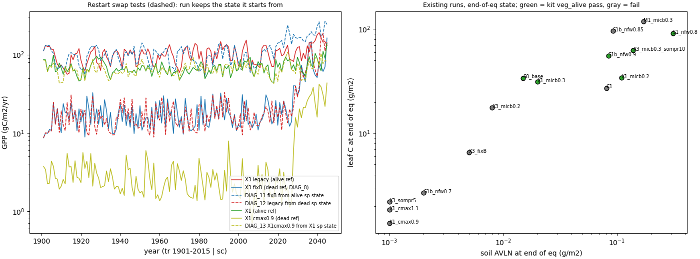
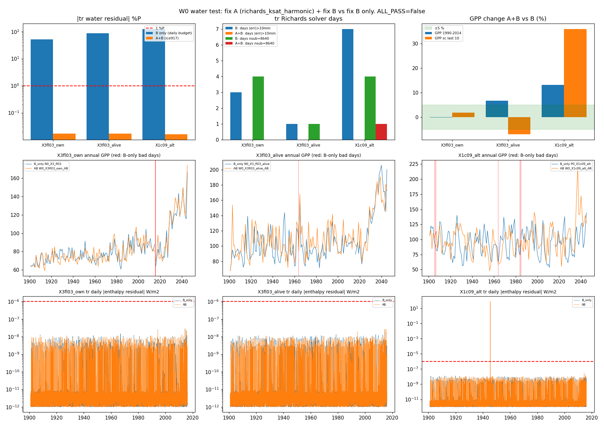
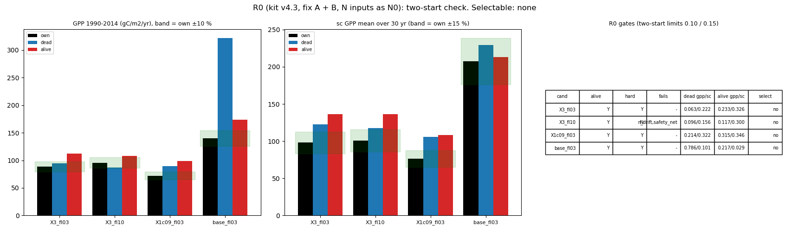
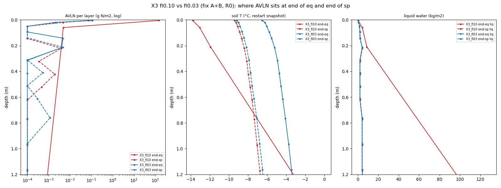
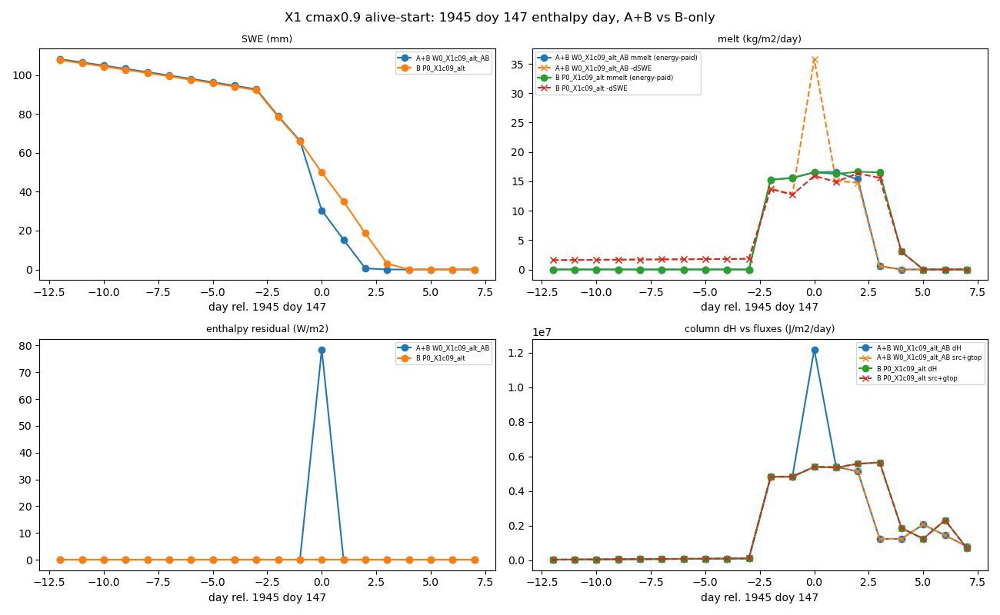
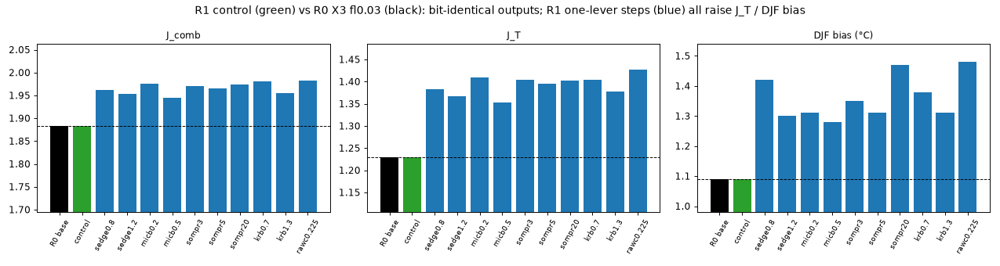

# WORK NOTES: CMT06 (Toolik) recalibration under Richards fix A + fix B

2026-11-20 · account calib-elchin · kit `~/cal-cmt06/kit_v4` (v4.6) · ledger `~/cal-cmt06/j4`

**Decision (Elchin, verbatim, 2026-11-20):** "Keep X3 fl0.03 as the calibration and write the work notes".

**Final calibration:** S2_X3_cmaxold_micb0.3_sompr10 with
- fnloss 0.03;
- fix A + fix B (`richards_ksat_harmonic 1`, `richards_lowsat_deriv_fix 1`);
- BNF constant scheme with free-living input 0.15 g N m⁻² yr⁻¹;
- leaching fixes on.

Its run is `j4/runs/R0_X3_fl03`, reproduced bit for bit by `R1_control`.

This note gathers the day's stage notes, which stay as the detailed record:
- NOTES_vegflip.md
- WORK_NOTES_eq_nunlim_years.md
- NOTES_N_inputs.md
- NOTES_fixB_water_eqlen.md
- NOTES_fixB_A_W0.md
- NOTES_snowmelt_enthalpy.md
- PLAN_R0.md / NOTES_R0.md / NOTES_R0_rescore.md
- PLAN_R1.md / NOTES_R1.md / NOTES_R1_control.md

All model times are UTC on the VM; times quoted here are EST.

---

## 1. Motivation

1. **Vegetation flip / spin-up bistability** (NOTES_vegflip.md). Under the fix-B Richards solver the previously calibrated X3 parameters spin up into a *dead* state (eq-900 GPP 17 vs 118 alive). The two runs fork in the first decade of eq.
   - The cause is nitrogen lock-up, not climate stress: N-unlimited GPP (INGPP) is 329 vs 351, but N limitation (GPP/INGPP) is 0.05 vs 0.34.
   - Restart-swap tests show each run keeps whichever state it starts from (left panel below). So the CMT06 C/N cycle is bistable and the spin-up outcome depends on the path.
2. **The N cycle was closed.** NINPUT = BNF = NLOST = 0 at Toolik.
   - BNF is off by config (no `bnf_scheme`), and `fnloss` = 0 for every CMT, here and upstream.
   - No N-deposition pathway exists in the code (NOTES_N_inputs.md).
   - With no inputs or losses, the low-N state is absorbing.
3. **Fix B alone fails water closure** (NOTES_fixB_water_eqlen.md). Single-day Richards mass errors (up to +48,000 mm of created water) appear under a thin saturated humic layer below a dry fibric stack. They give tr water residuals of −52 to −126 %P in three runs (N0_X3_fl03, its alive-start alt, P0_X1c09_alt).
4. **The N-unlimited early-eq switch (`eq_nunlim_years`) was tried and not adopted** (rmg 43c28e8f; WORK_NOTES_eq_nunlim_years.md).
   - It is bit-identical at 0.
   - K=100 vs K=200 just moves the fork to the switch-on year: X3 eq-900 GPP is 23 vs 125.

## 2. Fix A + fix B (W0)

- **The fixes** (rmg 0c40fd48; default-off switches):
  - **Fix B** = `richards_lowsat_deriv_fix 1`.
  - **Fix A** = `richards_ksat_harmonic 1` (harmonic interface ksat).
- **The W0 test** replayed tr+sc from frozen restarts on the three failing cases (NOTES_fixB_A_W0.md). Results with A+B:
  - 0 Richards error days (B alone: 1–7);
  - tr water −0.017 %P in all three (B alone: −52 / −87 / −126);
  - runoff/P 0.60 (B alone: 1.1–1.9, i.e. water was being created);
  - about 35 % fewer substeps.
- **GPP:** for the calibrated own X3 state, GPP is unchanged (−0.04 %). In non-calibrated alive/alt states fix A shifts GPP by up to +13 %, so the recalibration had to run with A on.
- **Known residual:** sc water under the corrected ice density (917 kg/m³) is −0.7 to −2.0 %P in A+B and B-only runs alike. It is a pre-existing residual that the ice ×1000 bug had hidden, and it is kept as a flag.

## 3. N inputs (N0)

- **Opened the N cycle with config only** (NOTES_N_inputs.md, kit v4.1). No model code was changed.
  - **Input:** `bnf_scheme 3` (CONST) with `bnf_const 0` and `bnf_asym 0.15` g N m⁻² yr⁻¹. This is a constant free-living input, so it does not depend on the vegetation state; a dead state stays fed.
  - **Loss:** `n_leach_fix 1` (pools lose exactly the booked NLOST) and `n_leach_curn_fix 1`, plus a scratch `fnloss` of 0.03 (HPC-like) or 0.10 (TVC-like) in the run-copy cmt_bgcsoil.txt.
- **Results:** with inputs, all N0 own runs are alive and the dead-start alts are alive too. The low-N trap is gone.
  - N0_X3_fl03 passed the dead-start pair (0.023 / 0.116), but its own run failed water under fix B only. That failure is what led to fix A.
  - The N budget gate needed a 300-yr AVLN trend window (v4.2).

## 4. Kit changes v4.2 → v4.6 and the gate set

| kit | approval | changes |
|---|---|---|
| v4.2 | 1:03 PM | Hard gate `richards`: 0 days with \|rich_err\| > 10 mm in pr/eq/sp/tr/sc (alts: tr/sc). Water closure with ice at 917 kg/m³ (tr gate); daily water budget per segment; AVLN trend window 300 yr (700–999); W0 tools |
| v4.3 | 2:41 PM | R0 stage (12 cases, cap 1.80); n_drift on own runs only; snowmelt-leak flag (`extract.enth_leak`, `score.leak_downgrade`: one matching day turns the enthalpy fail into a flag); r0_report/plot |
| v4.4 | 3:30 PM | Leak match tolerance 10 → 20 %; two-start = own hard gates + **dead-start** pair (GPP 1990–2014 ≤ 10 %, **sc 30-yr mean** ≤ 15 %), alive start reported only |
| v4.5 | 4:37 PM | R1 stage (10 one-lever cases + dead alts, cap 3.20); two-start gated only in R0 ("two-start reported not gated" in R1); r1_report/plot |
| v4.6 | 5:28 PM | R1_control (+ dead alt); `mk_cases --only/--tag`; R1 cap 3.13 |

- Every version has an installer in `~/cal-cmt06/j3_tools/v4x/` and backups `*.bak_pre_v4x`. The final test run is 77/77 with preflight 0 FAIL / 1 WARN (the known SWE warning). score.py was last changed in v4.4.
- **Hard gates (own run):**
  - veg_alive (GPP ≥ 33 in 1901–10 and 2006–15; LAI ≥ 0.10);
  - tr water |ice917| < 1 %P;
  - richards;
  - C/N closure;
  - enthalpy ≤ 1e-6 W/m² (one matching snowmelt-leak day may be downgraded to a flag);
  - N drift ≤ 0.5 %/century;
  - safety-net events ≤ 1.05 × base;
  - config readback;
  - N budget (closure in eq 900–999 plus the 300-yr AVLN trend).
- **Flags:** sc water, a snowmelt-leak day, MINEC change > 10 % (R1).
- **Ranking:** thermal guard as a tier, then J_comb.

## 5. R0 (12 runs) and the v4.4 re-score

- **Candidates:** X3 fl0.03, X3 fl0.10, X1 cmax0.9 fl0.03 and base S1_sd250_nfw0.8 fl0.03. Each ran as its own spin-up plus tr+sc alts from the frozen dead and alive refs. Total 0.595 core-h.
- **Fix A held in all 12 runs:** 0 Richards days and tr water −0.017 %P.

| candidate | own hard gates | J_comb | dead start GPP / sc30 rel (v4.4) | selectable |
|---|---|---|---|---|
| **X3 fl0.03** | PASS | **1.883** | 0.063 ✓ / 0.222 ✗ | no |
| X3 fl0.10 | FAIL (n_drift, safety net, AVLN trend) | 1.944 | 0.096 / 0.156 | no |
| X1 cmax0.9 fl0.03 | PASS | 1.950 | 0.214 / 0.322 | no |
| base S1_sd250_nfw0.8 | PASS | 1.967 | 0.786 / 0.101 | no |

- **Nothing was selectable** under v4.3 or v4.4.
- The dead start gives higher sc GPP in every candidate (+11 to +38 %). Alts get only 145 years from a foreign state, and the slow SOM pools (τ ≥ 10³ yr) cannot relax in that time. So the check measures start-state memory, not a second equilibrium.
- X3 fl0.03 was then carried into R1 by exception.

## 6. The fl0.10 moss-layer N trap

- **What happened:** in the X3 fl0.10 eq, 148.3 of 148.3 g/m² of AVLN ended up in soil layer 0, the 1 cm moss layer (NOTES_R0_rescore.md §3).
- **Why it stays there:**
  - The BNF input enters `tk_ninput_layer` = 0, which is the moss layer, and roots don't take it up there.
  - Leaching is capped by the AVLN in the drainage zone (Soil_Bgc.cpp:2411). The drainage zone collapsed because the shallow peat grew to 2.82 m (one 2.52 m layer at −0.01 °C, 89 % frozen).
  - Drainage fell to 1.5 mm/yr (fl0.03: 16), and NLOST stayed at 0 from about eq year 100. The input piled up linearly.
- **What happens in sp:** the geometry recovers and the pool washes out as booked leaching (total N 2361 → 2225 g/m²).
- The gates (N drift, AVLN trend, safety net) correctly rejected the run. fl0.03 keeps a normal horizon (about 0.26 m of organic soil) and a steady moss AVLN of about 0.1 g/m².

## 7. Snowmelt enthalpy leak (pre-existing; flagged at 20 %)

- **What it is:** an isolated enthalpy spike on a snowmelt day (W0_X1c09 1945 day 147, 78.5 W/m²; R0 X1 dead start 1929 day 132, 52.5 W/m²) (NOTES_snowmelt_enthalpy.md).
  - SWE leaves the 2-layer pack as runoff without its latent heat being paid inside the thermal step.
  - The residual / Lf matches the unpaid snow loss (≈ 19 mm × 334 kJ/kg ≈ 6.4e6 J/m²).
- **It is pre-existing:** the same pattern appears in fix-A-off runs, so it is not caused by fix A.
- **How the kit handles it:** at most one matching day per run is downgraded to a flag, with a 20 % match tolerance (v4.4). Any other spike day stays a hard fail.
- The final calibration has **no spike day at all**: max daily enthalpy residual 2.7e-8 W/m².

## 8. R1: one-lever steps on X3 fl0.03, plus the control

- **R1** (20 runs, 1.287 core-h): 10 single-lever steps (sedge cmax ×0.8/1.2, micbnup ×0.2/0.5, kdcsompr ×3/5/20, krb ×0.7/1.3, kdcrawc 0.225), each with its own run plus a dead-start alt.
  - All runs are alive, and 9 of 10 pass the own hard gates (krb0.7 fails n_drift and safety net).
  - **No case beats 1.883.** The best is micb0.5 at 1.9446.
  - Every step raises J_T from 1.229 to 1.35–1.43 and the DJF bias from 1.09 to 1.28–1.48 °C, while J_snow stays flat at about 2.54.
  - kdcsompr strongly moves MINEC (sompr3 +35 %, sompr20 −12 %).
- **R1_control** (0.127 core-h): the unchanged base, built through the same R1 path. Its outputs are **bit-identical** to R0_X3_fl03: the md5s of restart-eq/sp, GPP and TLAYER tr/sc match, and so does the dead alt. The configs, params, binary, inputs, driver script and scoring were also checked identical.
  - So the R1 sensitivity is real. X3 fl0.03 sits at a sharp local J_T minimum for one-lever C/N steps.

## 9. Final calibration: X3 fl0.03 (fix A + B, open N cycle)

**Scores and gates** (from R0_X3_fl03 = R1_control; kit v4.6 scoring):

| metric | value |
|---|---|
| J_comb / J_T / J_snow | **1.8834 / 1.229 / 2.5378** |
| thermal guard | DJF bias 1.09 °C, JJA 1.02 °C, snow bias 0.178: pass |
| GPP 1990–2014 / sc 2016–2045 mean | 88.6 / 98.0 gC m⁻² yr⁻¹ (eq 900–999 GPP 79.2, leaf C 36.3) |
| hard gates | veg_alive ✓, water tr −0.017 %P ✓, richards 0 days in pr/eq/sp/tr/sc ✓, C/N closure ✓, enthalpy max 2.7e-8 W/m² ✓, N drift 0.34 %/century ✓, safety net 4063 ≤ 7021 ✓, readback ✓ |
| N budget (eq 900–999) | NINPUT 0.15, NLOST 0.082, dN/dt 0.068, residual 3e-5 relative; AVLN 0.087 g/m², trend −0.66 %/century ✓ |
| tr 1990–2014 N | NINPUT 0.15, NLOST 0.083 g N m⁻² yr⁻¹ |
| flags | sc water −1.16 %P (ice917; known residual); no leak day |
| two-start (reported) | dead start GPP 1990–2014 0.063, sc30 0.222; alive start 0.233 / 0.326 |
| soil C 2014 | MINEC 105,412; SHLWC 3,537; DEEPC 7,472 g C/m² (end-of-sp SOMC 118,433) |

**Exact configuration (reproducible):**
- **Binary:** `~/cal-cmt06/bin_v4/dvmdostem_v4_43c28e8f`, md5 **7b850dc11241adaf743fd83179daba6d**.
  - Built from rmg branch fix/richards-mass-guard at 43c28e8f, which is 0c40fd48 (fix A/B switches) + eq_nunlim_years. rmg HEAD is f4d6f6fa (docs only; local, unpushed).
- **Driver:** `~/tem-dev/moss-snowcap-wt/scripts/run_rts_two_stage.py` (read-only checkout 5a55bb53; last changed Nov 19) via `kit_v4/tools/chain_run.py`.
  - Stage 1 runs with `ov_instr_stage1.json`, then tr+sc with `ov.json` from the run's own `stage1/restart-sp.nc`.
  - Years: pr 100 / eq 1000 / sp 200 / tr 115 (1901–2015) / sc 30 (2016–2045), `--mode baseline`.
- **Run directory:** `~/cal-cmt06/j4/runs/R0_X3_fl03/`
  - `case.json` md5 575c1846cd193941bfbdd74d6b9b65fd
  - `ov.json` md5 03575a57344a41d3cef644553a2f7c11
  - `ov_instr_stage1.json` md5 d3211517b017fd683f72a4498610de26
  - `params/` (a run copy; repo parameters/ never edited)
  - Identical copy: `~/cal-cmt06/j4/runs/R1_control/` (params diff empty).
- **Parameter edits** on the kit base parameters (moss-snowcap-wt 5a55bb53 parameters/, md5-pinned in kit.json), CMT06:
  - `cmax` = [22.8, 250.6, 65.0, 38.5, 7.8, 21.0, 36.3, 0, 0, 0] (X3 "cmaxold");
  - `micbnup` = 2.9876472 (base ×0.3);
  - `kdcsompr` = 0.0008735214 (base ×10);
  - `snwdenmax` = 250;
  - `nfactor(w)` = 0.8;
  - `fnloss` = 0.03.
- **params md5:** cmt_calparbgc 45be787714dd5f116d0ba4756c1d69b1; cmt_bgcsoil 3f2b15986b651ea29c600a2a617f4f59; cmt_bgcvegetation 8bd4eb97a74ddd49577e2d12c2e58d47; cmt_dimground c527d8f0152dfb7c5a16658f97d267ed; cmt_dimvegetation be9f1f2509e647bd072c9f4868e619c7; cmt_envcanopy 966f511d5803069f40dc2f299e2f6549; cmt_envground 4fdc9427db25816c6d3750149de14925; cmt_firepar 57ce5b7e0278dae51daba2a85d4b1384.
- **model_settings** (as written to ov.json):
  - **Richards:** richards_ksat_harmonic 1 (**A**), richards_lowsat_deriv_fix 1 (**B**), richards_mass_guard 0, richards_sat_deriv_fix 0.
  - **N:** bnf_scheme 3, bnf_const 0.0, bnf_asym 0.15, n_leach_fix 1, n_leach_curn_fix 1, eq_nunlim_years 0, n_rootless_fix 2, n_safetynet_conserve 2, n_som_move_fix 1, n_nonvasc_extract 1, deep_carbon 1.
  - **Thermal / moss:** thermal_solver 1, snowmelt_heat_cap 1, moss_water_scheme 1, moss_tc_scheme 2, org_tc_scheme 1 (kunf 0.27, kfrz 0.5134, dry 0.08571, thre_f 0.1795, thre_h 0.5638).
  - **Other:** energy_diag 1, baseline 1940–1970; thermokarst settings as the kit base.
- **Inputs:** `~/cal-cmt06/j4/inputs/toolik06/`. These are symlinks to moss-snowcap-wt demo-data `cru-ts40_ar5_rcp85_ncar-ccsm4_toolik_field_station_10x10`, plus the kit's own single-cell run-mask.nc and vegetation.nc. CO2 and climate are historic + projected RCP8.5 (CCSM4).
- **Kit:** `~/cal-cmt06/kit_v4` v4.6, rebuilt with `tools/mk_cases.py R1 --only R1_control --tag control`.
  - Scoring: `tools/r1_report.py` → `j4/r1_report_v4.6.json`.
  - Obs score: `obs_score_s1.score_case`.

## 10. Budget

- **j4 ledger: 3.1046 of 4.5 core-h** (stop 4.0; 1.3954 left).
- By stage: P0 0.456, N0 0.545, W0 0.051, R0 0.578, R1 + control 1.381, DIAG 0.032, aux 0.063.
- j3 closed earlier at 4.345.

## 11. Open model questions (no action taken)

1. **BNF goes into the moss layer.** `tk_ninput_layer` = 0 puts the whole input into the 1 cm moss layer, where there are no roots. It reaches plants only after it moves or mineralises, and it can pile up (§6).
2. **The leaching cap is keyed to the drainage zone.** AVLN outside the drainage zone can neither leach nor be taken up. A frozen or saturated profile shuts N loss off completely (fl0.10 trap).
3. **The soil safety net fires every year:** about 4,000 events per 1000-yr eq (final: 4063), in alive and dead states alike. Root extraction drives AVLN negative, and the deficit is debited from ORGN (`n_safetynet_conserve 2`).
4. **Net N mineralisation is exactly 0** (NETNMIN 0.000 in the alive eq while uptake is 0.52 g/m²/yr). Is it an output or clamp issue, or does N reach plants only through the safety-net debit?
5. **Snowmelt enthalpy leak** (§7). Snow mass leaves as runoff without latent heat in a rare 2-layer-pack melt path. It is pre-existing, flagged, and absent in the final run.
6. **No N deposition** pathway exists in dvmdostem. BNF `bnf_asym` stands in for it with the same mass into the same pool. A default-off `ndep_const` switch (about 15 lines) was sketched in NOTES_N_inputs.md.
7. Also noted: the sc water residual under ice917 (−0.7 to −2 %P, pre-existing). Two-start disagreement reflects start-state memory of slow SOM pools; testing convergence would need a settle period or an eq-restart code change.

## 12. Next steps (each needs Elchin's approval)

1. **Review and push `fix/richards-mass-guard`** (rmg; local commits 0c40fd48 fix A/B switches, 43c28e8f eq_nunlim_years, f4d6f6fa docs, plus this note, uncommitted). Name the reviewer and the push target.
2. **Possible model fix for the snowmelt enthalpy leak:** pay latent heat for snow mass removed in the 2-layer melt/merge path, then drop the kit's leak flag.
3. Optional:
   - investigate the N questions (BNF layer, leaching cap, safety net, NETNMIN);
   - add `ndep_const`;
   - an sp-settle two-start check (about +0.08 core-h per alt).
4. Production use of the X3 fl0.03 settings (would need parameter-file changes in a repo; not done).

## Files

- **This note:** `~/cal-cmt06/WORK_NOTES_CMT06_fixAB_recal.md`, with figures in `~/cal-cmt06/figs/cmt06_fixAB_recal/`.
  - Staged copy (uncommitted): `~/tem-dev/rmg/docs/WORK_NOTES_CMT06_fixAB_recal.md` + `docs/figs/cmt06_fixAB_recal/`.
  - Box copy: `/workspace/cmt06_m2d/out_j4/` (+ `figs/cmt06_fixAB_recal/`).
- **Reports:** `j4/n0_report.json`, `w0_report.json`, `r0_report_v4.4.json`, `r1_report_v4.5.json`, `r1_report_v4.6.json`.
- **Frozen refs** (read-only, unchanged): `j4/ref/dead_X3fixB_DIAG8_restart-sp.nc` (9b1c4a26…), `alive_X3fixB_K200_restart-sp.nc` (ac1eee7c…), `alive_X3legacy…` (6f5ee8d4…), `own_N0_X3_fl03_restart-sp.nc` (eaa5318c…).
