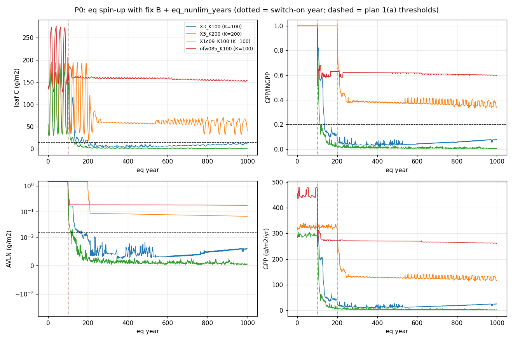
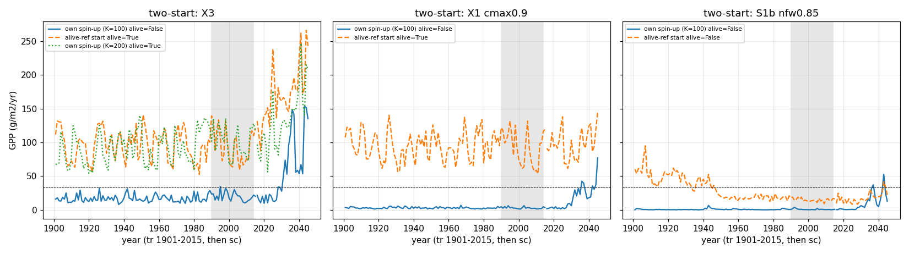

# WORK NOTES: `model_settings.eq_nunlim_years` (N-unlimited early equilibrium)

2026-11-20. Branch `fix/richards-mass-guard` (local only, **not pushed**), on top of 0c40fd48 (Richards switches incl. fix B).
Elchin (verbatim): "Approve the eq_nunlim_years switch, local commit with tests".
Plan: `~/cal-cmt06/PLAN_spinup_fixB_recal.md` section 1. Diagnosis: `~/cal-cmt06/NOTES_vegflip.md`.

## Why

CMT06 Toolik spin-up is bistable (NOTES_vegflip): during eq years 2-10 plant N either keeps up with C (alive, GPP/INGPP ~0.34)
or locks up (dead, ~0.05). With no N inputs (NINPUT = BNF = NLOST = 0) the low-N state is absorbing, so the outcome of a
calibration case depended on the solver path (fix B flipped X3 from alive to dead) rather than on the parameters.
Running the first K eq years N-unlimited lets C pools (leaf, litter, SOM) build up before the N cycle switches on.

## What

- `model_settings.eq_nunlim_years` (int, **default 0 = unchanged legacy path, bit-identical**), parsed with
  `bnf::valid_int(v, 0, 100000)`; anything else (negative, > 100000, non-integer, bool, string) is FATAL.
- `K > 0` (eq stage only): eq years `[0, K)` run with `nfeed` off, then `nfeed` is restored to `stage_settings.eq.nfeed`
  and eq years `[K, eq_years)` run as before (`TEM.cpp`, eq branch; split computed by `eq_nunlim_segments()` in `ModelData.h`).
- Refused (FATAL) unless `0 < K < eq years`, fire is off in eq (dsb), and `K % output_interval == 0` (keeps the netCDF year
  index of the two `run_years` segments on the output grid).
- pr, sp, tr and sc are untouched. No physics or parameter change; no change to restart files' layout.

## Tests

- `tests/unit/test_eq_nunlim.cpp`: parse (default 0; accepts 0, 1, 100, 200, 100000; FATAL on -1, 100001, 100.5, true, "100")
  and segment split (K = 0 single legacy segment; K in {1, 100, 200, 999} two segments; invalid K / fire on / output_interval
  0 / K not a multiple of output_interval give no split).
- Full suite: 471 test cases, 471 passed (the 8 failed assertions are the known pre-existing expected-failure assertions).
- Full-model identity (kit v4 P0, short stage 1 `-p 100 -e 30 -s 0`): see section "P0 results".

## Not changed / noted and deferred (Elchin: "Note the open model questions and proceed")

1. No N inputs at CMT06 Toolik (NINPUT = BNF = NLOST = 0): the N cycle is closed and the low-N state absorbing. Deferred.
2. The soil N safety net fires ~4 months every year (~4000 events per 1000-yr eq) in alive and dead runs alike. Deferred.
3. NETNMIN is exactly 0.000 in the alive eq while plant uptake is ~0.52 g/m2/yr. Deferred (would need its own approval).

These are model questions, not fixed by this switch; the switch only removes the dependence of the spin-up outcome on the
early-eq path.

## P0 results (kit v4, ledger ~/cal-cmt06/j4, binary dvmdostem_v4_43c28e8f md5 7b850dc11241adaf743fd83179daba6d)

All runs: CMT06 Toolik cell, fix B (`richards_lowsat_deriv_fix=1`, other Richards switches 0), pr100/eq1000/sp200, tr115, sc30.
Instrumented runs write 12 yearly eq variables (stage 1 only; tr/sc continue from the same run's own fresh restart-sp).

**Switch-off identity** (short stage 1, `-p 100 -e 30 -s 0`): restart-pr.nc and restart-eq.nc are variable-for-variable
identical (all 63 variables) for
- `eq_nunlim_years=0`, all Richards switches 0 vs the kit v3 binary 5a55bb53, and
- `eq_nunlim_years=0`, fix B vs the 0c40fd48 binary with fix B.

The files differ only in the global `Git_SHA` attribute. With `eq_nunlim_years=10`, restart-pr is byte-identical and
restart-eq differs, so the switch path is active.

| run | K | eq years 900-999 GPP | alive (kit gate) | GPP 1990-2014 | (a) post-switch leaf C / AVLN / GPP:INGPP min | leaf C:N at K-1 / K / K+50 |
|---|---|---|---|---|---|---|
| X3 | 100 | 23 | dead | 19.9 | 11.7 / 0.0095 / 0.086: FAIL | 89 / 99 / 47 |
| X3 | 200 | 125 | alive | 100.7 | 18.5 / 0.082 / 0.376: pass | 30 / 36 / 49 |
| X1 cmax0.9 | 100 | 2.4 | dead | 3.1 | 2.9 / 0.0015 / 0.019: FAIL | 71 / 87 / 37 |
| S1b nfw0.85 | 100 | 263 | dead (dies in sp/tr) | 0.9 | 154 / 0.18 / 0.52: pass | 113 / 105 / 48 |

- **(b) K independence fails.** For X3, K=100 vs K=200 gives eq years 900-999 GPP 23 vs 125: the switch-on is a new fork.
- **The switch-on shock happens.** During the N-off years leaf C swings with a period of about 25 years (30 to 270 g/m2).
  The outcome depends on the plant state in the year the N cycle switches on: X3 at K=100 switches with leaf C:N 99 and
  collapses within about 50 years; at K=200 it switches with C:N 36 and survives.
- **Two-start gate.**

  | run | tr GPP 1990-2014, own spin-up vs alive-ref start | sc last-10 GPP | gate |
  |---|---|---|---|
  | X3 K=200 | 100.7 vs 94.4 (6 %) | 177 vs 208 (16 %, limit 15 %) | FAIL |
  | X3 K=100 | dead vs alive | | FAIL |
  | X1 cmax0.9 K=100 | dead vs alive | | FAIL |
  | S1b nfw0.85 | dead vs dead (alt dies by ~1950) | | consistent but not alive |

- **The alive reference is a legacy-binary state.** Its tr water closure under fix B is -2.5 %P (X3) and -126 %P (X1 cmax0.9).
  A fix-B reference state is needed for any later two-start check.

**Conclusion.** The switch works and is bit-identical at 0, but at K=100 it does not remove the spin-up bistability. It moves
the fork to the switch-on transient. Not adopted for R0.
