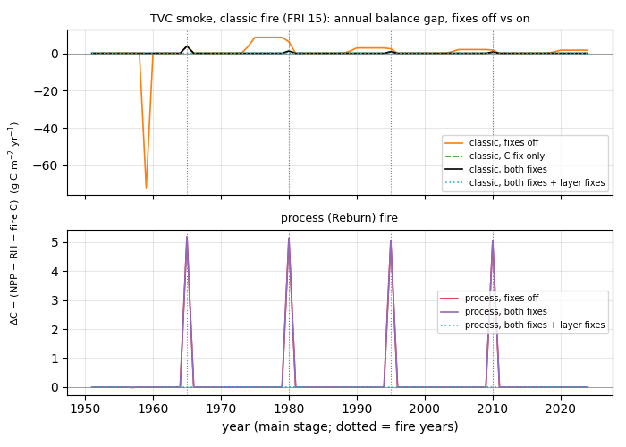
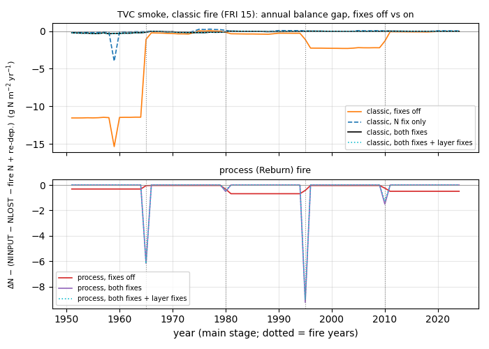
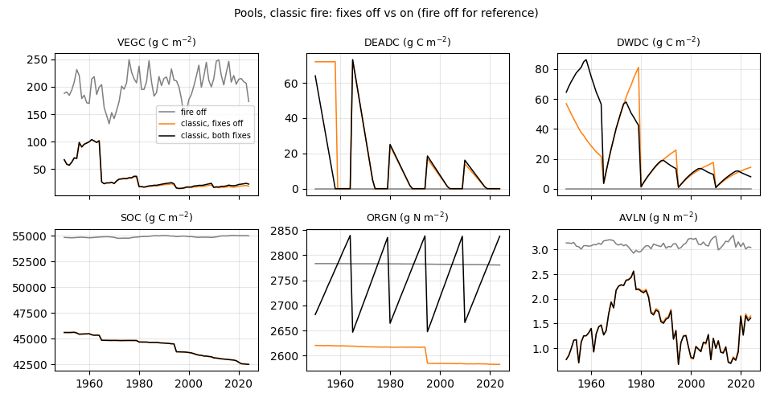
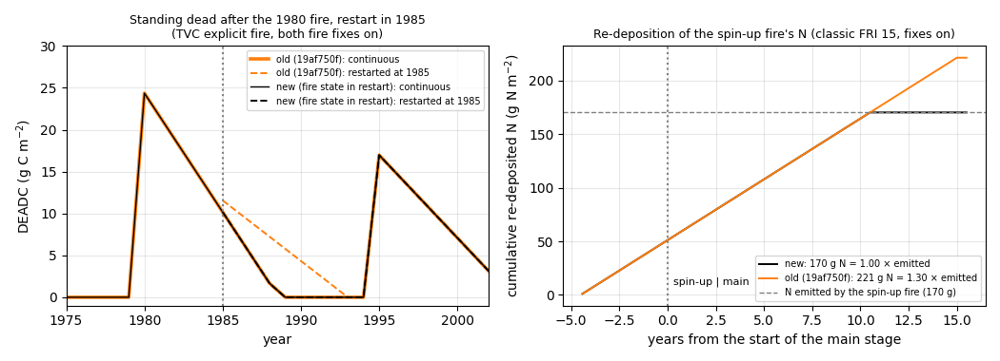

# Fire C/N balance fixes (classic fire): `fire_n_redep_fix`, `fire_c_bookkeep_fix`

Branch `wetland/reburn-switch`, on top of 5d86bad8 (Reburn merge behind `model_settings.fire`).
Requested by Elchin on 2026-11-12: "fix the fire N re-deposition and C gaps behind default-off switches".
Background: the C/N balance residuals found in the Reburn smoke runs (docs/WORK_NOTES_reburn.md).

## Switches (both default 0 = legacy, bit-identical to 5d86bad8)

| switch (`model_settings`) | default | what 1 does |
|---|---|---|
| `fire_n_redep_fix` | 0 | The fire-emitted N re-deposition really enters the soil. Each month `FirData.fire_a2soi.orgn / 12` (output `BURNAIR2SOILN`, an annual rate = emitted veg+soil N / FRI) is added to **organic N (ORGN) of the top soil layer** (`del_sois.orgn[0] += m_a2soi.orgninput`, nfeed only). It stops when Cohort zeroes `fire_a2soi.orgn` one FRI (`mthsdist >= FRI*12`) after the fire. |
| `fire_c_bookkeep_fix` | 0 | Standing-dead C/N bookkeeping (Vegetation_Bgc + WildFire): (i) the monthly fall `d2wdebrisc/n` is 0 when nothing falls; (ii) at the end of the 9-yr window (`mthsdist >= 108`) the remaining standing dead falls into woody debris (DWD) instead of being deleted; (iii) if `deadc0/deadn0` is unknown (they are not in the restart file) the remainder falls linearly over the rest of the window, `deadc/(108 - mthsdist)` per month; (iv) old standing dead burned by a later fire is added to the fire emissions (`BURNVEG2AIRC/N`, its unretained part used to vanish). The legacy fall rate `deadc0/108` per month is kept. |

Enable (config/config.js or a case config):

```json
"model_settings": { "fire": 1, "fire_n_redep_fix": 1, "fire_c_bookkeep_fix": 1 }
```

Both are integers 0/1; anything else is FATAL at start-up (like the other fork switches). They only do
something when fire is on (`fire = 1`) and a fire has happened (or a restart carries fire state).
To also close the fire-month C gap, use them together with the existing layer switches
`layer_n_remap_fix = 1, layer_bookkeep_fix = 1` (see "Results").

## The bugs (legacy, switches 0)

1. **N re-deposition never applied.** `Soil_Bgc::prepareIntegration` set `orgninput` only
   `if (cd->yrsdist < cd->fri)`. `CohortData::fri` is never assigned anywhere (not initialised either),
   so the N is reported in `BURNAIR2SOILN` but never added: in the classic smoke case about −11.5 g N/m²/yr
   of the N balance. Now `Soil_Bgc::setFireNRedepInput()`; switch 0 keeps the old gate exactly.
2. **Standing-dead C/N created after the fall window.** In `Vegetation_Bgc::prepareIntegration` the fall
   `bd->m_v2soi.d2wdebrisc` was only set inside the window; after it, it kept the last month's value
   (`deadc0/108`), and `Soil_Bgc` added it to DWD every month until the next fire: +8.5 g C/yr in the smoke case.
3. **Standing dead deleted.** At `mthsdist >= 108` the remaining `deadc/deadn` was set to 0 (lost). After a
   restart `deadc0 = 0` (not in the restart file), so nothing fell and the whole pool (72 g C in the smoke case)
   vanished 108 months into the main stage.
4. **Old standing dead burned but not emitted.** `burnVegetation()` burns all old `deadc/deadn` (`comb_deadc`),
   counts it in the retained share, but `fire_v2a.orgc = comb_vegc - reta_vegc` leaves it out of the emissions.
   (Zero in the FRI-15 smoke case, because the standing dead is gone after 9 years; it matters for FRI < 9 or
   re-burns.)

Not changed (found, see "Decisions"): the remaining fire-month C gap of classic fire (3.8 g in the first fire) is
the dynamic soil-layer bookkeeping that `layer_bookkeep_fix` already fixes; dead-root N added to `somcr` (a C pool)
in `burnVegetation()` (≤0.006 g); DWD N decomposed with no destination (`wdebrisn -= rhwdeb*N/C`, Soil_Bgc);
process (Reburn) fire burns soil C with `BURNSOIL2AIRN = 0`.

Files: `include/ModelData.h`, `src/ModelData.cpp` (parse/default/FATAL), `src/Cohort.cpp` (pass-through),
`include/Soil_Bgc.h`, `src/Soil_Bgc.cpp` (`setFireNRedepInput`), `include/Vegetation_Bgc.h`,
`src/Vegetation_Bgc.cpp`, `include/WildFire.h`, `src/WildFire.cpp`, `config/config.js` (keys at 0),
`tests/unit/test_fire_balance.cpp`. No input or `parameters/` change.

## Tests

### Bit identity with both switches 0 (binary of this commit vs b4618e85 = 5d86bad8)

`scripts/identdir.py` on every NetCDF output and restart file (all variables, data bytes; only
`total_runtime` and `config_record.js` ignored), spin-up (20 yr) and main (75 yr):

| set | stage dirs | result |
|---|---|---|
| 16 regression cases (HPC/TVC × warming/no-warming × nfeed/nonfeed, in two settings `leg` and `s4_f1`, 8 + 8), fire off | 32 | identical (65–93 files each, 0 differences) |
| classic explicit fire E1 (fire on) | 2 | identical (78 + 105 files) |
| classic FRI fire F1c (fire on, 4 main-stage fires) | 2 | identical (78 + 105) |
| process fire F1p, fire 0 with a fire request F0g, F1c with monthly DEADC/DWDC | 6 | identical |

### Unit tests (`tests/unit/test_fire_balance.cpp`, suite `fire_balance`, 5 cases, 45 assertions, all pass)

- switch defaults (ModelData(), ModelData(Json), Soil_Bgc, Vegetation_Bgc) and FATAL on 2, −1, 0.5, "1";
- fire-month N balance: with the fix the full `BURNAIR2SOILN/12` lands in top-layer ORGN and the
  soil N balance closes (dN − internal fluxes = input, 1e-12); legacy: not applied; 12 months = annual rate;
- standing-dead C over 168 months after a fire: fix conserves DEADC + fall to DWD exactly, nothing falls after
  the window; legacy keeps adding `d0/108` per month after it (C created);
- after a restart (deadc0 unknown): legacy deletes it at month 108, the fix lets it fall (`d/(108-m)`),
  remainder falls at once past the window;
- DWD side: `Soil_Bgc::deltastate` adds the fall to woody debris.

Full suite: 395/395 test cases pass (`build.sh ~/tem-dev/rb unittest`); the 8 failing assertions are the
known ones inside may-fail cases (climate, Richards, SEB, Stefan), unchanged.

### Balance gaps, TVC smoke cases (CMT51 inputs, 20-yr spin + 75-yr main, FRI 15, July, severity 3)

Annual residuals of the main stage. C: ΔC(VEGC+DEADC+DWDC+SOC) − (NPP − RHSOM − RHDWD − fire C).
N: ΔN(VEGNTOT+ORGN+AVLN+DEADN+DWDN) − (NINPUT − NLOST − fire N + re-deposition due), where the
re-deposition due in a month is the previous month's `BURNAIR2SOILN`/12 (Dsb runs after Bgc). With
`fire_n_redep_fix = 0` the N residual is therefore ≈ −re-deposition (N reported, not applied).

| case (classic fire) | C fire yrs 15/30/45/60 | C max other yrs | C sum 75 yr | N fire yrs | N max all yrs | N sum 75 yr |
|---|---|---|---|---|---|---|
| fixes off (5d86bad8 behaviour) | 3.80 / 6.13 / 2.39 / 1.69 | **72.0** | +23.2 | −1.10 / −0.16 / −1.11 / −1.33 | **15.3** | **−208.7** |
| `fire_n_redep_fix` only | 3.80 / 6.19 / 2.57 / 1.95 | 72.0 | +26.5 | −0.06 / 0.10 / 0.03 / 0.03 | 3.99 | −5.4 |
| `fire_c_bookkeep_fix` only | 3.80 / 1.16 / 0.73 / 0.54 | 0.005 | +6.2 | −1.24 / −0.36 / −1.06 / −1.33 | 11.7 | −209.0 |
| both fixes | 3.80 / 1.22 / 0.86 / 0.69 | **0.005** | +6.6 | −0.16 / −0.09 / −0.03 / −0.02 | **0.36** | **−7.7** |
| both fixes + `layer_n_remap_fix`/`layer_bookkeep_fix` 1 | **0.007 / 0.002 / 0.001 / 0.000** | 0.006 | — | −0.16 / −0.09 / −0.02 / −0.02 | 0.36 | −7.5 |
| layer fixes only (fire fixes 0) | 0.007 / 4.82 / 1.27 / 0.64 | 72.0 | — | −1.10 / −0.17 / −1.10 / −1.31 | 15.3 | −208.2 |

| case (process / Reburn fire) | C fire yrs | N fire yrs | N max | N sum |
|---|---|---|---|---|
| fixes off | 5.18 / 5.13 / 5.04 / 5.04 | −0.05 / −0.32 / −0.43 / −0.25 | 0.69 | −23.0 (= −re-dep. 22.9) |
| both fixes | 5.18 / 5.13 / 5.04 / 5.04 | −6.17 / −0.51 / −9.25 / −1.51 | 9.25 | −17.4 |
| both fixes + layer fixes | −0.001 / 0.009 / 0.000 / 0.009 | −6.17 / −0.41 / −9.01 / −1.27 | 9.01 | −16.9 |
| fire off (F0g) | ≤0.005 | — | 0.0004 | 0.0 |

Reading: with both fire fixes the classic C gap outside the fire month is gone (72 → 0.005 g) and the N gap
drops from −209 to −7.7 g N over 75 yr. The remaining classic fire-month C gap (≈ retained + dead-root C,
3.8 g in the first fire) closes only with the existing layer switches, so it is a soil-layer bookkeeping issue,
not standing dead. The remaining classic N residual (≈ −0.06 to −0.1 g/month in the growing season while DWD
decomposes; −7.5 g over 75 yr) is DWD N lost on decomposition (Soil_Bgc, not fire). For process fire, the N fix
moves the gap into fire years: process fire burns soil C (497 g in 1965) with `BURNSOIL2AIRN = 0`, and the
re-deposited N in the burned top layer disappears with it (ORGN ends the fire month at the same value as with the
fix off). That is the Reburn process soil-burn N accounting, not changed here.

Figures (`docs/figures/fire_balance/`, numbers in `fire_balance_summary.json`):

- `c_balance_gap.png`: annual C gap per year, fixes off vs on (classic and process).
- `n_balance_gap.png`: annual N gap per year, fixes off vs on.
- `pools_on_off.png`: VEGC, DEADC, DWDC, SOC, ORGN, AVLN, classic fire with fixes off vs on, fire off for reference.





Effect on pools (classic fire, 2024): ORGN +255 g N/m² (2582 → 2838; saw-tooth: +≈190 g N re-deposited over each
FRI, ≈200 g N emitted by the next fire), VEGC +3.8 g C (18.8 → 22.6), DWDC 14.3 → 8.0, SOC +3 g C; DEADC no longer
sits at 72 g for 9 years after the restart (it now falls into DWD).

Runs: `~/tem-dev/wet-work/runs/FB1_{leg,s4_f1}/*` and `~/tem-dev/wet-work/rbsmoke/runs/{E1,F1c,F1p,F0g,F1cdbg}_fb0`,
`F1c_{on,N,C,L,onL}`, `F1p_{on,L,onL}`, `F1cdbg_on`; binary `wet-work/bin/dvmdostem_fb2`; analysis `/tmp/fbana.py`
on the VM (copy in `tests/regression/reburn/analyze_fire_balance.py`). About 0.7 core-h in total.

## Decisions for Elchin

1. **Restart and the re-deposition window** (fixed, see "Fire state in the restart file" below). `mthsdist` (and `deadc0/deadn0`) are not in the restart file;
   `mthsdist` restarts at 0, so with `fire_n_redep_fix = 1` a fire late in the spin-up deposits for up to one more
   full FRI in the main stage (here 5 yr in spin + 15 yr in main of `emitted/FRI`, ≈ 1/3 too much). The balance
   still closes (the input is what `BURNAIR2SOILN` reports), but the "return all emitted N in one FRI" total does
   not. Fix options: write `mthsdist`, `deadc0`, `deadn0` to the restart (restart format change) or use `yrsdist`.
2. **How much N to return.** The TEM design returns 100 % of the fire-emitted N over one FRI (closed-N-cycle
   assumption, comment in WildFire.cpp). With the fix that is +≈13.6 g N/m²/yr in this case and ORGN +255 g by 2024.
   You may want a fraction (a parameter) instead; not added (no parameter changes in this task).
3. **Use with the layer fixes.** Classic fire C closes fully only with `layer_n_remap_fix = 1, layer_bookkeep_fix = 1`
   as well; the same layer switches also close the +5 g/fire C gap of process fire. Consider recommending the four
   together for fire runs.
4. **Not fixed, separate items if you want them:** DWD N decomposed with no destination (≈ −7.5 g N / 75 yr here);
   dead-root N added to `somcr` instead of `orgn` in `burnVegetation()` (≈0.006 g per fire); `BURNVEG2DEADC/N`
   output also counts PFTs with no cover (115 vs 77 g in 1965, output only); process fire soil N not burned/reported
   (`BURNSOIL2AIRN = 0`), which with the N fix shows up as −6 to −9 g N in process-fire years;
   `CohortData::fri` is read uninitialised in the legacy path (kept for bit identity).

## Fire state in the restart file (2026-11-12, follow-up)

Elchin: "Add the fire state to the restart file behind the switch, test it, then push". This fixes the
restart issue from decision 1 above.

**What is written.** When `fire_c_bookkeep_fix = 1` or `fire_n_redep_fix = 1`, the restart file (`restart-*.nc`)
gets three new variables. With both switches 0 nothing new is written or read, so the restart files are unchanged.

| variable | dims | type | content |
|---|---|---|---|
| `fire_mthsdist` | (Y, X) | int, `_FillValue` −9999 | months since the last fire (`CohortData::mthsdist`): the 108-month standing-dead fall window and the FRI×12-month re-deposition window |
| `fire_deadc0` | (Y, X, pft) | double, `_FillValue` −9999 | standing-dead C right after the last fire (sets the fall rate `deadc0/108`) |
| `fire_deadn0` | (Y, X, pft) | double, `_FillValue` −9999 | standing-dead N right after the last fire |

The rest of the fire state was already in the restart: `firea2sorgn` (re-deposition rate), `deadc`/`deadn`,
`yrsdist`. `d2wdebrisc/n` are recomputed every month with `fire_c_bookkeep_fix = 1`. `comb_deadc` lives only inside one
burn, so neither needs saving.
Code: `RestartData::{read,write}_px_fire_vars` (optional variables, added to an existing file the same way as
`d2m_ald_prevyr`; serial builds only), `Cohort::set_fire_state_from_restartdata()` (called last in
`set_state_from_restartdata`) and the writes in `Cohort::set_restartdata_from_state`.

**Old restart files** (no `fire_*` variables) still load. With a switch on, the model prints once
`WARNING: restart file has no fire state (...). Months since fire and the standing-dead fall start as before (legacy
behaviour).` and keeps the previous behaviour (the month counter starts at 0 and the fall uses `deadc/(108-m)`). The warning
showed up in the spin-up of the test case, which starts from the case's old `restart0.nc`.

**Tests**

- Bit identity, both switches 0, this commit vs 19af750f (binary `dvmdostem_fb2`), all NetCDF outputs and restart
  files: 16 regression cases (8 `leg` + 8 `s4_f1`, spin-up + main = 32 stage folders) and the fire cases E1
  (classic explicit), F1c (classic FRI), F1p (process), F0g, F1cdbg (10 stage folders): **42/42 identical,
  0 differences** (restart files have no new variables).
- Restart continuity, both fixes on. Case: TVC explicit classic fire 1965/1980/1995/2010. The main stage was run in
  one piece (75 yr) and again split at 1985, 5 yr after the 1980 fire (inside both the standing-dead window and the
  re-deposition window). Part A covered 1950–1984. Part B covered 1985–2024 from A's `restart-sc.nc`, with the projected
  climate and the explicit-fire file sliced by 35 yr (CO2 follows the calendar year of the climate file). Part B was
  compared with 1985–2024 of the continuous run (`compare_split.py`):

  | run, split vs continuous | DEADC max abs diff | DWDC | DEADN | BURNAIR2SOILN | DEADC in the first year after the split |
  |---|---|---|---|---|---|
  | new (fire state in restart) | **0.00057 g C** (3e-5 rel.) | 0.0018 | 4e-5 | 2e-8 | **0.0** |
  | old, 19af750f, fixes on | 5.78 g C (34 %) | 4.81 | 0.33 | 3.5e-5 | 1.39 |
  | fixes off (legacy) | 13.0 g C (77 %) | 20.4 | 0.67 | 5.5e-4 | 2.83 |

  The remaining differences are not fire-related. They appear the same in all three split runs (for example soil
  temperature up to 0.75 K in the first month, SOC 0.013 g, NPP 0.0013 g, ORGN 0.0019 g), because the dvmdostem
  restart does not restore the full thermal and snow state. That is why the split is not bit-identical: 5 of 101 output variables are identical
  in each split run, and 30–31 of 64–67 restart variables at the end. With the new restart, the fire pools follow
  the continuous run to that same noise level. With the old one they jump: the standing dead restarts a new 9-yr fall.
- Spin-up → main overshoot (classic FRI 15, spin-up fire in July of spin-up year 15, both fixes on), N re-deposited
  from the spin-up fire until the next fire (`redep_overshoot.py`):

  | binary | emitted N | re-deposited N | ratio | months depositing | all re-deposition in the main stage |
  |---|---|---|---|---|---|
  | 19af750f | 170.33 | 221.43 | **1.30** | 234 | 945.7 g N |
  | new | 170.33 | 170.33 | **1.000** | 180 (= FRI × 12) | 734.9 g N |

- Unit tests (suite `fire_balance`, now 8 cases, 154 assertions, all pass), with three new cases: the fire state is
  off by default, `reinitValue()` clears it, and reading a file without the variables leaves them MISSING and adds
  nothing; a round trip of `fire_mthsdist`, `fire_deadc0`, `fire_deadn0` for two pixels plus a never-written pixel
  (fill values); and the standing-dead fall resuming after a restart month for month exactly with the restored state
  (a legacy restart starts a new schedule). Full suite: 398/398 test cases pass (the 8 known may-fail assertions are
  unchanged).



`restart_continuity.png`, left: standing-dead C after the 1980 fire, continuous vs restarted in 1985, new vs old
restart. Right: cumulative N re-deposited from the spin-up fire, old (1.30 × emitted) vs new (1.00 × emitted). Numbers
are in `split_summary.json` and `overshoot.json`. Scripts are in `tests/regression/reburn/` (`split_run.py`,
`compare_split.py`, `redep_overshoot.py`, `plot_restart_continuity.py`). Runs (on the VM):
`rbsmoke/runs/E1on_fb{2,3}{,_split}`, `E1_fb3{,_split}`, `F1c_on_fb3`, `runs/FB3_*`. About 0.55 core-h.

Decision for Elchin: with explicit fire the re-deposition rate is `emitted / fri` with `fri` from `fri-fire.nc`. In
this test case `fri = 2000` yr, so only about 1 % of the emitted N comes back in 20 yr. That is unchanged here.
