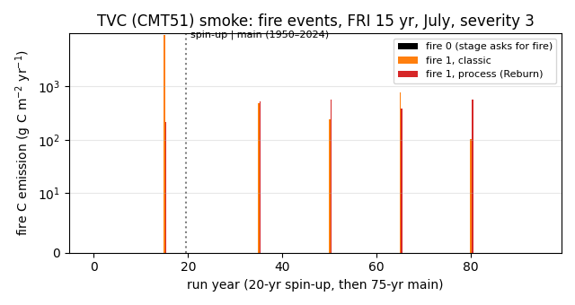
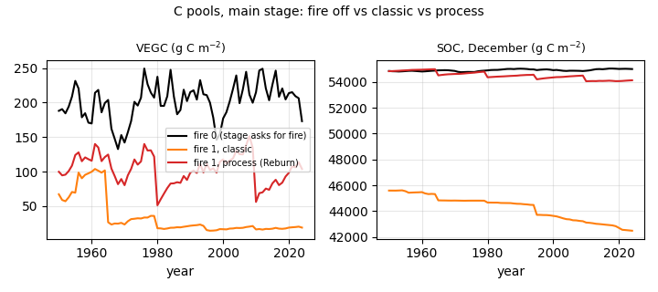
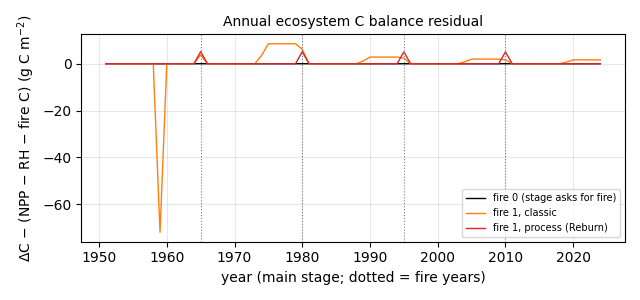

# Work notes: Reburn (process-based wildfire) behind a default-off fire switch

Local branch `wetland/reburn-switch` (from `wetland/frozen-liq-cap` `4693ec90`), Nov 12 2026, built and tested on calib-elchin.
**Not pushed** (needs Elchin's approval). Merge plan: `dvmdostem_merge_plan.md` §2, the step after wetland + deep C and before RTS.

## 1. What was merged

- **Source:** `JoshuaRady/dvm-dos-tem` branch `Reburn`, tip `ce80b344` (2026-08-10, "Merge branch 'Corolla' into Reburn"; merge-base with this branch `419a4eb3`).
  It adds 20 files (+4434/−370): `FW_Interface`, `GFProfile`, `GroundFire`, the `WildFire` rewrite, and new `ModelData` and `config.js` keys.
- **External modules:** not in the repo. `scripts/get_external.sh` clones them into `external/` (git-ignored) at the pinned hashes from discussion #789:
  - Fireweed `31051b0`
  - Burnup `6d56e29`

  Run it before `make`. HPC nodes without GitHub access need a vendored tarball.
- **Conflicts** (4 files, resolved as in merge plan §2.2):
  - `src/Cohort.cpp`: kept Reburn's `if (fire.FireBurned()) { … }` structure. The v5q `layer_n_remap_fix` N calls (`assignNitrogenBd2LayerMonthly`, `assignNitrogenLayer2BdMonthly`) go inside it, so the post-burn block runs once.
  - `Makefile`: kept the wetland `HPC_MODULES` block and `SnowClass.o`, set `-std=c++20` (Reburn needs `std::lerp`), and added the Reburn/Fireweed/Burnup objects.
  - `include/CohortLookup.h`: union of the deep C transfer fields and `cmt2fm/cbd/cbh`.
  - `parameters/cmt_firepar.txt`: **kept ours.** The repo `parameters/` is unchanged (still 18 lines per CMT, see §2).
- **Commits:**
  1. the merge commit (conflict resolution only, not runnable on its own with the repo parameters);
  2. one fork commit with the switch, fixes, tests and these notes.

## 2. The switch: `model_settings.fire` (default 0)

| `model_settings.fire` | behaviour |
|---|---|
| **0 (default, also when the key is absent)** | No stage burns, whatever `stage_settings.X.fire` / `X.dsb` say. The WildFire/Fireweed/Burnup code is never called. If a stage asks for fire, a WARNING says it is disabled. |
| 1 | Fire is on in each stage whose `stage_settings.X.fire` is true. If a stage has no `"fire"` key, its legacy `"dsb"` flag is used (backward compatible with existing fork/HPC configs). Pre-run uses `pr.dsb`. A WARNING is printed if `X.fire` and `X.dsb` disagree. |

Any value other than integer 0/1 is FATAL. Enable fire like this:

```json
"model_settings": { "fire": 1 },
"stage_settings": { "tr": { "fire": true }, ... },
"module_settings": { "dsb": { "fire": { "fire_process_wildfire": false } } }
```

- `fire_process_wildfire` **defaults to false** (classic severity-class fire; Reburn's default was true). Set it to true for the process-based model (Fireweed fuel moisture/spread/crown fire, Burnup, ground fire). Its parameters are provisional, so a WARNING is printed.
- All `module_settings.dsb.fire.*` keys are read with `.get(key, default)`, using the defaults in Reburn's `config.js`, so configs without the block run unchanged. `ignition_tr` and `ignition_sc` must be 0 (explicit) or 1 (FRI); anything else is FATAL.
- `IO.fire_fuel_model_file` and `fire_fosberg_{a,b,c,d}_file` are only read by the process model. They point to `external/Fireweed/Input_Files/`.
- **`cmt_firepar.txt` is 18 or 21 lines per CMT.**
  - 18 = legacy (all existing parameter sets, repo `parameters/`). The fuel model is unset (`cmt2fm = -1`).
  - 21 = Reburn (`+ cmt2fm, cbd, cbh`).
  - Process fire with an 18-line block and no `fire_temp_fm` stops with FATAL at the first burn.
  - Reburn's 21-line values are in `ce80b344:parameters/cmt_firepar.txt`. Add them in a **new** parameter directory, never in place.

### Other fork changes in this commit
- **FRI ≤ 0 guard** in the EQ fire-cycle year adjustment (`TEM.cpp`). Before, an FRI of 0 caused a SIGFPE (`eq_yrs % fri`).
- **`WildFire::should_ignite`:** Reburn's `if (stage.compare("tr-run"))` was inverted, so TR used `ignition_sc` and SC used `ignition_tr`. It is now `== 0`. This only matters with fire on and different TR/SC ignition modes.
- **`src/Vegetation.cpp:73`:** `(void)l.front();`, a C++20 `[[nodiscard]]` fix under `-Werror`.
- **Unit tests:**
  - `tests/unit/Makefile` builds with `-std=c++20` plus the `external/` include paths.
  - `test_leachcurn_v5q.cpp`: the helper `lcm(0, 0)` resolved to `std::lcm` under C++17+, so its first argument is now `Json::Value(0)`. It is a test-only change.
- **New test `tests/unit/test_fire_switch.cpp`** (4 cases):
  - parse/default/FATAL;
  - the stage truth table (12 rows plus pre-run);
  - `.get()` defaults;
  - the 18/21-line `cmt_firepar.txt` parser, with a 19-line block rejected.

## 3. Tests (calib-elchin, ≤ 4 cores)

**Build:** conda GCC 14 toolchain (`build.sh`), `-std=c++20 -Werror`. rc 0, binary md5 `b4618e85…`. SConstruct is **not** updated (it was not updated in Reburn either).

**Unit suite:** 390/390 test cases pass (386 existing + 4 new). The 8 failing assertions are the same 8 known xfails as at `a327e57d` (climate 2, richards 2, seb 2, stefan 2).

**Bit-identity, fire off (default).** The 16 regV7 cases: TVC/HPC × warming/no-warming × nfeed/nonfeed × thermal solver 0/1, each a 20-yr spin-up plus a 75-yr main run. All output variables in every NetCDF file and restart (`total_runtime` and `config_record.js` excluded) were compared with the `a327e57d` binary (`d0b3f6cb`).

| binary | cases | files compared | differing files |
|---|---|---|---|
| final `b4618e85` | 16 | 2532 | **0** |
| first build `91e58a83` | 16 | 2532 | 0 |

The first build differs only by where the process-fire FATAL check sits.

**Classic fire on, vs pre-Reburn fire on.**
- Case: TVC_Warming_nfeed with an explicit-fire input copy (fires in sc years 15/30/45/60, July, severity 3).
- Config: `"fire": 1` plus the legacy key only (`sc.dsb: true`, no `"fire"` key, no `module_settings`).
- Result: the new binary is **bit-identical to the `a327e57d` binary** (spin-up 78 files, main 105 files, 0 differences). The classic path, the `dsb` fallback and the `.get()` defaults reproduce production fire.

**Smoke runs** (TVC_Warming_nfeed, CMT51).
- Inputs: case copies with an FRI input copy (FRI 15 yr, day 196, severity 3, full area), `ignition_sc = 1`, and the BURN* outputs on. The original inputs were not modified.
- Cases:
  - `F0g`: `fire 0` while the stage asks for fire. Identical to the fire-off run on all 157 common files; the 12 extra BURN* outputs are zero.
  - `F1c`: classic fire.
  - `F1p`: process fire, with the CMT51 Reburn lines (`cmt2fm 123` = GS3, `cbd -1`, `cbh -1`) added to a copied 21-line `cmt_firepar.txt`.

| run | fire events (spin-up / main) | fire C emitted (g C m⁻²) | annual C residual, fire years / other years | annual N residual |
|---|---|---|---|---|
| F0g (fire 0) | 0 / 0 | 0 | — / ≤ 0.005 | ≤ 0.0004 |
| F1c classic | 1 / 4 (1965, 1980, 1995, 2010) | 9229 (spin-up) / 485, 237, 757, 104 | 1.7–6.1 / up to 72 (see below) | see below |
| F1p process | 1 / 4 (same dates) | 215 (spin-up) / 515, 574, 379, 563 | 5.0–5.2 / ≤ 0.01 | ≤ 0.021 if re-deposition is excluded (see below) |

Residual = ΔC − (NPP − RHSOM − RHDWD − fire C). C pools are VEGC + DEADC + DWDC + SOC; DEEPC is part of SOC. Every planned fire happened on its date, and both fire runs ran to the end with no VPD stop.

**Findings that need a decision (all pre-existing or provisional, none affect fire off):**
1. **Fire N re-deposition is reported but never applied.** `Soil_Bgc` adds `fire_a2soi.orgn/12` only while `cd->yrsdist < cd->fri`, and `cd->fri` is never set, so it stays 0. BURNAIR2SOILN is still output as an annual rate in every month.
   - In the smoke runs the N balance closes only if this deposition is left out. Then F1p closes to ≤ 0.021 g N/yr; F1c's largest remaining gap is 4.0 g N in one year.
   - The bug is in classic fire too, so production fire-on runs have it (F1c is bit-identical to the pre-Reburn binary).
2. **Classic fire C bookkeeping gaps after a burn.** Standing dead C falls with no matching sink (−72 g C in main year 9, after the spin-up fire), and DWD gains about 8.5 g C/yr with no source in some later years. This is pre-existing: classic fire is bit-identical to the pre-Reburn binary. `layer_bookkeep_fix` does not cover the fire path (merge plan §2.3 item 6).
3. **Process fire:**
   - In each fire year about 5 g C (≈ 1 % of the emission) is not removed from the stocks.
   - BURNSOIL2AIRC is greater than 0 while BURNTHICK = 0 in 3 of 4 fires.
   - The spin-up fire burned 215 g C vs 9229 g C for classic severity 3.
   - Parameters are provisional (Reburn #789).
4. Parser pitfall: a comment containing a CMT tag (e.g. "CMT51") inside a CMT block makes `get_cmt_data_block` start a new block there (pre-existing parser behaviour). Keep CMT tags out of comments when adding the 3 Reburn lines.
5. Not done yet: SConstruct; the HPC gcc `-std=c++20` check; fire-month N/C balance unit tests under `layer_n_remap_fix`/`layer_bookkeep_fix`; a tile run of ≤ 75 cells with MPI; the RTS merge (next).

**Core-hours:** about 0.48 core-h of model runs (regression 2 × 0.20, smoke and classic-identity runs 0.08) plus about 0.25 core-h of builds.

## 4. Figures (TVC_Warming_nfeed smoke runs)


*Fire C emissions per year (log scale) for fire 0, classic and process fire; FRI 15 yr in a 20-yr spin-up and a 75-yr main run.*


*Main-stage VEGC and December SOC: fire off vs classic vs process. The classic spin-up fire (severity 3) removed about 9.2 kg C m⁻² of soil C.*


*Annual ecosystem C-balance residual (main stage; dotted lines = fire years). Fire off closes to ≤ 0.005 g; process fire leaves about 5 g in fire years; classic shows the pre-existing post-fire gaps.*

Reproduce: `tests/regression/reburn/` (case builder and analysis scripts; calib-elchin paths). Smoke summary numbers: `docs/figures/reburn/smoke_summary.json`.

## 5. Follow-up: fire C/N balance fixes

The classic-fire balance gaps of section 4 (N re-deposition never applied, standing-dead C created/deleted) are fixed behind two default-off switches, `model_settings.fire_n_redep_fix` and `model_settings.fire_c_bookkeep_fix` (0 = this merge, bit-identical). See docs/WORK_NOTES_fire_balance.md.
