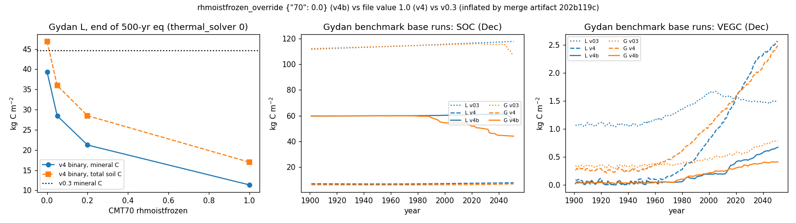

# WORK NOTES: `rhmoistfrozen_override` (per-CMT override of `rhmoistfrozen`)

Branch `wetland/rts-merge-rmf` (off `b29caa0c`, wetland/rts-merge). Approved by Elchin 2026-11-17.

## Why
The Gydan benchmark sites (L, G; CMT70) lose almost all permafrost mineral soil C in v4 (SOC ~7 kg/m2 vs ~112 kg/m2 in v0.3).
Diagnosis (rts-work/gydan/FINDINGS.md): upstream commit `efa2118a` (2026-10-03) changed CMT70 `rhmoistfrozen`
(cmt_bgcsoil.txt) from 0.0 to 1.0. With 1.0, frozen layers respire at the full moisture multiplier during the
equilibrium spin-up, and the deep mineral C pool respires away. The parameter files are shared/upstream, so instead
of editing `parameters/` this adds a default-off model_settings switch.

A second, unrelated cause inflates the v0.3 comparison values: v0.3 Gydan veg/soil C is a merge artifact of
`202b119c` (deep_carbon_v2 merged into rts-light-cbal). Do not treat v0.3 Gydan C as a target.

## Switch
```
"model_settings": { "rhmoistfrozen_override": {"70": 0.0} }
```
* Absent, `null` or `{}` (default in config/config.js) = no override, parameter-file values. Bit-identical to before.
* Keys: CMT number as string, `"70"`, `"07"`, `"7"` or `"CMT70"` (0..99). Values: finite numbers in [0, 1].
* FATAL (exit 1, message on stderr) on: non-object, malformed key, non-numeric or bool value, out-of-range value, the same CMT twice
  (e.g. `"70"` and `"CMT70"`).
* Applied overrides are logged on stderr at each cohort initialisation, e.g.
  `rhmoistfrozen_override: CMT70 rhmoistfrozen 1 (parameter file) -> 0`.
* CMTs not in the map keep their file value.

Implementation
* `include/RhmoistfrozenOverride.h` (new): `rmfo::parse_key`, `rmfo::parse`, `rmfo::lookup` (header-only).
* `ModelData`: `std::map<int,double> rhmoistfrozen_override`, parsed in the constructor (FATAL on error).
* `Cohort::initialize_state_parameters`: sets `soilbgc.rmf_override_on/val` for this cohort's CMT (per cell, so multi-cell runs
  with mixed CMTs are handled) and logs.
* `Soil_Bgc::initializeParameter`: `bgcpar.rhmoistfrozen = rmf_override_on ? rmf_override_val : chtlu->rhmoistfrozen;`
  (re-applied every time initializeParameter is called, e.g. by the calibration controller).
* `tests/unit/test_rhmoistfrozen_override.cpp` (new, 4 cases): absent/null/{} -> empty (incl. full `ModelData`); valid keys/values
  + lookup via `cmtcode2num`; all invalid forms rejected; `Soil_Bgc::initializeParameter` uses the override, else the file value.

## Verification
| check | result |
|---|---|
| unit tests (`make unittest`) | 435 test cases pass incl. 4 new; the 8 failing assertions are the known pre-existing ones (test_climate, test_richards_water_energy, test_seb, test_stefan_water; 2 each) |
| off-mode regression, 56 stage folders (tests/regression launch4/ident.py) vs ad509904 reference | 56/56 identical |
| on-mode: Gydan L, eq 500, thermal_solver 0, override `{"70": 0.0}` vs v4 binary with an edited parameter dir (CMT70 rhmoistfrozen 0.0) | restart-eq.nc 63/63 variables bitwise identical |
| non-matching override `{"05": 0.3}` on the CMT70 cell vs plain v4 | 63/63 variables bitwise identical |
| 6 invalid configs (bad key, 1.5, "0", list, duplicate 70/CMT70, true) | all exit 1 with a FATAL message |
| log line | printed once per cohort init with the override on |

## Effect (Gydan)


Left: Gydan L after a 500-yr equilibrium (thermal_solver 0). Mineral C is 39.3 / 28.5 / 21.2 / 11.4 kg/m2 for
rhmoistfrozen 0 / 0.05 / 0.2 / 1.0 (v0.3: 44.6). At eq 2000: v4 4.8, v4 + override 54.0, v0.3 97.1 kg/m2.
Middle/right: benchmark base runs (v4 deck switches: thermokarst 1, thermal_solver 1, n_safetynet_conserve 2, regrow on, CH4 on).
The override restores ~60 kg/m2 SOC at L and G (v4 ~7, v0.3 ~112, but v0.3 is inflated by 202b119c).
Caveat: with the override, CMT70 VEGC is low (L 0.02 -> 0.68 kg/m2 over 1901-2050, vs v4 0.09 -> 2.6 and v0.3 1.1 -> 1.5).
GPP at the start of the scenario is about 1/5 of v4 (G GPP base 0.064 vs 0.32 kg/m2/yr).
The likely cause is N held in the much larger soil pool. Not investigated further here.

Scorecard (v4 deck set, 33 tests): v4 11/33 -> v4b 10/33. One verdict changes: RTS-035, the ALD anomaly in the initiation year.
That test now fails: G anomaly 80.7 % vs window 4.7-47 %. Details are in rts-work/v4b/scorecard.

## Not changed
Parameter files, defaults and every other code path. With the switch absent the model is bit-identical (above).
