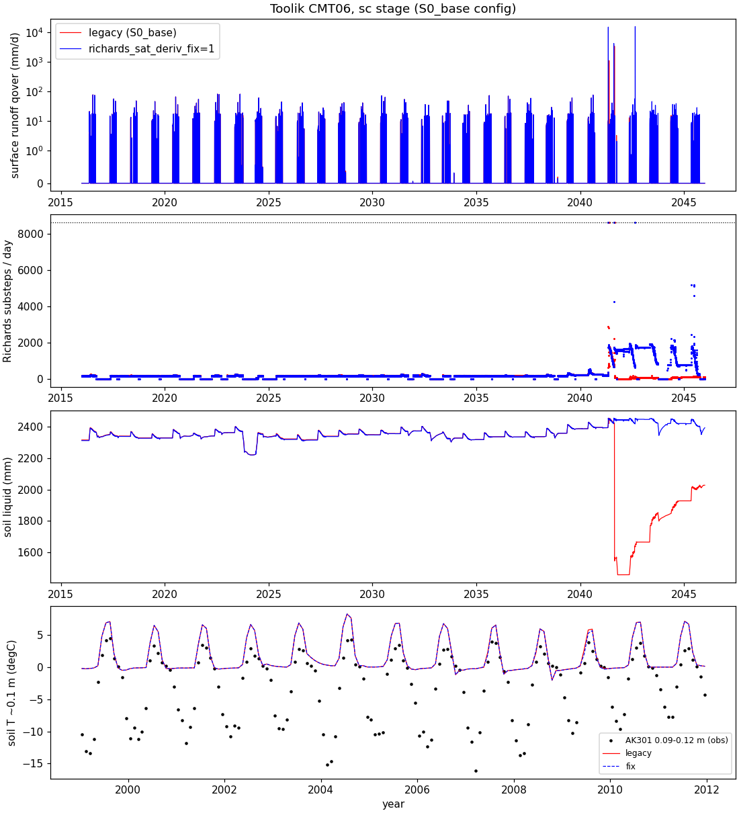
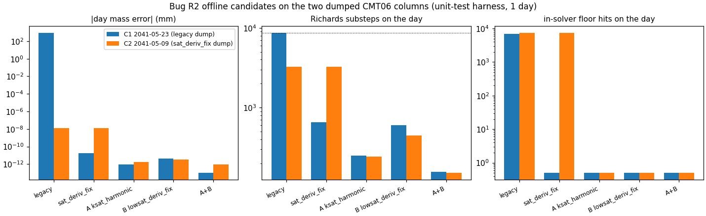

# WORK NOTES: Richards bug R2 (water created after a soil-layer split)

Branch `fix/richards-mass-guard` off `5a55bb53` (worktree `~/tem-dev/rmg`, calib-elchin). Local commit only, not pushed.
Elchin, 2026-11-20: "Report sc water as a flag only, and investigate the layer-split water bug"; "Yes, please do" (full-model check).
Every switch below defaults to 0 = legacy. Physics defaults, parameters/ and the CMT06 kit binary are unchanged.

## 1. Symptom
CMT06 S0_base (Toolik, kit v3) sc stage: 3371 mm of runoff in Aug 2041 and sc water closure −30.9 %P.
The column had gone from 20 to 21 layers on 2041-02-01.

## 2. Root cause
- The split conserves water: `redivideDeepLayers`/`splitOneSoilLayer` turned a 0.148 m humic layer (131.10 mm) into 0.049 + 0.099 m (43.71 + 87.42 mm).
- The water is created by the Richards solve. The split is only the trigger: a thin saturated humic layer now sits directly under the fibric layer.
- Failure days 2041-05-23 and 2041-08-26:
  - 8640 substeps (every one at dtmin 10 s); LAPACK info OK;
  - mass error +1124 and +2462 mm, equal to Σ(dz·Δθ − flux·dt);
  - the surplus went to qover through `checkSoilLiquidWaterValidity`.
- Mechanism:
  - The interface conductivity uses the upper layer's ksat (fibric 191 mm/s) over humic (0.0104 mm/s), times the mean interface saturation s1.
  - The derivative with respect to the lower layer's water, dqout/dθ_lower, keeps its positive gravity part (0.5·dhkdw/poro).
  - So the humic row loses diagonal dominance (b = +104 at dt 10 s). One substep drives the humic liquid to about −200 mm.
  - The solver floors it at 1e-4 mm (s2 = 0.01, smp ≈ −1e17 mm). Coefficients reach 1e15–1e17 and round-off creates mm-scale water every substep.
- In the S0_base run, before the split, 39 saturated-fibric-over-humic days had no failures; after it, 110 such days had 2 failures.
- The kit's new report-only flag (score.py 3.1c) finds the same failure in stage 1 of other cases, e.g. S1_sd250_nfw0.8: 4 days, up to 7314 mm. No gate sees these.

## 3. Switches (all default 0)
| setting | what it does | status |
|---|---|---|
| `richards_mass_guard` (+ `richards_mass_tol_mm`, 1.0) | reject a day whose column liquid does not close; restore it and re-book infiltration (Soil_Env) | safety net only. In the sc rerun it tripped on 333 days: the restored state stays unstable and redistribution freezes |
| `richards_sat_deriv_fix` | dhkdw = 0 where the unclamped s1 ≥ 1 | **fails in the full model** (section 4) |
| `richards_ksat_harmonic` (A) | interface ksat = (dz1 + dz2) / (dz1/ksat1 + dz2/ksat2) | **passes offline**; changes every interface with a ksat contrast |
| `richards_lowsat_deriv_fix` (B) | dhk/dθ_lower = 0 when the lower layer is saturated (unclamped s2 ≥ 1) | **passes offline**; bit-identical when no layer is saturated |

- `Richards::diag_nfloor` counts in-solver floor hits (diagnostic only).
- `CohortData`: `is_wetland`, `ch4_on`, `groundwater_status` and `runon_status` now default to false. Before, they were uninitialised in the default constructor, so the doctest defaults case failed depending on test order. The model sets them in Cohort, so model runs are unaffected.

## 4. Full-model check of `richards_sat_deriv_fix` (S0_base config, binary c076cf4b; ledger DIAG_3..6, 0.235 core-h)
- **Switches off:** stage2a + 2b rerun from S0_base's own stage-1 restart. All 396 variables in 100 files are identical (only Git_SHA and total_runtime differ).
- **Fix on, full stages:**
  - Aug 2041 runoff falls from 3371 to 4191 mm, but new failure days appear: 2041-05-09 (+14798 mm), 2041-08-14 (+4174 mm) and 2042-08-25 (+15493 mm). sc water goes to −297 %P.
  - Cause: the fibric layer above was only 88 % saturated (s1 = 0.94), so the clamp, and with it the switch, never applied.
  - The S1 pick + fix fails veg_alive (late GPP 84 → 24.5).
  - Differences from legacy start in stage 1 (day 170), not only on saturated-interface days.

## 5. Offline test of A and B (`tests/unit/test_richards_r2_fixes.cpp`, zero core-h)
Columns: C1 = 2041-05-23 start-of-day (legacy DIAG_1 dump, qinfil 0); C2 = 2041-05-09 (sat_deriv_fix DIAG_6 dump, qinfil 4.1 mm/d). Both are 6-digit dumps.

| column | variant | day error (mm) | substeps | floor hits | min(liq − minliq) (mm) | 30 more days: worst error / max substeps / floor hits |
|---|---|---|---|---|---|---|
| C1 | legacy | +869.7 | 8640 | 6822 | 2.70 | 1e-11 / 8640 / 0 |
| C1 | sat_deriv_fix | −1.8e-11 | 654 | 0 | 2.61 | 9e-13 / 64 / 0 |
| C1 | A | 9e-13 | 250 | 0 | 2.76 | 5e-13 / 64 / 0 |
| C1 | B | 5e-12 | 599 | 0 | 2.61 | 5e-13 / 65 / 0 |
| C1 | A+B | 0 | 157 | 0 | 2.76 | 5e-13 / 65 / 0 |
| C2 | legacy | −1.2e-8 | 3272 | 7336 | **−14.9** | 1e-12 / 112 / 224 |
| C2 | sat_deriv_fix | −1.3e-8 | 3262 | 7326 | **−15.6** | 2e-12 / 112 / 233 |
| C2 | A | −1.8e-12 | 244 | 0 | 4.66 | 9e-13 / 64 / 0 |
| C2 | B | 3e-12 | 450 | 0 | 4.51 | 9e-13 / 65 / 0 |
| C2 | A+B | 9e-13 | 152 | 0 | 4.66 | 9e-13 / 65 / 0 |

- On C2 the 6-digit dump does not reproduce the model's +14798 mm, but the same instability is there: thousands of floor hits and a layer driven 15 mm below minliq.
- Unsaturated columns (both columns at 60 % of their liquid, 2 mm/d, 10 days):
  - B is bit-identical to legacy;
  - A closes to 5e-13 mm but moves layer liquid by up to 2.1 mm;
  - on a uniform-ksat column A equals legacy exactly.
- Every variant, legacy included, leaves the bottom saturated layer up to about 330 mm over maxliq at day end. The harness has no lateral drainage, and in the model `checkSoilLiquidWaterValidity` redistributes the excess. This is not the R2 failure.

## 6. Recommendation and next step
- **B is the minimal fix:** it is a no-op unless a layer is saturated. **A** is the more physical series conductance, but it changes every moss/fibric/humic/mineral interface.
- Neither has run in the full model yet (Elchin: offline only). Next: switches-off identity plus one full S0_base run with B, then with A+B, booked as DIAG.
- Tests: the full unit suite passes 469/469 cases; the 8 failing assertions are the known xfails. The new files are `test_richards_mass_guard.cpp`, `test_richards_r2_repro.cpp` and `test_richards_r2_fixes.cpp`.
