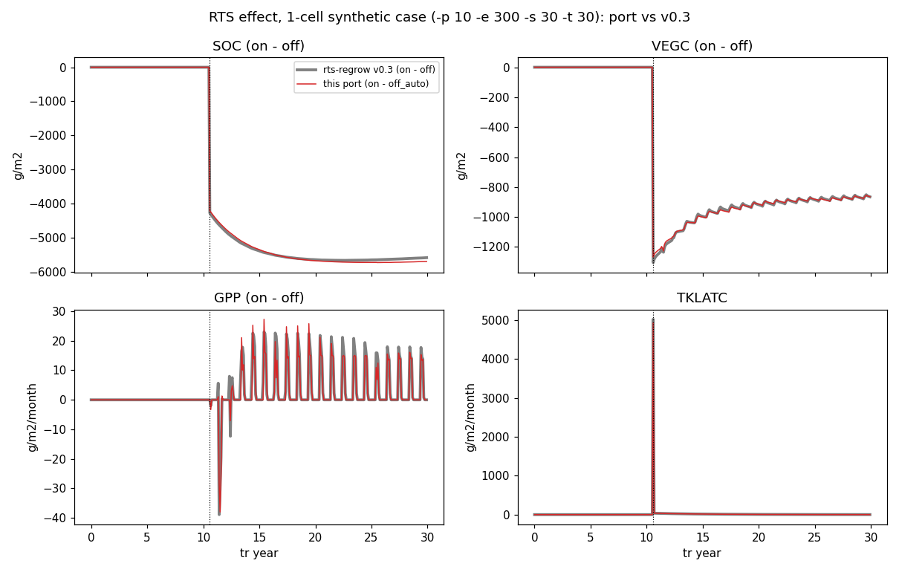
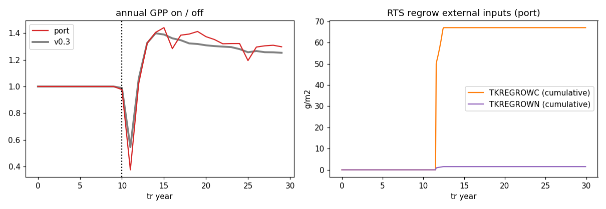

# Work notes: RTS (retrogressive thaw slumps) behind a default-off thermokarst switch

Local branch `wetland/rts-merge` on calib-elchin, Nov 15–17 2026 (Option A, approved by Elchin on 2026-11-15).
**Not pushed** (needs Elchin's approval). Merge plan: `dvmdostem_merge_plan.md` §7, the step after Reburn.

## 1. What was merged

- **Source:** RTS-expert's `rts-regrow` tip `7c9fd634` (fork `rts-regrow` `cf51550b` + 23 commits).
- **Commit 1, `95590b49`:** a merge commit that only records history. It keeps every existing file as ours and adds only the new RTS files:
  - `Thermokarst`, `ThermokarstData`, `RTSFloor`, `RTSMethane`, `RTSRegrow`, `TKNetC.h`;
  - `tests/rts/` with the v0.1/v0.2/v0.3 references;
  - `testing-data/rts-synthetic`;
  - the demo-data thermokarst files.
- **Following commits:** the port of the RTS core into this fork's files (Option A), with tests, tools and these notes.

### Ported (all under `model_settings.thermokarst = 1`)
- The thermokarst disturbance step (`Cohort::updateMonthly_Thermokarst`). It runs after fire, in tr and sc only. It covers:
  - initiation from `IO.hist_exp_thermokarst_file` (tr) and `IO.proj_exp_thermokarst_file` (sc);
  - removal of soil and vegetation C/N, split into lateral export (`TKLATC/N`) and a direct respired pulse (`TKRESPC`);
  - rebuilding the layers, plus `Ground::updateMineralProperties`;
  - instant thaw to `thermokarst_thaw_depth`;
  - the post-slump drainage class.
- Excess ground ice and subsidence: `Ground::initExcessIce/meltExcessIce` and `Layer::excess_ice`. When the surface subsides, the water table moves up by the same amount (`Soil_Env`).
- **RTS floor** (`RTSFloor.h`): RH cap, lateral export of floor mineral C/N, anoxia multiplier, and a floor minimum RH (`Soil_Bgc::deltac/deltan`).
- **RTS regrow** (`RTSRegrow.h`): pre-slump GPP record, shrub boost, reseeding and organic-layer rebuild (`TKREGROWC/N`), and the floor N supply with its GPP taper. The N supply is *added* to `m_a2soi.avlninput` in the first rooted layer, so it stacks with BNF; rts-regrow overwrote this input, which is 0 there.
- RTS CH4 (`thermokarst_ch4`, default off), output only.
- Outputs `TKLATC TKLATN TKREMTHICK TKICEMELT DRAINTYPE TKSUBSID TKEXICE TKEXMELT TKRESPC TKCH4* TKRHCO2 TKLATCH4 TKPONDSAT TKREGROWC TKREGROWN TKNETC` (`output_spec.csv`; all off by default).
- With `thermal_solver 1`, the enthalpy change from the slump restructuring is booked in the disturbance term (`enth_bk_fire`).

### Dropped (duplicates of fixes this fork already has behind switches, or not RTS)
- The always-on `deep_carbon_v2` and the rts-deepc N fixes.
- The integrator black-hole retry, double accumulation, and `cover_negative_orgn`.
- The always-on layer N carry from `23322af0`, which is our `layer_n_remap_fix`.
- The duplicate N3/G1/give-up switches and the daily-port fixes.
- **m2d** (mean-preserving monthly-to-daily forcing), left out as decided.

## 2. The switch

| `model_settings.thermokarst` | behaviour |
|---|---|
| **0 (default, also when the key is absent)** | Legacy. No RTS key or thermokarst file is read, no RTS code runs, no `tk_*` restart variable is written. Bit-identical to `ad509904` (§4). |
| 1 | RTS on. Sub-keys `thermokarst_*` / `rts_*` are read and checked: a wrong type or range is FATAL. |

Any value other than integer 0 or 1 is FATAL. `config/config.js` has the key set to 0, with a comment, plus the two IO keys, which are empty.

### What `thermokarst = 1` turns on by default (the auto-enabled list)
1. RTS sub-modules at their rts-regrow v0.3 defaults:
   - `thermokarst_initiation` true
   - `thermokarst_rh_cap` true
   - `thermokarst_floor_export` true
   - `thermokarst_floor_anox` true
   - `thermokarst_floor_rmin` true
   - `thermokarst_regrow` true
   - `rts_regrow_n_taper` true
   - `rts_regrow_navln_exempt` true
   - (`thermokarst_ch4` stays false)
2. Existing fork switches, which default to 1 when the key is absent (`ModelData::apply_thermokarst_auto_switches`):
   - **`soil_negpool_fix` = 1**
   - **`layer_n_remap_fix` = 1**
   - **`layer_bookkeep_fix` = 1**, only if `layer_n_remap_fix` ends up as 1.

   An explicit 0 is kept, with a WARNING. These switches change base physics in every cell from the first month, even where no slump ever happens. `thermokarst = 1` without a slump is therefore bit-identical to `thermokarst = 0` plus these three switches (§5.1), not to plain `thermokarst = 0`.
3. Internal hooks, set only in a cell's months *after* an RTS initiation:
   - `Soil_Bgc::tk_litter_fix`: litter goes to the first non-moss layer when no fibric layer is left.
   - `Soil_Env::tk_nofibric_fix`: the water domain starts at the first humic or mineral layer.
   - `Integrator::tk_tolerate_neg_avln`: a transient negative AVLN goes through the existing clip.
   - Floor/regrow N input layer and AVLN exemption.

   `adjustSoilAfterburn(true)` also removes mineral layers left with zero C. It runs only on the RTS path; fire still calls it with the legacy default `false`.
4. An RTS initiation sets `cd.yrsdist = cd.mthsdist = 0`, so the fire timer restarts. This matches the fire-state restart from `fire_c_bookkeep_fix` / `fire_n_redep_fix`, and it can happen only with `thermokarst = 1`.

`soil_giveup_retry` is **not** auto-enabled (see §5.2 and §8).

## 3. Restart

- With `thermokarst = 1`, `restart-*.nc` gains `tk_drainage_type`, `tk_init` (0 means no RTS yet, otherwise months since initiation + 1), `tk_exinit`, `tk_subsidence` and `tk_exice(Y,X,soillayer)`. They are read back only with `thermokarst = 1`.
- With 0, they are neither written nor read: §4 compares restart files too.
- An old restart without them loads with one WARNING, and the RTS starts as not initiated with no excess ice.
- 10-cell check (§5.4): sc carried on from restart-tr. Cell (0,0) has `tk_init` = 1484 at the end of sc, which is 115·12 − 17 + 10·12 + 1.
- **Not saved (known limitation, deferred, same as rts-regrow):**
  - the RTS regrow state (pre-slump PFT pools, GPP rings, taper);
  - the floor RH history.

  A run that restarts within the regrow window therefore restarts regrow without its pre-slump reference. Splitting a run at a stage boundary *before* any slump is exact.
- MPI builds don't write the `tk_*` state (WARNING), as with the fire state.

## 4. Thermokarst-off bit identity (vs `ad509904`)

- Reference binary: `rts-work/reg/bin/dvmdostem_ref`, built from a clean `ad509904` checkout (`~/tem-dev/rts-ref`).
- Port binary: HEAD `2a02b6eb` source, which is identical to the final C++.
- Runs: `tests/regression/run_case.py` (20-yr spin + 75-yr main), compared with `ident.py` on all NetCDF outputs and the restart files.

| case set | cases | stage folders identical |
|---|---|---|
| `srd-work/cs/leg` (calibrated HPC/TVC regression cases) | 8 | 16/16 |
| `wet-work/rbsmoke/cs` (E1, E1on, E1onL, F0g, F1c, F1c_C/L/N, F1c_on/onL/onLD/onLK/onLR, F1cdbg, F1cdbg_on, F1p, F1p_L/on/onL/onLK) | 20 | 40/40 |
| **total** | **28** | **56/56 (0 diffs)** |

The smoke set covers fire with every fire-balance, N-leak and layer switch on, and the restart split.

## 5. RTS on

### 5.1 1-cell synthetic case
- Setup: `testing-data/rts-synthetic`, `-p 10 -e 300 -s 30 -t 30`, RTS in tr year 10 Aug (month 127), `RTS_PARAMS` of `tests/rts/rtslib.py`.
- Tool: `tests/rts/port_check.py`, which writes `docs/figures/rts/port_check_summary.json`.
- Identity:
  - `off_auto` (`thermokarst 0` + the 3 auto switches) vs `noinit` (`thermokarst 1`, initiation off): **36/36 output files identical**.
  - Plain `off` vs `noinit` differ, as expected, through the auto switches (§2).

### 5.2 Closures (monthly, tr, 360 months)
Columns: C residual = d(VEGC+SOC+DEADC+DWDC) + RECO − GPP + TKLATC + TKRESPC − TKREGROWC. N residual comes from model state (`NBAL_DIAG`). Water is reported as % of P.

| run | C max \|month\| | N max \|month\| | N sum | water sum (% P) |
|---|---|---|---|---|
| off_auto | 0.0014 | – | – | 0.149 |
| **on** (default auto switches) | **0.0014** | 0.081 (month 66, before the slump; also in noinit) | 0.081 | −0.044 |
| ice (+ excess ice 0.3, 0.4–2 m) | 0.0014 | 0.081 (same month) | 0.081 | 0.345 |
| on + `soil_giveup_retry` 1 (on_fx) | 0.0014 | 8e-5 | −4e-5 | −0.046 |
| on, auto switches forced 0 (on_noauto) | **6.1** (slump month) | **340** (yr 29), 17.8 (yr 22) | −358 | −0.054 |

- With the default auto switches, C closes to round-off through the slump.
- The only N residual is a pre-slump give-up event, which `soil_giveup_retry` removes.
- Without the auto switches, C and N do not close. This is why they are on.
- **Water:** in the two slump months the residual is −34 mm against off_auto, from melt water above layer capacity drained at the instant thaw (`thaw_depth` 1 m). That water leaves the column with no output flux. The monthly ±100 mm pattern is the same in off; it is a snapshot/timing artefact of the monthly formula, and the yearly residual is ~0.1–0.3 % of P.

### 5.3 RTS effect vs rts-regrow v0.3 (no pass threshold claimed)
- Port effect: `on − off_auto`.
- v0.3 effect: `reference/v03/rts − reference/baseline`, from the rts-regrow binary with its own base physics (deep C v2, m2d, etc.).
- Base states differ: off-run end SOC is 27203 (port) vs 27332 (v0.3), and mean monthly GPP in the last year is 12.2 vs 15.4 g/m2/month.

| metric | port | v0.3 |
|---|---|---|
| slump-month SOC drop (g C/m2) | −4205 | −4272 |
| slump-month VEGC drop | −1267 | −1304 |
| slump-month SHLWC / DEEPC drop | −1807 / −2646 | −1859 / −2647 |
| slump-month ORGN drop (g N/m2) | −219 | −208 |
| TKLATC slump month / 20-yr total | 4925 / 6926 | 5018 / 7022 |
| TKRESPC slump month (= total) | 547 | 558 |
| TKLATN slump month / total | 224 / 397 | 217 / 391 |
| SOC effect, end of tr (yr 30) | −5694 | −5586 |
| VEGC effect, end of tr | −866 | −866 |
| GPP on/off, first full year after slump | 0.38 | 0.55 |
| years until annual GPP ≥ 90 % of off | 2 | 2 |
| GPP on/off, last year | 1.30 | 1.25 |
| ALD effect, end | +0.27 m | +0.33 m |
| ice case: subsidence / excess ice left | 0.25 m / 403 kg/m2 | 0.25 m / 403 kg/m2 |

- The slump pulse and its C/N partition match within about 2 %. The difference scales with the smaller pre-slump pools in this fork.
- The slower first-year GPP recovery (0.38 vs 0.55) is the main difference; after year 2 the two curves overlap.
- DRAINTYPE: the off run writes −1 (the module never runs), so "on − off" shows 2; the real post-slump class is 1 in both.

### 5.4 10-cell demo-data case (`tests/rts/port_demo10.py`, `port_demo10_analyze.py`)
- Setup: toolik 10x10, row 0 (10 cells), `-p 10 -e 100 -s 10 -t 115 -n 10`, with tr and sc outputs. The repo's demo thermokarst file has one RTS, in cell (0,0) in 1902. This is a smoke test, not a calibrated run.
- Cells (0,1)–(0,9): `on` vs `off_auto` identical in all outputs and restarts, apart from the DRAINTYPE output sentinel and `total_runtime`.
- Cell (0,0): slump in tr month 17. SOC −4212, VEGC −1253, TKLATC 4918, TKRESPC 546 g/m2. GPP over the last 10 years is 1.24× off.
- C closure over the row: max 0.0083 g/m2/month, the same in off_auto.
- `restart-tr/sc` carry `tk_*` only in `on`. Summary: `docs/figures/rts/demo10_summary.json`.

## 6. Unit tests
`make unittest`: **421 test cases pass**, which is 401 before plus 20 new in `tests/unit/test_rts.cpp`. Of 3,158,931 assertions, 8 fail; they are the same known 8 as before (test_climate ×2, test_richards_water_energy ×2, test_seb ×2, test_stefan_water ×2). The RTS tests cover:
- switch parsing, FATAL values, sub-key parsing, and the auto-enabled list;
- that hook defaults are inert;
- the restart `tk_*` round trip and old restarts;
- the AVLN input layer, and the default legacy argument of `adjustSoilAfterburn`;
- 9 ported rts-regrow unit tests (removal thickness, partition mass balance, thaw column, excess ice init/melt, CH4, floor, regrow, TKNETC).

## 7. Tools (in the repo)
- `tests/rts/port_check.py BIN WORK`: runs the synthetic cases, then writes the identity, closure and v0.3 effect summary.
- `tests/rts/port_figs.py WORK OUT`: draws these figures and writes `rts_port_metrics.json`.
- `tests/rts/port_demo10.py BIN WORK [--cases off,on,off_auto]` and `port_demo10_analyze.py WORK`.
- `tests/rts/rtslib.py`: the switch is an integer here.
- rts-regrow's pytest suites (`tests/rts/test_rts_*.py`) are kept as they came. Some of them assume m2d and rts-regrow's base physics, so they are not expected to pass on this branch.

## 8. Open items
- **Regrow-state restart** (deferred, §3).
- **Melt water drained at the instant thaw has no output flux.** This explains the −34 mm water gap in the slump month. A `TKWDRAIN` output (output only) would close it.
- **`soil_giveup_retry`:** not auto-enabled, though it removes the small pre-slump N give-up residual. Elchin to decide whether RTS runs should turn it on (recommended).
- **DRAINTYPE output is −1 when the RTS module is off** (cosmetic; the output is off by default).
- **v0.3 comparison has only one case.** It is the single synthetic cell; the base physics differ (m2d, deep C v2), so only the effect is compared.
- The excess-ice profile (`ICE_PARAMS`) is a placeholder from rts-regrow.
- **HPC:** the new sources are in `SConstruct` and `Makefile`; the C++20 support of the HPC compiler is still unverified.
- **Two-stage / trigger-file drivers:** RTS-expert's `scripts/run_rts_two_stage.py` and the trigger-file workflow came in with the merge but were not exercised here.

Compute on calib-elchin for this work (worker 3): builds about 0.55 core-h, identity runs 0.81, synthetic and 10-cell runs about 0.3. Total about 1.7 core-h.
