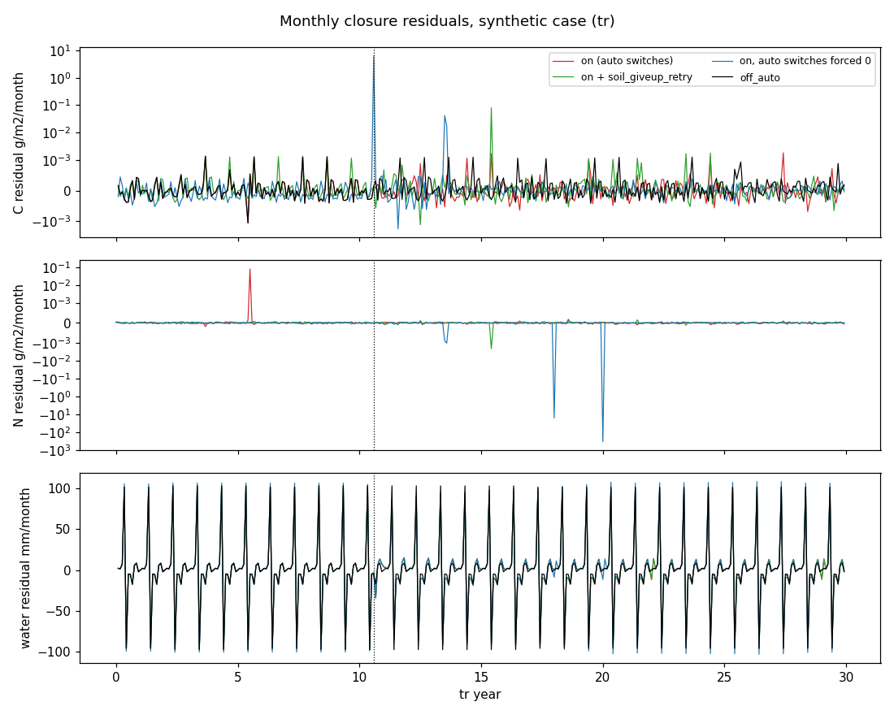
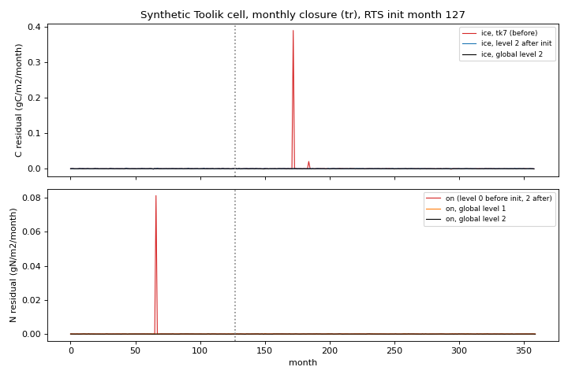

# Work notes: RTS (retrogressive thaw slumps) behind a default-off thermokarst switch

Local branch `wetland/rts-merge` on calib-elchin, Nov 15–17 2026 (Option A, approved by Elchin on 2026-11-15).
**Not pushed** (needs Elchin's approval). Merge plan: `dvmdostem_merge_plan.md` §7, the step after Reburn.

## 1. What was merged

- **Source:** RTS-expert's `rts-regrow` tip `7c9fd634` (fork `rts-regrow` `cf51550b` + 23 commits).
- **Commit 1, `95590b49`:** a merge commit that only records history. It keeps every existing file as ours and adds only the new RTS files:
  - `Thermokarst`, `ThermokarstData`, `RTSFloor`, `RTSMethane`, `RTSRegrow`, `TKNetC.h`;
  - `tests/rts/` with the v0.1/v0.2/v0.3 references;
  - `testing-data/rts-synthetic`;
  - the demo-data thermokarst files.
- **Following commits:** the port of the RTS core into this fork's files (Option A), with tests, tools and these notes.

### Ported (all under `model_settings.thermokarst = 1`)
- The thermokarst disturbance step (`Cohort::updateMonthly_Thermokarst`). It runs after fire, in tr and sc only. It covers:
  - initiation from `IO.hist_exp_thermokarst_file` (tr) and `IO.proj_exp_thermokarst_file` (sc);
  - removal of soil and vegetation C/N, split into lateral export (`TKLATC/N`) and a direct respired pulse (`TKRESPC`);
  - rebuilding the layers, plus `Ground::updateMineralProperties`;
  - instant thaw to `thermokarst_thaw_depth`;
  - the post-slump drainage class.
- Excess ground ice and subsidence: `Ground::initExcessIce/meltExcessIce` and `Layer::excess_ice`. When the surface subsides, the water table moves up by the same amount (`Soil_Env`).
- **RTS floor** (`RTSFloor.h`): RH cap, lateral export of floor mineral C/N, anoxia multiplier, and a floor minimum RH (`Soil_Bgc::deltac/deltan`).
- **RTS regrow** (`RTSRegrow.h`): pre-slump GPP record, shrub boost, reseeding and organic-layer rebuild (`TKREGROWC/N`), and the floor N supply with its GPP taper. The N supply is *added* to `m_a2soi.avlninput` in the first rooted layer, so it stacks with BNF; rts-regrow overwrote this input, which is 0 there.
- RTS CH4 (`thermokarst_ch4`, default off), output only.
- Outputs `TKLATC TKLATN TKREMTHICK TKICEMELT DRAINTYPE TKSUBSID TKEXICE TKEXMELT TKRESPC TKCH4* TKRHCO2 TKLATCH4 TKPONDSAT TKREGROWC TKREGROWN TKNETC` (`output_spec.csv`; all off by default).
- With `thermal_solver 1`, the enthalpy change from the slump restructuring is booked in the disturbance term (`enth_bk_fire`).

### Dropped (duplicates of fixes this fork already has behind switches, or not RTS)
- The always-on `deep_carbon_v2` and the rts-deepc N fixes.
- The integrator black-hole retry, double accumulation, and `cover_negative_orgn`.
- The always-on layer N carry from `23322af0`, which is our `layer_n_remap_fix`.
- The duplicate N3/G1/give-up switches and the daily-port fixes.
- **m2d** (mean-preserving monthly-to-daily forcing), left out as decided.

## 2. The switch

| `model_settings.thermokarst` | behaviour |
|---|---|
| **0 (default, also when the key is absent)** | Legacy. No RTS key or thermokarst file is read, no RTS code runs, no `tk_*` restart variable is written. Bit-identical to `ad509904` (§4). |
| 1 | RTS on. Sub-keys `thermokarst_*` / `rts_*` are read and checked: a wrong type or range is FATAL. |

Any value other than integer 0 or 1 is FATAL. `config/config.js` has the key set to 0, with a comment, plus the two IO keys, which are empty.

### What `thermokarst = 1` turns on by default (the auto-enabled list)
1. RTS sub-modules at their rts-regrow v0.3 defaults:
   - `thermokarst_initiation` true
   - `thermokarst_rh_cap` true
   - `thermokarst_floor_export` true
   - `thermokarst_floor_anox` true
   - `thermokarst_floor_rmin` true
   - `thermokarst_regrow` true
   - `rts_regrow_n_taper` true
   - `rts_regrow_navln_exempt` true
   - (`thermokarst_ch4` stays false)
2. Existing fork switches, which default to 1 when the key is absent (`ModelData::apply_thermokarst_auto_switches`):
   - **`soil_negpool_fix` = 1**
   - **`layer_n_remap_fix` = 1**
   - **`layer_bookkeep_fix` = 1**, only if `layer_n_remap_fix` ends up as 1.

   An explicit 0 is kept, with a WARNING. These switches change base physics in every cell from the first month, even where no slump ever happens. `thermokarst = 1` without a slump is therefore bit-identical to `thermokarst = 0` plus these three switches (§5.1), not to plain `thermokarst = 0`.
3. Internal hooks, set only in a cell's months *after* an RTS initiation:
   - `Soil_Bgc::tk_litter_fix`: litter goes to the first non-moss layer when no fibric layer is left.
   - `Soil_Env::tk_nofibric_fix`: the water domain starts at the first humic or mineral layer.
   - `Integrator::tk_tolerate_neg_avln`: a transient negative AVLN goes through the existing clip.
   - Floor/regrow N input layer and AVLN exemption.

   `adjustSoilAfterburn(true)` also removes mineral layers left with zero C. It runs only on the RTS path; fire still calls it with the legacy default `false`.
4. An RTS initiation sets `cd.yrsdist = cd.mthsdist = 0`, so the fire timer restarts. This matches the fire-state restart from `fire_c_bookkeep_fix` / `fire_n_redep_fix`, and it can happen only with `thermokarst = 1`.

`soil_giveup_retry` is **not** auto-enabled (see §5.2 and §8).

## 3. Restart

- With `thermokarst = 1`, `restart-*.nc` gains `tk_drainage_type`, `tk_init` (0 means no RTS yet, otherwise months since initiation + 1), `tk_exinit`, `tk_subsidence` and `tk_exice(Y,X,soillayer)`. They are read back only with `thermokarst = 1`.
- With 0, they are neither written nor read: §4 compares restart files too.
- An old restart without them loads with one WARNING, and the RTS starts as not initiated with no excess ice.
- 10-cell check (§5.4): sc carried on from restart-tr. Cell (0,0) has `tk_init` = 1484 at the end of sc, which is 115·12 − 17 + 10·12 + 1.
- **Regrow / floor-RH state (added Nov 17):** `tk_regrow_state(Y,X,tkrgstate)`, 371 doubles, attribute `layout_version` = 1, packed by `Cohort::tk_rg_pack` / `tk_rg_unpack`: pre-slump PFT C/N and types, GPP and N-unlimited-GPP rings, taper, organic-layer rebuild state, N carry, floor RH history. Written and read only with `thermokarst = 1`.
  - An older thermokarst restart (five `tk_*` vars, no `tk_regrow_state`) still loads, with one WARNING; regrow then starts without its pre-slump reference, as before. A length mismatch is ignored, not misread.
  - Check (`tests/rts/port_split.py`, synthetic, `-t 12` so the split falls inside the regrow window): sc run alone in a new process from a copy of `restart-tr.nc` is **bit-identical** to the continuous run (on and off_auto). The previous binary differs in 26 sc files (GPP up to 31 g/m2/month).
  - Note: within one dvmdostem process tr→sc kept these members anyway; the restart only matters for separate restart runs (`restart_from`).
- MPI builds don't write the `tk_*` state (WARNING), as with the fire state.

## 4. Thermokarst-off bit identity (vs `ad509904`)

- Reference binary: `rts-work/reg/bin/dvmdostem_ref`, built from a clean `ad509904` checkout (`~/tem-dev/rts-ref`).
- Port binary: HEAD `2a02b6eb` source, which is identical to the final C++.
- Runs: `tests/regression/run_case.py` (20-yr spin + 75-yr main), compared with `ident.py` on all NetCDF outputs and the restart files.

| case set | cases | stage folders identical |
|---|---|---|
| `srd-work/cs/leg` (calibrated HPC/TVC regression cases) | 8 | 16/16 |
| `wet-work/rbsmoke/cs` (E1, E1on, E1onL, F0g, F1c, F1c_C/L/N, F1c_on/onL/onLD/onLK/onLR, F1cdbg, F1cdbg_on, F1p, F1p_L/on/onL/onLK) | 20 | 40/40 |
| **total** | **28** | **56/56 (0 diffs)** |

The smoke set covers fire with every fire-balance, N-leak and layer switch on, and the restart split.

Re-run Nov 17 with `tk6` and again with the final binary `rts-work/reg/bin/dvmdostem_tk7` (HEAD source): **56/56 identical** both times (`rts-work/reg/ident6.json`, `ident7.json`).

## 5. RTS on

### 5.1 1-cell synthetic case
- Setup: `testing-data/rts-synthetic`, `-p 10 -e 300 -s 30 -t 30`, RTS in tr year 10 Aug (month 127), `RTS_PARAMS` of `tests/rts/rtslib.py`.
- Tool: `tests/rts/port_check.py`, which writes `docs/figures/rts/port_check_summary.json`.
- Identity:
  - `off_auto` (`thermokarst 0` + the 3 auto switches) vs `noinit` (`thermokarst 1`, initiation off): **36/36 output files identical**.
  - Plain `off` vs `noinit` differ, as expected, through the auto switches (§2).

### 5.2 Closures (monthly, tr, 360 months)
Columns: C residual = d(VEGC+SOC+DEADC+DWDC) + RECO − GPP + TKLATC + TKRESPC − TKREGROWC. N residual comes from model state (`NBAL_DIAG`). Water is reported as % of P.

| run | C max \|month\| | N max \|month\| | N sum | water sum (% P) |
|---|---|---|---|---|
| off_auto | 0.0014 | – | – | 0.149 |
| **on** (default auto switches) | **0.0014** | 0.081 (month 66, before the slump; also in noinit) | 0.081 | −0.044 |
| ice (+ excess ice 0.3, 0.4–2 m) | 0.0014 | 0.081 (same month) | 0.081 | 0.345 |
| on + `soil_giveup_retry` 1 (on_fx) | 0.0014 | 8e-5 | −4e-5 | −0.046 |
| on, auto switches forced 0 (on_noauto) | **6.1** (slump month) | **340** (yr 29), 17.8 (yr 22) | −358 | −0.054 |

- With the default auto switches, C closes to round-off through the slump.
- The only N residual is a pre-slump give-up event, which `soil_giveup_retry` removes.
- Without the auto switches, C and N do not close. This is why they are on.
- **Water:** in the slump month the output-based residual is about −34 mm against off_auto. The exact in-model check (Nov 17, `NBAL_DIAG` `WB` lines) shows it is the soil water exported with the slumped soil (35.9 kg/m2, now output as `TKWLAT`); melt water drained above layer capacity is `TKWDRAIN` (0 in `on`, 185.6 kg/m2 in `ice`, from excess-ice melt). Per RTS step, W0 − W1 − TKWDRAIN − TKWLAT = 0 to ≤ 1e-6 kg/m2 in every case. The output-only formula cannot close exactly (monthly-mean LWC/IWC, ice counted at 1000 kg/m3, excess ice outside IWC). The monthly ±100 mm pattern is the same in off; it is a snapshot/timing artefact of the monthly formula, and the yearly residual is ~0.1–0.3 % of P.

### 5.3 RTS effect vs rts-regrow v0.3 (no pass threshold claimed)
- Port effect: `on − off_auto`.
- v0.3 effect: `reference/v03/rts − reference/baseline`, from the rts-regrow binary with its own base physics (deep C v2, m2d, etc.).
- Base states differ: off-run end SOC is 27203 (port) vs 27332 (v0.3), and mean monthly GPP in the last year is 12.2 vs 15.4 g/m2/month.

| metric | port | v0.3 |
|---|---|---|
| slump-month SOC drop (g C/m2) | −4205 | −4272 |
| slump-month VEGC drop | −1267 | −1304 |
| slump-month SHLWC / DEEPC drop | −1807 / −2646 | −1859 / −2647 |
| slump-month ORGN drop (g N/m2) | −219 | −208 |
| TKLATC slump month / 20-yr total | 4925 / 6926 | 5018 / 7022 |
| TKRESPC slump month (= total) | 547 | 558 |
| TKLATN slump month / total | 224 / 397 | 217 / 391 |
| SOC effect, end of tr (yr 30) | −5694 | −5586 |
| VEGC effect, end of tr | −866 | −866 |
| GPP on/off, first full year after slump | 0.38 | 0.55 |
| years until annual GPP ≥ 90 % of off | 2 | 2 |
| GPP on/off, last year | 1.30 | 1.25 |
| ALD effect, end | +0.27 m | +0.33 m |
| ice case: subsidence / excess ice left | 0.25 m / 403 kg/m2 | 0.25 m / 403 kg/m2 |

- The slump pulse and its C/N partition match within about 2 %. The difference scales with the smaller pre-slump pools in this fork.
- The slower first-year GPP recovery (0.38 vs 0.55) is the main difference; after year 2 the two curves overlap.
- DRAINTYPE: the off run writes −1 (the module never runs), so "on − off" shows 2; the real post-slump class is 1 in both.

### 5.4 10-cell demo-data case (`tests/rts/port_demo10.py`, `port_demo10_analyze.py`)
- Setup: toolik 10x10, row 0 (10 cells), `-p 10 -e 100 -s 10 -t 115 -n 10`, with tr and sc outputs. The repo's demo thermokarst file has one RTS, in cell (0,0) in 1902. This is a smoke test, not a calibrated run.
- Cells (0,1)–(0,9): `on` vs `off_auto` identical in all outputs and restarts, apart from DRAINTYPE (before Nov 17: the −1 sentinel in off) and `total_runtime`. Final rerun (`rts-work/demo10_7`, `tk7`): cells (0,1)–(0,9) identical to off_auto (DRAINTYPE now equal too); cell (0,0) end effects SOC −5970, VEGC −600, GPP last 10 yr 1.20× off; `restart-tr/sc` carry `tk_regrow_state` (cell (0,0) recorded) only in `on`.
- Cell (0,0): slump in tr month 17. SOC −4212, VEGC −1253, TKLATC 4918, TKRESPC 546 g/m2. GPP over the last 10 years is 1.24× off.
- C closure over the row: max 0.0083 g/m2/month, the same in off_auto.
- `restart-tr/sc` carry `tk_*` only in `on`. Summary: `docs/figures/rts/demo10_summary.json`.

## 6. Unit tests
`make unittest`: **426 test cases pass** (Nov 17: 401 before + 25 in `tests/unit/test_rts.cpp`, 5 new: `thermokarst_safetynet_conserve` parsing, regrow-state restart round trip and old thermokarst restarts, length-mismatch, `tk_rg_pack`/`unpack` round trip, TKWDRAIN/TKWLAT diagnostics and output_spec rows). Of 3,158,931 assertions, 8 fail; they are the same known 8 as before (test_climate ×2, test_richards_water_energy ×2, test_seb ×2, test_stefan_water ×2). The RTS tests cover:
- switch parsing, FATAL values, sub-key parsing, and the auto-enabled list;
- that hook defaults are inert;
- the restart `tk_*` round trip and old restarts;
- the AVLN input layer, and the default legacy argument of `adjustSoilAfterburn`;
- 9 ported rts-regrow unit tests (removal thickness, partition mass balance, thaw column, excess ice init/melt, CH4, floor, regrow, TKNETC).

## 7. Tools (in the repo)
- `tests/rts/port_check.py BIN WORK`: runs the synthetic cases, then writes the identity, closure and v0.3 effect summary.
- `tests/rts/port_figs.py WORK OUT`: draws these figures and writes `rts_port_metrics.json`.
- `tests/rts/port_demo10.py BIN WORK [--cases off,on,off_auto]` and `port_demo10_analyze.py WORK`.
- `tests/rts/rtslib.py`: the switch is an integer here.
- rts-regrow's pytest suites (`tests/rts/test_rts_*.py`) are kept as they came. Some of them assume m2d and rts-regrow's base physics, so they are not expected to pass on this branch.

## 9. Retune and small items (Nov 17)

### 9.1 Regrow N bug (fixed, `19f6eb67`)
The port added the floor N supply with `+=` to `m_a2soi.avlninput`, which only the BNF scheme re-assigns each month. With `bnf_scheme` 0 the supply accumulated: NINPUT 12.2 gN/m2/yr forever, vs rts-regrow's 0.37, 0.67, 0.22, 0.03 in years 10–13. The fix resets it to the base (0 without BNF) before adding the month's supply. After the fix: 0.45, 0.61, 0.03, 0. This changed the last-year GPP ratio from 1.30 to 1.17 and did not change the first-year ratio.

### 9.2 First-year GPP gap (0.38 vs 0.55): base physics, not port logic
- The RTS functions are identical to 7c9fd634 apart from the N-assign calls. The rebuilt rts-regrow binary (`rts-work/rr-src`) reproduces the v0.3 references exactly; m2d off moves its ratio only from 0.546 to 0.552.
- The gap is in July–August of year 11, *before* stabilization (month 139), from the 1 % remnant vegetation. LAI is similar (0.28 vs 0.33), but GPP is 12.6 vs 34.8 g/m2: soil AVLN in June is 0.08 vs 0.20 g/m2. The fork's post-slump vegetation is more N-limited (off GPP 142 vs 182 gC/m2/yr). With the v5o N fixes set to legacy the ratio becomes 0.46.
- Reseed fraction and `n_rate1` don't change year 11 (they start at stabilization). Only `rts_regrow_t_active` does.

### 9.3 Regrow parameters (Elchin, Nov 17: "use values from Pizano et al.")
`config/config.js` sets `rts_regrow_n_rate1` 2.2 gN/m2/yr (Pizano et al. 2014, the v0.3 value) and `rts_regrow_t_active` 1.0 yr (v0.3). Both are read only when `thermokarst = 1`.
- An earlier retune (`n_rate1` 5.0, `t_active` 0.9; `e4b1f7bf`) matched the v0.3 GPP curve but was withdrawn.
- `t_active` is not a Pizano parameter: it is rts-regrow's 1-yr active-slump phase (`docs_src/rts_ch4.md`). 0.9 had no field basis, only the fit. With `n_rate1` 2.2 it gives yr 11 0.50 but yr 13 1.07 (worse than 1.0's 1.15 against v0.3's 1.33), so it was **reverted to 1.0**. Case `on_ta09` in `port_check.py` keeps the comparison.

| on − off_auto | phase 1 | N fix only (`19f6eb67`) | withdrawn retune (5.0 / 0.9) | **final (2.2 / 1.0 + safety-net N)** | v0.3 |
|---|---|---|---|---|---|
| GPP ratio yr 11 / 12 / 13 / 14 / 15 | 0.375 / – | 0.375 / 0.99 / 1.15 / 1.18 / 1.26 | 0.543 / 1.11 / 1.35 / 1.36 / 1.32 | **0.375 / 0.99 / 1.15 / 1.18 / 1.26** | 0.546 / 1.06 / 1.33 / 1.40 / 1.39 |
| GPP ratio last year | 1.30 | 1.165 | 1.165 | **1.226** | 1.253 |
| SOC effect end | −5694 | −5739 | −5710 | **−5738** | −5586 |
| VEGC effect end | −866 | −919 | −907 | **−921** | −866 |
| slump SOC / VEGC drop; TKLATC; TKRESPC; TKLATN | −4205 / −1267; 4925 (6926); 547; 224 (397) | same | same | same | −4272 / −1304; 5018 (7022); 558; 217 (391) |
| ice: subsidence / excess ice left | 0.247 / 402.6 | same | same | same | 0.247 / 402.6 |

The first-year gap (0.375 vs 0.546) stays: it is the base N limitation of §9.2, not an RTS parameter.

### 9.4 Safety-net N residual (Elchin: "tune it"): closed inside the thermokarst path
- Cause: a base soil-integrator safety-net event (adapt() gives up; Integrator.h Fix L1). The vegetation already took the whole month's root N, but the net skips the root N extraction for the remaining (1 − t0) of the month; with `n_rootless_fix` 2 it also skips the AVLN input (here: the RTS floor N supply) into a rootless top layer. Post-slump soils hit such events (yr 13–15).
- Fix: new RTS sub-key `thermokarst_safetynet_conserve` (bool, default **true**, read only with `thermokarst = 1`). `Cohort::tk_set_month_flags` turns `n_safetynet_conserve` on for a cell **from its RTS initiation on**; before initiation and in cells without an RTS the global `n_safetynet_conserve` applies unchanged. So it is not an auto-switch of the base flag.
- Effect: no-slump cells are bit-identical (10-cell case: cells (0,1)–(0,9) `on` vs `off_auto` identical in all outputs and restarts, only `run_status` runtime differs), and RTS-off is untouched (56/56).
- Alternative considered (auto-enable the global `n_safetynet_conserve` with thermokarst = 1, like the other three): it changes no-slump cells. 10-cell case, `off_auto` + `n_safetynet_conserve` 1 vs `off_auto`: 7 of 10 cells differ in tr (27 events in tr/sc), last-year VEGC −1.9 … +0.7 % in tr, −2.4 … +0.5 % in sc, last-year GPP up to −11 %, SOC within 0.02 %. Not adopted.

Closures (syn7, final binary `tk7`, monthly, tr):

| run | C max | N max | note |
|---|---|---|---|
| on | 0.0018 | **0.081** | only the pre-slump base event (month 66, also in noinit and thermokarst-off runs) |
| on_nosnc (`thermokarst_safetynet_conserve` false) | 0.009 | 0.19 | post-slump events yr 14–15 |
| ice | **0.39** | 0.081 | C: one event month (yr 14 m 5); **fixed in §9.6** (base float accumulation, now 0.0014) |
| on_snc (global `n_safetynet_conserve` 1) | 0.0026 | 1.5e-4 | closes the pre-slump event too |
| on_fx (`soil_giveup_retry` 1, not enabled) | 0.080 | 0.002 | |
| on_noauto | 6.1 | 342 | why the auto switches are on |

### 9.6 Ice-case C residual and base N leak (Elchin: "ice case chase it. fix the N leak for the base model")
- **Cause (base, not RTS):** the soil integrator state is float. In months where the step size collapses, large pools (SOMCR ~1e3 g/m2) drop increments below half their float spacing while the RH / N-flux accumulators book them. In the ice event month: +0.390 gC/m2 before the give-up (t0 = 0.729), exactly the residual. The litter routing and the safety net itself are exact. Same mechanism as the v5k C1 note (+2.74 gC).
- **Fix:** base switch `n_safetynet_conserve` **level 2** = L1 + exact (double) soil accumulation in `adapt()`; default stays 0. `config/config.js` now sets it to 2 (Elchin's go-ahead); the RTS test scripts inherit it, so before initiation they also run at level 2. Details, closures, regression effect: `docs/WORK_NOTES_safetynet_conserve2.md`.
- **RTS:** `thermokarst_safetynet_conserve` (default true) now gives `max(global, 2)` from initiation on. The base N leak before initiation (0.081 gN, also with RTS off) closes only with a global level ≥ 1. Elchin's base fix is level 2, not auto-enabled (base defaults unchanged).
- Synthetic closures (tk9c): on C 0.0014 / N 0.081 (pre-init); ice **0.389 → 0.0014** / 0.081; ice_snc 0.36 → 0.0026 / 1.5e-4; on_snc2 0.00083 / 6.8e-5; ice_snc2 0.00068 / 7.1e-5.
- **10-cell case (tk9c):**
  - `on` vs `off_auto`: cells (0,1)–(0,9) identical except `run_status` runtime. Slump-cell C closure max 0.0039 → 0.0007.
  - RTS effect: SOC end −5974 (was −5970), VEGC −600.1 (−599.8), GPP last 10 yr 1.198 (1.198).
- **Global level 2 in the 10-cell case** (`off_snc2`): all 10 cells differ.
  - vs `off_auto` (level 0), last year: VEGC −2.5 … +0.8 %, GPP −12.9 … +11.9 %, SOC within 0.03 %.
  - vs `off_snc` (level 1), last year: VEGC −1.9 … +1.5 %, GPP −8.1 … +11.9 %, SOC within 0.02 %. Means over the run: VEGC ≤ 0.9 %, GPP ≤ 3 %.
  - So in these N-limited cells, the yearly GPP trajectory is sensitive to the round-off path, while the stocks are not.

### 9.4b What `soil_giveup_retry` does (correction)
It does **not** retry with smaller substeps (the month is already forced at the minimum step 100 times before it gives up). On a give-up it restores the month's starting state and integrates the month again with the G1 N-extraction limiter on (plant root N extraction becomes a saturating function of soil available N, so a zero-order sink can't drive AVLN negative), for that month only. If the retry also gives up, the safety net applies as before. Months without a give-up are bit-identical. It stays off (pending).

### 9.5 Small items
- (a) restart: §3.
- (b) `TKWDRAIN` (melt water drained at thaw / excess-ice melt) and `TKWLAT` (soil water exported with the slumped soil), output only, kg/m2/time; `water_removed` is a new diagnostic field. §5.2.
- (c) DRAINTYPE: when the RTS module does not run (thermokarst 0, or eq/sp) the output now is the cohort's drainage class (0/1) instead of −1. **This is the only off-mode output change**; DRAINTYPE is not in the default output set and nothing reads it back. 10-cell off and off_auto vs the previous binary: only DRAINTYPE and `run_status` (runtime) differ.
- (d) HPC readiness (no change made):
  - The only C++20 feature used is `std::lerp` in `src/GFProfile.cpp` (ground fire, not RTS). Every other source passes `-std=c++17 -fsyntax-only` (conda gcc 13.4). Needs GCC ≥ 9 (libstdc++ `std::lerp`) and `-std=c++20` (GCC ≥ 10; `-std=c++2a` on 8–9).
  - Makefile: `CC=g++` hard-coded, `-Werror`; system g++ on calib-elchin lacks `-std=c++20` (we build with `CC=$CXX` from conda). `HPC_MODULES=1` uses exacloud lmod paths (`/mnt/exacloud/...`, `dvmdostem-deps/2026-02`). The RTS sources are in the Makefile.
  - SConstruct is stale: `-std=c++11`, personal absolute paths (`/home/UA/rarutter`, `/home/vagrant`, `/home/tobey`), missing `FW_Interface`, `GFProfile`, `GroundFire`, `SnowClass`, and `distutils` (removed in Python 3.12). It cannot build this branch as is. RTS sources are listed.
- The excess-ice profile (`ICE_PARAMS`) is still the rts-regrow placeholder. `soil_giveup_retry` stays off.

## 8. Open items
- **`soil_giveup_retry`:** not enabled (Elchin pending; §9.4b).
- Ice-case C residual: fixed (§9.6).
- **Pre-slump base safety-net N leak** (0.081 gN/m2, also in thermokarst-off runs): fixed by the global `n_safetynet_conserve` 1 or 2 (§9.6); default stays 0.
- First-year GPP after the slump is 0.375 vs v0.3 0.546 (base N limitation, §9.2).
- **v0.3 comparison has only one case** (single synthetic cell; base physics differ).
- The excess-ice profile (`ICE_PARAMS`) is a placeholder from rts-regrow.
- **HPC:** §9.5 (d); SConstruct is not usable for this branch.
- **Two-stage / trigger-file drivers** were not exercised. MPI builds do not write the `tk_*` state.

Compute on calib-elchin for this work (worker 3): builds about 0.55 core-h, identity runs 0.81, synthetic and 10-cell runs about 0.3. Total about 1.7 core-h.

Nov 17 retune + small items: about 1.3 core-h more (identity 0.45, unit tests/builds 0.4, synthetic/scans/10-cell 0.45).
Nov 17 decisions round (Pizano values, safety-net N): about 1.0 core-h more.
