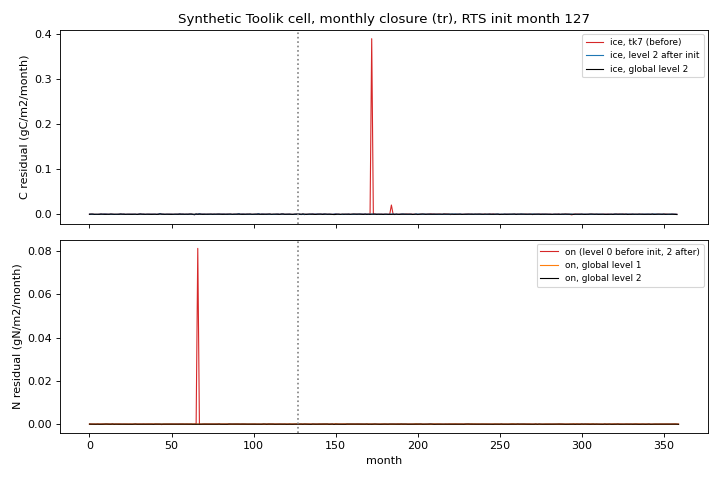

# `n_safetynet_conserve` level 2: exact soil accumulation (base model)

Branch `wetland/rts-merge`, Nov 17 2026. Base-model switch, **default 0 (legacy)**. It is bit-identical when off, and levels 0 and 1 are unchanged.

**Config (Elchin, Nov 17 2026: go-ahead):** `config/config.js` sets `"n_safetynet_conserve": 2`. So runs from the repo config, and the RTS test scripts that derive from it (`tests/rts/rtslib.py`: port_check, port_demo10, port_split), use level 2. The C++ default (`ModelData`) stays 0, and configs without the key are unchanged. The regression cases carry their own configs (level 1), so their 56/56 identity check is unaffected.

## Problem
The soil integrator state `y[]` is `float`. Each accepted RKF step does `pool += dt*f` in float. A large pool such as SOMCR (about 1e3 g/m2, float spacing about 1.2e-4) drops every increment smaller than half its spacing. The small accumulators (RH per pool, NMIN, NIMMOB, ...) still book the same increment. As long as steps are large this is harmless. When the step size collapses (2^-10 … 2^-20, in the months that end in a safety-net give-up), it becomes a systematic, one-signed gain: the pools keep C and N whose loss the fluxes report.

- **RTS ice case** (synthetic Toolik cell, yr 14 m 5, give-up at t0 = 0.729): with the TEMP `SN_DEBUG` dump at the give-up, `C0 + t0·litter − RH_acc` = 21950.728, while the state at t0 = 21951.118, so **+0.390 gC/m2** before t0. This is the whole 0.39 monthly C residual. Litter routing, floor export, `afterIntegration` and the safety-net delivery are exact.
- It is a **base** bug. The RTS only produces soils (post-slump) where the step collapses. The v5k note (C1 `soil_nmin_tol_fix`, TVC Nov 2012: +2.74 gC) is the same mechanism.
- N: same mechanism for ORGN/AVLN against the N flux accumulators (ice_snc 0.021 gN). The pre-slump base N leak (0.081 gN, also with RTS off) is the L1 mechanism (skipped (1 − t0) root N extraction), which level 1 already closes.

## Fix (`Integrator::adapt`, `Integrator::acceptStep`)
- `n_safetynet_conserve = 2` gives L1 plus this: in the **soil** `adapt()`, the state is also kept in double (`ystate_d`). Every accepted step adds the same float increment `dt*yprime` there and copies it back to `y[]`.
  - The `oldstate` save and reset at the give-up use the double copy too.
  - A step forced after a negative pool adds nothing (legacy: `dum4 == pstate`).
- Pools and accumulators then receive identical increments, so C and N are conserved to double round-off, plus one float rounding per pool at the end of the month.
- Vegetation integration is unchanged.
- A month with a single accepted step gives exactly the legacy result (a float sum rounded from double is the correctly rounded float sum). That is why the nonfeed HPC cases are bit-identical with level 2.
- `ModelData` accepts 0, 1 or 2 (3 or more is FATAL). Every L1 branch (`>= 1`) is unchanged.
- **RTS:** `thermokarst_safetynet_conserve` (default true) now sets `max(global, 2)` in a cell from its RTS initiation on. Before initiation, and in cells without an RTS, the global level applies unchanged.
- Refs: Higham 2002, *Accuracy and Stability of Numerical Algorithms*, ch. 4 (doi:10.1137/1.9780898718027); Kahan 1965 (doi:10.1145/363707.363723); L1 refs in Integrator.h.

## Closures (synthetic Toolik cell, monthly, tr; `port_check.py`)

| run | before (tk7) C / N | after (tk9c) C / N |
|---|---|---|
| on | 0.0018 / 0.081 | 0.0014 / 0.081 (N: pre-init base event, global 0) |
| ice | **0.389** / 0.081 | **0.0014** / 0.081 (C max is now a pre-init month) |
| ice_snc (global 1) | 0.36 / 0.021 | 0.0026 / 1.5e-4 |
| on_snc2 (global 2) | – | 0.00083 / 6.8e-5 |
| ice_snc2 (global 2) | – | 0.00068 / 7.1e-5 |
| off_snc2 (RTS off, global 2) | – | 0.00052 / – |
| on_fx (`soil_giveup_retry`, not enabled) | 0.080 / 0.0022 | 0.0014 / 8.1e-5 |

## Effect of level 2 on the regression cases (8 leg + 20 rbsmoke, level 2 vs the same case at its own setting, which is level 1 in all 28)
`tests/rts/port_snc2_reg.py`, `reg/snc2_cmp.json`; main stage, last year.
- **C closure** (closure.py, max |annual|): nfeed leg cases 0.0018–0.0052 → 0.0010–0.0037. Smoke cases are unchanged (their large residual is the fire terms, not counted by closure.py).
- **Monthly N residual** (output-based): leg nfeed 4e-5–4e-4 → 2–3e-5.
- **VEGC / GPP / SOC:**
  - Leg nfeed: within 0.005 %.
  - HPC nonfeed: bit-identical.
  - TVC nonfeed: 75-yr mean −0.01 %/−0.02 %; single years up to −0.8 % VEGC / −1.3 % GPP (TVC_Warming_nonfeed: 3–4 years > 0.1 %; trajectory divergence, not drift).
  - rbsmoke: VEGC and GPP within 0.09 % (E1onL mean −0.07 %); SOC within 0.001 %.

## Effect in the 10-cell Toolik case
Global level 2 (`off_snc2`), all 10 cells differ, compared at the last year:
- **vs level 0 (`off_auto`):** VEGC −2.5 … +0.8 %, GPP −12.9 … +11.9 %, SOC within 0.03 %.
- **vs level 1 (`off_snc`):** VEGC −1.9 … +1.5 %, GPP −8.1 … +11.9 %, SOC within 0.02 %. Means over the run are VEGC ≤ 0.9 % and GPP ≤ 3 %.

These cells are N-limited: yearly GPP follows the round-off path, while the stocks barely move.

RTS default (level 2 only after initiation): no-slump cells stay identical. See WORK_NOTES_rts.md §9.6.

## Unit tests (`tests/unit/test_snc2.cpp`, 5 cases; `test_fixes_v5m.cpp` updated: 2 is valid, 3 is FATAL)
- Legacy copy is bit-identical.
- Float absorption is demonstrated: a 1500 g pool with 1e5 steps of 7.6e-8 keeps everything, while the accumulator books 0.0076.
- Level 2 conserves this to 1.3e-4.
- A forced step after a negative pool adds nothing.
- The `tk_set_month_flags` level mapping is covered.
