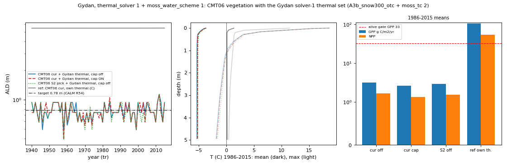
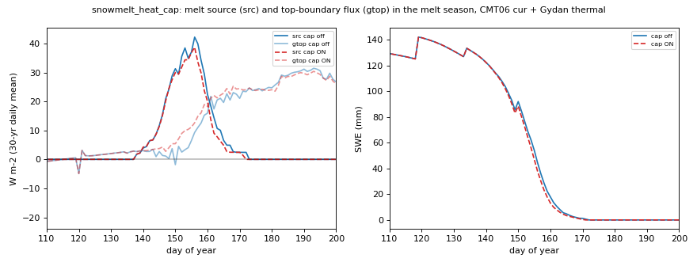

# WORK NOTES: snowmelt_heat_cap (thermal_solver 1)

Branch `moss/snowmelt-heat-cap` off `moss/rts-int-m2d` a3f2bda0 (worktree `~/tem-dev/moss-snowcap-wt`, calib-elchin).
Elchin, 2026-11-19: "Do both the melt-heat fix and the borrowed thermal set run". Local commit only, not pushed.

## 1. Why
Under thermal_solver 1, the radiation/SEB melt energy (`Soil_Env::enthMeltSource`) enters the solve as a heat source S[0] in the top snow cell.
In the Gydan CMT06 ts1 run E (pt159u), src was 1.468 W/m2 but the latent heat of the snow actually melted was only 1.196 W/m2.
The 0.27 W/m2 surplus fell on partial-melt days.
When S[0] is larger than what a thin top cell can melt, the cell melts out inside the solve and heats above 0 C.
Its heat then leaves through the Robin top boundary (cn 100 to tsurface) or conducts down, instead of melting the snow below.

## 2. What the switch does (`model_settings.snowmelt_heat_cap`, default false)
- **false (default):** legacy S[0] heat source. Bit-identical (section 4).
- **true (thermal_solver 1 only; FATAL with solver 0):** before the solve, the day's melt energy E is applied to the snow cells from the top down (`Soil_Env::enthApplyMeltDirect`).
  - Each cell with ice is first warmed to 0 C (cold content), then its ice melts (ice to liq, Lf per kg). The cell is then put back on its freezing curve at the same H (H-conserving equilibrate). The next cell gets the rest.
  - Emptied (zero-mass) cells are skipped.
  - The solve then runs with S[0] = 0.
  - Booked energy: src = mdir = mcc + Lf × mmelt goes into the column. Energy the pack cannot take (mret) is returned to the surface: it is not put into the column and not counted in src.
  - The daily closure res = dH − (gtop + gbot + src) is unchanged.
- energy_daily.csv gets the columns `mdir,mcc,mmelt,mret` only when the switch is on. With it off, the file is unchanged.
- Files changed: `include/ModelData.h`, `src/ModelData.cpp`, `include/Soil_Env.h`, `src/Soil_Env_enthalpy.cpp`, `src/Cohort.cpp`, `config/config.js` (comment), `tests/unit/test_snowmelt_heat_cap.cpp`.

## 3. Tests
- **`tests/unit/test_snowmelt_heat_cap.cpp`:** 6 cases.
  - Partial melt of a near-0 C pack: Lf × melted mass + cold content = the melt energy (1e-12). Nothing returned. Net snow melt after the solve agrees within 5 %.
  - Partial melt of a cold pack: cold content first, then melt; mdir + mret = E.
  - Melt-out: mret = E − cold content − Lf × ice, and it is kept out of src.
  - An emptied top cell is skipped.
  - Switch off gives the legacy S[0] path.
  - No snow: nothing is applied.
  - Every case checks the daily budget: |res| ≤ 1e-6 W/m2, water conserved, and dH = init + equil + gtop + gbot + src + res + clip.
- **Full unit suite:** 456/456 test cases pass. The same 8 known assertion failures (test_climate, test_richards_water_energy, test_seb, test_stefan_water) also appear with the a3f2bda0 test binary (450/450 cases). Enthalpy suites plus snowmelt_heat_cap: 28/28 cases, 670/670 assertions.
- **`tests/regression/check_meltout_r1.sh`:** PASS. Enth_resday_max 5.65e-8 W/m2, 0 fallback failures.

## 4. Bit-identity (switch off)
r1 regression case (TVC_Warming_nfeed, thermal_solver 1, spin000 + main sc 75 yr), new binary vs the `dvmdostem_m2d_k` binary (a3f2bda0, md5 12bfcbaa…):
- `tests/regression/ident.py`: IDENTICAL, spin000 69 files and main 96 files. Every NetCDF variable is compared byte for byte, including restarts.
- energy_daily.csv md5 is identical: main a50b893b…, spin000 3108172f….
- This holds for both builds, v1 57714a8b… and the final v2 fefa5558….

## 5. Gydan: CMT06 vegetation with the Gydan solver-1 thermal set
Setup:
- **Thermal set:** copied read-only from the P4 T1 case (`~/cal-gydan/rmf2_moss/p4/runs/T1_e2000_rmf0.05_k0.5`, A3b_snow300_otc → A3c_otc_sd300).
  - CMT70 values written into the CMT06 rows of scratch parameter copies (`~/tem-dev/moss-work/m2d/snowcap/params/`, record `params_record.json`): snwdenmax 300, snwdennew 175, tcsolid(m/f/h) 0.10/0.08/0.08, nfactor(s/w) 1.5/1.0.
  - model_settings: org_tc_scheme 1 and the 5 S21H coefficients, moss_tc_scheme 2.
- **Kept from CMT06:** vegetation, C/N, hydraulic and dimground structure rows. The repo's `parameters/` is never edited.
- **Run settings:** thermal_solver 1, moss_water_scheme 1. Two-stage, hist 76 / sc 30, baseline mode, fresh dirs, no restart reuse.

1986–2015 means (sc = 30-yr baseline stage):

| | cur off | cur cap ON | S2 pick off | ref: CMT06 own thermal (C) | target |
|---|---|---|---|---|---|
| ALD (m) | 0.791 | 0.782 | 0.769 | 5.48 (talik) | 0.78 |
| ALD 2006–2015 / sc (m) | 0.82 / 1.38 | 0.81 / 1.38 | 0.81 / 1.35 | 5.48 / 5.48 | |
| T at 1 / 3 m (C) | −5.27 / −5.27 | −5.20 / −5.20 | −5.11 / −5.12 | +0.14 / +0.15 | |
| ice (kg/m2) | 1906 | 1908 | 1914 | 38 | |
| GPP / NPP (g C/m2/yr) | 3.2 / 1.7 | 2.7 / 1.4 | 2.9 / 1.5 | 107 / 55 | GPP ≥ 33 (alive gate) |
| LAI | 0.016 | 0.014 | 0.014 | 0.52 | ≥ 0.10 |
| water closure tr / sc (%P) | 0.007 / −0.75 | −0.002 / −0.60 | 0.001 / 0.21 | 0.004 / 0.03 | |
| energy (enthalpy) resday max tr (W/m2) | 1.4e-8 | 1.4e-8 | 1.3e-8 | 1.1e-8 | ≤ 1e-6 |
| C closure tr / sc (g/m2/yr) | 0.005 / 0.007 | 0.005 / 0.009 | 0.006 / 0.008 | −0.0003 / −0.002 | |
| closure gate tr / sc | PASS / PASS | PASS / PASS | PASS / PASS | PASS / PASS | |
| safety-net rows (all stages) | 4668 | 4711 | 4723 | 4766 | |

Findings:
- **Thermal:** the borrowed set brings ALD onto the CALM target (0.77–0.79 m) with permafrost at −5 C, so the 5.5 m talik came from the CMT06 thermal set.
- **Vegetation:** CMT06 vegetation does not survive under it. GPP is 3 g/m2/yr and LAI 0.015, against 107 / 0.52 with the CMT06 thermal set. That fails the GPP ≥ 33 and LAI ≥ 0.10 alive gate, for both the current set and the S2 pick. The CMT06 C/N calibration depends on its own warm soil.

## 6. Effect of the cap (CMT06 cur + Gydan thermal)

- **Melt source:** src 1.624 → 1.457 W/m2, with mdir = mcc 0.039 + Lf × mmelt 1.419 W/m2 (134 mm/yr) and mret = 0. The cap never had to return energy at this site.
- **Top boundary:** gtop −0.354 → −0.210 W/m2. With the cap off, the melt-season gtop dips while src peaks: the surplus source heat left through the top boundary rather than heating the soil.
- **Thaw and snow:** ALD −0.009 m, soil 1–3 m +0.07 C, melt-out 0.7 days earlier, ice +2 kg/m2. GPP 3.2 → 2.7, both far below the alive gate.
- **Conclusion:** the cap removes a non-physical heat path and books melt energy exactly. Its effect on Gydan thermal state is small, so it does not explain the CMT06 talik (pt159u H3 confirmed secondary).

## 7. Runs and core-h (Gydan ledger ~/cal-gydan/rmf2_moss/p4/logs/ledger.json 6.51142 → 6.84644 of 7.0, backup .bak_pt160u_20261120T022507)
| run | core-h |
|---|---|
| r1_m2dk, r1_new_off, r1_v2_off (identity) | 0.04167 |
| meltout_r1_new (check_meltout_r1.sh) | 0.01278 |
| G06cur_A3b_off | 0.09167 |
| G06S2_A3b_off | 0.09167 |
| G06cur_A3b_cap | 0.09723 |
| total | 0.33502 (cap 0.35) |

Scripts and results: `~/tem-dev/moss-work/m2d/snowcap/{caprun.py, mkparams.py, capan.py, capplot.py, results_cap.json, ledger_cap.json}`.
