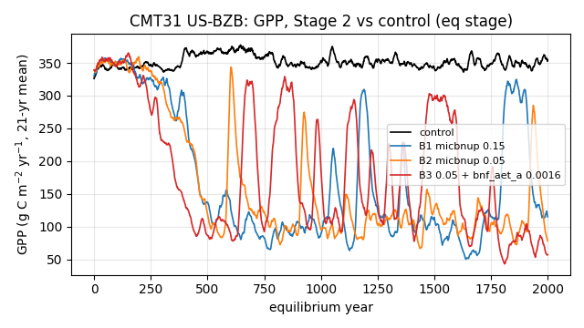
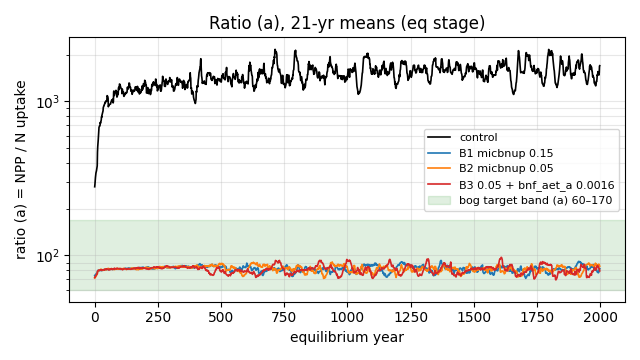
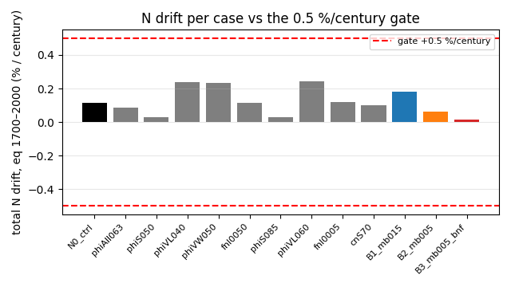
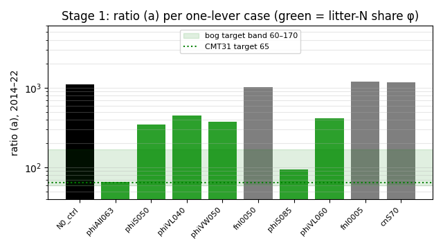

# Work notes: wetland + deep C integration and the CMT31 N-uptake study

Branch `wetland/frozen-liq-cap`, tip `a327e57d`, Nov 12 2026. These notes say what was merged, which default-off switches
the branch adds or carries, how each was tested, and what is still open. All new options are **off by default**; with
them off, results are bit-identical to the previous step (gates below). Calibrated parameter sets were never edited in
place. Every run used copied parameter directories.

## 1. Purpose

The goal is a single fork branch that can drive the **4×4 km HPC simulation**. It combines:
- the production v5q physics and N fixes (`v5q-gpp-fleaf2`, `29f26b5d`);
- upstream master;
- the upstream deep soil C burial scheme (`deep_carbon_v2`);
- the upstream wetland / CH4 / run-on hydrology work (`regional_wetland_deepc`);
- the enthalpy thermal solver, keeping every production switch reproducible.

Reburn (process-based fire) and RTS come after this (§6).

Structural options (deep C, wetland, enthalpy solver) change soil C/N, layering and thermal state. They invalidate the T125/S23
(and S22/S21H) calibration and the existing restarts for production use. A re-spin and recalibration are needed before
production 4×4 km runs.

## 2. Merged phases and commits

| phase | commits / tags | what it does | gate |
|---|---|---|---|
| 1 master sync | `8d224ec7` (tag `phase1-master-sync`) | merges upstream master `c0fa75cb` onto `v5q-gpp-fleaf2` `29f26b5d`. No `src/` changes; brings upstream `parameters/` changes (CMT13–15 added, CMT65/66/70/71 changed) through the merge. | regression 8/8 bit-identical vs v5q base |
| 2a deep C history | `527a3046` | merges `deep_carbon_v2` `7f607479` as history only (`Soil_Bgc.cpp` kept as ours) | no behaviour change |
| 2b deep C switch | `f8f8268f` (tag `phase2-deepc`) | `model_settings.deep_carbon` (binary default 1 per Elchin; 0 = v5q burial path) with `Soil_Bgc::deepCarbonTransfer()`; `tests/unit/test_deepc.cpp` | `deep_carbon 0` 8/8 bit-identical; `1` closes C/N within the harness tolerances |
| 2b energy diagnostic | `517ab675` (tag `phase2b-energy`), `1dca209e` (tag `phase2c-harness`), `a6c718d4` (tag `phase2d-diagfix`) | output-only `model_settings.energy_diag` (`energy_daily.csv`) and the harness energy check (FAIL at a 3 W/m² run mean) | outputs bit-identical with the diagnostic on or off |
| enthalpy solver | tags `stageB-solver`, `stageC-integration`, `stageC2`; `5d783561` (EnvData one-past-end read fix) | `model_settings.thermal_solver` (0 = legacy default; 1 = enthalpy, NCZ/Katzenelson), `thermal_sfcc`, `thermal_substeps` (default 4) and related fixes; snow (`snow_scheme`, `snow_empty_cleanup`) and Richards (`richards_dt_fix`) fixes are documented per stage in `docs/dev-stages/` (`2bc763ea`) | `thermal_solver 0` md5-identical; `1` full-day closure ≤ 3.7e-8 W/m² |
| 3 wetland | merge `fd0e8096` (upstream `regional_wetland_deepc` `b09d5844`) + `0cf95eca`, `ce3af6cd`, `9cd56373`, `f1a60adc`, `006b6f8f`, `b5d9a2cc`, `e1aa6332`, `a3649abc`, `df9edce9` | `model_settings.wetland` block (default off; per-cohort flags replace the hard-coded CMT lists), run-on water-loss fix, `interception_scheme`, `eq_co2_mode`, optional `ch4` restart variable, flexible 18/35/41 + 33/34 parameter-block parser, CH4 3-D output fix | wetland off 16/16 bit-identical to `2bc763ea`, both solvers |
| 3 v2 | `9ce99ade` … `46dc658d` | `runon_energy_mode`, `ch4_conserve`, `ch4_daily` (all default 0) | wetland off 16/16 bit-identical |
| 3 output | `236d1f52` | `reco_ch4ox_output` (output only, default 0): CH4 oxidation CO2 (1), plus efflux (2), in RH/RECO/NEE | regV5 16/16 bit-identical |
| 3 hydrology | `f4086138`, `fd8e98a1`, `21c6d9e3` | `wetland.keep_expelled_water` (default 0): expelled water is kept in poorly drained wetland cohorts | regV6 16/16 bit-identical |
| 3 thermal/water | `a327e57d` | `frozen_layer_liq_cap` (default 0): caps liquid in partly frozen layers at porosity minus ice volume | regV7 16/16 identical; unit suite 386/386 (8 known xfail assertions) |

## 3. N-conservation switches carried by this branch (all default 0 = legacy, bit-identical)

These come from the v5m/v5q production line and are ancestors of `a327e57d`. Each is an integer under `model_settings`;
any value other than 0/1 is FATAL. Enable one by adding it to `config.js`, e.g. `"model_settings": {"n_safetynet_conserve": 1}`.

| key | commit | what 1 does | unit tests |
|---|---|---|---|
| `n_leach_fix` | `46e425ab` | soil AVLN pools lose exactly the booked NLOST (legacy removed a different amount, and N closure failed once `fnloss > 0`) | `test_leach_v5q.cpp` (7 cases) |
| `n_leach_curn_fix` | `99ae7e0c` | the drainage part of the leaching rate uses the current (integrator-state) AVLN of the drainage zone instead of the month-start AVLN; **requires `n_leach_fix = 1`** | `test_leachcurn_v5q.cpp` (7) |
| `n_safetynet_conserve` | `23e8077b` | when the soil integrator gives up and the safety net delivers the rest of the month's inputs, it also debits the root N extraction the plants already took (legacy creates that N); shortfalls are carried as `n_debt` | `test_fixes_v5m.cpp` (8) |
| `soil_negpool_fix` | `13cf9f04` | no negative soil N pools from the legacy AVLN clamp; negatives are healed at month start and the removed N is booked as debt | `test_negpool_v5q.cpp` (7) |
| `layer_n_remap_fix` | `982d79a3` | layer ORGN/AVLN follow the C pools through the dynamic soil-layer split/combine/remap; it also fixes the legacy `avln =+` typo in the layer combine, which is kept on the 0 path for bit-identity | `test_layern_v5q.cpp` (9) |
| `layer_bookkeep_fix` | `0c11be6c` | four further dynamic-layer C/N bookkeeping fixes; **requires `layer_n_remap_fix = 1`**. Not covered: the fire path | `test_layerbk_v5q.cpp` (9) |

BNF (`c86304c7`, `128241d6`; `include/Bnf.h`; `test_bnf_v5q.cpp`, 14 cases) is also config-only: `bnf_scheme` 0 off / 1 PRO /
2 AET / 3 CONST, with optional `bnf_pro_c`, `bnf_pro_d`, **`bnf_aet_a`** (default 0.00234 gN/mm/m², must be ≥ 0), `bnf_aet_b`,
`bnf_const`, `bnf_asym`, `bnf_avln_cap` and `bnf_to_plant`. `bnf_scheme > 0` requires `n_rootless_fix = 2`. Setting any of these
keys while `bnf_scheme = 0` is FATAL. On the v5q-bnf branch, switch-off regression was bit-identical on 8/8 cases.

### What the W5 US-BZB (CMT31) runs showed about these switches
- **Legacy safety net creates N.** In a 2000-yr equilibrium, total N rose about 30 g/m² once AVLN ≈ 0. The cause is `Integrator::applySoilSafetyNet()`: without `n_safetynet_conserve`, the skipped root extraction is never removed from the soil. Yearly N gain tracks safety-net events (about 0.009 g per event). It does not line up with layer re-splits.
- **`n_safetynet_conserve = 1` stops the N gain**, with carried debt ≈ 0. But plants then run down faster after eq year 1000: real N starvation, with no N input.
- **Adding BNF (`bnf_scheme = 2`)** stops the decline: eq GPP is about 350 through year 2000, and N closes to ΣBNF. With `fnloss = 0`, most fixed N accumulates as AVLN, so a loss path (`n_leach_fix 1` + `fnloss > 0`) or a lower `bnf_aet_a` is needed to balance it.

## 4. CMT31 (Boreal Bog, US-BZB) N-uptake recalibration: Stages 0–2, closed as a limitation

**Problem.** In the W5b US-BZB reference, CMT31 vegetation N uptake is about 0.1–0.2 g N m⁻² yr⁻¹. The NPP/uptake ratio (a) is about 1100–1600, against a target of about 65.

**Setup.**
- Binary from `a327e57d`.
- Switches: `frozen_layer_liq_cap`, `nonvasc_trans_withdraw`, `keep_expelled_water`; `bnf_scheme 2`, `n_rootless_fix 2`, `n_safetynet_conserve 1`, `n_nonvasc_extract 1`. Off: `n_leach_curn_fix`, `soil_negpool_fix` and the layer fixes.
- Run: `-p 100 -e 2000 -s 250 -t 123`, one cell, copied parameter directories only.
- Ratio definitions: (a) = NPP / (NUPTAKEST + NUPTAKELAB); (b) = NPP / (uptake + NRESORB).

| stage | cases | result |
|---|---|---|
| 0 | identity check + control `N0_ctrl` (bnfaet + `n_leach_fix 1` + `fnloss 0.02`) | identity PASS (124 NetCDF variables plus the daily files bit-identical over 100 eq years). Control 2014–22: GPP 472, ALD 2.19 m, AVLN 0.16, uptake 0.18, (a) 1110, (b) 45.7; eq N drift 0.116 % per century |
| 1 | 9 one-lever cases (litter-N share φ = nfall/cfall by PFT/part, fnloss, Sphagnum C:N) | only φ moves (a): φ 0.63 all parts → 66; φ 0.85 Sphagnum leaf → 94. But every φ case fails health (643–8547 safety-net events vs an allowance of 15.5), and the high-φ equilibria collapse (GPP, moss), with talik in the warming transient. fnloss and C:N barely move (a) |
| 2 | φ 0.50 plus `micbnup` 0.15 / 0.05 (one also `bnf_aet_a 0.0016`) | the kit watchdog stopped all three in the transient at the 4.0 core-h cap; eq and spinup completed |

Stage 2 equilibrium years 1700–2000 (ratio of means; AVLN as the December value where output is monthly):

| case | GPP | NPP | AVLN | uptake | (a) | (b) | ALD (m) | N drift g/yr (% per century) | safety-net events 1700–2000 / whole eq |
|---|---|---|---|---|---|---|---|---|---|
| N0_ctrl | 349.7 | 149.2 | 0.176 | 0.094 | 1592 | 41.2 | 0.48 | 0.0485 (0.116) | 0 / 3 |
| B1 micbnup 0.15 | 194.5 | 82.1 | 0.206 | 1.002 | 82 | 41.1 | 1.15 | 0.0765 (0.181) | 1061 / 6756 |
| B2 micbnup 0.05 | 122.2 | 50.1 | 0.093 | 0.614 | 82 | 40.6 | 0.60 | 0.0266 (0.063) | 1078 / 6588 |
| B3 B2 + bnf_aet_a 0.0016 | 88.8 | 36.1 | 0.060 | 0.454 | 79 | 39.4 | 0.59 | 0.0056 (0.013) | 1103 / 6922 |

(An earlier reading gave B1–B3 AVLN as 2.08/0.99/0.64. Those were 12-month sums of a monthly stock; the values above are corrected.)

### Figures (made from the existing eq-stage yearly extract and the Stage 1 scores; no new runs)

*Fig. 1. Equilibrium-stage GPP (21-yr running mean) for the control and the three Stage 2 cases: φ 0.5 starves the equilibrium.*

*Fig. 2. Ratio (a) = NPP / N uptake (21-yr means, log scale): Stage 2 sits in the bog target band, and the control is about 20× above it.*

*Fig. 3. Total-N drift over eq years 1700–2000 (% per century) for every Stage 0–2 case. All are inside the ±0.5 % per century gate.*

*Fig. 4. Stage 1 ratio (a), 2014–22, per one-lever case (log scale). Only the litter-N share φ levers (green) move it toward the target.*

**Conclusion (Elchin, Nov 12 2026: Option A, documented as a limitation).**
- **Mechanism:**
  - CMT31 resorbs 96–98 % of tissue N at litterfall, so uptake only replaces litter N, and (a) ≈ tissue C:N / φ.
  - Microbial immobilization pins AVLN near 0.1–0.5 g/m².
  - Plant uptake is capped at 0.95·AVLN per PFT per month, taken from overlapping pools. When demand rises, AVLN goes negative, the soil integrator gives up, and the safety net skips that month's decomposition, which feeds the starvation. nmax is not the limit.
- **Result:** φ large enough to reach the target starves the equilibrium; lowering micbnup does not rescue it. The limit is structural, not a parameter value.
- **Working set:** `N0_ctrl`. It passes all hard gates under the restated drift gate (|ΔNtot| ≤ 0.5 % per century).
- **Do not use:** the Stage 1/2 φ or micbnup values.
- **Possible future work** (each needs approval): a shared in-month uptake limit across PFTs or uptake inside the soil integrator; a CMT31 soil C:N / `nmincnsoil` review; testing `soil_negpool_fix` together with those.

## 5. Known open issues
1. **Reburn not merged yet.** Then RTS. Plan: a single fire master switch (default off), `fire_process_wildfire` default false, an FRI = 0 guard (a SIGFPE exists in EQ), the C++20 build fix, and the N bookkeeping in the new burn path (`layer_bookkeep_fix` does not cover fire).
2. **CH4.**
   - Efflux about 5× high: with `ch4_conserve 1` and `runon_energy_mode 1` at US-BZB, efflux is 43.5 g C/yr against observed 9.40.
   - About 14 g C m⁻² yr⁻¹ is still unbooked in the CH4 budget: the component sums don't close.
   - Monthly/yearly CH4POOL output sums µmol/L concentrations but labels them g/m² (upstream output bug, unchanged).
3. **Solver-0 water spikes.** With the new wetland switches, the legacy thermal solver (0) shows one-day water spikes (e.g. qover 52,849 mm in one day). Solver 1 is clean. Not debugged.
4. **CMT06 (Betty Pingo) thermal gap.**
   - With run-on on, the CMT06 test cells lose all permafrost (ALD 5.43–5.50 m vs about 0.19 m with wetland off) in every mode and with both solvers.
   - The driver is the CMT06 summer `ponding_max` of 51.5 mm. A parameter copy with 4 mm gives 0.17–0.25 m.
   - The parameter decision is pending.
5. **US-BZB baseline.** The baseline is close to the talik threshold (ALD max 3.17 m vs 3.19 m). Carbon does not close with wetland CH4 on.
