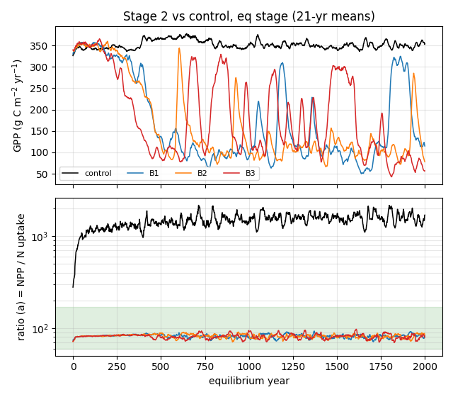
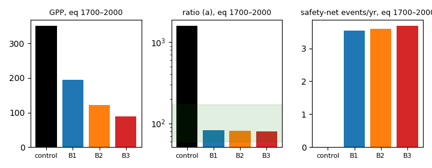

# Experiment: CMT31 (US-BZB) N-uptake recalibration, Stage 2 (Option B), **NOT ADOPTED**

> These parameter files are an archived experiment. They are **not** the branch's calibrated parameters and are
> **not used by default**. Repo `parameters/` is unchanged. Elchin's decision (Nov 12 2026) is **Option A**: CMT31 low N
> uptake is documented as a structural model limitation, and `N0_ctrl` stays the working set. Background, mechanism and
> Stages 0–1 are in [../../WORK_NOTES_wetland_N.md](../../WORK_NOTES_wetland_N.md) (§4).

## Contents
| path | what |
|---|---|
| `N0_ctrl/` | control (Stage 0): `params/` (single-CMT31 parameter set derived from US-BZB Q1), `config.js`, `case.json` |
| `N2_B1_mb015/`, `N2_B2_mb005/`, `N2_B3_mb005_bnf/` | Stage 2 cases: full `params/`, `config.js`, `case.json`, plus `params_vs_ctrl.diff` and `config_vs_ctrl.diff` (the only deltas from the control) |
| `specs/` | output spec files used (`usbzb_spec_Nup.csv` control; `usbzb_spec_Nup_m.csv` Stage 2, monthly) |
| `figures/` | plots from the existing eq-stage yearly extract (no new runs) |

Files were copied read-only from `~/tem-dev/wet-work/cmt31_nup/runs/<case>/` on calib-elchin. `config.js` paths are the
VM paths of the original runs. To reuse a case, point `parameter_dir`/`output_dir` at your own copies.

## What each case changed (vs `N0_ctrl`)
All three cases change only `cmt_calparbgc.txt`, plus one config key in B3:
- **litter-N share φ = nfall/cfall = 0.50 for all PFTs and parts** (rows `nfall(0..2)`; e.g. Sphagnum leaf nfall 0.0398 → 0.498);
- **`micbnup`** 0.294893 → **0.15 (B1)** or **0.05 (B2, B3)**;
- **B3 only:** `model_settings.bnf_aet_a` 0.00234 (default) → **0.0016** in `config.js`.

The control and all cases share the binary from `a327e57d` with `frozen_layer_liq_cap`, `nonvasc_trans_withdraw`,
`keep_expelled_water`, `bnf_scheme 2`, `n_rootless_fix 2`, `n_safetynet_conserve 1`, `n_nonvasc_extract 1`,
`n_leach_fix 1` and fnloss 0.02. Run `-p 100 -e 2000 -s 250 -t 123`, one cell. The kit's 4.0 core-h watchdog stopped all
three Stage 2 runs in the transient; eq and spinup completed, so the results below are equilibrium-stage only.

## Results: eq years 1700–2000 (corrected)
Ratio of means; AVLN is the December value of the monthly output. (a) = NPP/(NUPTAKEST+NUPTAKELAB); (b) = NPP/(uptake+NRESORB).

| case | GPP | NPP | AVLN | uptake | (a) | (b) | ALD (m) | N drift g/yr (% per century) | safety-net events 1700–2000 / whole eq |
|---|---|---|---|---|---|---|---|---|---|
| N0_ctrl | 349.7 | 149.2 | 0.176 | 0.094 | 1592 | 41.2 | 0.48 | 0.0485 (0.116) | 0 / 3 |
| B1 micbnup 0.15 | 194.5 | 82.1 | 0.206 | 1.002 | 82 | 41.1 | 1.15 | 0.0765 (0.181) | 1061 / 6756 |
| B2 micbnup 0.05 | 122.2 | 50.1 | 0.093 | 0.614 | 82 | 40.6 | 0.60 | 0.0266 (0.063) | 1078 / 6588 |
| B3 B2 + bnf_aet_a 0.0016 | 88.8 | 36.1 | 0.060 | 0.454 | 79 | 39.4 | 0.59 | 0.0056 (0.013) | 1103 / 6922 |

(An earlier reading gave B1–B3 AVLN as 2.08/0.99/0.64. Those were 12-month sums of a monthly stock; the values above are corrected.)

**Why not adopted.** Ratio (a) reaches the bog target band (about 80 vs target about 65), but only by starving the
equilibrium: GPP falls 44–75 % and the safety net fires about 3.5 times per year. Lowering `micbnup` does not rescue it.

*GPP (top) and ratio (a) (bottom, log scale) through the eq stage, 21-yr means: (a) hits the target only as GPP collapses.*

*Eq 1700–2000 means: GPP, ratio (a) (log scale, target band shaded) and safety-net events per year.*
