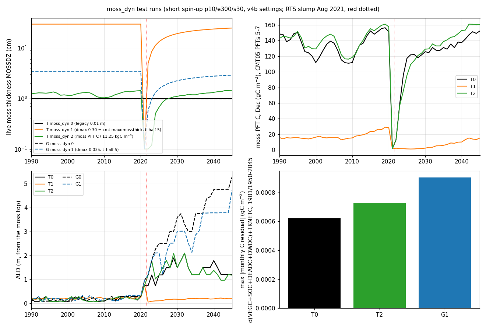
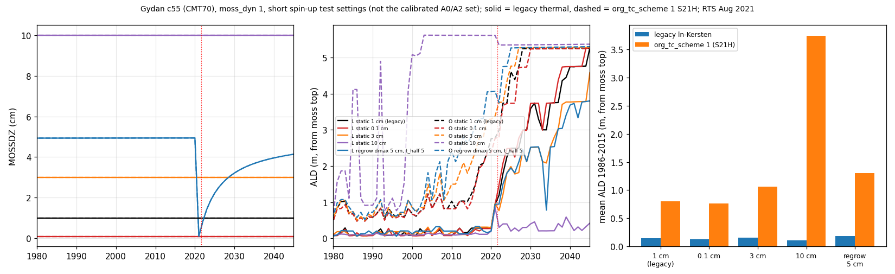
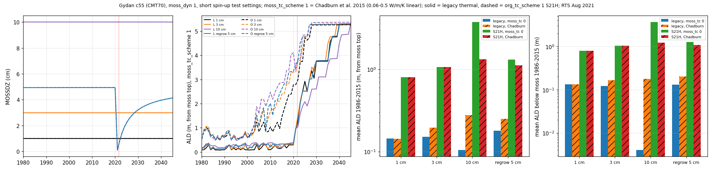
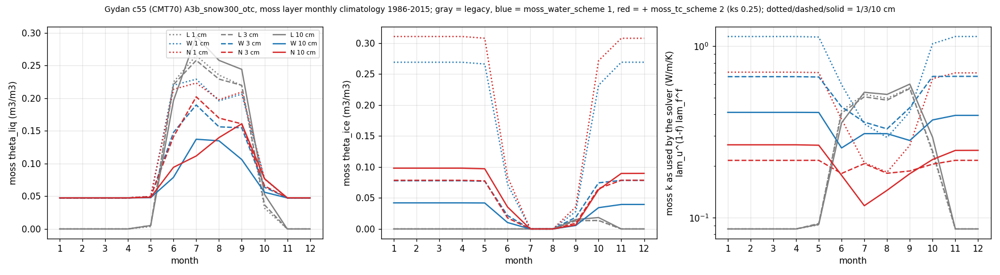
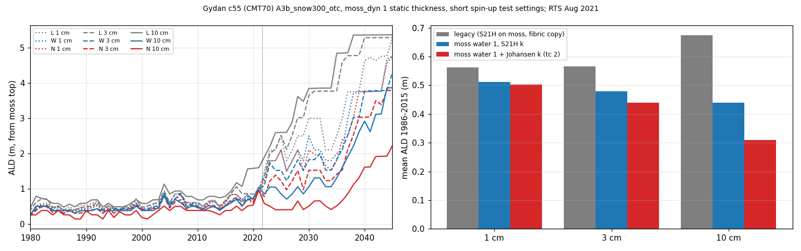
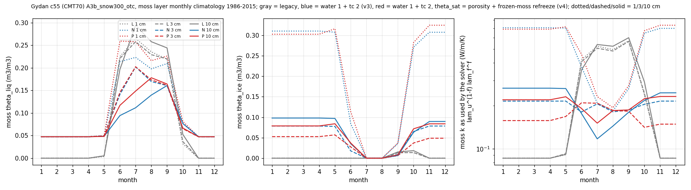
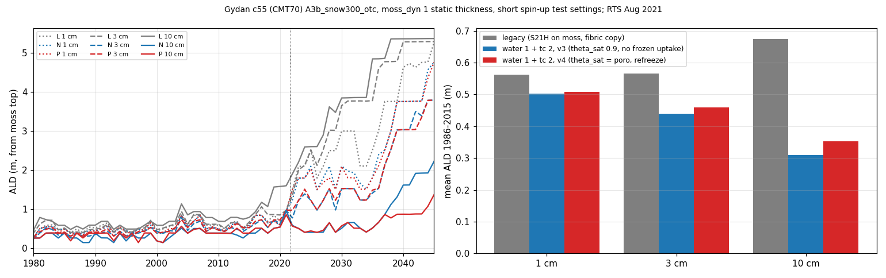

# Work notes: `moss_dyn`, a dynamic live-moss layer (default off)

Branch `moss/dyn-moss` (local only, not pushed), branched from 7b6a629a (`wetland/rts-merge-rmf`).
Worktree ~/tem-dev/moss-wt on calib-elchin. Scratch test area ~/tem-dev/moss-work.
Requested by Elchin Jafarov on 2026-11-18: a switch that alternates between the static 1 cm moss and dynamic moss modules,
with the dynamic one coupled to carbon. Background review: ~/tem-dev/notes/moss_regrowth_review.md.

## 1. What the legacy code does (7b6a629a)
- The live moss layer is one layer, hard-coded at 0.01 m (`Ground.cpp` initSnowSoilLayers, "This is wrong - FIX",
  and `redivideMossLayers`). It holds no C. `cmt_dimground` maxdmossthick is read but never used.
- Fire and RTS remove it (`adjustSoilAfterburn`: zero-C layers are dropped), and the same call re-creates a 0.01 m layer.
- The moss PFTs (`cmt_dimvegetation` nonvasculartype > 0) already carry live C in `bd[ip].m_vegs.c[]`, grow with their own
  NPP, drop litter into the first non-moss (fibric) layer (`Soil_Bgc`), and are burned (WildFire) or removed (Thermokarst,
  `thermokarst_veg_remove_frac`) with the existing C bookkeeping. Nothing links that C to the moss layer thickness.

## 2. The switch
`model_settings` keys (all optional; absent = legacy). Parsed in `include/MossDyn.h` (`mossdyn::parse`), FATAL on bad values.

| key | default | meaning |
|---|---|---|
| `moss_dyn` | 0 | 0 legacy static 0.01 m (bit-identical); 1 prescribed regrowth; 2 moss-PFT-carbon coupled |
| `moss_dmax` | -1 | maximum thickness (m); < 0 = DOS-TEM default by drainage class: 0.04 upland (well drained, 0) / 0.06 lowland (poorly drained, 1); section 6.1 |
| `moss_min_thick` | 0.001 | floor (m), in (0, 0.05]. The layer is never removed: `fstmossl` is dereferenced without guards (Soil_Bgc.cpp:508, Soil_Env.cpp:966/1046) |
| `moss_t_half` | 5 | mode 1 half-recovery time (yr), Yi et al. 2009; 0 = always dmax (static prescribed thickness) |
| `moss_bulkden` | 25 | mode 2 live-moss dry bulk density (kg/m3) |
| `moss_cfrac` | 0.45 | mode 2 C fraction of moss dry mass (gC/g) |
| `moss_tc_scheme` | 0 | moss-layer conductivity, any `moss_dyn` mode: 0 legacy; 1 Chadburn et al. 2015 linear form (section 6.2) |
| `moss_tc_kdry`, `moss_tc_ksat` | 0.06, 0.5 | Chadburn 2015 dry / saturated moss conductivity (W/m/K), k_sat used only with `moss_tc_scheme` 1; k_dry with 1 and 2 |
| `moss_tc_ksolid` | 0.25 | `moss_tc_scheme` 2: moss/peat solids conductivity (W/m/K), Farouki 1981 organic matter (section 7.2) |
| `moss_water_scheme` | 0 | 0 legacy daily copy of the fibric liquid; 1 the moss keeps its own liquid + ice (section 7.1; needs `thermal_solver` 1) |
| `moss_bsw`, `moss_psisat`, `moss_thetasat` | 1, 0.12 m, -1 | `moss_water_scheme` 1 Brooks-Corey moss parameters (Beringer et al. 2001 via Chadburn et al. 2015); `moss_thetasat` -1 = layer porosity (section 8), or a value in (0, 1] |

- Mode 1: `d = clamp(dmax * t / (t + t_half), dmin, dmax)`, `t = cd.yrsdist` (years since fire/RTS; reset to 0 by both, already in
  the restart file). DOS-TEM form (Yi et al. 2009, doi:10.1029/2008JG000841; Jafarov et al. 2013 Eq. 1, doi:10.1088/1748-9326/8/3/035030).
  No carbon.
- Mode 2: `d = clamp(C_moss / (moss_bulkden * 1000 * moss_cfrac), dmin, dmax)`. `C_moss` = live C (all parts) of the PFTs with
  nonvasculartype > 0 and vegcov > 0, in gC/m2 ground. With the defaults 112.5 gC/m2 = 1 cm. Same idea as ORC-HL-VEG (Druel et al. 2017,
  doi:10.5194/gmd-10-4693-2017: h = biomass / density); moss bulk density range from O'Donnell et al. 2009 (doi:10.1097/SS.0b013e3181c4a7f8).
  A CMT with no nonvascular PFT (e.g. CMT70) keeps the legacy layer, with one stderr line per cohort.
- When: every January in `Cohort::updateMonthly_DIMgrd` (independent of the DSL switch), and right after a fire
  (`updateMonthly_Fir`, after `adjustSoilAfterburn`) or an RTS removal (`updateMonthly_Thermokarst`, before the RTS water
  accounting). Mode 1 uses t = 0 at a removal; mode 2 uses the post-removal moss PFT C.
- How: `Ground::setMossThickness(dz)` changes the dz of the single moss layer, keeps its volumetric liquid/ice and temperature,
  shifts the fronts, re-derives the layer properties and the z of the layers below. Skipped when |change| < 1e-12 m.
  Enthalpy changes are booked by the existing solver-1 windows (`enth_bk_layer` for January, `enth_bk_fire` for fire/RTS).
  The moss water change is summed in `Ground::moss_dz_water_mm` (diagnostic only; the legacy daily copy of fibric water into
  the moss layer, Soil_Env.cpp:1049-1056, overwrites moss liquid anyway).

### Why this coupling (mode 2)
I looked for the cleanest carbon link. The moss PFTs already are a closed C pool with NPP, litterfall to the fibric layer and
disturbance losses. Taking the thickness from them adds **no new C pool and no new C flux**, so the C budget cannot change by
construction. The alternatives were worse: (a) bring back the dead-moss C pool (`dmossc`, removed in 9c3ec516 because dead moss is
not separable from fibric) — a second home for the same C; (b) a separate live-moss C pool fed from moss NPP — double counts the
moss PFT C. The cost: mode 2 only works where a CMT has nonvascular PFTs (CMT05, 06, 07, 13, 31, ... yes; CMT70, 71, 65 no).

### Restart
No new restart fields are needed. The moss dz is saved in `DZsoil` (TYPEsoil 0) and rebuilt from it; mode 1 depends on `yrsdist`
and mode 2 on `vegc`, both already in the restart. Tested in 3.4.

## 3. Tests (all on calib-elchin, binary `dvmdostem_moss_v1`, md5 f9dffa63a0a6b040018f66083cbd38bc)
Test runs: one cell, two-stage RTS driver of the v4 bench (`run_rts_two_stage.py`), short spin-up p10 / e300 / s30, historical
(T 1901-2015, G 1950-2015), scenario 30 yr (2016-2045) with the bench RTS slump in Aug 2021. Settings = bench v4b (thermal_solver 1,
n_safetynet_conserve 2, thermokarst_regrow, rhmoistfrozen_override {"70": 0}). Sites: T = Toolik MAT (CMT05, moss PFTs 5-7),
G = Gydan c55 (CMT70). Parameters from a scratch copy of 7b6a629a parameters/. These are mechanics tests, not calibrated runs.

### 3.1 Unit tests (`tests/unit/test_moss_dyn.cpp`, 5 cases; 9 since section 6)
`make unittest`: 440/440 test cases pass (5 new, 1542 new assertions). The 8 failing assertions are the known pre-existing ones
(test_climate, test_richards_water_energy, test_seb, test_stefan_water; 2 each), unchanged from 7b6a629a.

### 3.2 Bit identity (moss_dyn absent / 0 vs the 7b6a629a binary, md5 1bb756b8…)
`tests/moss_dyn/identdir.py`: every variable of every NetCDF file (outputs and restarts of all stages; wall-clock `total_runtime` excluded).

| case | vs | result |
|---|---|---|
| T, keys absent | T, 7b6a629a binary | 486/486 variables, 62 files identical |
| T, `moss_dyn` 0 | same | 486/486 identical |
| T, `moss_dyn` 1, dmax 0.01, t_half 0 (equivalence) | same | 486/486 identical |
| G, keys absent | G, 7b6a629a binary | 486/486 identical |
| G, `moss_dyn` 2 (CMT70 fallback) | same | 486/486 identical; stderr "CMT70 has no nonvascular PFT ..." |

FATAL checks: `moss_dyn` 3, `moss_dyn` "1", `moss_min_thick` 0 all exit 1 with a FATAL message.

### 3.3 Carbon balance through the removal and regrowth
Monthly residual r = Δ(VEGC + SOC + DEADC + DWDC) + TKNETC over 1901/1950-2045 (TKNETC = NEE + RTS lateral export + RTS respiration
pulse − RTS regrow input), including the Aug 2021 slump (moss PFT C ~160 → 1.6 gC/m2 at T) and the regrowth.

| run | max abs r (gC/m2/month) | mean r |
|---|---|---|
| T mode 0 | 6.2e-4 | 1e-8 |
| T mode 1 | 7.8e-4 | 1e-6 |
| T mode 2 | 7.3e-4 | -1e-6 |
| G mode 0 | 7.8e-4 | -8e-7 |
| G mode 1 | 9.0e-4 | 1e-5 |

All at float round-off of the outputs. Mode 2 closes as well as legacy because it moves no carbon.

### 3.4 Restart round trip (`tests/moss_dyn/rcarry.py`), modes 1 and 2
For T1, T2 and G1, at the end of the historical run (restart-tr.nc, long undisturbed) and at the end of the scenario
(restart-sc.nc, 24 yr into the post-slump regrowth, yrsdist 25):
1. write: moss dz in memory at the restart time (MOSSDZ, Dec) == restart DZsoil[0];
2. read: a 2-yr run from that restart with moss_dyn 0 (nothing changes the thickness) has exactly that dz in every month;
3. state: a 2-yr run from that restart in the run's own mode gives, in its first January, exactly the mode formula evaluated on the
   restored yrsdist (mode 1) or moss PFT vegc (mode 2).

All 6 × 3 checks pass bit for bit (e.g. T2 restart-sc: 0.014260421413845486 m written and read; January target 0.014296891615125868 m
= formula). A split spin-up test (sp 60 vs sp 30 → restart → sp 30) is not usable as a bitwise check: legacy moss_dyn 0 already
differs in 29 of 63 restart variables (lai, vegc, soil T, toptA, prvltrfcnA, ...). That is pre-existing and not caused by this switch.

### 3.5 What the test runs show (Fig. 1)

- Mode 2 at T: 1.2-1.4 cm before the slump (moss PFT C 110-160 gC/m2), floor 0.1 cm for two years after it, back to ~1 cm by
  2027-2028 as the moss PFTs regrow. The thickness is set each January from the moss C of that moment, so it lags the moss C by up to a year. ALD after the slump is deeper than legacy in the first years (thinner moss).
- Mode 1 at T with the CMT05 parameter maxdmossthick (0.30 m) gives a 30 cm moss layer: it suppresses moss PFT C
  (16-28 vs ~140 gC/m2) and after the slump the regrowing moss (5 cm after 1 yr) holds ALD at 0.05-0.2 m. That value is the old
  dead-moss maximum, not a live-moss thickness (caveat 5.3).
- ALD in dvmdostem is measured from the top of the moss layer (Soil_Env.cpp:733-740), so a thicker moss adds its own thickness to ALD.

## 4. Gydan sensitivity: ALD vs moss thickness (8 cases + 1 control, `tests/moss_dyn/plot_sens.py`)
Gydan c55 (CMT70), mode 1, same short test settings as section 3 (not the calibrated A0/A2 set in ~/cal-gydan, so absolute
ALD is not comparable to the 0.78 m CALM target). Two thermal options: legacy ln-Kersten (L) and `org_tc_scheme` 1 with the
S21H values (O: kunf 0.27, kfrz 0.5134, dry 0.08571, thre_f 0.1795, thre_h 0.5638). Moss: static 0.1 / 3 / 10 cm (`moss_t_half` 0),
and regrowth to 5 cm with `moss_t_half` 5 (thinned to 0.1 cm by the Aug 2021 slump). Controls: L = G0 (legacy 1 cm), O = 1 cm.
ALD is from the moss top.

| thermal | moss | ALD 1986-2015 (m) | ALD below moss | ALD 2022-26 | ALD 2036-45 | max abs C resid |
|---|---|---|---|---|---|---|
| L | 1 cm (legacy) | 0.144 | 0.134 | 2.05 | 4.54 | 7.8e-4 |
| L | 0.1 cm | 0.127 | 0.126 | 2.16 | 4.71 | 6.8e-4 |
| L | 3 cm | 0.151 | 0.121 | 1.51 | 3.68 | 7.5e-4 |
| L | 10 cm | 0.104 | 0.004 | 0.32 | 0.34 | 6.6e-4 |
| L | regrow 5 cm | 0.180 | 0.131 | 1.61 | 3.42 | 7.2e-4 |
| O | 1 cm | 0.802 | 0.792 | 3.90 | 5.26 | 9.1e-4 |
| O | 0.1 cm | 0.763 | 0.762 | 3.54 | 5.25 | 6.5e-4 |
| O | 3 cm | 1.064 | 1.034 | 4.28 | 5.28 | 7.1e-4 |
| O | 10 cm | 3.748 | 3.648 | 5.35 | 5.36 | 6.5e-4 |
| O | regrow 5 cm | 1.306 | 1.257 | 4.76 | 5.30 | 7.1e-4 |

What it shows (test settings, so read the signs, not the numbers):
- **The sign of the moss effect depends on the moss thermal scheme.** Legacy: more moss = shallower thaw below the moss
  (0.134 → 0.121 → 0.004 m for 1 / 3 / 10 cm), the insulation Elchin expected; with 10 cm the thaw stays at ~0.3 m even after the slump.
  S21H: more moss = much deeper thaw (0.79 → 1.03 → 3.65 m). In Feb 2000 the 10 cm S21H moss is −2.8 °C at its centre and −0.9 °C
  just below (1 cm case: −2.3 / −2.1 °C), and the 1995-2004 mean soil T is +1.4 °C just below the moss and still +0.4 °C at 0.5 m, versus +0.2 °C and −1.4 °C at the same depths with 1 cm.
  So the S21H moss insulates in winter more than in summer, which warms the soil. The likely reason is the moss hydrology
  shortcut: the moss copies only the fibric layer's *liquid* water each day, so it is wet when thawed (summer Sr ≈ 0.28, above
  thre_f, k well above dry) and has little ice when frozen (k near the dry value). Real moss is the opposite (dry in summer, icy
  in winter: the thermal offset). The legacy ln-Kersten puts summer moss at k = tcdry because Sr < 1/e, so it insulates in summer.
- Removal and regrowth (regrow 5 cm): with legacy thermal, ALD 2022-26 is 1.6 m vs 2.0 m with the static 1 cm moss (the two also
  differ before the slump: 5 vs 1 cm). The slump itself (organic and mineral removal, excess ice) dominates both.
- C balance stays at round-off in every case.

## 5. Caveats and open points
1. Mode 2 needs nonvascular PFTs. CMT70 (Gydan) has none: its "Omoss" PFT is flagged nonvasculartype 0. Using mode 2 at Gydan
   would need a parameter change (flag the PFT as moss), which is a physics/parameter decision for Elchin.
2. Removal is only by fire or RTS. There is no imposed moss-only removal (e.g. a list of years), because in mode 2 that would have
   to move moss PFT C somewhere (litter or emission) and in mode 1 needs a new restart field. Can be added if wanted.
3. ~~`cmt_dimground` maxdmossthick as the dmax default~~ — replaced in section 6.1 by the DOS-TEM 0.04/0.06 m upland/lowland default.
4. Moss thermal properties: with the legacy ln-Kersten at the summer saturations of these sites the moss conductivity is
   ~tcdry 0.025 W/m/K, so each extra cm of moss is a strong summer insulator. With `org_tc_scheme` 1 the sign reverses (section 4).
5. Moss hydrology is unchanged: the moss copies the fibric layer's liquid water daily (no own wetting/drying, little winter ice).
   Before using dynamic moss for ALD work, the moss moisture (or a moss-specific conductivity, e.g. Chadburn 2015 linear form) needs a decision.
6. The moss water change on a thickness change is not routed to runoff; it is summed in `moss_dz_water_mm` only.

## 6. Task 2: DOS-TEM dmax default and Chadburn et al. 2015 moss conductivity (binary `dvmdostem_moss_v2`, md5 cf5c4142ed6e4765c030dab6d5031cd9)
Elchin: "Yes use the upland and lowland defaults. Use the one from chadburn et al." Moss-only removal: not implemented (undecided).
Omoss is not re-flagged (parameter change, not approved).

### 6.1 dmax default (modes 1 and 2 only; mode 0 never reads it)
`moss_dmax` < 0 (default) now means `mossdyn::default_dmax(cd.drainage_type)`: **0.04 m for drainage class 0 (well drained, upland)
and 0.06 m for class 1 (poorly drained, lowland)**; any other value is treated as upland. An explicit `moss_dmax` > 0 still overrides.
- Where it comes from: Jafarov et al. 2013 (ERL 8 035030, doi:10.1088/1748-9326/8/3/035030), sec. 2 after Eq. 1: DOS-TEM moss thickness
  `dmoss = dmoss,max * ysf/(ysf + yhalf)` (Yi et al. 2009b), yhalf = 5, and "for the upland and the lowland sites we assigned dmoss,max
  equal to 4 and 6 cm correspondingly, according to our observations" (also their Table 1, moss thickness 0.04 / 0.06 m). The PDF text
  extraction of the paper's Eq. 1 shows ysf/(ysf − yhalf); the + form (half of dmax at ysf = yhalf, as the text says) is implemented.
  Upland/lowland in the paper are two Interior Alaska sites; mapping them to the dvmdostem drainage class is my choice.
- In the code: `include/MossDyn.h` (`DMAX_UPLAND`, `DMAX_LOWLAND`, `default_dmax`), used in `Cohort::mossTargetThick`.
  The DOS-TEM values are not in this repo's history (the old `maxdmossthick` was the dead-moss maximum, CMT05 0.30 m).
- `cd.drainage_type` is read when the thickness is computed, so after an RTS with `thermokarst_post_drainage` 1 the regrowing moss
  targets the lowland 0.06 m. Seen in the runs: G (class 0) pre-RTS max 0.0395 m = 0.04·411/416; after the 2021 slump it regrows
  towards 0.06 (0.0497 m in 2045). T (class 1) reaches 0.0594 m before its slump.

### 6.2 `moss_tc_scheme` 1: Chadburn et al. 2015 moss conductivity
Source: Chadburn et al. 2015, GMD 8, 1493–1508, doi:10.5194/gmd-8-1493-2015, sec. 2.2.1 (read from the paper): moss saturated
conductivity 0.5 W m⁻¹ K⁻¹, dry 0.06 W m⁻¹ K⁻¹ (Soudzilovskaia et al. 2013, doi:10.1111/1365-2435.12127), and the conductivity is
found by linearly interpolating between the two with the moss moisture content.

Implemented (`SoilLayer::getUnfThermCond` and `getFrzThermCond`, first branch, moss layer only):

    k_moss = k_dry + (k_sat - k_dry) * S,   S = clamp((theta_liq + theta_ice) / porosity_moss, 0, 1)
    k_dry = moss_tc_kdry = 0.06, k_sat = moss_tc_ksat = 0.5 W/m/K; same formula for the frozen and unfrozen conductivity

- Applies only to the layer with `isMoss`. Fibric/humic/mineral layers keep their scheme. With `org_tc_scheme` 1 the moss layer
  uses Chadburn and the organic layers keep the S21H/Côté-Konrad form; with `org_tc_scheme` 0 the organic layers keep legacy Kersten.
- The Stefan front, the Crank-Nicolson solver (TemperatureUpdator) and the enthalpy solver all read these two functions, so both
  thermal solvers see it.
- Choices to confirm: (a) theta_sat = the dvmdostem moss porosity (CMT70 0.95), not the paper's θsat,moss = 0.9; (b) ice counts as
  moisture (the paper gives no frozen form; JULES applies the same k); (c) no moss fractional cover weighting (JULES weights by cover).
- Not implemented (moss hydrology, needs a decision): the paper's Eq. 1 sets moss moisture from the top-soil suction,
  Brooks-Corey with exponent −bmoss; bmoss = 1, so θmoss/θsat,moss = ψsat,moss/ψ, with ψsat,moss = 0.12 m, θsat,moss = 0.9 (Beringer et al. 2001). Here S uses the
  dvmdostem moss water, which is the daily copy of the fibric liquid water (caveat 5.5).

### 6.3 Tests (`tests/unit/test_moss_dyn.cpp`, now 9 cases; runs in `~/tem-dev/moss-work/runs`)
| test | result |
|---|---|
| unit tests, full suite | 444/444 cases pass; 8 failing assertions are the known pre-existing expected-fail ones (climate, richards_water_energy, seb, stefan_water) |
| new unit: `default_dmax` 0.04/0.06, regrowth at t_half and asymptote | pass |
| new unit: `moss_tc_scheme` parse/defaults/rejects (2, 0.5, true, kdry>ksat, kdry 0) and ModelData | pass |
| new unit: `chadburn_k` endpoints, mid-point 0.28, clamping | pass |
| new unit: SoilLayer moss k frozen/unfrozen = Chadburn under org_tc_scheme 0 and 1; non-moss layer unchanged | pass |
| bit identity, all new keys absent: T0c vs T0ref, G0c vs G0ref (7b6a629a binary) | 486/486 variables identical, 62 files each |
| bit identity vs 459686a8 code (mode 0): T0c vs T0, G0c vs G0 (`dvmdostem_moss_v1`; 459686a8 only adds docs to the v1 source 3d58d4c4) | 486/486 identical |
| explicit `moss_dyn` 0 + `moss_tc_scheme` 0: G0z vs G0ref | 486/486 identical |
| S21H control (org_tc_scheme 1, new keys absent): S_O_ctl_v2 vs S_O_ctl (v1) | 486/486 identical |
| switch has an effect: C_L_d01 vs G0 | 183/486 differ (expected) |
| C balance, all 14 new runs | max monthly residual ≤ 8.5e-4 gC/m² (round-off, same as before) |

### 6.4 Gydan sensitivity with Chadburn moss k (Fig. 3, `tests/moss_dyn/plot_sens_tc.py`)

Mean ALD 1986–2015 (m from moss top; below the moss in brackets). Same short spin-up test settings as section 4, mode 1, t_half 0
except regrow (dmax 0.05, t_half 5). moss_tc 0 runs are the section 4 runs.

| moss | legacy, moss_tc 0 | legacy, Chadburn | S21H, moss_tc 0 | S21H, Chadburn |
|---|---|---|---|---|
| 1 cm | 0.144 (0.134) | 0.143 (0.133) | 0.802 (0.792) | 0.803 (0.793) |
| 3 cm | 0.151 (0.121) | 0.196 (0.166) | 1.064 (1.034) | 1.063 (1.033) |
| 10 cm | 0.104 (0.004) | 0.276 (0.176) | 3.748 (3.648) | 1.319 (1.219) |
| regrow 5 cm | 0.180 (0.131) | 0.249 (0.200) | 1.306 (1.257) | 1.119 (1.070) |

- **Key question — does thicker moss now make ALD shallower under S21H? No.** With Chadburn the S21H 10 cm runaway is cut from
  3.75 to 1.32 m, but ALD still deepens with moss thickness (0.80 → 1.06 → 1.32 m for 1/3/10 cm). Under legacy thermal Chadburn makes
  thicker moss deepen ALD too (0.14 → 0.20 → 0.28 m), because legacy moss k was ~tcdry 0.025 W/m/K (a strong insulator) and Chadburn
  raises it to ~0.17.
- Why (from `tests/moss_dyn/moss_wc.py`, monthly moss layer 1986–2015): the moss liquid water in thawed months is 0.22–0.26 m³/m³
  (S ≈ 0.23–0.27 of porosity 0.95), so Chadburn k ≈ 0.16–0.18 W/m/K in summer; frozen-month liquid is ~0.005 and the ice is the
  frozen summer water, so the winter k is about the same. Same k in both seasons means no thermal offset, so thick moss insulates
  summer and winter alike and the winter effect wins (as in section 4). Moss that is drier in summer and icier in winter (the
  paper's Eq. 1 hydrology, or wetter winter moss) is what would make thick moss cool the ground.
- 2022–2026 / 2036–2045 ALD after the slump: 2.0–4.5 / 4.5–5.4 m; the slump dominates (see the JSON next to the figure).

### 6.5 Open questions for Elchin
1. Implement Chadburn Eq. 1 moss moisture (from top-soil suction; bmoss 1, ψsat 0.12 m, θsat 0.9)? It changes moss hydrology.
2. θsat for S: moss porosity 0.95 (now) or the paper's 0.9?
3. Count ice in S (now yes)?
4. JULES weights moss properties by moss cover; dvmdostem has no moss cover here. Leave out?
5. After an RTS that switches the cohort to poorly drained, the default dmax becomes 0.06 m. Keep, or use the pre-disturbance class?

## 7. Task 4: the moss layer's own water and ice, and a Johansen/Farouki moss conductivity (binary `dvmdostem_moss_v3`, md5 a3da783f0079d56fcfe6ad2e1c63ff14)
Elchin (2026-11-18), on the three questions of the conductivity analysis: "it's own" (the moss gets its own wetting and
freezing, Chadburn et al. 2015 moss moisture, not the fibric ice); "solid conductivity grab from literature"; "yes, stop
applying s21h once new scheme is in."

Why: in every legacy Gydan run the moss layer held **no water and no ice in winter** (December restarts: liquid 0, ice 0), so its
frozen conductivity was the dry value whatever the scheme. The legacy moss water is set only by the daily copy `liq = dz (1 - frozenfrac) theta_liq(fibric)`
(Soil_Env.cpp, end of `updateDailySM`), which never writes ice. (The exact step that loses the little ice formed at freeze-up was not traced.) The formulas themselves already use liquid and ice, and the enthalpy
solver already blends thawed and frozen conductivity as `lam_u^(1-f) lam_f^f`, f = ice / (liquid + ice) (EnthalpySolver.cpp:113-119),
i.e. the GIPL form of Nicolsky et al. 2007 Eq. 6 (doi:10.5194/tc-1-41-2007) that Jafarov et al. 2012 (doi:10.5194/tc-6-613-2012) use.

### 7.1 `moss_water_scheme` 1 (Soil_Env::mossWaterStep, mossdyn::water_step)
The legacy copy is switched off and the moss keeps its liquid and ice. Once a day, inside `updateDailySM` just before Richards
(infiltration and soil evaporation in mm/day; nothing happens while the moss is fully frozen):
1. **wetting**: the moss takes infiltration (rain/throughfall + snow melt + puddle) up to `moss_thetasat` (0.9, capped at porosity)
   minus its ice;
2. **drainage**: liquid above the Chadburn et al. 2015 Eq. 1 equilibrium goes on to the soil infiltration (Richards, or the
   frozen-ground branch / puddle):
   `theta_eq = theta_sat,moss (psi / psi_sat,moss)^(-1/b_moss)`, psi = suction of the top soil (fibric) layer
   (`SoilLayer::getMatricPotential`), Brooks-Corey with Beringer et al. 2001 moss values b = 1, psi_sat = 0.12 m, theta_sat = 0.9.
   While the top soil layer is frozen, theta_eq = theta_sat (the moss can hold water over frozen ground). The residual
   (`minliq` = 0.05 porosity) does not drain;
3. **capillary rise**: below theta_eq the moss is refilled from the thawed top soil layer (its liquid above `minliq`) — the
   same equilibrium seen from below, so moss and soil share the suction as in Chadburn's Eq. 1;
4. **evaporation**: soil evaporation is taken from the moss liquid first (above `minliq`); the rest from the soil as before.

Freezing and thawing of the moss water are done by the enthalpy solver (the moss is an ordinary SOIL cell there), so the moss now
carries ice through the winter. The enthalpy of every kg moved (in at the infiltration enthalpy, between layers at the source
temperature, out with the ET) is booked by the existing water-window remap (`enthRemapWater`), so the scheme needs `thermal_solver` 1
(FATAL otherwise). With moss_dyn the thickening keeps the moss water mass (new moss is dry); thinning (fire/RTS) removes water
with the removed moss (summed in `moss_dz_water_mm`).

Chadburn's JULES moss is a diagnostic layer (θ from the suction of the top soil layer every step). Here it is prognostic (it can
be wetter after rain or drier after evaporation for a day) and relaxes to that equilibrium daily through steps 2-3, so mass closes.

### 7.2 `moss_tc_scheme` 2 (mossdyn::johansen_k, SoilLayer::getUnfThermCond / getFrzThermCond)
    k_sat,thawed = ks^(1-eta) k_liq^eta     k_sat,frozen = ks^(1-eta) k_ice^eta     (eta = moss porosity, 0.95 for CMT70)
    k = Ke k_sat + (1 - Ke) k_dry,   Sr = (theta_liq + theta_ice)/eta
    Ke = max(0, log10 Sr + 1) thawed,  Ke = Sr frozen         (Johansen 1975; CLM / Lawrence & Slater 2008)
    the enthalpy solver uses lam_u^(1-f) lam_f^f with f = ice / (liq + ice)
- k_liq = TCLIQ 0.6, k_ice = TCICE 2.29 (physicalconst.h, same as the other layers), k_dry = `moss_tc_kdry` 0.06 (Chadburn et al.
  2015 / Soudzilovskaia et al. 2013 dry moss).
- **ks = `moss_tc_ksolid` = 0.25 W/m/K**: thermal conductivity of organic-matter solids from Farouki (1981, CRREL Monograph 81-1,
  doi:10.21236/ADA111734), the value used for organic soil by Lawrence & Slater (2008, Clim. Dyn. 30, 145-160,
  doi:10.1007/s00382-007-0278-1) and CLM5 (Tech. Note eq. 2.6.80: lambda_s,om = 0.25 W m-1 K-1, Farouki 1981; read 2026-11-18).
  It is a model_settings key; `parameters/` is not changed. (The CMT70 `tcsolid` of moss is 0.1.)
- Saturated end members for eta 0.95: thawed 0.55, frozen 1.96 W/m/K, ratio (k_ice/k_liq)^eta = 3.6 (GIPL/Nicolsky).
- Like scheme 1 this branch comes before the `org_tc_scheme` branch, so **S21H is not applied to the moss layer** with scheme 2;
  fibric and humic keep S21H (unit test). With all switches off the code path is unchanged.

### 7.3 Tests
| test | result |
|---|---|
| unit tests, full suite | 449/449 cases pass (5 new); the 8 failing assertions are the known pre-existing ones |
| new: parse/defaults/rejection of `moss_water_scheme`, `moss_tc_scheme` 2, `moss_tc_ksolid`, `moss_bsw/psisat/thetasat` | pass |
| new: `theta_eq` (Eq. 1) values; `water_step` mass balance over 648 state combinations (|residual| < 1e-12 kg/m2) and limits | pass |
| new: `johansen_k` saturated end members, ratio, dry, Kersten; SoilLayer: moss uses scheme 2 and not S21H, fibric keeps S21H | pass |
| bit identity, all new switches off (`dvmdostem_moss_v3` vs `dvmdostem_moss_v2` at 22ad8d35): T0f vs T0c, G0f vs G0c | 486/486 identical |
| bit identity vs 7b6a629a: T0f vs T0ref, G0f vs G0ref | 486/486 identical |
| `moss_tc_scheme` 1 unchanged (C_O_d03_v3 vs C_O_d03) | 486/486 identical |
| moss water closure (daily, `moss_daily.csv` resid, all stages, 9 runs) | max 1.5e-14 kg/m2 |
| energy closure (`energy_daily.csv`, all stages, 9 runs) | max abs resday 0.0057 J/m2/day (6.6e-08 W/m2; legacy runs the same size); unattr 0 |
| offline k check: `k_unf`/`k_frz` written by the model vs Python Johansen form from the logged moss state (N runs) | agree to 3e-8 W/m/K |
| C balance | max monthly residual 1.0e-03 gC/m2 |

### 7.4 Gydan sensitivity, thermal set A3b_snow300_otc (Fig. 4, 5; `tests/moss_dyn/plot_moss_water.py`)
A3b_snow300_otc = org_tc_scheme 1 with the S21H values (kunf 0.27, kfrz 0.5134, dry 0.08571, thre_f 0.1795, thre_h 0.5638) and CMT70
snwdenmax 300 (scratch parameter copy `~/tem-dev/moss-work/params_A3b`, only that line changed from 225). Other settings as the
earlier sections (short spin-up, rhmoistfrozen_override 70: 0, not the accepted calibration set). moss_dyn 1 with t_half 0 (static
thickness), energy_diag 1 for the daily moss/energy logs. L = legacy, W = `moss_water_scheme` 1 (S21H still on moss),
N = `moss_water_scheme` 1 + `moss_tc_scheme` 2.

Moss layer 1986-2015 means: summer = Jul-Aug, winter = Jan-Feb; k = conductivity as the solver uses it (lam_u^(1-f) lam_f^f).

| moss | scheme | summer θliq / θice | winter θliq / θice | k summer | k winter | ALD 1986-2015 m (below moss) | ALD 2022-26 m |
|---|---|---|---|---|---|---|---|
| 1 cm | legacy | 0.250 / 0.000 | 0.000 / 0.000 | 0.510 | 0.086 | 0.562 (0.552) | 1.993 |
| 1 cm | water 1, S21H k | 0.212 / 0.000 | 0.047 / 0.269 | 0.322 | 1.140 | 0.512 (0.502) | 1.706 |
| 1 cm | water 1 + tc 2 | 0.210 / 0.000 | 0.047 / 0.310 | 0.196 | 0.706 | 0.503 (0.493) | 1.680 |
| 3 cm | legacy | 0.243 / 0.000 | 0.000 / 0.000 | 0.495 | 0.086 | 0.565 (0.535) | 2.018 |
| 3 cm | water 1, S21H k | 0.173 / 0.000 | 0.047 / 0.078 | 0.344 | 0.664 | 0.479 (0.449) | 1.415 |
| 3 cm | water 1 + tc 2 | 0.186 / 0.000 | 0.047 / 0.078 | 0.194 | 0.216 | 0.439 (0.409) | 1.113 |
| 10 cm | legacy | 0.276 / 0.000 | 0.000 / 0.000 | 0.531 | 0.086 | 0.674 (0.574) | 2.376 |
| 10 cm | water 1, S21H k | 0.136 / 0.000 | 0.047 / 0.042 | 0.309 | 0.411 | 0.440 (0.340) | 0.898 |
| 10 cm | water 1 + tc 2 | 0.126 / 0.000 | 0.047 / 0.098 | 0.131 | 0.266 | 0.310 (0.210) | 0.456 |

- **The moss now freezes**: winter ice 0.04-0.31 m3/m3 (0 in legacy) plus the freezing-curve residual liquid 0.047.
- **Winter k is now higher than summer k** with scheme N (1 cm 0.71 vs 0.20; 3 cm 0.22 vs 0.19; 10 cm 0.27 vs 0.13), the right
  thermal offset; legacy is the reverse (S21H: 0.50-0.53 in summer, the dry 0.086 in winter).
- **Thicker moss now makes ALD shallower**: N 0.50 / 0.44 / 0.31 m for 1 / 3 / 10 cm (legacy 0.56 / 0.57 / 0.67 m); W alone already
  reverses the sign (0.51 / 0.48 / 0.44 m). The scheme N 10 cm case also keeps a shallow active layer for ~8 years after the 2021 slump.
- Thick moss holds less water per volume (10 cm: summer θliq 0.13, winter ice 0.04-0.10) because the equilibrium with the fibric
  suction is dry for b = 1, psi_sat 0.12 m, and evaporation is taken from the moss first.

### 7.5 Open points
1. The Eq. 1 parameters are Beringer et al. 2001 values via Chadburn; with b = 1 the equilibrium is dry (theta_eq = 0.9 · 0.12 m / psi).
   Gydan moss moisture observations would constrain this.
2. Evaporation comes from the moss first (no separate moss surface resistance). An alternative is a moss evaporation fraction.
3. `moss_tc_kdry` 0.06 (Chadburn/Soudzilovskaia) is shared by schemes 1 and 2; CLM uses 0.05 for organic matter (Farouki 1981).
4. Sensitivity used the short spin-up test settings, not the accepted Gydan calibration (rhmoistfrozen_override 0.05, kdc multiplier).

## 8. Task 5: θsat = porosity, frozen-moss refreeze / runoff, and the Gydan setting (binary `dvmdostem_moss_v4`, md5 20d66fb171a2b37ab6725f7b8df749e9)
Elchin (2026-11-18): "Saturation: cap match porosity"; "When moss is frozen, snowmelt becomes a runoff or freezes at the ground surface
depends on conditions"; "Yes. Make new scheme Gydan setting".

### 8.1 Changes (moss_water_scheme 1 only; legacy unchanged)
- **`moss_thetasat` default -1 = the moss layer porosity** (CMT70 0.95), used for the wetting cap and as θsat in Chadburn Eq. 1.
  A value in (0, 1] (e.g. Beringer's 0.9) is still accepted (capped at porosity).
- **Frozen moss (`frozen == 1`)**: before, nothing entered fully frozen moss. Now today's surface water — the infiltration and, because
  `getRunoff` sends everything to surface runoff when the ground is frozen, that runoff — is taken by the moss and frozen in place, up to
  1. the pore space left (as ice, 917 kg/m3) and
  2. the cold content `C_moss (0 - T_moss) / (L_f + h_in)` (`C_moss` = solids + liquid + ice heat capacity, J/m2/K; h_in = specific
     enthalpy of the incoming water, 0 for snow melt) (`mossdyn::refreeze_take`, `Soil_Env::mossWaterStep`).
  The rest follows the existing frozen-ground path unchanged: magic puddle (ponding; with run-on energy on it freezes there) or surface
  runoff (QRUNOFF). So whether melt refreezes in the moss, ponds/freezes at the ground surface or runs off depends on the moss
  temperature, its ice content and the puddle space. The added ice is booked in the enthalpy water remap (mass in at the inflow
  enthalpy, so the moss warms by L_f per kg refrozen and stays at or below 0 C); runoff taken is subtracted from `qover`.
  New `moss_daily.csv` columns `frzin` (kg/m2/day refrozen) and `frz_runoff` (part of it taken from surface runoff).
- A first version took only the infiltration and **never fired** at Gydan: on frozen ground `getRunoff` already turns all melt into
  runoff, so infiltration was 0. That build was moved aside (`bin/_aside/dvmdostem_moss_v4_pre_runoffaccess`, runs in `runs/_aside2/*_v4pre`).

### 8.2 Tests
| test | result |
|---|---|
| unit tests, full suite | 450/450 cases pass (1 new: `refreeze_take` supply / pore space / cold content limits, warm-rain case, T stays <= 0 C); same 8 known failing assertions |
| `moss_thetasat` parse: default -1, accepts 0.9, rejects -0.5 and 1.5 | pass |
| bit identity, all new switches off (v4 vs v3: T0g vs T0f, G0g vs G0f; v4 vs 7b6a629a: T0g vs T0ref, G0g vs G0ref) | 486/486 identical (all 4) |
| moss water closure (daily, all stages, P runs) | max 1.2e-14 kg/m2 |
| energy closure (all stages, P runs) | max abs resday 0.0046 J/m2/day (5.4e-08 W/m2); unattr 0 |
| C balance | max monthly residual 8.5e-04 gC/m2 |
| moss_dyn 0 (kit default, static 0.01 m) vs moss_dyn 1 static 1 cm, both water 1 + tc 2 (first v4 build) | 486/486 identical |

### 8.3 Gydan sensitivity (A3b_snow300_otc, settings as 7.4; Fig. 6, 7)

| moss | scheme | summer θliq | winter θliq / θice | max θ (liq+ice) | k summer | k winter | ALD 1986-2015 m (below moss) | ALD 2022-26 m | wetting mm/yr | refrozen mm/yr |
|---|---|---|---|---|---|---|---|---|---|---|
| 1 cm | legacy | 0.250 | 0.000 / 0.000 | 0.569 | 0.510 | 0.086 | 0.562 (0.552) | 1.993 | 0.0 | 0.00 |
| 1 cm | v3: θsat 0.9, no frozen uptake | 0.210 | 0.047 / 0.310 | 0.864 | 0.196 | 0.706 | 0.503 (0.493) | 1.680 | 53.6 | 0.00 |
| 1 cm | v4: θsat = porosity + refreeze | 0.236 | 0.047 / 0.303 | 0.914 | 0.213 | 0.689 | 0.508 (0.498) | 1.720 | 54.4 | 1.68 |
| 3 cm | legacy | 0.243 | 0.000 / 0.000 | 0.671 | 0.495 | 0.086 | 0.565 (0.535) | 2.018 | 0.0 | 0.00 |
| 3 cm | v3: θsat 0.9, no frozen uptake | 0.186 | 0.047 / 0.078 | 0.837 | 0.194 | 0.216 | 0.439 (0.409) | 1.113 | 76.4 | 0.00 |
| 3 cm | v4: θsat = porosity + refreeze | 0.188 | 0.047 / 0.053 | 0.714 | 0.197 | 0.157 | 0.460 (0.430) | 1.177 | 76.9 | 2.14 |
| 10 cm | legacy | 0.276 | 0.000 / 0.000 | 0.940 | 0.531 | 0.086 | 0.674 (0.574) | 2.376 | 0.0 | 0.00 |
| 10 cm | v3: θsat 0.9, no frozen uptake | 0.126 | 0.047 / 0.098 | 0.639 | 0.131 | 0.266 | 0.310 (0.210) | 0.456 | 61.8 | 0.00 |
| 10 cm | v4: θsat = porosity + refreeze | 0.164 | 0.047 / 0.079 | 0.603 | 0.168 | 0.220 | 0.353 (0.253) | 0.459 | 61.6 | 6.06 |

- θsat = porosity raises the wetting cap and θ_eq by 0.95/0.9: summer liquid +0.026 / +0.002 / +0.038 (1 / 3 / 10 cm); max θ rises for
  1 cm (0.914 vs 0.864) but not for 3 and 10 cm (0.714, 0.603), where the wettest days are set by drainage to θ_eq, not by the cap.
- Refreezing is small: 1.7 / 2.1 / 6.1 mm/yr for 1 / 3 / 10 cm. The moss cold content is small (thin, 95 % porous layer) and most melt
  arrives when the moss is already at 0 C (partly frozen, `frozen == 0`), where it is wetted the normal way.
- ALD change v4 vs v3: +0.005 / +0.021 / +0.043 m (1 / 3 / 10 cm), still well below legacy (0.562 / 0.565 / 0.674 m).
- With 3 cm moss the winter ice is lower (0.053 vs 0.078) and the winter k lower (0.157 vs 0.216); not traced further.

### 8.4 Gydan setting (prepared, not run)
`~/cal-gydan/kit_v9_moss/` (copy of kit_v9; only kit.json differs + MOSS_SETTING.md + seed/): binary `dvmdostem_moss_v4`,
`model_settings_set` = {moss_water_scheme 1, moss_tc_scheme 2} for every case, new W `~/cal-gydan/rmf2_moss`, ledger carried 5.33141.
Estimates in MOSS_SETTING.md: T re-check of the accepted case 0.25 core-h, T top 3 0.49, + A3c thermal re-check 0.68, + reduced
B1 1.44 (to 6.77 of 7.0); the full B1 grid does not fit.
