# Hg tracer T2: work notes

Branch `feat/hg-t2` (local, not pushed) off 9e0f657c. Worktree `~/tem-dev/hg_t2/wt` on calib-elchin.
Design: `docs_src/HG_T2_design.md`. Ledger: `~/tem-dev/hg_t2/LEDGER.txt`, continuing the T1 total of 2.0586 core-h; cap 2.4.

## 1. Phase 1: surface interface (2026-11-24)

**Code** (`include/HgTracer.h`, `src/Cohort.cpp`, `src/Runner.cpp`, `src/RestartData.cpp`, `config/output_spec.csv`, `tests/unit/test_hg_tracer.cpp`):
* `hg_t2` (default 0) turns on the phase-1 block, `hgtr::surface_t2_`. It runs in the BGC sub-step only (`Flux::t2 = 1`).
  * Foliar uptake (`hg_t2_foliar`), following ORCHIDEE-Hg l.1046-1056: leaf input of PFT p is
    hg_fol_scale × f_fix(LAI_p) × vegcov_p × (1 − f_snow) × (dry Hg(0) + dry Hg(II)).
    * f_fix = 0.25 × min(1, LAI/1.25), and the canopy total is capped at 1.
    * This replaces the leaf NPP × r_leaf uptake. Stem and root keep NPP × r.
  * Wet deposition (`hg_t2_wetprec`) follows the month's precipitation: rain_d + snow_d of the year.
  * Snowpack Hg pool (`hg_t2_snow`).
    * Inputs: Hg(II) falling on the snow-covered fraction min(1, SWE/10 mm).
    * Photoreduction of the photic part min(1, 0.10 m / z_snow) at 0.090 h⁻¹ × 24-h mean cos Z (ORCHIDEE l.845). This loss is booked as evasion.
    * Release in proportion to melt, sublimation and SWE (ORCHIDEE l.1018-1020): the melt share goes to the top C soil layer, the sublimation share is evasion.
  * Optional ORCHIDEE photoreduction of ground Hg(II), 0.67·exp(−0.016·SW) (`hg_t2_photored`, default 0).
* Deposition file: new optional column `hg0_dry` (gross dry Hg(0)). When it is absent, hg0_dry = hg0_soil / 0.37.
  * For the GEOS-Chem files this is exactly the GEOS-Chem gross dry Hg(0), rounded to 4 decimals.
  * For the Obrist Toolik file it is the measured net Hg(0) deposition, 6.5.
  * Phase 1 needs no new data files.
* The snow pool is part of:
  * `State::total()`, so conservation is exact;
  * the spin-up affine vector (NVEC + 1);
  * the restart: layout v3 has 95 values; v2 (94) and v1 (92) are still read.
* New outputs: HGSNOW, HG_FOLIAR, HG_SNOWDEP, HG_SNOWRED, HG_SNOWMELT, HG_PHOTORED.
* No feedback: C, N, water and energy are only read.

**Checks:**
* Unit tests.
  * New tests: parse; f_fix and the 24-h cos Z against numerical integration; hg_t2 = 0 bit-exact against the T1 step; foliar balance and canopy cap; snow accumulation, reduction and release; photoreduction; 3000 random steps balanced to roundoff; spin-up jump with snow equal to explicit repetition; restart v3/v2.
  * Standalone Hg suite: 27/27. Full `make unittest`: 509/509 cases. The 8 known may-fail assertions are the same as in T1.
* T1 path in the model: binT2p1 with hg_t2 = 0 (P1T1) against binT1d_final (VF4), TVC/HPC spin + main and Toolik sp + tr.
  * Every common NetCDF variable is bit-identical.
  * The only exception is the restart `hg_state` length, 95 vs 94 (layout v3, expected).
* Hg off: binM against binT2p1 on hg_t1/cs/sub_off, run_regression --no-repeat: PASS (bit-identical).
* hg_t2 = 1: binM against binT2p1 on cs/sub_t2 (hg_tracer 1, hg_mehg 1, hg_t2 1): C/N/water/energy identical = True (cmp_on.py).
* HG_BALERR is at most 2e-10 ug/m2 in all site runs.

**Site runs.**
* Protocol: T1d VF4, with GEOS-Chem deposition at TVC/HPC and Obrist at Toolik. Spin-up is a 10-yr cycle jumped to 5000 yr; segments are ≤ 75 yr; 3 processes run in parallel.
* All values are means of the last 20 yr. Export targets are pan-Arctic river yields of 0.8-4.0 (Zolkos 2020). Organic Hg:C target: T0 0.32-0.35.

| Site | Variant | R org | R min | Uptake (foliar) | Export | Snow dep → re-emit / melt | Evasion |
|---|---|---|---|---|---|---|---|
| TVC | T1d (P1T1) | 2.63 | 1.46 | 21.73 | 4.26 | - | 6.93 |
| TVC | T2 p1 (P1T2) | 0.78 | 1.38 | 5.30 (1.22) | 1.40 | 2.51 → 2.16 / 0.35 | 4.56 |
| HPC | T1d | 1.06 | 2.00 | 12.67 | 5.80 | - | 2.99 |
| HPC | T2 p1 | 0.35 | 1.69 | 2.79 (1.75) | 1.91 | 1.70 → 1.59 / 0.11 | 2.61 |
| Toolik | T1d | 0.42 | 1.58 | 3.56 | 0.24 | - | 0.95 |
| Toolik | T2 p1 | 0.22 | 1.53 | 0.53 (0.22) | 0.21 | 1.80 → 1.49 / 0.31 | 2.32 |

**Sensitivities:**
* P1F4, hg_fol_scale 4 (the scheme's upper bound: all dry deposition fixed under a full canopy):
  * foliar uptake: Toolik 0.87, TVC 2.64, HPC 3.54;
  * organic Hg:C: TVC 0.86, HPC 0.43, Toolik 0.24.
* P1K10, hg_snow_kred / 10: snow re-emission falls by only 11-15 %, because the sublimation term dominates. Melt release to soil: TVC 0.64, HPC 0.34, Toolik 0.46.

**Findings:**
1. Tying leaf uptake to LAI × dry deposition removes most of the T1 vegetation pump.
   * TVC: 21.7 → 5.3. Of that, 4.1 is still the stem/root NPP × r pathway.
   * HPC organic Hg:C 0.35 is in the T0 range, and HPC export 1.9 falls within the Zolkos range. This closes T1 open item 2 for phase 1.
   * TVC organic Hg:C 0.78 is still about 2× T0. The remainder comes from the stem/root NPP pathway (shrub tundra) and the fixed 2 % evasion; it is addressed in phases 3 and 5.
2. The ORCHIDEE LAI scheme cannot reproduce the Toolik vegetation pump.
   * Obrist 2017 found ~4.1 µg/m²/yr growing-season uptake and a net 6.5. T2 gives 0.22 foliar; even the upper bound gives 0.87.
   * Toolik's LAI and canopy cover are low. The measured pump would need a GPP/stomatal-conductance scheme (CLM5-Hg, Yuan 2023), or a much larger effective dry Hg(0) flux. Decision D3.
3. Snowpack: 80-86 % of the Hg(II) deposited to snow is re-emitted, mostly through the ORCHIDEE sublimation-loss form.
   * If Hg stays in the pack when snow sublimates, which is likely and is how most snow-chemistry studies treat it, melt release rises.
   * This is a structural choice. Decision D7: proposed default "sublimation concentrates Hg".
4. Toolik export is unchanged at 0.21, because it has no lateral drainage. That is phase 2: overland flow and the snowmelt pulse.
5. Toolik organic Hg:C 0.22 is below the Toolik organic range of 0.29-0.41 that hg_log_kd_org was calibrated to. Kd_org should be recalibrated with the T2 inputs (phase 2/5).
6. The T1 "net Hg(0) uptake" diagnostic (uptake + 0.37·dep − evasion) is not comparable under T2: evasion now includes Hg(II) re-emitted from snow. Phase 3 should add an explicit Hg(0)/Hg(II) split of the fluxes.

**Core-h:** phase-1 runs 0.1786 (P1T1, P1T2, P1F4, P1K10 ≈ 0.027 each; I1 0.033; I2 0.034). Total 2.2372 of 2.4; 0.163 remains.

**Files on the VM, under ~/tem-dev/hg_t2/:**
* bins/binT2p1: md5 3b04ea7d38427e044e3f7e233bf07cb7, GIT_SHA g639e3b.
* src/: runP1.sh, runP1s.sh, runT2.sh, mk_t2.py, mk_cs_t2.py, cmp_t1.py, an_t2.py, an2.sh, plots_t2.py, ledger.py, build.sh.
* an2/: per-variant json/txt.
* Figures: docs_src/figures_hg_t2/hg_t2_fig1_surface_monthly.png, hg_t2_fig2_sites.png.

## 2. Phase 2: dissolved pool, explicit export, mixing; Kd_org refit (2026-11-24)

Commits (local feat/hg-t2, not pushed): c32cd335 code (hg_t2_diss, default 0; D7; restart v4; outputs; tests),
ecc13285 refit fix (moss sorbent, joint daily removal, tau_sorb 0.25 d), ae1a200b Kd_org default 3.5, then the docs commit.
Binary bins/binT2p2c (md5 fcc2bf38..., GIT_SHA ae1a200b). Runs: hg_t2/src/runP2.sh stages a-e (logs out/runP2_*.log).

### What it does (hg_t2 = 1, hg_t2_diss = 1)
- Separate dissolved pool diss[l] (in total, restart v4 = 117 values, spin-up vector NVEC + 22). Decay-released Hg
  that does not evade goes to diss (hg_f_export not used). Geometry changes re-sorb diss first.
- Monthly transport sub-step loops over the month's days with the model's daily water (qinfl, qover, Richards layer
  drain, daily layer liq / ice, buffered in Cohort after grnd_endOfDay): sorption relaxation toward
  phi = liq / (liq + Kd M) (tau 0.25 d); overland export from the layers starting above 4.5 cm, qover / (qover + liq);
  lateral drainage diss x drain / liq; vertical advection 0.2 q / liq; the three fractions act together on the same
  diss, sum capped at 0.9; stopped at the frost table. Then monthly cryo/bioturbation of sorbed Hg (ORCHIDEE).
- Moss layers (type 0) carry no soil C, so the T1c sorbent M = C / 0.5 was 0 there: phi = 1 and all deposition reaching
  the moss ran off (first pass P2A: Toolik organic Hg:C 0.02, Kd-insensitive). Fix: M_moss = dz x hg_t2_rho_moss.
- D7: hg_snow_sublim_loss 0 (default): sublimated snow Hg stays in the pack and leaves with the melt.

### Parameters (model_settings; no parameters/ edits)
| name | value | source |
|---|---|---|
| hg_t2_log_kd_org | 3.5 (log10 L/kg) | refit here (scan 2.8-4.3) to Toolik organic Hg:C 0.29-0.41 (Obrist et al. 2017 Nature 547:201) and the T0 0.32-0.35; provisional until the phase-5 joint refit |
| hg_log_kd_min | 3.8 (unchanged) | Allison & Allison 2005 EPA/600/R-05/074 |
| hg_tau_sorb | 0.25 d | Hg(II)-soil sorption near equilibrium within hours (Yin et al. 1996 J Environ Qual 25:837); scan: tau 0.02-0.5 d alike, 5 d changes Hg:C |
| hg_t2_rho_moss | 30 kg/m3 | live + dead moss dry bulk density 10-50 kg/m3 (O'Donnell et al. 2009 Soil Sci 174:646) |
| hg_v_adv | 0.2 | ORCHIDEE-Hg |
| hg_z_runoff | 0.045 m | ORCHIDEE-Hg runoff mixing depth |
| hg_d_cryo, hg_z_cryo, hg_d_bio | 1e-3 m2/yr, 3 m, 1e-4 m2/yr | ORCHIDEE-Hg cryoturbate_Hg |
| hg_snow_sublim_loss | 0 (D7) | approved design choice D7 |

### Sites (last 20 model years; ug/m2/yr; Hg:C ug/g). P2FT1 = hg_t2 0 (= T1d), P2N0 = phase 1 + D7, P2F = phase 2 defaults
| site | run | R org | R min | uptake (foliar) | export (overland / drain) | evasion | net storage | %MeHg JJAS |
|---|---|---|---|---|---|---|---|---|
| TVC | P2FT1 | 2.63 | 1.46 | 21.7 | 4.26 | 6.93 | +16.4 | 1.24 |
| TVC | P2N0 | 0.78 | 1.38 | 5.30 (1.22) | 1.40 | 4.55 | +4.67 | 1.11 |
| TVC | P2F | 0.43 | 1.28 | 5.30 (1.22) | 5.45 (1.53 / 3.92) | 4.51 | +0.65 | 0.98 |
| HPC | P2FT1 | 1.06 | 2.00 | 12.7 | 5.80 | 2.99 | +9.24 | 0.10 |
| HPC | P2N0 | 0.35 | 1.69 | 2.79 (1.75) | 1.92 | 2.60 | +3.19 | 0.07 |
| HPC | P2F | 0.33 | 1.53 | 2.79 (1.75) | 3.13 (0.64 / 2.49) | 3.76 | +0.81 | 0.12 |
| Toolik | P2FT1 | 0.42 | 1.58 | 3.56 | 0.24 | 0.95 | +7.48 | 0.12 |
| Toolik | P2N0 | 0.22 | 1.53 | 0.53 (0.22) | 0.21 | 2.26 | +3.11 | 0.11 |
| Toolik | P2F | 0.35 | 1.29 | 0.53 (0.22) | 3.07 (3.07 / 0) | 2.30 | +0.21 | 0.20 |

Targets: Toolik organic Hg:C 0.29-0.41 (met at Toolik and HPC; TVC 0.43 is high); Toolik plant uptake ~4.1
(Obrist 2017; model 0.53, not addressed until phase 3 D3); export vs Zolkos et al. 2020 river yields 0.8-4.0
(HPC, Toolik inside; TVC 5.45 above).

Kd scan (binT2p2b, fig3): log Kd 3.3 / 3.5 / 3.6 / 3.8 / 4.3 gives Toolik R org 0.23 / 0.35 / 0.43 / 0.57 / 0.86,
TVC 0.33 / 0.43 / 0.49 / 0.59 / 0.76, HPC 0.28 / 0.33 / 0.35 / 0.39 / 0.43; TVC export 6.4 / 5.5 / 4.9 / 3.8 / 1.6.
No single Kd fits TVC Hg:C and TVC export together with Toolik; 3.5 favours the Toolik / HPC Hg:C targets.
Sensitivity hg_t2_rho_moss 0 (fix off): Toolik R org 0.08, TVC export 8.8.

### Checks
- Hg-off: sub_off (2 cases) PASS and full 8-case prod vs binM PASS (bit-identical).
- hg_t2 = 0 (P2FT1, binT2p2c) vs T1d VF4: every output bit-identical; only the restart hg_state length differs
  (117 vs 94). (HG_DRAIN is now written monthly in these variant runs; its monthly sums equal VF4's yearly to 2e-16.)
- hg_t2 = 1 with hg_t2_diss 0 and hg_snow_sublim_loss 1 (P2S1, c32cd335) = phase-1 P1T2 bit-exact.
- hg_t2 + diss on (sub_t2d, 2 cases): C/N/water/energy identical to binM, ndiff 0; balance error max 9e-10 ug.
- Conservation: site balance errors <= 2e-9 ug on 1.4e5 ug (1e-14 relative).
- Unit tests: standalone Hg suite 35/35 (609 assertions); full unittest 517/517 cases (8 known may-fail assertions as T1).

### Findings and open items
- Export timing: peaks Jul-Aug (fig4), May-Jun only 25-40 %; observed Arctic river Hg export is freshet-dominated
  (Zolkos 2020). Melt delivers little Hg (snow re-emission takes 80-86 %); candidate for phase 4/5.
- D7 effect is small: Toolik snow re-emission 1.49 -> 1.42, melt release 0.31 -> 0.37 ug/m2/yr.
- At Toolik, cryo/bioturbation moves 1.6 ug/m2/yr of mineral Hg up into the organic horizon (mineral Hg per m is
  higher); this props up organic Hg:C with uptake still at 0.53.
- With the explicit export, soil Hg is near steady state after the spin-up jump (net storage +0.2 to +0.8), so the
  export is set by the inputs minus evasion; TVC export stays above Zolkos unless Kd >= 3.8.
- Kd_org has to be refit jointly in phase 5 after D3 (GPP uptake) raises Toolik uptake toward 4.1.

### Cost
Phase 2: 0.738 core-h (ledger 2.2372 -> 2.9755 of 7.537).

## 3. Phase 3: process soil re-emission, ground Hg(0) sink, stomatal foliar uptake (D3), melt routing, D8 (2026-11-24)

Commits (local feat/hg-t2, not pushed): e3f1c3c2 code, 4c0d6914 hg_gs_ingpp, 98aa09ee hg_gs_eff 0.75, then the docs commit.
Binary bins/binT2p3c (md5 362b542a..., GIT_SHA 98aa09ee). Runs: hg_t2/src/runP3.sh stages a-c (logs out/runP3_*.log).
All new switches default to 0 (hg_t2 behaviour of phase 2 unchanged); P3F = phase-2 defaults + hg_t2_evasion 1,
hg_t2_foliar 2, hg_t2_meltroute 1.

### What it does
- hg_t2_evasion 1: re-emitted fraction of decay-released Hg per layer = hg_fd (1 - f_snow) [T_layer > 0]
  exp(-z_mid / hg_ev_z) (replaces hg_f_evade; woody debris z = 0 with air T; geometry-change pot: decomposition-
  weighted). The hg0_soil column is replaced by a process ground Hg(0) sink v_ground x GEM x veg_scale x seconds, all
  months. New outputs HG_SOILEV (part of HG_EVASION), HG_SINK0 (part of HG_DEP).
- hg_t2_foliar 2 (D3, CLM5-Hg form): leaf Hg(0) uptake = GEM x integral of the Hg(0) stomatal conductance, with Medlyn
  g_sw = 1.6 m A / c_a from the PFT's monthly GPP (A), the month's CO2 and the molar air density (air T), Hg(0)/H2O
  diffusivity scaling sqrt(200.59/18.02) (Wesely 1989), x hg_gs_eff; plus the phase-1 LAI interception of dry Hg(II).
  hg_t2_foliar 1 (LAI scheme) stays available. hg_gs_ingpp 1 (default) uses the N-unlimited GPP (INGPP): dvmdostem's
  canopy conductance is not N-limited (N limitation scales GPP afterwards), and the N-limited GPP of the Toolik proxy
  run is 78 g C/m2/yr (INGPP 356) against several hundred observed for tussock tundra. Output HG_STOMATAL.
- hg_t2_meltroute 1 (needs hg_t2_diss): the month's snowmelt Hg (State::mpend, in the total and spin-up vector; 0 at
  month ends, folded into the top dissolved pool for the restart) is delivered day by day with the day's melt; the
  share qover / (qover + qinfl) leaves as overland flow (HG_MELTRUN, part of HG_RUNOFF), the rest enters diss[0].

### Parameters (model_settings; no parameters/ edits)
| name | value | source |
|---|---|---|
| hg_fd | 0.053 | ORCHIDEE-Hg fd_Hg (Smith-Downey et al. 2010 JGR 115 G03008) |
| hg_ev_z | 0.05 m | soil-air Hg(0) depleted below the top few cm, soils a net sink (Obrist et al. 2017 Nature 547:201) |
| hg_v_ground | 8.5e-5 m/s | Obrist 2017 winter net Hg(0) deposition 0.4 ng/m2/h (37 % of 6.5 ug/m2/yr) at GEM 1.3 |
| hg_gem | 1.3 ng/m3 | Arctic background GEM 1.2-1.5 (AMAP 2021), x the deposition series veg_scale |
| hg_gs_m | 4.0 | Medlyn 1 + g1/sqrt(D): g1 2.2-4.5 kPa^0.5 (CLM5 arctic grass / boreal shrub), D 0.5-1 kPa (Yuan et al. 2023 Environ Int 174:107904) |
| hg_gs_eff | 0.75 | fit here: Toolik stomatal uptake 5.32 at 1.0 -> 3.99 (target ~4.1, Obrist 2017) |
| hg_gs_ingpp | 1 | see above |
| D8 tissue ratios (sensitivity only) | stem 0.0044 / root 0.0067 ug/gC (shrubland medians 2 / 3 ng/g dw); 0.013 / 0.042 (means 6 / 19 ng/g) | Zhou & Obrist 2021 ES&T 55:14245, Table S2, / 0.45 g C per g dw |

### Sites (last 20 model years; ug/m2/yr; Hg:C ug/g). P3FP2 = phase-2 defaults (== P2F), P3F = phase 3 on
| site | run | R org / min | uptake total (stomatal) | export (overland / drain) | evasion (soil / snow) | net Hg(0) uptake | net storage | %MeHg JJAS | May-Jun export |
|---|---|---|---|---|---|---|---|---|---|
| TVC | P3FP2 | 0.43 / 1.28 | 5.30 (-) | 5.45 (1.53 / 3.92) | 4.51 | - | +0.65 | 0.98 | 25 % |
| TVC | P3F | 1.10 / 1.47 | 9.40 (4.83) | 13.66 (4.11 / 9.55) | 4.13 (1.98 / 2.15) | 4.2 | -1.14 | 0.97 | 26 % |
| HPC | P3FP2 | 0.33 / 1.53 | 2.79 (-) | 3.13 | 3.76 | - | +0.81 | 0.12 | 40 % |
| HPC | P3F | 0.51 / 1.80 | 5.13 (3.63) | 4.98 (1.10 / 3.88) | 4.78 (3.20 / 1.58) | 2.3 | +1.74 | 0.13 | 39 % |
| Toolik | P3FP2 | 0.35 / 1.29 | 0.53 (-) | 3.07 | 2.30 | - | +0.21 | 0.20 | 27 % |
| Toolik | P3F | 0.50 / 1.36 | 4.36 (3.99) | 4.79 (4.79 / 0) | 1.51 (0.09 / 1.42) | 6.0 (21 % Oct-mid May) | +4.20 | 0.20 | 33 % |

Net Hg(0) uptake = stomatal + ground sink - soil re-emission - snow re-emission (what a flux tower sees).
Targets: Toolik vegetation uptake ~4.1 (met, 3.99 stomatal / 4.36 total); Toolik net Hg(0) 6.5 +/- 0.7 (6.0, met);
winter share 37 % (21 %, low: snow re-emission Feb-May offsets the ground sink); organic Hg:C 0.29-0.41 (now high at all
sites: Toolik 0.50, HPC 0.51, TVC 1.10); export vs Zolkos 0.8-4.0 (HPC 4.98, Toolik 4.79, TVC 13.7: all above).

Single-process effects (gs_eff 1 runs, binT2p3/b): evasion alone (P3E) raises the input by the ground sink (+3.45) and
cuts the re-emission (Toolik 2.30 -> 1.49); stomatal alone with N-limited GPP (P3G): Toolik 1.17, TVC 6.2.
Melt routing (P3EG -> P3EGM): melt Hg 0.37 (Toolik) leaves almost entirely with the melt overland flow; the May-Jun
export share rises 27 -> 33 % (Toolik), TVC 25 -> 26 %, HPC unchanged; small, because 80-86 % of the snowpack Hg is
re-emitted before the melt (fig6).
D8 (P3D8a/b): Zhou & Obrist shrubland medians cut the stem/root uptake (T1 ratios 0.02 / 0.07) from 4.1 to 0.5 at TVC
(total uptake 9.40 -> 5.71, export 13.7 -> 11.7, R org 1.10 -> 0.94), 0.31 -> 0.03 at Toolik (4.36 -> 4.08), HPC 5.13 ->
4.26; the means give TVC 7.77. Stem/root uptake is 40 % of the TVC input with the T1 ratios.

### Checks
- Hg-off: sub_off PASS and full 8-case prod vs binM PASS (bit-identical), binT2p3c.
- hg_t2 = 0 (P3FT1) vs T1d VF4: all outputs bit-identical; only the restart hg_state length differs (as before).
- Phase-2 path (P3FP2, binT2p3c; and P3P2, binT2p3) vs P2F: every common output bit-identical (0 diffs).
- All phase-3 switches on (sub_t2e, 2 cases): C/N/water/energy identical to binM, ndiff 0; balance error max 1.3e-9 ug.
- Conservation: site balance errors <= 2e-9 ug (1e-14 relative).
- Unit tests: Hg suite 41/41 (2205 assertions, 6 new phase-3 cases); full unittest 523/523 cases.

### Findings and open items (for phase 5 / decisions)
- With the realistic Hg(0) inputs (stomatal + ground sink), every site now has more Hg input than export can carry under
  Zolkos-range yields at steady state: organic Hg:C and export both above target. Phase 5 needs a joint refit
  (Kd_org, hg_v_ground, hg_fd / hg_ev_z, D8 ratios); lowering Kd alone raises export further.
- TVC is the outlier (uptake 9.4, export 13.7): GPP 517, stem/root uptake 4.1, re-emission only 2.0. D8 medians remove
  most of the stem/root part.
- Winter net Hg(0) share 21 % vs 37 %: the snow re-emission (photoreduction in the photic layer) in Feb-May; the
  phase-1 hg_snow_kred is the candidate (10x lower changed little in phase 1 because the release form dominated; with
  D7 it is now the main term).
- Freshet: the melt routing works but moves little Hg; a larger spring pulse would need soil Hg mobilised in the
  first thaw days (top-layer desorption into the melt overland flow), not built.
- Default flips (hg_t2_evasion, hg_t2_foliar 2, hg_t2_meltroute under hg_t2) are left for phase 5 after the joint refit.

### Cost
Phase 3: 0.494 core-h (ledger 2.9755 -> 3.4692 of 7.537).

## 4. Phase 4: fire ash retention, RTS particulate export, canopy wash-off (2026-11-24)

Commit a94f93bb (code, local feat/hg-t2, not pushed) + docs commit. Binary bins/binT2p4 (md5 df11db94..., built at a94f93bb, clean).
Runs: hg_t2/src/runP4.sh (dist / dist2 / sites / ident / prod), case maker src/mk_p4.py, analysis src/an_p4.py, figure src/plots_p4.py.
All three items default off (hg_t2 phase-3 behaviour unchanged); they act with hg_t2 = 1 only.

### What it does
- hg_fire_ash (0-1, default 0): in the fire sub-step the emitted Hg is the pot's share of the fire C (T1). Of it, the part
  that came from burned soil (soil donors' share of the pot: removed layers + soil C losses) is kept at the fraction
  hg_fire_ash in the ash / char, added to the new top C layer (HG_ASH, internal); burned vegetation, standing dead and woody
  debris Hg is all emitted (Friedli et al. 2001 GRL 28:3223: essentially complete release from vegetation fuel). Linear in Hg.
- hg_t2_rts (0/1): RTS sub-step: the slumped material's Hg (pot share of RTS lateral C) is particulate export (HG_PARTIC, part of
  HG_EXPORT), and so is the Hg of the RTS-respired C share that is not re-emitted; T1 returned that Hg to the remaining column
  (receivers / donors). Mineral layers: dvmdostem's RTS removes C (organic and mineral) down to the removal depth; the
  tracer removes Hg with that C from the top of the old column, so the slumped mineral Hg leaves with the particulate flux
  at its layer Hg:C (no separate mineral term needed in this code; the design's "mineral Hg of removed layers" is covered).
- hg_wash (0-1, default 0), hg_wash_pref (mm/month, 10): the share hg_wash x P_rain / (P_rain + hg_wash_pref) of the month's
  canopy-intercepted dry Hg(II) (both canopy schemes) goes to the ground with the throughfall instead of the leaves
  (HG_WASH, part of HG_DEP); P_rain = the month's rainfall (m_a2l.rnfl). Design said "leaf Hg(II)": the tracer has no
  separate leaf Hg(II) pool, so the month's fresh surface deposit is washed (no new state, restart unchanged).

### Parameters (model_settings; no parameters/ edits)
| name | default | tested | source |
|---|---|---|---|
| hg_fire_ash | 0 | 0.1 (0.3 sensitivity) | Ku et al. 2018 ES&T 52:13366 (white ash >= 90 % of the Hg lost, black ash 34-83 % lost); Biswas et al. 2007 GBC 21 GB1005 (>95 % released above 300 C); Harden et al. 2004 GBC 18 GB3014 (FROSTFIRE forest floor ~70 % lost); range 0.03-0.3 |
| hg_t2_rts | 0 | 1 | St Pierre et al. 2018 ES&T 52:14099 (RTS Hg export is particulate) |
| hg_wash | 0 | 0.5 | Rea et al. 2000 ES&T 34:2418 (leaf-surface Hg(II) washes off); Wright et al. 2016 Environ Rev 24:205 (throughfall = wet + washed dry Hg(II)); assumption |
| hg_wash_pref | 10 mm/month | 10 | assumption (half-saturation rainfall) |

### Disturbance case (Toolik proxy CMT06, cell 0,0; sp 15 yr, tr 75 yr 1901-1975)
New scratch inputs hg_t2/inputs_p4: explicit fire 1926 (jday 196, severity 3) and RTS 1956 (jday 180; the repo file's RTS in
1902 moved), model_settings fire 1, thermokarst 1, tr dsb/fire true. dvmdostem: fire burns 3050 g C/m2 soil (0.113 m) and
20 g C/m2 veg; the RTS removes 0.129 m (TKLATC 6616 g C/m2 in 1956, then 1690, 1363, ... from the active slump; TKRESPC 625).

| run | settings | fire Hg emitted 1926 | ash | burned Hg:C | fire-year export | RTS 1956 export (particulate) | export 1956-75 | soil Hg 1975 (mg/m2) |
|---|---|---|---|---|---|---|---|---|
| P4DT1c | hg_t2 = 0 (T1) | 494.6 | - | 0.16 | 0.30 | 4208.0 | 18109 | 152.9 |
| P4DP3b | phase-3 settings (P3F) | 1876.3 | - | 0.61 | 24.0 | 3867.3 | 15946 | 132.1 |
| P4D1 | + ash 0.1, rts 1, wash 0.5 | 1690.0 | 186.6 | 0.61 | 82.7 | 4209.9 (4203.9) | 16278 (16215) | 131.9 |
| P4DA3 | + ash 0.3 | 1316.8 | 559.7 | 0.61 | 200.1 | 4361.6 (4355.3) | 16436 (16372) | 132.0 |

Units ug/m2 (per year where a year is given). Burned Hg:C = (emitted + ash) / burned C (ug/g).
- Ash: 99.4 % of the burned Hg is from soil, so ash = 0.0994 x the T1 fire Hg at 0.1. About 31 % of the ash Hg leaves in the
  fire year (export 24 -> 83 ug/m2): it is put in the thin new top layer, where the dissolved share is high. Ku et al. 2018
  find ash Hg largely recalcitrant, so this pulse is likely too large; a lower ash Hg mobility (own Kd) is a phase-5 option.
- RTS: the particulate flux is the T1 lateral export plus the respired-C Hg that T1 left in the column: +342 ug/m2 (+8.9 %)
  in 1956, +1.7 % over 1956-75. Particulate Hg:C 0.64 ug/g (soil + veg). The long tail is dvmdostem's ongoing lateral C of
  the active slump (also in T1).
- The T1 and T2 burned Hg:C differ (0.16 vs 0.61): T2 puts deposition and foliar litter Hg into the top layers.

### Wash-off at the sites (P4F vs P3F, last 20 years, ug/m2/yr)
| site | wash-off | foliar | dep | export | R org |
|---|---|---|---|---|---|
| TVC | 0.160 | 5.32 -> 5.16 | 7.24 -> 7.40 | 13.66 -> 13.66 | 1.100 -> 1.100 |
| HPC | 0.124 | 4.09 -> 3.96 | 6.37 -> 6.50 | 4.98 -> 4.98 | 0.514 -> 0.513 |
| Toolik | 0.017 | 4.05 -> 4.03 | 6.14 -> 6.16 | 4.79 -> 4.79 | 0.503 -> 0.503 |
Wash-off moves ~1/3 of the intercepted dry Hg(II) from the leaves to the ground; the budgets do not change.

### Checks
- Phase-4 switches off on binT2p4 vs binT2p3c, with fire + RTS (P4DP3b vs P4DP3a; P4DT1c vs P4DT1a for hg_t2 = 0): sp all 71
  variables, tr 327 of 330 bit-identical; the 3 others are the new HG_ASH / HG_PARTIC / HG_WASH files (the old binary has no
  values for them).
- Hg off: sub_off PASS (2 cases). The 8-case run (P4M1_prod) used by mistake the Hg-on case set hg_t1/cs/prod_hg (T1 path):
  RESULT FAIL only because the 10 Hg output files differ from binM (no tracer); all other outputs bit-identical in all 8 cases.
  The 8-case Hg-off run (regress/cs/prod) was not repeated (budget); it is left for the start of phase 5.
- All phase 3 + 4 switches on (sub_t2f, 2 cases): C/N/water/energy identical to binM, ndiff 0, balance error <= 1.3e-9 ug.
- Conservation: Toolik disturbance runs |HG_BALERR| <= 1.9e-9 ug/m2 (fire and RTS years included); sites <= 2e-9.
- Unit tests: Hg suite 46/46 (2303 assertions; 5 new: parse, ash retention + linearity, RTS particulate + linearity, wash-off in
  both canopy schemes, random steps with fire / RTS / daily transport and all phase 3 + 4 switches); full unittest 528/528 cases.

### Open items (phase 5)
- Ash Hg mobility (fire-year export pulse) and hg_fire_ash value; no observations at the three sites.
- RTS respiration uses hg_f_evade (0.02) for the re-emitted share (the fire / RTS sub-steps carry no layer temperatures).
- Defaults: hg_fire_ash, hg_t2_rts, hg_wash stay 0 until the phase-5 decision; they do not change the undisturbed site budgets
  except the small wash-off shift.

### Cost
Phase 4: 0.311 core-h (ledger 3.4692 -> 3.7805 of 7.537), of which 0.139 is the 8-case run on the wrong case set and 0.010 a
disturbance run cut short when I stopped the first chain (booked).

## 5. Phase 5a: TVC carbon spin-up (D4), joint refit, identifiability, k_meth (2026-11-24)

Phase 5 was split at a clean boundary. **5a** (this section) covers the D4 spin-up, the 64-member ensemble with the fit and
identifiability analysis, the verification runs, the k_meth scaling and all final checks. **5b** (optional, not run) would add a
refinement round with a wider hg_ev_z range and any structural option Elchin picks (see Open decisions). There are no code
changes, so the binary is still binT2p4 (md5 df11db94, a94f93bb). Scripts are in ~/tem-dev/hg_t2/src: d4_spin.py, mk_d4cs.py,
ens5.py, runP5.sh, col5.py, fit5.py, fit5b.py and plots_p5.py.

### D4: TVC carbon spin-up protocol (no carbon physics change)
- Method (d4_spin.py): chained 20-yr sc segments on the case's 1950-69 spin forcing, with Hg off (hg_tracer 0, hg_mehg 0).
- Each segment runs from a copy of the previous restart-sc.nc in a new directory, out/D4/TVC_Warming_nfeed_b/segNNN. Nothing is overwritten or reused.
- Stop rule: total soil C drift below 0.5 % per 100 yr.
- The first attempt, out/D4/TVC_Warming_nfeed (hg_mehg 1 without the tracer), failed. It is kept.
- Result: 34 segments (680 yr).

| | Start (restart0) | End (seg034) |
|---|---|---|
| Total soil C (kgC/m2) | ~67.8 | 59.2 |
| Organic-layer C (kgC/m2) | 16.8 | 10.4 |
| Mineral C (kgC/m2) | – | 48.8 |
| Organic thickness (m) | – | 0.28 |
| Drift (%/100 yr) | – | -0.46 |

- The vegc column in drift.json sums fill values and is not meaningful.
- cs/sites_d4 (mk_d4cs.py) copies hg_t1/cs/sites_hg with the paths rewritten. The TVC restart0.nc is a copy of the seg034 restart; its provenance is in case.json under restart0_src and d4. HPC is unchanged.
- D4 effect, P5B (phase-4 switches and defaults) against P4F:
  - TVC organic Hg:C fell from 1.10 to 0.81 and export from 13.7 to 10.4.
  - HPC and Toolik are bit-for-bit unchanged.
- Figure: figures_hg_t2/hg_t2_fig8_d4_spin.png.

### Joint refit and identifiability ensemble
- Switch set SW: mehg, t2, diss, evasion, foliar 2, meltroute, fire_ash 0.1, rts 1, wash 0.5.
- 64-member Latin hypercube (ens5.py, seed 11) over six parameters:

| Parameter | Range | Scale |
|---|---|---|
| hg_t2_log_kd_org | 3.0-4.6 | linear |
| hg_v_ground | 3e-5 to 3e-4 | log |
| hg_fd | 0.02-0.4 | log |
| hg_ev_z | 0.02-0.2 | log |
| D8 weight w | 0-1 | linear; r_stem = 0.0044 (0.02/0.0044)^w, r_root = 0.0067 (0.07/0.0067)^w |
| hg_snow_kred | 0.005-0.2 | log |

- Emulator (fit5.py): quadratic, one per observable, 18 observables (log for Hg:C, export, %MeHg and evasion).
  - Leave-one-out RMSE is at most 0.08 in log units against ensemble SDs of 0.03-1.0.
  - For Toolik net Hg(0) the LOO RMSE is 0.26 ug/m2/yr, against an SD of 3.2.
- Cost: the sum of squared normalised distances outside each target band (scale in brackets):
  - organic Hg:C 0.29-0.41 (0.10 in ln)
  - export 0.8-4.0 (Zolkos; 0.2 in ln)
  - Toolik uptake 4.1 (0.4)
  - Toolik net Hg(0) 6.5 (0.7)
  - Toolik winter share 0.37 (0.07)
  - mineral Hg:C 0.97-1.69 (0.15 in ln)
- Minimisation: random search over 2e5 points, then Nelder-Mead.
- Uncertainty (fit5b.py) comes from the near-optimal emulator set, cost <= best + 7.04 (the 68 % delta-chi2 for 6 parameters, n = 148 of 2e5). No point meets every band to within one scale, so there is no strict plausible set.

**Fitted set** (preset config/hg_t2_calibrated.json; the defaults are not changed):

| Parameter | Previous default | Fitted | 5-95 % (near-optimal) | Constrained by / source |
|---|---|---|---|---|
| hg_t2_log_kd_org | 3.5 | **3.46** | 3.36-3.55 | Organic Hg:C 0.29-0.41 (Obrist 2017 Toolik horizons) against Zolkos export |
| hg_v_ground (m/s) | 8.5e-5 | **1.1e-4** | 8.2e-5 to 1.25e-4 | Toolik net Hg(0) 6.5±0.7 (Obrist 2017) |
| hg_fd | 0.053 | **0.10** | 0.087-0.146 | Hg:C and evasion (trades off with ev_z) |
| hg_ev_z (m) | 0.05 | **0.20** | 0.10-0.20 (at the range bound) | Same |
| hg_r_stem / hg_r_root | 0.02 / 0.07 (T1) | **0.0044 / 0.0067** (D8a) | 0.0045-0.015 / 0.0069-0.045 | Toolik uptake 4.1 (weak); D8a = Zhou & Obrist 2021 wood/root |
| hg_snow_kred (1/h) | 0.090 | **0.090** (kept) | 0.007-0.12 | Not identifiable (cost profile flat, 7.3-10.8) |
| hg_k_meth_proxy | 87 (T1) | **71** | ±~5 % (linear scaling) | Thompson 2025: HPC 0.1 % (0.122 -> 0.100) and TVC 0.7 % (0.86 -> 0.70); both ask for ×0.81-0.82 |
| hg_k_meth_ch4 | 3250 (T1) | 3250 (kept) | – | Toolik CH4 fen case 2.06 % against the 2 % class |

- Verification: P5V (fitted set, k_meth_proxy 87, with the Toolik CH4 case) and P5V2 (k_meth_proxy 71).
- Emulator against model:

| Site | Quantity | Emulator | Model |
|---|---|---|---|
| TVC | Hg:C | 0.40 | 0.45 |
| TVC | Export | 5.9 | 6.5 |
| Toolik | Net Hg(0) | 6.44 | 6.70 |

- The emulator optimum used snow_kred 0.036 and the verification used 0.090.
- P5V2 differs from P5V only in %MeHg, which confirms that %MeHg is linear in k_meth and has no feedback on total Hg.

### Sites against targets (P5V2, last 20 model years; ug/m2/yr; Hg:C ug/g)

| | TVC (D4) | HPC | Toolik proxy | Toolik CH4 | Target | Met? |
|---|---|---|---|---|---|---|
| Organic Hg:C | 0.447 (P4F 1.10) | 0.276 (0.51) | 0.467 (0.50) | 0.467 | 0.29-0.41 | TVC/Toolik slightly high, HPC slightly low |
| Mineral Hg:C | 1.27 | 1.45 | 1.35 | 1.35 | 0.97-1.69 | yes |
| Export | 6.54 (13.7) | 2.98 (4.98) | 4.88 (4.79) | 4.88 | 0.8-4.0 (Zolkos) | HPC yes; TVC and Toolik high |
| Vegetation uptake | 5.42 | 4.14 | 4.06 | 4.08 | Toolik 4.1 | yes |
| Net Hg(0) | 2.17 | 0.69 | 6.70 | – | Toolik 6.5±0.7 | yes |
| Winter share of net Hg(0) | – | – | 0.28 | – | 0.37 | no (structural) |
| %MeHg (Jun-Sep active layer) | 0.70 | 0.100 | 0.165 | 2.06 | bog 0.7 / plateau 0.1 / fen 2 | yes |
| Evasion | 7.03 | 7.42 | 1.81 | 1.81 | – | – |
| Max Hg balance error (ug) | ≤ 3e-9 | | | | roundoff | yes |

TVC and HPC winter shares are not meaningful because net Hg(0) there is small. Figure: hg_t2_fig10_targets.png (ensemble spread,
target bands, and the P4F / P5B / P5V2 runs).

### Identifiability (hg_t2_fig9_identifiability.png: SRRC and near-optimal correlations)
1. **Kd_org** is well constrained (3.36-3.55). It raises Hg:C and lowers export at every site (SRRC +0.8-1.0 and -0.74 to -0.79), so Hg:C and export trade off along it.
   - The best compromise leaves Hg:C at TVC and Toolik about 10-15 % above the band, Hg:C at HPC 5 % below it, and export at TVC (6.5) and Toolik (4.9) above 4.0.
   - The site-to-site spread (HPC/Toolik Hg:C ratio about 0.6) is not controlled by any of the six parameters. That is a structural misfit, not a parameter one.
2. **v_ground** controls both Toolik net Hg(0) (SRRC 0.96) and the winter share (0.97). Reaching the 37 % winter share needs about 1.6e-4, which gives net Hg(0) of about 9 (above 7.2).
   - Along v_ground with the other parameters at their best values: 7.5e-5 gives 5.1 / 21 %, 1.2e-4 gives 7.1 / 31 %, 1.5e-4 gives 8.4 / 36 %.
   - snow_kred barely moves the winter share (SRRC -0.12), so it cannot carry it. The 37 % share needs a structural winter term, for example the sink under snow or D7.
3. **fd and ev_z** trade off (near-set correlation -0.48). Both set evasion and the Hg:C reduction at TVC and HPC. ev_z sits at the 0.2 m upper bound, so its upper uncertainty is open (5b).
4. **D8 stem/root ratios** act only on Toolik uptake (SRRC 1.0), and only weakly (4.06-4.34 over the whole range). The fit prefers the low D8a end, but anything up to w ≈ 0.8 stays near-optimal.
5. Other correlations: v_ground-fd +0.35, Kd-v_ground -0.26, ev_z-w +0.38 (from shared Hg:C and uptake). The Laplace (Hessian) correlations agree in sign. Its weakest direction is snow_kred (sd 0.38 in unit-cube units).

### Recommended switch defaults (proposals only; nothing changed in code)
- **Keep as is:** the hg_t2 master switch stays at 0 (D5, Elchin's decision). The T1 and Hg-off paths are untouched.
- **When hg_t2 = 1, proposed defaults** for the T2-only switches and parameters (none affect T1 or Hg off):

| Setting | Proposed default |
|---|---|
| hg_t2_diss | 1 |
| hg_t2_evasion | 1 |
| hg_t2_foliar | 2 |
| hg_t2_meltroute | 1 |
| hg_t2_rts | 1 |
| hg_fire_ash | 0.1 |
| hg_wash | 0.5 (hg_wash_pref 10) |
| hg_t2_log_kd_org | 3.46 |
| hg_v_ground | 1.1e-4 |
| hg_fd | 0.10 |
| hg_ev_z | 0.20 |
| hg_snow_kred | 0.090 (kept) |

- **Shared with T1, preset only:** r_stem 0.0044, r_root 0.0067 and k_meth_proxy 71. Either add T2-specific copies used only when hg_t2 = 1, or change the T1 values (a T1 recalibration). This is Elchin's decision.

### Checks (all on binT2p4, which is unchanged in phase 5)

| Check | Run / output | Result |
|---|---|---|
| Hg off, 8 cases (binT2p4 vs binM, regress/cs/prod) | P5I0 | PASS. Not repeated at the end of 5a because the binary and cases are unchanged (md5 re-checked). |
| Hg off, 2-case set | P5I1 sub_off | PASS |
| hg_t2 = 0 vs T1 (P5T1 vs VF4) | an2/cmp_P5T1_VF4.json | All common variables bit-identical. The only difference is the restart hg_state length (117 vs 94, the T2 slots). |
| hg_t2 = 0 vs P3FT1 | – | 0 differences |
| C/N/water/energy, all T2 on with the fitted set | P5I2 cs/sub_t2g + cmp_on | Identical (True), PASS |
| Conservation | 64 members + P5B/P5V/P5V2 | Max Hg balance error 2.5e-9 ug |
| Unit tests | dvmdostem_unittest | 528/528 cases (8 known may-fail assertions); Hg subset 46/46 (2303 assertions) |
| Core use | – | ≤4 processes, except for an overlap of about 7 s when the unit-test binary ran next to a 4-process identity run |

### Cost (core-h)

| Item | Core-h |
|---|---|
| P5I0 | 0.136 |
| D4 | 0.057 |
| P5B | 0.029 |
| E5 (64 members) | 1.878 |
| P5V (with CH4) | 0.045 |
| P5T1 | 0.029 |
| P5V2 | 0.029 |
| P5I1 + P5I2 | 0.068 |
| **Phase 5a total** | **2.270** |

The ledger stands at 6.048 of 7.537. That leaves 1.49, or 1.19 above the 0.3 reserve.

### Open decisions
1. Residual misfits:
   - TVC export 6.5 and Toolik export 4.9 (target ≤4.0).
   - Organic Hg:C at TVC 0.45 and Toolik 0.47 (≤0.41) and at HPC 0.28 (≥0.29).
   - Toolik winter share 28 % (37 %).

   Options are to accept them, or to make a structural change: a site- or moss-dependent Kd, or an export-path control (overland fraction / tau_sorb); and a winter ground Hg(0) sink under snow, or D7.
2. D5: whether hg_t2 becomes default-on with the tracer.
3. Shared T1 parameters (r_stem, r_root, k_meth_proxy): T2-specific copies, or a T1 recalibration.
4. 5b: a refinement round with hg_ev_z extended to 0.5 m, about 16 members ≈ 0.47 core-h, within the remaining budget.
5. D4: whether the 680-yr chained TVC restart (organic C 16.8 -> 10.4 kgC/m2) should become the TVC case restart for other work. So far it is used only in cs/sites_d4.

## 6. Phase 5b: structural options, preset for hg_t2 = 1, T2-only copies, D4 standard restart, refit (2026-11-24)

Elchin's decision (verbatim): "Go with your recommendations and do the structural fix within the remaining budget".
Commits on local feat/hg-t2 (not pushed): d787f0fd (code + tests, defaults off), 4339a0fc (fitted preset values +
config/hg_t2_calibrated.json), plus this docs commit. Binaries: binT2p5b (md5 34cb6d5a, d787f0fd), binT2p5c
(md5 b2e878b3, 4339a0fc, final). Scripts in ~/tem-dev/hg_t2/src: ens6.py, runP5b.sh, runP5b_chain1.sh, fit6.py, hg0_lin.py,
fit6c.py, runP5b_final.sh, plots_p6.py (runP5.sh gained the ENSGEN option; old copy src/runP5.sh.p5a).

### Structural changes (include/HgTracer.h; all inside hg_t2, each behind its own switch)
1. **Humic-layer Kd** (hg_t2_kdsplit 0/1, hg_t2_dlog_kd_hum in [-3, 3]): in diss_transport_, layers of type 2
   (deep/humic) use log10 Kd = hg_t2_log_kd_org + dlog; moss (0) and fibric (1) layers keep hg_t2_log_kd_org. This is the
   moss/fibric-vs-humic Kd tied to the organic-layer type (needs hg_t2_diss). dlog = 0 is bit-identical to off (unit test).
2. **Explicit export-path control** (hg_t2_xpath 0/1, hg_f_conn in [0, 1]): only the share f_conn of the organic-layer
   overland + lateral dissolved flux (including the melt overland share) leaves the column; the rest goes to the first
   mineral layer's dissolved pool (booked in the downward flux, so the column balance is unchanged). f_conn = 1 is
   identical to off (unit test).
3. **Ground Hg(0) sink under snow** (hg_t2_snowsink 0/1, hg_v_snow m/s): with snow fraction fs = min(1, SWE / swe_full),
   sink = ((1 - fs) v_ground + fs v_snow) x GEM x veg_scale x dt; off: v_ground in all months (phase 3; see the correction in section 8). Needs hg_t2_evasion.
4. **hg_t2 = 1 takes the calibrated preset** (hg_t2_preset, default 1; T2-only). t2_preset_() sets the fitted switches and
   values before the explicit keys are read, so any explicit hg_* key wins; hg_t2_preset 0 gives the old component defaults
   (used by the older unit tests). Dependent switches follow an explicit parent switch-off (e.g. hg_t2_diss 0 also turns
   meltroute/kdsplit/xpath off unless set). The master switch hg_t2 stays default 0 (D5 not flipped).
5. **T2-only copies** hg_t2_r_stem, hg_t2_r_root, hg_t2_k_meth_proxy: with hg_t2 = 1 they replace r_stem / r_root /
   k_meth_proxy; setting the T1 names together with hg_t2 = 1 is a parse error (no silent ambiguity). hg_t2 = 0 never reads
   them, so the T1 path is untouched (checked bit-identical below). k_meth_ch4 (3250) remains shared (fen class reproduces).
6. Unit tests (tests/unit/test_hg_tracer.cpp): 5 new cases (preset/parse, snow sink, kdsplit, xpath incl. melt share and
   retention, random all-on balance); standalone 51/51 cases (2450 assertions); full suite 533/533 cases (8 known may-fail).

### D4 restart as the standard TVC starting point
restarts/TVC_Warming_nfeed_D4_680yr_restart-sc.nc (copy of out/D4/TVC_Warming_nfeed_b/seg034/output/restart-sc.nc,
md5 450a15da, restarts/README.md) is the TVC restart0.nc of the standard case set cs/sites_d4 (cs/STANDARD.md; default
SRC_CS of runP5.sh). HPC is unchanged. Old restarts and T1 / identity case sets are untouched; every run copies into new dirs.

### Refit (E6 + exact Hg(0) solve)
- P5R (binT2p5b, new switches off, 5a values) reproduced P5V2 bit-identically.
- E6: 26-member LHS (seed 23, ~0.76 core-h, budget-limited from the planned 32) on binT2p5b with kdsplit, xpath and
  snowsink all on, 7 parameters: kd_org 3.0-4.2, dlog_kd_hum -0.5-1.5, f_conn 0.2-1, v_ground 3e-5-2e-4 (log),
  r_snow = v_snow / v_ground 0.5-8 (log), fd 0.03-0.3 (log), ev_z 0.05-0.5 m (log; the extended range). Max balance error 2.6e-9.
- fit6: quadratic emulator on E5 (64, structural terms 0) + E6 (26) = 90 points. Ro / export / Rm are well emulated
  (LOO RMSE in log 0.04-0.18 vs SD 0.5-1.0); Toolik net Hg(0) is not (LOO 3.5 vs SD 6).
- hg0_lin: the Toolik ground sink is exactly linear, sink0_m = a_m v_ground + b_m v_snow (residual 5e-16; snow covers
  Oct-May). fit6c therefore solves v_ground and v_snow exactly for net Hg(0) 6.5 and winter share 0.37 at every candidate and
  fits kd_org, dlog, f_conn, fd, ev_z on the emulator (cost bands as fit5).
- Best (fit6c): kd_org 3.453, dlog_kd_hum 0.242, f_conn 1.0, fd 0.083, ev_z 0.50 (upper bound), v_ground 4.88e-5,
  v_snow 1.283e-4 (r_snow 2.63). Emulator cost 0.32 (5a structure on the same emulator: 3.05).
- Near-optimal set (n = 15; 5-50-95 %): kd_org 3.04-3.26-3.46, dlog -0.21-0.17-0.84, f_conn 0.35-0.73-0.98 (corr with
  kd_org 0.94: export path and Kd substitute), fd 0.058-0.088-0.103, ev_z 0.31-0.44-0.49 (fd~ev_z -0.55). Fixed ev_z:
  0.1 -> cost 3.87, 0.2 -> 4.0, 0.3 -> 2.2; at shallow ev_z the fit uses xpath (f_conn 0.36) and a larger dlog.
- v_ground / v_snow are set by the two Toolik Obrist constraints: the solve maps net 6.5 with winter 0.30-0.44 to
  v_ground ~9e-5 to ~2e-5 and v_snow ~1.1e-4 to ~1.5e-4, so the winter-share uncertainty dominates v_ground.
- Verification P5G (explicit best set, --ch4) came out above the emulator for Ro / export (extrapolation at ev_z 0.5).
  P5H = P5G + xpath f_conn 0.6 lowered export (TVC 4.49, HPC 1.74, Toolik 3.99) but raised organic Hg:C (TVC 0.524, Toolik
  0.655): the retained Hg goes to the first mineral layer and is mixed back by cryo/bioturbation. Cost: P5H 28.4, P5G 6.86,
  5a P5V2 11.37 -> the preset is P5G (xpath available but off). Figures 11-13.

### Results (P5G = preset; last 20 yr; ug/m2/yr; Ro organic Hg:C ratio to T0 basis, Rm mineral)

| Quantity | TVC | HPC | Toolik proxy | Target | 5a (P5V2) |
|---|---|---|---|---|---|
| Ro | 0.409 | 0.268 | 0.448 | 0.29-0.41 | 0.447 / 0.276 / 0.467 |
| Rm | 1.254 | 1.430 | 1.351 | 0.97-1.69 | 1.268 / 1.445 / 1.354 |
| Export | 6.15 | 2.71 | 4.77 | 0.8-4.0 | 6.54 / 2.98 / 4.88 |
| Vegetation uptake | 5.42 | 4.14 | 4.06 | Toolik 4.1 | same |
| Net Hg(0) | 1.65 | 0.46 | 6.40 | Toolik 6.5 +- 0.7 | 2.17 / 0.69 / 6.70 |
| Winter share of net Hg(0) | - | - | 0.367 | 0.37 | 0.283 |
| Soil re-emission | 4.98 | 5.36 | 0.40 | - | |
| Ground sink | 4.05 | 3.77 | 4.23 | - | |
| %MeHg (JJAS active) | 0.709 | 0.100 | fen case 2.05 | 0.7 / 0.1 / 2 | 0.704 / 0.100 / 2.06 |

Fixed by 5b: Toolik winter share (28 -> 37 %) with net Hg(0) kept in band; TVC Ro now at the band edge (0.409); export down
4-9 %. Still outside: TVC export 6.15 and Toolik export 4.77 (> 4.0), Toolik Ro 0.448 (> 0.41), HPC Ro 0.268 (< 0.29).

### Checks (all on binT2p5c unless noted)

| Check | Result |
|---|---|
| hg_t2 = 1 preset only (P5F) vs explicit P5G | 0 differing variables (all 6 site/stage dirs) + CH4 fen case 0/379 |
| hg_t2 = 0 (P5T1b) vs T1 final (VF4) | only restart hg_state length (117 vs 94, the T2 restart extension) |
| P5T1b vs P5T1 (5a, binT2p4) | 0 differences |
| P5R (binT2p5b, new switches off) vs P5V2 | 0 differences |
| P5I4 Hg off 2-case (sub_off) | RESULT: PASS |
| P5I5 all on via preset (sub_t2h) | RESULT: PASS; C/N/water/energy identical with tracer on: True |
| P5I6 Hg off 8-case prod | RESULT: PASS |
| Balance error | <= 1e-9 ug/m2 in every run (E6 max 2.6e-9) |
| Unit tests | 533/533 (8 known may-fail); Hg standalone 51/51 (2450 assertions); run only inside the builds, no overlap |
| Cores | <= 4 processes; segments <= 75 yr; nohup; no parameters/ edits; no deletions |

### Cost (core-h)

| Item | Core-h |
|---|---|
| P5R | 0.029 |
| E6 (26) | 0.760 |
| P5G (with CH4) | 0.044 |
| P5H | 0.029 |
| P5F (with CH4) + P5T1b | 0.074 |
| P5I4 + P5I5 + P5I6 | 0.201 |
| **Phase 5b total** | **1.136** |

Ledger 7.184 of 7.537 (0.353 left, 0.053 above the 0.3 reserve). Phase 5 total 3.41; T2 total 5.125.

### Open items after 5b
1. Export at TVC (6.2) and Toolik (4.8) and the Ro edges remain; neither the humic Kd split nor flow-path retention fixes
   export without raising organic Hg:C, because retained Hg is mixed back. Next structural option: route retained Hg below
   the cryo/bioturbation zone or into a non-mixing (sorbed-mineral) pool, or the DOC-linked export (D6).
2. ev_z sits at the 0.5 m bound (deep re-emission is physically doubtful; Obrist soil-gas depletion is near-surface).
   ev_z 0.3 costs 2.2 (emulator) and is the conservative alternative.
3. dlog_kd_hum is weakly identified (near-optimal range spans 0); kdsplit could be dropped without much loss.
4. v_ground hinges on the winter-share target (0.30-0.44 -> v_ground 9e-5 to 2e-5).
5. D5: hg_t2 default stays 0. k_meth_ch4 is still shared with T1. Configs that set hg_r_stem / hg_r_root /
   hg_k_meth_proxy together with hg_t2 = 1 now fail at parse (use the hg_t2_* names).
6. The emulator uses 26 new members only (budget); a further ensemble would sharpen dlog / f_conn.

## 7. T2 summary (phases 1-5b, 2026-11-24)
T2 replaces T1's surface and transport closures with process pieces, all inside include/HgTracer.h and behind hg_t2
(default 0; needs hg_tracer = 1). With hg_t2 = 0 the T1 step is unchanged (bit-identical to T1 VF4 except the restart
vector length), and Hg off stays bit-identical to the base model (8-case prod). Nothing in T2 feeds back on C/N/water/energy
(checked identical with everything on). The tracer is affine and exactly conservative (balance at roundoff, spin-up jump).

| Phase | Content | Key commits |
|---|---|---|
| 1 | Foliar uptake (LAI), snowpack Hg with photoreduction / sublimation (D7), wet deposition timing, restart v3, outputs | (phase-1 commits, section 1) |
| 2 | Dissolved pool, daily sorption + overland / lateral / vertical export, cryo/bioturbation, moss sorbent; Kd_org refit | c32cd335, ecc13285, ae1a200b |
| 3 | Process soil re-emission (fd, temperature, snow, ev_z), ground Hg(0) sink, stomatal foliar uptake (D3), melt routing, D8 | e3f1c3c2, 4c0d6914, 98aa09ee |
| 4 | Fire ash retention, RTS particulate export, canopy wash-off | a94f93bb |
| 5a | D4 TVC carbon spin-up (680 yr), 64-member ensemble, joint refit, k_meth classes | cb018895, b7dbc42a |
| 5b | Humic Kd, export-path control, winter snow sink, hg_t2 = 1 preset, T2-only r_stem / r_root / k_meth_proxy, D4 standard | d787f0fd, 4339a0fc, docs |

Against T1d: TVC organic Hg:C 2.63 -> 0.41, HPC 1.06 -> 0.27; TVC export 4.26 -> 6.15 (now from explicit daily
pathways), HPC 5.80 -> 2.71, Toolik 0.24 -> 4.77; Toolik uptake 4.06 and net Hg(0) 6.40 with a 37 % winter share match
Obrist 2017; %MeHg classes match Thompson 2025. Main remaining gap: export at TVC / Toolik vs Zolkos-type yields and the
Ro edges (open item 1 above). Cost: T2 5.125 core-h (ledger 7.184 / 7.537). Use: hg_tracer 1, hg_mehg 1, hg_t2 1 (preset),
case set cs/sites_d4 (D4 TVC restart). Figures: docs_src/figures_hg_t2/hg_t2_fig1-13.

## 8. Phase 5c: flow-path retention routed below the mixing zone (option A), refit (2026-11-24)

Elchin's decision (verbatim): "Go with option A, below-mixing-zone routing, up to 1.2 core-h". Commits on local
feat/hg-t2 (not pushed): c19c2b9c (code + tests, default off), 2972fc49 (preset values + config/hg_t2_calibrated.json), plus
this docs commit. Binaries: binT2p5d (md5 7da12750, c19c2b9c), binT2p5e (md5 54a45cff, 2972fc49, final). Scripts in
~/tem-dev/hg_t2/src: runP5c.sh (phase-5c cap), ledger5c.py, runP5c_probe.sh, runP5c_fd.sh, gn7.py, runP5c_v1.sh,
runP5c_v2.sh, runP5c_final.sh, plots_p7.py. Backups of the 5b sources: p5c_src/*.p5b.
Correction to section 6: with hg_t2_snowsink = 0 the phase-3 ground sink uses v_ground in every month regardless of snow
(equivalent to v_snow = v_ground), not (1 - f_snow) v_ground.

### Why the 5b retention raised Hg:C, and the change
In 5b (P5H) the retained share 1 - f_conn of the organic-layer overland / lateral export went to the first mineral layer,
just below the organic horizon and inside the thawed zone. Cryo/bioturbation (diffusive in Hg per unit depth) then carried it
back up, so organic Hg:C rose (TVC Ro 0.41 -> 0.52, Toolik 0.45 -> 0.66) while export fell. A probe with the receiving depth
at 0.5 m (P5K, still in the active layer, ALD 0.6-1.0 m) behaved the same (Ro 0.52 / 0.29 / 0.65).

New switch (include/HgTracer.h, inside hg_t2, needs hg_t2_xpath = 1; component default 0):
- hg_t2_deeproute 0/1, hg_f_deep in [0, 1] (default 1), hg_z_deep (m, default 1.0): the share f_deep of the retained Hg goes
  to the dissolved pool of the layer containing depth z_deep (never above the first mineral layer; the deepest layer if the
  column is shallower); the rest stays with the first mineral layer as in 5b. Booked in HG_DOWN like the 5b retention.
- With z_deep below the active layer the Hg sorbs in frozen mineral soil, outside the monthly cryo/bioturbation of the thawed
  zone and below the daily drainage, so it does not return to the organic layers. It is a 1-D stand-in for retention at the
  base of the active layer / transient layer and its incorporation into permafrost.
- Geometry-only coefficients: the step stays affine and exactly conservative. Off, f_deep = 0 or z_deep above the first
  mineral layer are bit-identical to 5b (unit tests).
- Parse: needs hg_t2 = 1 and hg_t2_xpath = 1; under the preset an explicit hg_t2_xpath 0 also turns it off.
- Unit tests (tests/unit/test_hg_tracer.cpp, 4 new cases): parse / dependencies / ranges; routing to the layer at z_deep, the
  f_deep split and the identities above; below a frozen layer with strong mixing the organic layers end exactly as with no
  retention and all retained Hg is in the frozen layer; a random all-on balance test with geometry changes.
  Standalone Hg tests 55/55 (2579 assertions); full suite 537/537 (8 known may-fail assertions).

### Refit (local Gauss-Newton / Broyden on site runs)
The 5b emulator overpredicted near the optimum, so 5c fits directly on site runs:
- Probe P5J = 5b preset + xpath f_conn 0.6 + deep route z_deep 1.5 m: Ro unchanged at all sites (0.409 / 0.268 / 0.448, as P5G),
  export 3.69 / 1.62 / 2.86 (from 6.15 / 2.71 / 4.77), Rm 1.47 / 1.58 / 1.46 (from 1.25 / 1.43 / 1.35). The mechanism works as
  intended. z_deep only needs to be below the active layer, so it is fixed at 1.5 m (TVC / HPC / Toolik ALD <= 0.78 / 0.99 / 0.76 m).
- Jacobian: 7 one-at-a-time runs around P5J (kd_org -0.15, dlog_kd_hum +0.3, f_conn 0.45, fd x1.25, v_ground x1.3, v_snow x1.2,
  ev_z 0.3). In log units per step: kd_org moves Toolik Ro most (+0.30 per +0.15) and HPC Ro least (+0.07); f_conn moves only
  export (+0.29 per +0.15) and Rm; fd lowers Ro and Rm at TVC / HPC; v_ground / v_snow set Toolik net Hg(0) and winter share;
  dlog_kd_hum has no effect on any target (|effect| <= 0.05), so it is not fitted (kept at 0.242).
- Proposal: minimise the 12-band cost (fit5 bands) of the linear model inside a trust radius of 1.5 steps, bands shrunk by
  3-5 % of their width to aim inside; two verification rounds with Broyden updates (V7a/b, V8a/b), each with ev_z free (<= 0.5)
  and ev_z fixed at 0.3 (side comparison). Run costs (12 bands): P5G 6.86, P5J 1.46, V7a 0.013, V7b 0.039, V8a 0.008, V8b 0.014.
- Fitted set (V8a = preset): t2_log_kd_org 3.377, t2_dlog_kd_hum 0.242 (kdsplit on, not identified), hg_t2_xpath 1,
  hg_f_conn 0.53582, hg_t2_deeproute 1, hg_f_deep 1, hg_z_deep 1.5, hg_fd 0.068765, hg_ev_z 0.50, hg_v_ground 4.3731e-5,
  hg_v_snow 1.3038e-4; unchanged: snow_kred 0.090, t2_r_stem / r_root 0.0044 / 0.0067, t2_k_meth_proxy 71, k_meth_ch4 3250.
- ev_z: with the deep route ev_z is no longer constrained. V8b (ev_z 0.3, kd 3.355, f_conn 0.513, fd 0.0724, v_ground 4.19e-5,
  v_snow 1.303e-4) fits as well (cost 0.014; HPC Rm 1.71, 1 % above the band). It is the physically shallower option.
- The binding pair is HPC organic Ro (>= 0.29) vs HPC mineral Rm (<= 1.69): fd moves both the same way and the deep route adds
  to Rm. Both sit on their band edges in V8a.

### Results (last 20 yr; ug/m2/yr)

| Quantity | Target | TVC 5b -> 5c | HPC 5b -> 5c | Toolik 5b -> 5c |
|---|---|---|---|---|
| Ro (organic Hg:C) | 0.29-0.41 | 0.409 -> 0.407 | 0.268 -> 0.291 | 0.448 -> 0.391 |
| Rm (mineral Hg:C) | 0.97-1.69 | 1.254 -> 1.545 | 1.430 -> 1.689 | 1.351 -> 1.477 |
| Export | 0.8-4.0 | 6.15 -> 3.83 | 2.71 -> 1.85 | 4.77 -> 2.64 |
| Vegetation uptake | Toolik 4.1 | 5.42 -> 5.42 | 4.14 -> 4.14 | 4.06 -> 4.06 |
| Net Hg(0) | Toolik 6.5 +- 0.7 | 1.65 -> 2.52 | 0.46 -> 0.97 | 6.40 -> 6.50 |
| Winter share of net Hg(0) | Toolik 0.37 | - | - | 0.367 -> 0.370 |
| %MeHg (JJAS active layer) | 0.7 / 0.1 / fen 2 | 0.709 -> 0.709 | 0.100 -> 0.100 | fen 2.05 -> 2.03 |
| Evasion | - | 7.13 -> 6.24 | 6.94 -> 6.39 | 1.82 -> 1.71 |
| Column storage change | - | 0.13 -> 3.32 | 1.30 -> 2.66 | 4.36 -> 6.59 |

All 12 calibration bands are met (V8a cost 0.008, against 6.86 for the 5b preset). The rise in column storage is the routed
Hg accumulating in frozen mineral soil around 1.2-1.7 m (figure 16): a permafrost sink of about 2.3 (TVC), 0.9 (HPC) and
2.1 (Toolik) ug/m2/yr that the 5000-yr spin-up jump does not bring to equilibrium.

### Checks (binT2p5e unless noted)

| Check | Result |
|---|---|
| hg_t2 = 1 preset only (P5F2) vs explicit V8a (binT2p5d) | 0 differing variables (all 6 site/stage dirs) |
| P5R2 (binT2p5d, 5b preset) vs P5G | 0 differences (deep route off == 5b) |
| hg_t2 = 0 (P5T1c) vs T1 final (VF4) | only the restart hg_state length (117 vs 94) |
| P5T1c vs P5T1 (5a) | 0 differences |
| P5I7 Hg off 2-case (sub_off) | RESULT: PASS |
| P5I8 all on via the preset (new case set cs/sub_t2i) | RESULT: PASS; C/N/water/energy identical with the tracer on: True |
| P5I9 Hg off 8-case prod | RESULT: PASS |
| Balance error | <= 2e-9 ug/m2 in every run |
| Unit tests | 537/537 (8 known may-fail) in both builds; Hg standalone 55/55 (2579 assertions); run only inside the builds or with nothing else running |
| Rules | <= 4 processes; -j2 builds; segments <= 75 yr; nohup; no parameters/ edits; no deletions; restarts copied, never reused |

### Cost (core-h, ledger section "PHASE 5c" in LEDGER.txt)

| Item | Core-h |
|---|---|
| Probes P5R2, P5J, P5K | 0.088 |
| One-at-a-time runs F7k/h/c/f/g/s/e | 0.205 |
| Verification V7a/b, V8a/b | 0.117 |
| Final chain (P5F2 with CH4, P5T1c, P5I7-9) | 0.273 |
| **Phase 5c total** | **0.683 of 1.2** |

Ledger total 7.867 (5c start 7.184).

### Open items after 5c
1. The routed Hg is a permafrost sink that keeps growing: column storage rises by 2-3 ug/m2/yr at TVC / HPC. It needs a check
   against deep permafrost Hg profiles (Schuster 2018, Olson 2018) and a decision on whether the share of retention reaching
   the permafrost (f_deep < 1) should be lower. Under thaw (transient warming) this Hg becomes mobile, which is a real
   feedback, but it is untested here.
2. HPC organic Ro and mineral Rm are both on their band edges: the 1-D column cannot raise HPC organic Hg:C without raising
   mineral Hg:C.
3. ev_z is unconstrained (0.3 and 0.5 fit equally); the preset keeps 0.5 (best cost), V8b (0.3) is the physically shallower
   alternative.
4. t2_dlog_kd_hum has no effect: kdsplit could be dropped (structure simplification).
5. f_conn 0.54 means 46 % of the organic-layer export is retained, a single value for all sites. There is no site or hydrology
   dependence (riparian / hillslope connectivity), and Toolik export (2.6) now sits below the Kuparuk-type yields used earlier.
6. Unchanged: D5 (hg_t2 stays default 0), k_meth_ch4 shared with T1, D6 DOC export not implemented.

## 9. Phase 5d: cleanup (ev_z 0.3, humic offset 0, T2 copy of k_meth_ch4, refit) (2026-11-24)

Elchin agreed ("I agree") to the 5c recommendations. Commits on local feat/hg-t2 (not pushed), base 81a6fc5d:
91b456de (hg_t2_k_meth_ch4 copy + test), f60c7170 (preset + config/hg_t2_calibrated.json), plus this docs commit. Binary
binT2p5f (md5 5fb01b66, f60c7170). Scripts: src/gn8.py (gn7 + forced expansion point, band weights, f_deep column),
runP5d.sh (5d cap, Toolik-only vtlk), runT2tlk.sh, ledger5d.py, runP5d_final.sh, plots_p8.py. Backups: p5d_src/*.p5c.

### Changes
1. Preset ev_z 0.5 -> 0.3 (the physically shallower value; the targets do not constrain it).
2. Preset hg_t2_dlog_kd_hum 0.242 -> 0. The switch hg_t2_kdsplit and its code stay; with offset 0 it is bit-identical to off.
3. T2-only copy hg_t2_k_meth_ch4 (default 3250, the shared value, so all results are unchanged). With hg_t2 = 1 it replaces
   hg_k_meth_ch4; giving hg_k_meth_ch4 together with hg_t2 = 1 is a parse error, like the other copies. hg_t2 = 0 never reads it.
   config/hg_t2_calibrated.json now uses the T2 name. New unit test; standalone Hg tests 56/56 (2592 assertions).
4. Refit without new exploration runs (5d budget). gn8 reuses the 5c Jacobian (P5J + 7 one-at-a-time runs). It takes P5H
   (retention to the first mineral layer) as the f_deep = 0 column, Broyden-updates with V7a/b and V8a/b, and expands at V8b
   (ev_z 0.3). ev_z is fixed at 0.3, dlog at 0, z_deep at 1.5.
   - f_deep: lowering it sends retained Hg into the mixed zone. Per unit f_deep that raises Ro by 0.25 / 0.09 / 0.38
     (log, TVC / HPC / Toolik) but lowers Rm only by 0.12 / 0.07 / 0.04. Rm is not reduced selectively, so the fit keeps f_deep 1.
   - With ev_z 0.3 the linear model has no point that meets all 12 bands. The best cost is 0.0105, and one of TVC Ro, TVC
     export, HPC Ro or HPC Rm stays out by about 1 % (weighting tests). The preset keeps 11 in band with HPC Rm about 1.70.
   - Fitted set: t2_log_kd_org 3.356, dlog_kd_hum 0, f_conn 0.53419, f_deep 1.0, z_deep 1.5, fd 0.071857, ev_z 0.30,
     v_ground 4.1389e-5, v_snow 1.3046e-4; unchanged: snow_kred 0.090, t2_r_stem / r_root 0.0044 / 0.0067,
     t2_k_meth_proxy 71, t2_k_meth_ch4 3250.

### Results (P5F3 = hg_t2 = 1 preset only, binT2p5f; last 20 yr; ug/m2/yr)

| Quantity | Target | TVC 5c -> 5d | HPC 5c -> 5d | Toolik 5c -> 5d |
|---|---|---|---|---|
| Ro (organic Hg:C) | 0.29-0.41 | 0.407 -> 0.410 | 0.291 -> 0.288 (low) | 0.391 -> 0.377 |
| Rm (mineral Hg:C) | 0.97-1.69 | 1.545 -> 1.562 | 1.689 -> 1.706 (high) | 1.477 -> 1.477 |
| Export | 0.8-4.0 | 3.83 -> 3.995 | 1.85 -> 2.08 | 2.64 -> 2.65 |
| Vegetation uptake | Toolik 4.1 | 5.42 | 4.14 | 4.06 |
| Net Hg(0) | Toolik 6.5 +- 0.7 | 2.52 -> 2.83 | 0.97 -> 1.06 | 6.50 -> 6.50 |
| Winter share | Toolik 0.37 | - | - | 0.370 -> 0.370 |
| %MeHg (JJAS active) | 0.7 / 0.1 / fen 2 | 0.709 -> 0.708 | 0.100 -> 0.0997 | fen 2.03 -> 2.02 |
| Evasion | - | 6.24 -> 5.90 | 6.39 -> 6.25 | 1.71 -> 1.68 |
| Hg below 1 m: accumulation | - | 3.32 -> 3.48 | 1.60 -> 1.81 | - |
| Hg below 1 m: stock (mg/m2; 5b 37.4 / 14.8) | - | 51.5 -> 52.2 | 19.3 -> 19.7 | - |

10 of 12 bands are met. HPC Ro is 0.8 % below its band (0.2878) and HPC Rm 1.0 % above (1.706). The gn8 prediction was
HPC Ro 0.290 and HPC Rm 1.705 (error about 1 %). 12-band cost 0.018 (5c 0.008, 5b 6.86). With ev_z 0.3 the HPC
organic / mineral pair cannot both be met in this structure (section 8, open item 2). Keeping ev_z 0.5 (5c, V8a) is the only
tested way to meet all 12.

Deep storage: Hg below 1 m (all layers permanently frozen: max ALD 0.78 m at TVC, 0.99 m at HPC) grows by 3.5 ug/m2/yr at TVC
and 1.8 at HPC over the last 20 yr (5b: 0). The 5000-yr spin-up leaves +14.8 (TVC) and +4.9 (HPC) mg/m2 below 1 m compared
with 5b.

### Checks (binT2p5f)

| Check | Result |
|---|---|
| hg_t2 = 1 preset only (P5F3) vs explicit values with hg_t2_preset 0 (X5d, Toolik column) | 0 differing variables (Toolik sp + tr) |
| Routing off + 5b values (R5d, Toolik) vs P5G (5b, binT2p5c) | 0 differences |
| hg_t2 = 0 (T5d, Toolik) vs T1 final VF4 | only the restart hg_state length (117 vs 94) |
| T5d vs P5T1 (5a) | 0 differences |
| P5I10 Hg off 2-case (sub_off) | RESULT: PASS |
| P5I11 all on via the preset (new case set cs/sub_t2j) | RESULT: PASS; C/N/water/energy identical with the tracer on: True |
| P5I12 Hg off 8-case prod | RESULT: PASS |
| Balance error | <= 2e-9 ug/m2 |
| Unit tests | 538/538 (8 known may-fail); Hg standalone 56/56 (2592 assertions) |
| Rules | <= 4 processes; -j2 build; segments <= 75 yr; nohup; no parameters/ edits; no deletions; no GCS; restarts copied only |

The 0.3 core-h budget did not cover 3-site runs for the preset-vs-explicit, routing-off and hg_t2 = 0 checks. They ran on
the Toolik column only, which has every T2 switch active, and the unit tests cover the parse. The 3-site preset run, the
identity suite and all-on C/N/water/energy are full.

### Cost (core-h, LEDGER.txt section "PHASE 5d")

| Item | Core-h |
|---|---|
| P5F3 (3 sites + fen) | 0.044 |
| X5d, R5d, T5d (Toolik only) | 0.031 |
| P5I10 + P5I11 + P5I12 | 0.204 |
| **Phase 5d total** | **0.278 of 0.3** |

Ledger total 8.145.

### Open items after 5d
1. HPC Ro (0.288) and Rm (1.706) are just outside their bands with ev_z 0.3. Options: accept (about 1 %), return to
   ev_z 0.5 (5c preset met all 12), or make a structural change that separates HPC organic from mineral Hg:C.
2. The deep (permafrost) Hg store grows by 1.8-3.5 ug/m2/yr. It needs checking against deep profiles, and it would be
   released on thaw.
3. Unchanged: D5 (hg_t2 default 0), D6, a single f_conn for all sites.

## 10. Phase 6a: deep permafrost Hg check (observations, warming test, f_deep) (2026-11-24)

Elchin approved ("yes") the deep-permafrost check, budget 0.5 core-h (LEDGER section "PHASE 6a", src/ledger6a.py). The
analysis uses the 5d preset (feat/hg-t2 @ 0b9dd694, binT2p5f). The model code and the preset are unchanged in 6a. Scripts:
src/deep_an.py (layer profiles -> an2/deep_6a*.json) and src/p6a/ (mk_w6b.py f_deep base case sets, mk_w6c.py / mk_w6d.py
continuation run dirs, run_w6.sh / run_w6b.sh chains, an_w6.py -> an2/w6_6a.json, plots_p6a.py). Figures 18 and 19.

### 10.1 Observations used (all open access)
- Schuster et al. 2018, GRL 45, 1463, https://doi.org/10.1002/2017GL075571. Data: USGS ScienceBase
  https://doi.org/10.5066/F7NC5Z9T. There are 588 samples from 13 Alaskan permafrost cores, all below the thaw depth. Medians:
  STHg 43 +- 30 ng/g and RHgC 1.6 +- 0.9 ug/g C. The data-release column "mg Hg/g C" holds values in ug/g C.
  - Recomputed from the release, z >= 1 m (n = 166): STHg median 48 ng/g (IQR 35-97); RHgC 1.58 (0.94-3.09).
    Frozen dry bulk density is 0.44-0.47 g/cm3 (ice-rich). Hg per m depth (STHg x BD) is 21.6 mg/m2 per m (13-30).
  - Toolik core TL, z >= 1 m: STHg 113 ng/g, RHgC 1.53.
  - Long-term accumulation over 14C-dated intervals is 0.8-9.3 ug/m2/yr: DH1 4.09 and 0.79, NC 2.08 and 5.50,
    TL 6.59 and 9.31.
- Azaroff et al. 2026 Arctic permafrost soil Hg-C synthesis (Bolin Centre, https://bolin.su.se/data/azaroff-2026-permafrost-mercury,
  2089 samples, 18 studies). Mineral samples (SOC < 20 %) at z >= 1 m, n = 214:
  - RHgC median 1.35 (IQR 0.66-2.45; p90 3.80, p95 4.10, p99 4.64);
  - STHg median 38 ng/g (IQR 23-91).
  Organic samples at z >= 1 m have RHgC 0.087. The Mackenzie Delta (Inuvik, Outridge et al. 2016) samples are peat only: RHgC 0.10, STHg 42.
- Olson et al. 2018, GBC 32, https://doi.org/10.1029/2017GB005840 (Toolik):
  - active layer: organic 151 +- 7, A 108 +- 10, B 87 +- 5 ug/kg; frozen (transient permafrost) 56 +- 2; rock 47 +- 1;
  - active-layer pool 41.9 +- 9.2 mg/m2 (range 16.6-136.5);
  - mineral 14C ages > 7300 yr, with the highest Hg:OC.
- Lim et al. 2020, Biogeosciences 17, 3083, https://doi.org/10.5194/bg-17-3083-2020 (W Siberia): RHgC falls from 0.38
  (active-layer peat) to 0.23 (frozen peat). Mineral horizons are 5-10x higher; the pan-Arctic means are 0.19 (organic) and
  0.63 (mineral) ug/g C.
- Schaefer et al. 2020, Nat Commun 11, 4650, https://doi.org/10.1038/s41467-020-18398-5. This is the SiBCASA-Hg thaw model: Hg is
  released with the decay of thawed old organic matter, 16 % evades and 1.5 % is exported. Under RCP8.5 the permafrost region
  becomes a net Hg(0) source of 1.9 +- 1.1 Gg/yr (peak, by 2200), and Yukon River Hg doubles by 2100.

### 10.2 Model vs observations: deep (> 1 m) Hg (5d preset P5F3, last year 2024; f_deep 0 = W6B000)

| Quantity | Observations | TVC f_deep 1 (f_deep 0) | HPC f_deep 1 (f_deep 0) | Toolik proxy f_deep 1 |
|---|---|---|---|---|
| Hg:C, mineral > 1 m, background layers | 1.58 (0.94-3.09) Schuster; 1.35 (0.66-2.45) synthesis; TL core 1.53; Lim mineral 0.63 | 1.47 | 1.47 | 1.52 |
| Hg:C, routed layer (contains z_deep 1.5 m) | p75 2.45, p90 3.80 | **3.55** (1.47), 1.28-1.58 m | **3.16** (1.47), 1.29-1.59 m | **3.50**, 1.26-1.56 m |
| Hg:C, 1-3 m column | as above | 2.01 (1.47) | 1.94 (1.49) | 1.84 |
| Hg per m depth, background > 1 m (mg/m2 per m) | 21.6 (13-30), frozen BD 0.44 | 32-37 | 13-14 | 32-40 |
| Hg per m depth, routed layer | - | 84 (35) | 31 (14) | 88 |
| Concentration (ng/g) at assumed mineral BD 1.3 g/cm3 (1.0-1.6) | 48 (35-97) Schuster; 38 (23-91) synthesis; Olson frozen 56; TL 113 | 26-28; routed 65 | 10-11; routed 23 | 25-31; routed 68 |
| Stock 0-1 m (mg/m2) | Olson Toolik AL pool 41.9 (16.6-136.5); Schuster 28 per m (all samples) | 24.8 (30.9) | 18.2 (20.5) | 26.2 |
| Stock 1-3 m (mg/m2) | about 43 (2 m x 21.6) | 55.3 (40.5) | 21.1 (16.2) | 86.9 |
| Deep accumulation (ug/m2/yr) | 0.8-9.3 (dated cores, Hg accumulating with C) | 3.48 (0) | 1.81 (0) | - |

Notes. The model mineral bulk density is not output. The ng/g row divides the stock density by an assumed 1.3 g/cm3. The
observed stock density uses the ice-rich frozen BD, so the two density rows are not like-for-like. At TVC and HPC the model has
no C, and so no Hg, below about 2.2 m: Hg is initialized as C x RHgC. Observed mineral and rock Hg there is about 47-56 ug/kg,
so the model underestimates the deep stock at 2.2-5 m. This is a separate issue from the routed store.

Assessment.
1. Background deep mineral Hg:C (1.47-1.52) sits at the observed medians, and the 0-1 m stocks are within the observed ranges.
2. The 5d routed layer is a 0.3-m Hg:C hotspot at 2.2-2.4x background: 3.2-3.6 ug/g C, between p75 and p90 of the deep
   mineral samples. It contains 14.8 (TVC) / 4.9 (HPC) mg/m2 of excess Hg. At the current rates that is the
   equivalent of 4.3 / 2.7 kyr of accumulation, which the 5000-yr spin-up jump put there.
3. The rate is plausible. 3.5 / 1.8 ug/m2/yr is inside the 0.8-9.3 ug/m2/yr of Holocene dated-core intervals, and 10 kyr at
   that rate (35 / 18 mg/m2) is similar to the observed 1-3 m stocks (about 43 mg/m2).
4. The placement is not plausible. In the cores, Hg accumulates with C (syngenetic aggradation): Hg:C stays near 1.5 over
   metres, with no Hg-only layer at a fixed depth. In the model, routing adds Hg without C to one fixed layer, so its Hg:C
   rises by 0.49 (TVC) / 0.62 (HPC) ug/g C per kyr. After 10 kyr that reaches 6.4 / 7.7 ug/g C, above the observed deep
   mineral p99 of 4.6 (figure 18c).
5. Over the model's 5-kyr spin-up horizon, the hotspot stays within the observed range (< p90). Over Holocene-scale storage it
   would not.

### 10.3 Warming test (TVC, HPC; from the 5d 2024 state)
Set-up (new dirs only):
- Each base run's main/output/restart-sc.nc is copied to output/restart-tr.nc of a new run dir under out/W6_*. The Hg state is
  already spun (hg.spun = 1), so there is no new jump.
- Copied inputs get a new projected-climate.nc (the original is kept as projected-climate_orig.nc in the copy).
- hg_sc_year0 is 2025: deposition is held at its 2020 values (end of the file) in every scenario.
- Segment 1 is 75 yr, 2025-2099:
  - ctl: the case's own 2000-2024 daily forcing, recycled 3x;
  - proj: the case's existing projected forcing for 2025-2099 (+1.7 to 2 C, the transient forcing in the setup);
  - w8: ctl plus a linear tair ramp from 0 to +8 C, with vapor_press scaled to keep RH constant.
- Segment 2 is 75 yr: ctl2 continues ctl, and w8h continues w8 with +8 C held. The CO2 file ends in 2100, so segment 2
  repeats the 2025-2099 CO2 in both runs.
- Bases are f_deep 1 (P5F3), 0.5 (W6B050) and 0 (W6B000; retention to the first mineral layer). The bases with f_deep < 1 are
  the 5d preset with only hg_f_deep changed, so they are not refit. At f_deep 0.5: TVC Ro 0.488, export 4.59; HPC Ro 0.308,
  Rm 1.631. At f_deep 0: TVC Ro 0.590, export 5.37.
- All 30 runs: run_status 100, balance error <= 2e-9 ug/m2.

| TVC (f_deep 1 unless noted) | ctl | proj | w8 (yr 1-75) | w8h (yr 76-150) |
|---|---|---|---|---|
| ALD, last 20 yr mean / max (m) | 0.70 / 0.79 | 0.89 / 1.18 | 1.26 / 1.72 | 2.22 / 2.69 |
| Years with ALD above the routed-layer top (1.28 m) | 0 | 0 | 10 | 69 |
| Deep Hg in the thawed zone, last 20 yr (mg/m2) | 0 | 0.8 | 13.9 | 47.8 |
| Routed-layer Hg, warm - ctl at end (mg/m2) | - | +0.65 | -0.21 | -1.71 |
| Hg below 1 m, warm - ctl at end (f_deep 1 / 0.5 / 0) | - | -0.48 | -1.20 / -1.23 / -1.28 | -2.02 / -2.08 / -2.18 |
| Excess routed Hg below 1 m (f_deep 1 - f_deep 0) | 15.09 | - | 15.17 | 15.48 (ctl2 15.32) |
| Hg 0-1 m, warm - ctl at end | - | +0.43 | +1.03 | +1.54 |
| Column Hg, warm - ctl at end (f_deep 1 / 0) | - | -0.04 | -0.17 / -0.25 | -0.47 / -0.73 |
| Soil C below 1 m (kg/m2) | 27.5 -> 27.9 | - | 27.5 -> 24.5 | 24.4 -> 14.1 |
| Export, last 20 yr (ug/m2/yr) | 3.49 | 4.17 (+0.67) | 6.06 (+2.56) | 6.52 (+3.03) |
| Export change, f_deep 1 / 0.5 / 0 | - | - | +2.56 / +3.06 / +3.71 | +3.03 / +3.68 / +4.52 |
| Evasion change, f_deep 1 / 0.5 / 0 | - | +0.48 | +1.59 / +1.95 / +2.43 | +0.87 / +1.24 / +1.73 |
| Net Hg(0) uptake change, f_deep 1 / 0.5 / 0 | - | +0.04 | -1.64 / -2.01 / -2.48 | -1.11 / -1.48 / -1.97 |

| HPC (f_deep 1 unless noted) | ctl | proj | w8 | w8h |
|---|---|---|---|---|
| ALD, last 20 yr mean / max (m) | 0.75 / 0.83 | 0.98 / 1.43 | 1.22 / 1.43 | 1.24 / 1.42 |
| Years with ALD above the routed-layer top (1.29 m) | 0 | 4 | 6 | 23 (never below 1.59 m) |
| Hg below 1 m, warm - ctl at end (f_deep 1 / 0.5 / 0) | - | -0.09 | -0.11 / -0.11 / -0.11 | -0.02 / -0.03 / -0.03 |
| Export, last 20 yr | 1.98 | 1.89 (-0.09) | 2.41 (+0.43) | 2.72 (+0.66) |
| Export change, f_deep 1 / 0.5 / 0 | - | - | +0.43 / +0.46 / +0.50 | +0.66 / +0.71 / +0.77 |
| Evasion change, f_deep 1 / 0 | - | +0.19 | +1.62 / +1.93 | +1.56 / +1.91 |
| Net Hg(0) uptake (change), f_deep 1 | 1.38 | 1.21 | -0.58 (-1.95), a net source | -1.04 (-2.07) |

Findings.
1. The existing projected forcing (2025-2099) does not reach the routed layer at TVC: ALD max is 1.18 m. HPC reaches it in
   4 yr. So under the setup's transient forcing the deep store simply keeps accumulating to 2100. The export change is
   +0.67 (TVC, +19 %) and -0.09 (HPC).
2. Under the +8 C stress test the TVC active layer reaches the routed layer in segment 1 (10 yr) and thaws through it in
   segment 2 (ALD about 2.2 m).
   - The routed excess is barely remobilized. The routed layer loses 1.7 mg/m2 of its 15 mg/m2 excess to the neighbouring
     deep layers by thaw-zone mixing. The excess below 1 m is unchanged (15.1 -> 15.5 mg/m2), because the routing keeps
     adding to it.
   - The deep Hg that does leave (about 2 mg/m2 in 150 yr, about 13 ug/m2/yr, mostly into 0-1 m) is background Hg. The loss
     is the same for f_deep 1, 0.5 and 0.
3. The export and evasion responses come from active-layer deepening and soil warming, not from the routed Hg.
   - At TVC, export rises 2.6-4.5 ug/m2/yr and evasion 0.9-2.4 ug/m2/yr; net Hg(0) uptake falls 1.1-2.5 ug/m2/yr.
   - The rises are smallest with f_deep 1, because routing still diverts part of the extra flow-path Hg to depth. The response
     depends on f_deep only through that diversion: about 1.5 ug/m2/yr of export between f_deep 1 and 0.
4. HPC: the modelled ALD stays at or below about 1.45 m even at +8 C, so the response is mostly evasion (+1.6) and HPC
   becomes a net Hg(0) source.
5. A structural gap shows up with deep thaw: TVC loses 42 % of its soil C below 1 m in segment 2 (24.4 -> 14.1 kg/m2), but
   the deep Hg stays.
   - Decay-released Hg goes to the dissolved pool of its own layer, and its re-emitted share falls off with depth (ev_z 0.3 m),
     so in thawed mineral layers it re-sorbs (mineral Kd) and remains. Deep Hg:C rises from 2.0 to 3.9 ug/g C.
   - For comparison, the Schaefer et al. 2020 decay release (16 % evades, 1.5 % exported) applied to the same C loss
     (10 kg C x 2 ug/g = 20 mg/m2 of Hg released) would give about 3 mg/m2 evaded and 0.3 mg/m2 exported over 75 yr (about
     45 ug/m2/yr). That is roughly 10x the model's whole-column loss.
   - So in the model, thaw-released permafrost Hg is retained, not released. That is a bigger issue for thaw projections
     than the value of f_deep.

### 10.4 Recommendation
- **Keep f_deep = 1 (z_deep 1.5) in the preset.** Lowering it raises Ro and export out of their bands: f_deep 0.5 gives TVC
  Ro 0.49 and export 4.6. It does not change the century-scale warming response, which differs by only about 0.5-1.5 ug/m2/yr
  of export between f_deep 1 and 0. The 5d deep Hg:C and stocks are within the observed ranges.
- **Do not lower f_deep to fix the deep store; change where it goes, if needed.** For runs longer than the spin-up horizon, or
  for Holocene-consistency, spread the routed Hg over the permafrost layers below the maximum ALD in proportion to their
  soil C, instead of into the single layer holding z_deep. Optionally, make z_deep relative to the running maximum ALD so the
  target moves down as permafrost degrades.
  - This keeps the export and Ro fit (same f_conn / f_deep) and removes the Hg:C hotspot, which would exceed the observed p99
    after about 6 kyr.
  - Cost: code + tests + a check run, about 0.1 core-h. No refit is expected.
- **Add a thaw-release coupling for decay-released Hg in thawed formerly frozen layers. This matters more than f_deep.** In
  layers below the historical maximum ALD (newly thawed permafrost), send a fraction of the decay-released Hg to export
  (DOC-bound, about 1.5 % as in Schaefer 2020, or tied to the drainage) and to Hg(0) evasion with a depth attenuation bounded
  by the ALD rather than ev_z.
  - Default off, so all current results stay bit-identical. Constrain it with thaw-chronosequence or RTS data if they can be
    found.
  - Without it, the model's warming response of deep Hg is a lower bound.
- No change is needed for runs to 2100 with the setup's projected forcing: the routed layer stays frozen (TVC) or thaws only
  briefly (HPC).

### Cost (core-h, LEDGER.txt section "PHASE 6a")

| Item | Core-h |
|---|---|
| Segment 1: P5F3 ctl/w8/proj (6 runs) | 0.040 |
| Bases W6B050, W6B000 (TVC/HPC, spin 20 + main 75) | 0.037 |
| Segment 1 ctl/w8 for W6B050, W6B000 (8 runs) | 0.054 |
| Segment 2 ctl2/w8h for 3 bases (12 runs) | 0.080 |
| **Phase 6a total** | **0.212 of 0.5** |

Rules: <= 4 processes; all segments 75 yr; nohup; restarts copied only (never reused in place); climate inputs changed only in
copies under out/W6_*; no parameters/ edits; no deletions (a partial dir from a failed set-up assertion was renamed to
out/W6_P5F3_TVC_ctl2.partial1); no GCS. No code or preset change in 6a, so the identity and unit suites were not rerun (5d
results stand).

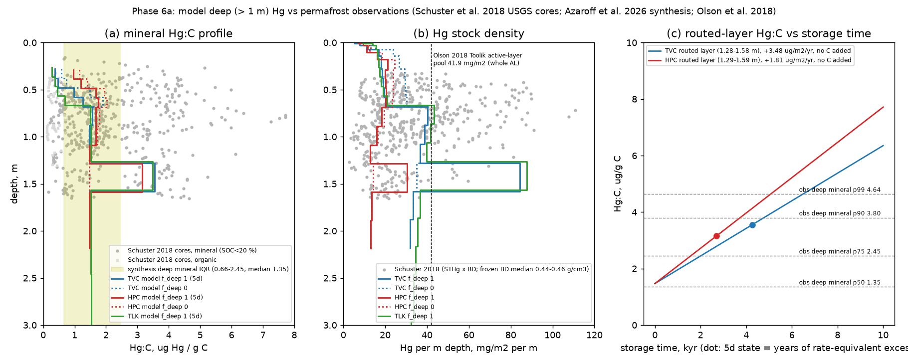
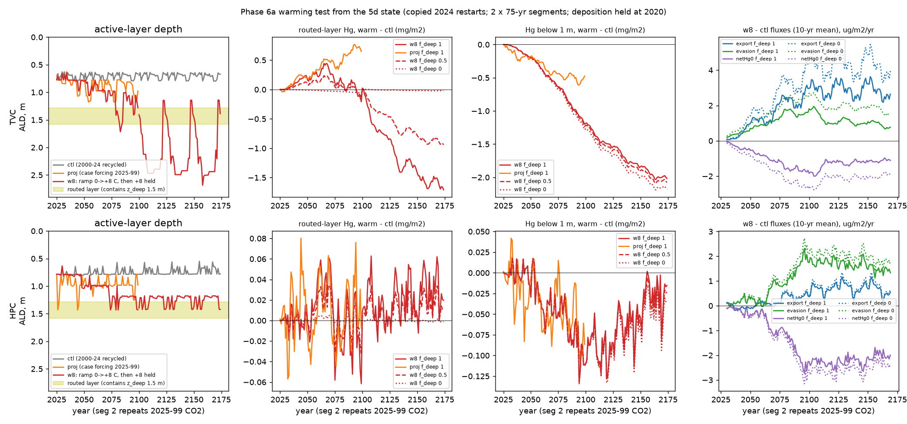

## 11. Phase 6b: SOC-weighted deep spread and thaw release (both default off) (2026-11-24)

Approved by Elchin ("Yes"), with a budget of 0.4 core-h (LEDGER section "PHASE 6b"). The work is on local feat/hg-t2 on top
of 460b29e4 and has not been pushed.

Commits:
- 0a7980fd: code and tests.
- 8d2732d4: thaw-release fix.
- One docs commit (this section).

Binaries: binT2p6a (0a7980fd) and binT2p6b (8d2732d4).

### Switches

**`hg_t2_deepspread` (0/1).** Needs hg_t2 = 1 and hg_t2_deeproute = 1. The preset follows deeproute.
- The routed flow-path share (f_deep) no longer goes to the single layer holding hg_z_deep. It goes to every layer from the
  mixing-zone bottom down whose top is at or below State::zmax and whose soil C is above 0, in proportion to that C.
  - State::zmax is the running maximum of the monthly thaw depth: the daily maximum of the bottom of the contiguous
    non-ice-dominated zone, from `hgtr::thaw_track`.
  - The last eligible layer takes the exact remainder.
  - If zmax is unset or no layer qualifies, the routed share goes to the old z_deep layer.
- zmax keeps tracking, so the target moves down as thaw deepens.

**`hg_t2_thawrel` (0/1).** Needs hg_t2, hg_t2_diss and hg_t2_transport. Parameters:
- `hg_f_thaw_evade`, default 0.16 (Schaefer et al. 2020).
- `hg_f_thaw_export`, default 0.015 (Schaefer et al. 2020).
- `hg_t2_thaw_ref_year`, default 2024.

How it works:
- Decay-released Hg normally re-sorbs in place. Under this switch, decay-released Hg in a layer whose top is at or below
  State::zpf and that is thawed in that month (layer T > 0 °C) goes to soil evasion (fraction f_thaw_evade) and to export
  (fraction f_thaw_export) in the same step. The remainder enters the dissolved pool as before.
- State::zpf is the maximum thaw depth in years up to and including the reference year, frozen afterwards. A layer that
  meets this test is newly thawed, previously perennially frozen ground.
- The release is mass-conserving and is reported as part of HG_EVASION and HG_EXPORT. The new outputs HG_THAWEV and
  HG_THAWEX give the thaw parts.
- Geometry-change months use the same decomposition-weighted fractions as the existing pot branch.

**Restart.** zmax and zpf are written to a new optional restart variable `hg_thaw` (Y, X, 2), and only when a 6b switch is on.
hg_state keeps the v4 layout, so restarts with the switches off are bit-identical. A restart without `hg_thaw` leaves zpf unset,
and thaw release stays off until zpf is set in a year up to the reference year.

### Fix during 6b (8d2732d4)

The first version (0a7980fd) treated every layer below zpf with decomposition above 0 as thawing. Toolik's frozen soil
decomposes slowly but continuously, so the P6B Toolik run re-emitted about 4.3 µg/m²/yr. This raised evasion from 1.68 to
5.73, dropped net Hg(0) from 6.50 to 2.45 and made the winter share negative. The fix adds a test that the layer is thawed
(layer T > 0 °C) and fills layer T whenever thawrel is on. With the fix, Toolik is identical to deepspread alone in every
metric (P6B2), and HG_THAWEV is 0 over 1901–1975.

### Present-climate 12 targets (variants on the 5d spec; TVC/HPC main 1950–2024, Toolik tr)

| Metric | P5F3 (5d) | P6X0 switches off | P6S deepspread | P6B both, pre-fix | P6B2 both, fixed |
|---|---|---|---|---|---|
| TVC Ro / Rm | 0.4097 / 1.5618 | identical | 0.4097 / 1.5617 | 0.4097 / 1.5617 | (as P6S, see note) |
| TVC export | 3.995 | identical | 3.995 | 3.995 | |
| HPC Ro / Rm | 0.2878 / 1.7062 | identical | 0.2878 / 1.7062 | 0.2878 / 1.7004 | |
| HPC export | 2.077 | identical | 2.077 | 2.079 | |
| TLK Ro / Rm | 0.3767 / 1.4769 | identical | 0.3767 / 1.4769 | 0.3767 / **1.235** | 0.3767 / 1.4769 |
| TLK export | 2.647 | identical | 2.647 | **3.026** | 2.647 |
| TLK net Hg(0) / winter | 6.504 / 0.369 | identical | 6.503 / 0.369 | **2.455 / -0.30** | 6.503 / 0.369 |
| %MeHg TVC / HPC / TLK | 0.708 / 0.100 / 0.162 | identical | 0.712 / 0.100 / 0.161 | 0.712 / 0.100 / 0.162 | — / — / 0.161 |
| max balance error (µg) | 2.2e-9 | identical | 1.9e-9 | 1.9e-9 | 1.4e-9 |

- **P6X0 vs P5F3: identical.** All 6 output sets match (TVC/HPC spin and main, Toolik sp and tr), with 0 differing variables,
  restarts included.
- **Deepspread does not move any target band.** Every change is under 0.1 %, except TVC %MeHg, which is +0.6 %. The same 10 of
  12 bands are met as in 5d.
- **Thaw release (fixed): TVC and HPC were not rerun because of the budget.** In the present climate, only months that exceed
  the earlier maximum thaw qualify. The pre-fix TVC run already matched P6S to better than 1e-5. The pre-fix HPC change
  (Rm -0.3 %, evasion +0.025) is an upper bound for the fixed code.

### Deep Hg:C (2024, 1–3 m)

| Site | Fixed layer (P6X0): routed layer / background | Deepspread (P6S): layers below zmax | 1–3 m stock P6X0 → P6S (mg/m²) |
|---|---|---|---|
| TVC | 3.55 / 1.47 | 1.94 (uniform) | 55.3 → 53.3 (0–1 m 24.8 → 26.8: the 0.88–1.08 m layer, partly in 0–1 m, receives a share) |
| HPC | 3.16 / 1.47 | 2.01 | 21.1 → 21.1 |
| TLK | 3.50 / 1.52 | 1.70 | 86.9 → 80.5 |

The hotspot is gone. The deep Hg:C now lies between the observed deep-mineral median and p75 (2.45). The total retained Hg is
unchanged: only its depth distribution changes.

### Warming test (6a design, 75-yr segments from copies of the 2024 restarts; TVC ctl and w8; HPC w8 and proj)

| Run | ALD max (m) | Thaw evasion, sum (mg/m²) | Thaw export, sum (mg/m²) | Evasion, last 25 yr | Export, last 25 yr | Δ Hg below 1 m (mg/m²) | Deep Hg:C at end, 1–3 m |
|---|---|---|---|---|---|---|---|
| 6a TVC ctl (P5F3) | 0.79 | — | — | 5.85 | 3.45 | +0.81 | 2.01 |
| 6b TVC ctl (P6B) | 0.79 | 0 | 0 | 5.85 | 3.45 | +0.97 | 1.95 |
| 6a TVC w8 | 1.72 | — | — | 7.41 | 5.85 | -0.39 | 2.24 (routed layer 4.0) |
| **6b TVC w8, fixed (P6B2)** | 1.72 | **0.452** | **0.042** | **25.5** | **7.55** | **-1.16** | 2.13 (max layer 2.36) |
| 6b TVC w8, pre-fix | 1.72 | 0.650 | 0.061 | 32.0 | 8.16 | -1.36 | — |
| 6a TVC w8h (seg 2) | 2.69 | — | — | 6.85 | 6.33 | -0.42 | 3.85 (routed layer 6.8) |
| 6b TVC w8h, pre-fix | 2.69 | 4.08 | 0.38 | 27.1 | 8.24 | -5.00 | 3.32 |
| 6a HPC w8 | 1.43 | — | — | 7.18 | 2.31 | +0.06 | 1.96 |
| 6b HPC w8, pre-fix | 1.43 | 0.002 | 0.0002 | 7.22 | 2.32 | +0.05 | 1.94 |

Fluxes are in µg/m²/yr; the last-25-yr means are 2075–2099.

- The 6b TVC ctl ran on binT2p6a. Its thaw release is exactly 0, so the fix leaves it unchanged. W6_P6B2_TVC_w8 starts from a
  copy of the P6B 2024 restart. That base differs from a fixed-code base by less than 1e-5 in all TVC metrics.
- **TVC w8: deep Hg is now released.** The release is a pulse of up to 110 µg/m²/yr in 2079–2085, when the ALD first passes
  about 1.3–1.5 m into the old routed zone (fig. 21). Over 75 yr, 0.49 mg/m² leaves (0.45 evaded, 0.04 exported). Hg below 1 m
  falls by 1.16 mg/m², against 0.39 in 6a.
  - In 6a, the excess re-sorbed in place.
  - The extra loss beyond the direct release is Hg that deepspread had placed in layers that later thaw and mix.
  - The fixed code releases 30 % less than the pre-fix binary (0.49 vs 0.71 mg/m²). The difference is decay in layers below
    zpf that are still frozen, which now re-sorbs in place.
- **HPC w8 (ALD 1.43 m; the routed zone is barely reached): negligible release.**
- **TVC w8h (seg 2, pre-fix binary): an upper bound.** 4.5 mg/m² is released and 5.0 mg/m² is lost below 1 m.
- **Toolik net Hg(0) (present climate) is unchanged with the fix.** Under strong warming, the thaw-release evasion would reduce
  the tundra's net Hg(0) sink at TVC, from +1.1 in 6a w8 to -17 µg/m²/yr in the pulse-weighted last 25 yr.

### Preset choice: neither switch was added to the hg_t2 preset; both stay default off

- **Deepspread meets the inclusion criterion.** The present-climate targets are unaffected (all under 0.1 %, %MeHg TVC +0.6 %)
  and the deep Hg:C is more realistic. I still did not change the preset in 6b, because a preset change needs a rebuild plus a
  verification run of the preset path (about 0.05 core-h), and only 0.004 core-h was left after the fix.
- **Thawrel was verified with the fixed code only at Toolik (unaffected).** The TVC and HPC confirmation of the fixed code is
  still open.
- **Recommendation for the next phase:** add both to the preset (0.1 core-h: P6 preset rerun TVC/HPC/TLK and identities with
  binT2p6b).

### Checks

**Unit tests.**
- Standalone Hg suite: 61/61 test cases, 2760 assertions, including 5 new 6b tests and a frozen-layer case in the thawrel test.
- Full unit build: 543/543, both binaries; the 8 known may-fail assertions are unchanged.

**Switches off, bit-identical.**
- P6X0 (binT2p6a) is identical to P5F3: 6 output sets, 0 differing variables.
- P6X2 (binT2p6b, Toolik) is identical to P6X0: 377 variables. Only run_status total_runtime (wall time) is excluded.

**Hg-off identity (binT2p6a vs upmerge binM).**
- P6I1 sub_off (2 cases): PASS.
- P6I3 prod (8 cases): PASS.

**All-on (sub_t2k = sub_t2j + deepspread + thawrel, binT2p6a): C/N/water/energy identical.**
- P6I2: PASS.
- cmp_on: True. The new B-only restart variable hg_thaw is allowed next to hg_state, in a local copy src/cmp_on6b.py; the
  hg_t1 original is untouched.
- Max balance error 1.3e-9 µg.

**The fix (8d2732d4) changes only code under `t2_thawrel == 1`.**
- The Cohort layer-T fill is a new else-branch and is read-only.
- The release test sits inside `if (thr)`.
- So the binT2p6a identity results carry over by construction. The P6X2 Toolik identity confirms it for binT2p6b.

**Balance.** Every 6b run reaches run_status 100. Max |HG_BALERR| is ≤ 2.2e-9 µg; W6_P6B2_TVC_w8 is 8.9e-10.

### Cost (core-h, LEDGER.txt section "PHASE 6b")

| Item | Core-h |
|---|---|
| P6X0, P6S, P6B (TVC/HPC/Toolik proxy; P6X0 and P6B also Toolik ch4) | 0.118 |
| Warming from P6B, 7 runs (TVC ctl/w8/ctl2/w8h, HPC ctl/w8/proj) | 0.048 |
| Identities P6I1 sub_off 0.033, P6I2 sub_t2k 0.035, P6I3 prod 0.135 | 0.203 |
| Fix check: P6B2 and P6X2 Toolik proxy, W6_P6B2_TVC_w8 | 0.028 |
| **Phase 6b total** | **0.396 of 0.4** |

The ledger total is 8.7530.

Rules followed: ≤ 4 processes; 75-yr segments; nohup; restarts copied only; no deletions, GCS writes or parameters/ edits; no
push.

### Open items

1. Confirm the fixed thawrel at TVC and HPC in the present climate, then add both switches to the preset (about 0.1 core-h).
2. Rerun TVC w8h, HPC w8 and HPC proj with binT2p6b; the pre-fix numbers above are upper bounds (about 0.02 core-h).
3. Rerun the P6I1–3 identities with binT2p6b (about 0.2 core-h). They pass by construction.
4. Thaw-release fractions:
   - Schaefer 2020 applies 0.16 and 0.015 to the Hg released by decomposition over the whole thawed permafrost. Here they
     apply only below zpf.
   - The evasion share is not depth-attenuated. That is high for Hg released at 1.3–1.7 m: f_thaw_evade is an upper bound.
     The 6a note suggested an attenuation bounded by the ALD.
5. zpf depends on the run history:
   - A run that starts from a restart without hg_thaw has no thaw release.
   - The reference year 2024 assumes calendar years. Spin and pre-industrial stages have years ≤ 2024, so they only track.

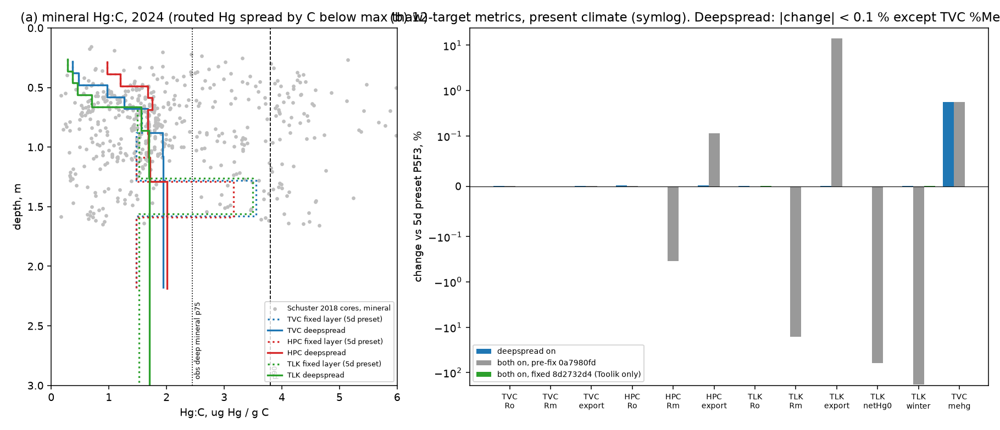
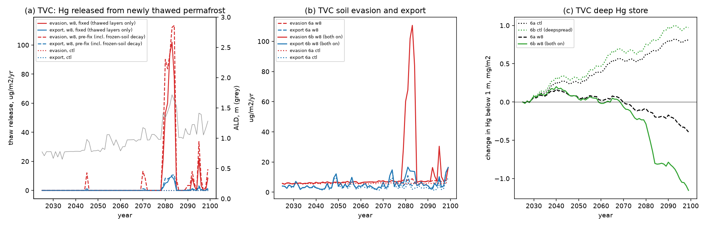

## 12. Phase 6c: fixed thaw release at TVC/HPC, preset with deepspread + thawrel, warming rerun (2026-11-24)

Approved by Elchin ("Go ahead"), with a budget of 0.12 core-h (LEDGER section "PHASE 6c"). The work is on local feat/hg-t2 on
top of 037c3154 and has not been pushed.

Commit: c38be089 (preset), plus a docs commit.

Binaries:
- binT2p6b: the 6b fix, 8d2732d4.
- binT2p6c: the preset, c38be089.

### 1. Present climate with the fixed code (P6C: binT2p6b, hg_t2 preset + explicit hg_t2_deepspread 1, hg_t2_thawrel 1)

| Site / metric | P5F3 (5d) | P6C | change |
|---|---|---|---|
| TVC Ro / Rm | 0.4097 / 1.5618 | 0.4097 / 1.5617 | +0.0005 % / -0.001 % |
| TVC export / net Hg(0) / winter | 3.995 / 2.828 / 0.562 | 3.995 / 2.828 / 0.562 | < 0.001 % |
| TVC %MeHg | 0.708 | 0.712 | +0.57 % |
| HPC Ro / Rm | 0.2878 / 1.7062 | 0.2878 / 1.7062 | +0.002 % / -0.001 % |
| HPC export / net Hg(0) / winter | 2.077 / 1.063 / 1.394 | 2.077 / 1.063 / 1.394 | < 0.006 % |
| HPC %MeHg | 0.0997 | 0.0997 | -0.001 % |
| TLK Ro / Rm / export | 0.3767 / 1.4769 / 2.647 | 0.3767 / 1.4769 / 2.647 | < 0.001 % |
| TLK net Hg(0) / winter | 6.504 / 0.369 | 6.503 / 0.369 | -0.0004 % |
| TLK %MeHg (proxy) | 0.162 | 0.161 | -0.36 % |
| max balance error (µg) | ≤ 2.2e-9 | ≤ 1.4e-9 | |

- **The same 10 of 12 bands are met.** HPC Ro is 0.288 and HPC Rm is 1.706, both still about 1 % out, as in 5d.
- **The %MeHg shifts come from deepspread** (identical in P6S).
- **The fixed thaw release is 0 in the present climate:**
  - TVC main (1950–2024), HPC spin and main, and Toolik tr: exactly 0.
  - TVC spin000: 0.43 µg Hg(0) + 0.04 µg export in total, in 2 early years, before zpf reaches its maximum.

### 2. Preset

`t2_preset_` now sets `t2_deepspread = 1` and `t2_thawrel = 1`. config/hg_t2_calibrated.json lists them as well.

The existing follow rules still apply under the preset:
- deepspread turns off when deeproute is off.
- thawrel turns off when diss is off.
- Explicit settings win, and hg_t2_preset 0 gives component defaults (off).

Unit test: the 6b parse test now checks the preset value, preset 0, an explicit 0 winning, and thawrel following diss off.

### Checks

**Unit tests.**
- Standalone Hg suite: 61/61 test cases, 2770 assertions.
- Full unit build (binT2p6c): 543/543; the 8 known may-fail assertions are unchanged.

**Preset alone = explicit.** P6P (binT2p6c, only hg_mehg 1, hg_t2 1) against P6C (binT2p6b, explicit switches): 6 output sets
(TVC/HPC spin and main, Toolik sp and tr), 0 differing variables out of 1694, restarts included (cmp_t2.py).

**Explicit off reproduces 5d.** P6Q (binT2p6c, preset with hg_t2_deepspread 0 and hg_t2_thawrel 0) against P6X0 (5d preset,
binT2p6a), Toolik proxy: 377 variables identical. Only run_status total_runtime (wall time) is excluded.

**Hg-off and switches-off paths are unchanged by construction.** The preset applies only with hg_t2 = 1. The 6b identities
still stand: P6I1 sub_off, P6I3 prod (8 cases) and the P6I2 all-on C/N/water/energy check.

**Balance.** Every 6c run reaches run_status 100 or EXIT_CODE 0. Max |HG_BALERR| is ≤ 2.0e-9 µg.

### 3. Warming rerun with the fixed code

Setup:
- 75-yr segments from copies of the P6P 2024 restarts, binT2p6c.
- TVC ctl/w8, then ctl2/w8h (segment 2).
- HPC w8 and proj.

| Run | ALD max (m) | Thaw evasion, sum (mg/m²) | Thaw export, sum (mg/m²) | Evasion, last 25 yr | Export, last 25 yr | Net Hg(0), last 25 yr | Δ Hg below 1 m (mg/m²) | Deep Hg:C at end, 1–3 m |
|---|---|---|---|---|---|---|---|---|
| 6a TVC ctl | 0.79 | – | – | 5.85 | 3.45 | 2.61 | +0.81 | 2.01 |
| **6c TVC ctl** | 0.79 | 0 | 0 | 5.85 | 3.45 | 2.61 | +0.97 | 1.95 |
| 6a TVC w8 | 1.72 | – | – | 7.41 | 5.85 | 1.06 | -0.39 | 2.24 (routed layer 4.0) |
| **6c TVC w8** | 1.72 | 0.452 | 0.042 | 25.5 | 7.55 | -17.0 | -1.16 | 2.13 (max 2.36) |
| 6a TVC ctl2 | 0.80 | – | – | 5.94 | 3.44 | 2.56 | +0.42 | 2.02 |
| **6c TVC ctl2** | 0.80 | 0 | 0 | 5.94 | 3.44 | 2.56 | +0.46 | 1.95 |
| 6a TVC w8h | 2.69 | – | – | 6.85 | 6.33 | 1.45 | -0.42 | 3.85 (routed layer 6.8) |
| **6c TVC w8h** | 2.69 | **3.635** | **0.341** | **25.3** | **8.07** | **-17.0** | **-4.53** | 3.36 (max 3.58) |
| 6a HPC w8 | 1.43 | – | – | 7.18 | 2.31 | -0.26 | +0.055 | 1.96 (routed layer 3.21) |
| **6c HPC w8** | 1.43 | 0 | 0 | 7.18 | 2.31 | -0.26 | +0.048 | 1.96 (max 2.03) |
| 6a HPC proj | 1.43 | – | – | 6.02 | 1.77 | 1.19 | +0.077 | 1.95 (routed layer 3.20) |
| **6c HPC proj** | 1.43 | 0 | 0 | 6.02 | 1.77 | 1.19 | +0.075 | 1.95 (max 2.02) |

Fluxes are in µg/m²/yr; the last-25-yr means are 2075–2099 (segment 2: years 51–75).

- **6c TVC w8 is identical to the 6b W6_P6B2 run.** Both use the same fixed code; the base difference is below output
  precision.
- **The pre-fix 6b w8h and HPC w8 numbers are replaced.**
  - TVC w8h releases 3.98 mg/m² over segment 2 (pre-fix 4.46) and loses 4.53 mg/m² below 1 m (pre-fix 5.00).
  - Over w8 + w8h (150 yr), TVC releases 4.47 mg/m² (4.09 evaded, 0.38 exported). The release comes in pulses when the ALD
    reaches a new depth (fig. 22).
  - Hg below 1 m falls by 5.7 mg/m², about 11 % of the 2024 stock at 1–3 m (53 mg/m²). In 6a it fell by 0.8 mg/m².
- **HPC (ALD ≤ 1.43 m): the fixed code releases nothing.** No layer below zpf is both thawed and decomposing. Fluxes are
  identical to 6a. The only change is the deep Hg distribution: the routed-layer Hg:C of 3.2 becomes about 2.0.
- **Deep Hg:C at the end stays in the observed range.** 6a w8h reaches 6.8 in the routed layer, far above the observed p90. 6c
  w8h reaches at most 3.6, below p90 (3.80), as thawed C loss concentrates the remaining Hg.

### Cost (core-h, LEDGER.txt section "PHASE 6c")

| Item | Core-h |
|---|---|
| P6C (TVC/HPC/Toolik proxy, explicit switches, binT2p6b) | 0.029 |
| P6P (preset alone, binT2p6c) | 0.030 |
| Warming from P6P: TVC ctl/w8, HPC w8/proj, TVC ctl2/w8h (6 runs) | 0.041 |
| P6Q Toolik proxy (explicit off vs 5d) | 0.010 |
| **Phase 6c total** | **0.110 of 0.12** |

The ledger total is 8.8633.

Rules followed: ≤ 4 processes; 75-yr segments; nohup; restarts copied only; no deletions, GCS writes or parameters/ edits; no
push.

### Open items

1. ~~Rerun the Hg-off and all-on regression identities with binT2p6c.~~ Done in phase 6c-reg (below): all pass.
2. The thaw-evasion fraction 0.16 is not depth-attenuated. For release at 1.3–2.7 m it is an upper bound; an ALD-bounded
   attenuation (6a note) would lower the 17 µg/m²/yr net Hg(0) source.
3. Toolik ch4 (fen %MeHg) was not rerun with the preset; the spreading-only Toolik proxy %MeHg changed by -0.4 %.
4. zpf depends on the run history: restarts without hg_thaw give no thaw release until the next year up to the reference year.
5. HPC Ro/Rm about 1 % out of band, as in 5d (no refit).

### Regression rerun on binT2p6c (phase 6c-reg, 2026-11-24)

Approved by Elchin ("Yes"), with a budget of 0.2 core-h (LEDGER section "PHASE 6c-reg"). The chain is src/p6c/runP6creg.sh. All
checks pass:

| Check | Runs | Result |
|---|---|---|
| hg_t2 = 0 vs T1 (VF4), Toolik | P6T0 (hg_mehg 1, binT2p6c) | **PASS**. The only difference is the restart hg_state length (117 vs 94), plus the T2 output-file set. This is the same as the accepted T5d result in 5d; every shared variable is identical. |
| hg_t2 = 0 vs 5a (P5T1), Toolik | P6T0 | **PASS**: 0 differing variables (sp 71 + tr 306). |
| Hg off, 2 cases (hg_t1/cs/sub_off) | P6R1, binM vs binT2p6c | **PASS** |
| All on (cs/sub_t2j: hg_t2 preset only, now including deepspread + thawrel) | P6R2, binM vs binT2p6c | **PASS**: C/N/water/energy identical (cmp_on6b; the B-only restart variables hg_state and hg_thaw are allowed). 4 stages, 0 diffs. Max Hg balance error 1.2e-9 µg. |
| Hg off, 8 cases (regress/cs/prod) | P6R3, binT2p6c B runs | **PASS**: A == B bit-identical in all 8 cases, run_status OK. |

**How P6R3 was run.** To stay inside the budget, P6R3 reran only the B side. The A side is the binM reference runs of
out/P6I3_prod/A (6b), linked read-only. It is the same binM md5 (e9fe5eff), the same case set and the same machine and runtime.
No restart was reused as input. The full A+B run costs 0.135 core-h.

Cost: P6T0 0.010, P6R1 0.033, P6R2 0.034, P6R3 0.067, for 0.145 of 0.2 core-h. The ledger total is 9.0080.

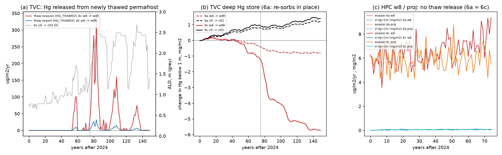

## 13. Phase M1: MeHg-index temperature response, substrate, 0-50 cm metric, effective rates, export diagnostic (2026-11-25)
Plan: `/workspace/hg/t2/PLAN_mehg_lit.md`, phase M1, items (a), (b), (d), (e) and (g). Literature: `lit_7questions.md`.
Base: local feat/hg-t2 at 3d8927a5. Code commit ed950a56 (not pushed). Binary bins/binM1. Scripts are in src/m1/: patchM1.py,
testsM1.cpp, mk_m1.py, runM1.sh, an_m1.py, cmp_m1.py, sum_m1.py, exp_months.py and plots_m1.py. Results are in an2/m1/.
M1 used 0.638 of 1.2 core-h; the ledger total is 9.646.

### 13.1 Code (all default off or diagnostic only)
- **(a) Q10 swap: no code needed.** The hg_t2 = 1 parse rule rejects only the T1 names hg_r_stem, hg_r_root,
  hg_k_meth_proxy and hg_k_meth_ch4. `hg_q10_meth` and `hg_q10_demeth` are read directly with hg_t2 = 1 (unit test), so the
  plan's T2 copies are unnecessary.
- **(b) `hg_t2_mehg_subst`** (int 0-2, default 0) sets the methylation substrate in `mehg_month`:
  - 0: layer Hg hl = sorbed + dissolved (unchanged);
  - 1: dissolved Hg, min(hl, State::diss);
  - 2: Kd-equilibrium dissolved share, hl x phi_eq, with phi_eq = liq / (liq + Kd M) from the month's mean liquid water.
    It is computed in diss_transport_ and is not part of the restart.

  The cap MeHg <= hl is unchanged. Values > 0 need hg_mehg = 1, hg_t2 = 1 and hg_t2_diss = 1 (parse error otherwise).
- **(e) HG_KMEFF and HG_KDEFF** (1/d; monthly and yearly).
  - k_m,eff = sum P / sum hl over the producing layers / 30.44: the effective first-order rate on ambient layer Hg.
  - k_d,eff = sum (P x kd) / sum P / 30.44: the production-weighted demethylation rate.
- **(g) HG_MEHGEXP** (ug/m2/time; monthly and yearly): the dissolved export of each layer each day (overland plus lateral
  drainage, the acc.export_ flows) times that layer's MeHg share min(1, MeHg / (sorbed + dissolved)), taken before the
  transport step.
  - It is a diagnostic only. MeHg is not removed, because the T2 transport does not carry the index.
  - It is zero without flow or with hg_mehg = 0.
- New State fields (mehg_hsub, mehg_kdp, mehg_exp _m/_y and phieq) are not in the restart, so the restart format stays v4. The
  output_spec rows are invalid by default.
- **Unit tests** (3 new cases): parse (default, range, dependencies, q10 names with hg_t2); steady state for subst 0/1/2; the
  KMEFF/KDEFF algebra; the Q10 swap at t_ref - 10; MEHGEXP bounds (zero without flow, Hg pools bit-identical with the index on
  or off); phi_eq in (0, 1].
  - Standalone Hg suite: 64/64 cases, 2925 assertions.
  - Full unit suite: 546/546 cases. The same 8 known failing may-fail assertions appear as in every earlier build; status
    SUCCESS.

### 13.2 Runs and checks
Every run is a full 4-case set: TVC and HPC (spin + main, sites_d4) plus Toolik proxy and CH4 (sp 15 yr + tr 75 yr), on
binM1 with the preset (`hg_mehg 1, hg_t2 1`) and extra keys. The metric is the Jun-Sep mean over the last 20 years.
- **Off identity.** M1P0 (binM1, old output spec) vs P6P (binT2p6c): 0 differences over the TVC/HPC spin and main and the
  Toolik sp and tr outputs (cmp_t2.py).
- **New outputs do not perturb.** M1B (new spec, with --ch4) vs M1P0: 0 differences in every common variable, including
  MEHGSOIL and MEHGPROD (cmp_t2.py and cmp_m1.py; 475 files).
- **Hg-off regression.** run_regression sub_off, binM vs binM1: PASS.
- **Non-MeHg identity of every variant vs M1B.** cmp_m1.py compares all variables except MEHGSOIL, MEHGPROD, HG_KMEFF,
  HG_KDEFF and HG_MEHGEXP, and compares hg_state without its mehg slice.
  - Q11, Q21, Q31, Q22, Q32, S1, S2, S1Q32, V22 and V32: 0 differences each (558 files).
  - Warming W6 V22 and V32 vs M1B: 0 differences (796 files).
- **Balance.** Max |HG_BALERR| is 4.1e-10 (TVC), 1.1e-9 (HPC), 1.4e-9 (Toolik proxy) and 1.8e-9 (Toolik CH4) µg, identical
  in every variant (≤ 2.2e-9).

### 13.3 Results: %MeHg (active layer / 0-50 cm), figure 23
"Q a/b" means hg_q10_meth a, hg_q10_demeth b. The preset is Q 1/2 with k_proxy 71 and k_ch4 3250.

| run | TVC | HPC | TVC/HPC | Toolik proxy | Toolik CH4 |
|---|---|---|---|---|---|
| M1B preset Q 1/2 | 0.712 / 0.767 | 0.0997 / 0.144 | 7.14 | 0.161 / 0.206 | 2.018 / 2.541 |
| Q 1/1 | 0.404 / 0.450 | 0.0276 / 0.0343 | 14.6 | 0.079 / 0.102 | 1.045 / 1.322 |
| Q 2/1 | 0.218 / 0.250 | 0.0137 / 0.0169 | 15.9 | 0.040 / 0.052 | 0.541 / 0.693 |
| Q 3/1 | 0.152 / 0.178 | 0.0091 / 0.0112 | 16.8 | 0.027 / 0.035 | 0.369 / 0.476 |
| Q 2/2 | 0.379 / 0.419 | 0.0484 / 0.0696 | 7.83 | 0.077 / 0.099 | 1.022 / 1.299 |
| Q 3/2 | 0.263 / 0.297 | 0.0318 / 0.0457 | 8.27 | 0.050 / 0.065 | 0.690 / 0.883 |
| subst 1, Q 1/2 | 0.00095 / 0.0012 | 0.00124 / 0.0020 | 0.76 | 0.0003 | 0.0024 |
| subst 1, Q 3/2 | 0.00039 / 0.0005 | 0.00039 / 0.0007 | 0.99 | 0.0001 | 0.0009 |
| subst 2, Q 1/2 | 0.00034 / 0.0005 | 0.000004 / 0.00001 | 91 | 0.0002 | 0.0017 |
| **V22** Q 2/2, k 138.7 / 6362 | 0.740 / 0.819 | 0.0946 / 0.136 | 7.83 | 0.150 / 0.193 | 2.000 / 2.543 |
| **V32** Q 3/2, k 205.3 / 9419 | 0.761 / 0.857 | 0.0920 / 0.132 | 8.27 | 0.146 / 0.188 | 2.000 / 2.560 |

- **Recalibration.** %MeHg is linear in k. The proxy k is the geometric mean over TVC and HPC; the CH4 k is scaled to
  Toolik 2.0. Verified: V22 and V32 give Toolik CH4 at exactly 2.000.
- **The TVC/HPC contrast does not depend on k.** It is set by Q10_demeth. With Q10_demeth 1 (the literature choice, "k_d
  insensitive to T") the ratio is 14.6-16.8, more than the band's upper limit of 10.5.
  - With the best single k_proxy, TVC and HPC would be off by about +44 % / -31 % (Q 1/1) to +55 % / -35 % (Q 3/1).
  - So no single proxy rate fits both sites with Q10_demeth ~1.
  - With Q10_demeth 2, every Q10_meth in {1, 2, 3} passes (ratio 7.1-8.3).
- **Substrate switches fail by an order of magnitude.** The dissolved share is larger at HPC than at TVC, so the ratio
  collapses to 0.8-1.0 (subst 1). The Kd share at HPC is about 1e-4, so the ratio blows up to 91 (subst 2).
  - Fitting subst 1 would also need k about 740x (proxy) and 850x (CH4).
  - Both stay default-off sensitivities.

### 13.4 Results against the success criteria
1. **One k_proxy fits TVC 0.7 % and HPC 0.1 % within ±20 %.**
   - Yes for the preset: +1.8 % / -0.3 %.
   - Yes for V22 (+5.7 % / -5.4 %) and V32 (+8.7 % / -8.0 %).
   - No for any Q10_demeth 1 setting or either substrate switch.
2. **One k_ch4 fits Toolik fen 2.0 % ±20 %.** Yes: preset 2.018 (+0.9 %); V22 and V32 2.000.
3. **0-50 cm metric with plateau < bog < fen.** Holds in all three candidates:
   - preset: HPC 0.144 < TVC 0.767 < Toolik CH4 2.54;
   - V22: 0.136 < 0.819 < 2.54;
   - V32: 0.132 < 0.857 < 2.56.

   Toolik proxy (moist acidic tussock) is 0.19-0.21. 0-50 cm is above active-layer %MeHg everywhere, because MeHg is surface
   weighted.
4. **Effective rates** (Jun-Sep, 1/d; figure 24).

   | site (class) | k_m,eff preset / V22 / V32 | Thompson 2025 tracer k_m | offset (tracer / eff, preset) | k_d,eff preset |
   |---|---|---|---|---|
   | HPC (plateau) | 8.6e-6 / 8.3e-6 / 8.1e-6 | 8e-4 | 93x | 0.048 |
   | TVC (bog) | 6.3e-4 / 6.6e-4 / 6.8e-4 | 4e-3 | 6.4x | 0.054 |
   | Toolik CH4 (poor fen) | 4.1e-4 / 3.8e-4 / 3.7e-4 | 0.059 (rich fen 0.146) | 142x (352x) | 0.046 |

   - Toolik proxy: k_m,eff 3.1e-5 and k_d,eff 0.044.
   - k_d,eff is 0.044-0.055 d⁻¹, at most 0.5 (Helmrich 2022), and within Helmrich's 0.04 ± 0.03 k_m sediment range, which
     brackets ambient k_d of the same order.
   - k_m,eff is below the tracer k_m in every class, as an ambient rate on total Hg should be. The offset grows from bog
     (6x) to plateau (93x) and fen (142x). The fen offset is consistent with tracer k_m/%MeHg implying k_d 3-7 d⁻¹ (not a
     self-consistent ambient steady state; lit_7questions Q1).
   - **PASS.**
5. **MeHg export** (last 20 yr; ng/m2):

   | site | May-Oct (preset / V22 / V32) | annual | May share | Jun-Oct | MeHg:THg export |
   |---|---|---|---|---|---|
   | TVC | 15.7 / 14.2 / 13.4 | 15.7 | 52 % | 7.5 | 0.39 % |
   | HPC | 191 / 177 / 170 | 204 | 91 % | 17.4 | 9.8 % |
   | Toolik proxy | 6.3 | 6.3 | | 2.6 | 0.24 % |
   | Toolik CH4 | 20.5 | 20.5 | | 8.9 | 0.78 % |

   - THg export here is the dissolved route (HG_DRAIN + HG_RUNOFF = HG_EXPORT): TVC 4.0, HPC 2.1 and Toolik 2.6 µg/m2/yr.
   - TVC and Toolik pass (season 2-50, annual 1-100). **HPC fails**: 191 per season and 204 per year.
   - **HPC cause:** a spring flush. 91 % of the HPC export leaves in May. MeHg builds up over winter in the thin shallow
     organic layers (layers 2-3, about 0.03-0.07 m). The May mean MeHg share is 6 % and 46 % of layer Hg, against 0.1-0.9 % in
     July.
     - This happens because with Q10_meth ≤ Q10_demeth, cold-season demethylation slows at least as much as methylation, and
       proxy methylation continues in cold, saturated layers.
     - The flush shrinks as Q10_meth rises: May export is 173 (Q 1/2), 82 (Q 2/2), 53 (Q 3/2) and 31 (Q 3/1). With Q10_demeth
       2 it never reaches 50.
     - Jun-Oct export alone (17.4) would pass.
     - The index is not transported by T2, so this is a diagnostic of what the MeHg-share-weighted water export would carry,
       not a mass flux removed from the index.
   - MeHg:THg export observations, for scale: Mackenzie and Scotty Creek order 1-5 %. TVC and Toolik are low (0.2-0.8 %);
     HPC is high (9.8 %).
6. **Identity.** PASS (section 13.2).
7. **Warming** (2080-2099 Jun-Sep, w8 vs ctl; copied 2024 restarts; figure 25):

   | config | TVC act ctl → w8 | TVC 0-50 cm | TVC MEHGPROD (mg/m2/yr) | HPC act ctl → w8 | HPC MEHGPROD |
   |---|---|---|---|---|---|
   | preset | 0.745 → 2.333 (x3.1) | 0.946 → 0.079 | 2.21 → 28.8 (x13.0) | 0.119 → 0.019 (x0.16) | 0.92 → 0.87 (x0.95) |
   | V22 | 0.789 → 2.323 (x2.9) | 1.017 → 0.079 | 2.21 → 28.3 (x12.8) | 0.113 → 0.017 | 0.83 → 0.71 |
   | V32 | 0.821 → 2.320 (x2.8) | 1.068 → 0.079 | 2.21 → 28.1 (x12.7) | 0.110 → 0.017 | 0.79 → 0.65 |

   - ALD: TVC 0.70 → 1.26 m; HPC 0.75 → 1.22 m.
   - **TVC: the same direction as Yang 2016** (> 10x net production from -2 to 8 °C). Gross production rises x13, and
     active-layer %MeHg rises x3, carried by the newly thawed, saturated deep active layer.
     - The top 0-50 cm loses MeHg (x0.08) as it dries.
   - **HPC: the opposite.** %MeHg falls x0.16 and production stays flat, because the deeper thaw adds Hg without saturation.
   - **The Q10 swap barely changes the warming response** (TVC within 5 %, HPC production -14 to -30 %). The response is set by
     the saturation proxy and the thaw depth, not by Q10_meth.
   - Plausibility only; not a target.

### 13.5 Recommendation for the T2 preset (Elchin decides)
- **Keep the preset as it is:** Q 1/2, k_proxy 71, k_ch4 3250, subst 0.
  - It already meets criteria 1-4 and 6.
  - The literature-motivated swap (Q10_demeth ~1) cannot keep the 7:1 TVC/HPC contrast with one k.
  - Q10_meth 2-3 with Q10_demeth 2 (V22/V32) also passes but fits slightly worse. It does not change the warming response, and
    it only halves the HPC spring flush without curing it.
- **Keep `hg_t2_mehg_subst` off** as a sensitivity.
- **Adopt the diagnostics in reporting:** HG_KMEFF, HG_KDEFF and HG_MEHGEXP (spec rows off by default), and the 0-50 cm
  metric.
- **Open issue for M2 (not done here):** the HPC spring MeHg flush. Options:
  - (i) no or reduced methylation in frozen or near-freezing layers (an explicit T threshold);
  - (ii) transport the index with the dissolved share;
  - (iii) report Jun-Oct export only.
- **Figures** (docs_src/figures_hg_t2): hg_t2_fig23_m1_pctmehg_q10_subst.png, hg_t2_fig24_m1_rates.png,
  hg_t2_fig25_m1_export_warming.png.

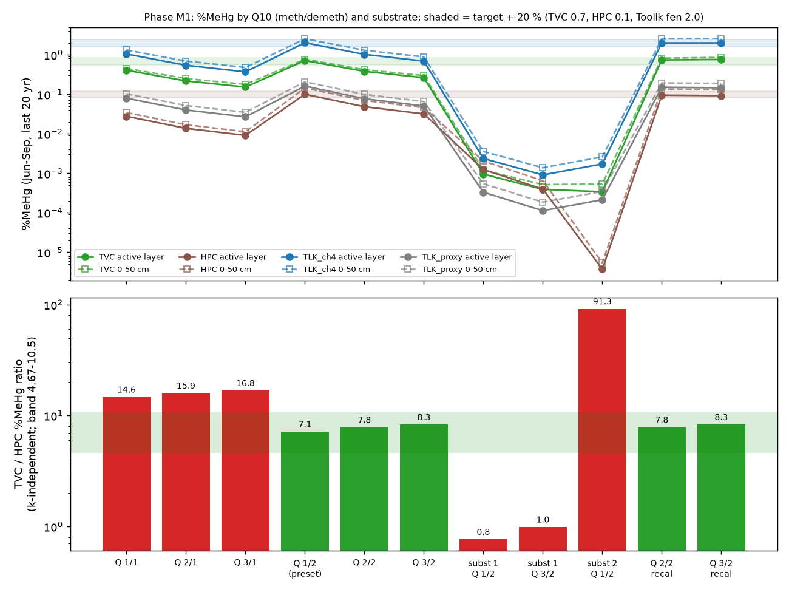
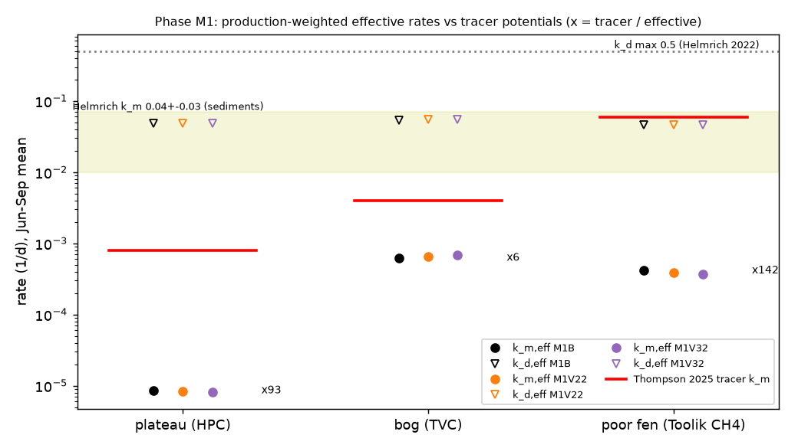
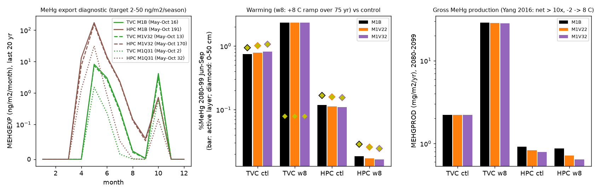

## 14. Phase M2: frozen-layer methylation, MeHg transport and timing, Jun-Oct export, depth-attenuated thaw evasion (2026-11-25)
Plan: `/workspace/hg/t2/PLAN_mehg_M2.md` (approved: D1 0.8 core-h budget, 1.0 cap; D2 May-Oct export target, Jun-Oct secondary;
D3 report the trade-off rather than force a fit; D4 item 2 in; D5 item h in, item f deferred; D6 preset unchanged).
Base: local feat/hg-t2 at 127a0ffb. Code commits (local, not pushed): 132b9d7f (item 1), 764bf360 (items 2 and h), 8c2f92f5
(item 2 timing). Binaries bins/binM2 (764bf360, md5 of the final binary binM2c e16fed1c at 8c2f92f5). Scripts in src/m2/:
patchM2a/b/c.py, testsM2a/b/c.cpp, mk_m2.py, runM2.sh, diag_m2.py, an_m2.py, sum_m2.py, cmp_m2.py, mk_w6h.py, mk_w6dh.py,
run_h.sh, run_h2.sh, anh_m2.py, plots_m2.py. Results in an2/m2/. **M2 used 0.8025 of 1.0 core-h; ledger total 10.449.**

### 14.1 Code (all default off; unit tests 552/552, Hg 70/70)
- **Item 1, `hg_t2_mehg_frz`** (int 0-2, default 0), with `hg_t2_mehg_frz_t0` (°C, default 0) and `hg_t2_mehg_frz_dt` (°C,
  default 1). In `mehg_month` the production P of each layer is multiplied by f(ts):
  - 0: f = 1 (unchanged);
  - 1: f = 0 at ts <= t0, else 1 (hard cutoff);
  - 2: linear ramp, f = clamp((ts - t0) / dt, 0, 1).

  Demethylation is unchanged, so a frozen layer only loses MeHg. Needs hg_mehg = 1 and hg_t2 = 1.
  New output MEHGPRODL (layer MeHg production, ug/m2/month; sums to MEHGPROD; spec row off by default).
- **Item 2, `hg_t2_mehg_transport`** (0/1, default 0) and `hg_t2_mehg_mobfac` (default 1). In `diss_transport_` every daily
  dissolved transfer F out of a layer carries F x mobfac x MeHg / (sorbed + dissolved) of the index; exports (overland,
  lateral, melt and the flow-path routes) leave the index, so HG_MEHGEXP becomes a removal. MeHg arriving in a layer is
  clamped to the layer Hg; the clamp loss is booked. New output HG_MEHGBAL = dMeHg - (P - D - export - clamp).
- **Item 2 timing, `hg_t2_mehg_lag`** (0/1, default 0). Found during M2.0: Cohort's end-of-month step runs `mehg_month` before
  the month's dissolved transport, so the month's water export carries MeHg produced in that same month (May export = end of
  May stock). With lag = 1 the index update is deferred until after the transport, so a month's water moves the
  start-of-month stock and the new production is exported from the next month on.
- **Item h, `hg_t2_thaw_evz`** (m, default 0 = off). In thawrel the evading fraction becomes f_thaw_evade x exp(-(z -
  z_prev,max) / evz); the remainder goes to the dissolved pool as before (mass-conserving).
- **Item 3** is analysis only (an_m2.py): MEHGEXP May-Oct, Jun-Oct, May share, annual, a thawed-surface window, MeHg:THg
  export and HG_MEHGBAL. It reproduces M1 (HPC 190.6 / 17.4, TVC 15.7 / 7.5).
- The restart format stays v4 (no new restart fields; the lag state is within-month only).

### 14.2 Identity and regression (all pass unless noted)
- All M2 switches off (binM2) vs M2D (binM2a) and M2Q (binM2c) vs M2P: 0 diffs in every variable, all 6 case groups.
- M2D (binM2a, diagnostic outputs) vs M1B: 0 diffs.
- Every MeHg variant (F1, F2a, F2b, L, LF1, LT, LF1T, LF2a, LF2c, V1, V2) vs M2P: 0 non-MeHg diffs (cmp_m2, 558 files).
- Hg-off sub_off, binM vs binM2c: PASS. hg_t2 = 0 (T1 path), Toolik M2T0 (binM2c) vs P6T0: 0 diffs.
- Warming: M2P w8/w8h/ctl reproduce the 6c table exactly (net Hg(0) -17.0, thaw evasion 0.452 / 3.635 mg/m2).
- **Item h in the present climate is not bit-identical** (plan expected 0 diffs). thawrel fires in the spin-up whenever the
  thaw depth sets a new maximum, so evz changes trace releases: TVC 20/19 files and Toolik 17 files differ; HPC 0. Main-run
  differences are <= 1e-6 relative (HGSOIL 0.0095 of 1.4e4 ug/m2); all targets unchanged to 4 digits.
- Balance <= 1.8e-9 ug in all runs; HG_MEHGBAL 0 with transport on.

### 14.3 M2.0 diagnosis (step 1; the stop rule did not fire)
- End-of-April stock (as planned): 98 % (HPC) and 94 % (TVC) made at ts <= 0 °C, 100 % / 99.9 % at <= 1 °C; HPC 85 % in April.
  HPC holds it in layers 1-2 (15 and 41 ug/m2; 6.7 and 8.2 %MeHg).
- End-of-May stock (the one May export actually uses, see 14.1 timing): HPC 95 % made in May itself, 66 % at ts <= 0 and 34 %
  at 0-1 °C, 230 ug/m2 in layer 2 (45.6 %MeHg). TVC 89 % in May, 94 % at <= 0.
- Under the cutoff (M2F1) the residual HPC May stock (83 ug/m2, layer 2 at 16 %MeHg) is all made at 0-1 °C in May: a thin,
  snowmelt-saturated, just-thawed organic layer with Q10_meth = 1 methylates at full rate.

### 14.4 Results (Jun-Sep %MeHg, last 20 yr; export ng/m2; figures 26-27)

| run | switches | TVC act | HPC act | ratio | fen (CH4) | HPC May-Oct | HPC Jun-Oct | TVC May-Oct | TLK fen May-Oct |
|---|---|---|---|---|---|---|---|---|---|
| M2P | preset (off) | 0.712 | 0.0998 | 7.14 | 2.018 | **190.6** | 17.4 | 15.7 | 20.5 |
| M2F1 | cutoff T<=0 | 0.478 | 0.0444 | 10.78 | 1.229 | 49.3 | 3.8 | 4.3 | 0.00 |
| M2F2a | ramp -1..0 | 0.689 | 0.0698 | 9.88 | 1.613 | 106.6 | 12.6 | 6.5 | 0.00 |
| M2F2b | ramp 0..2 | 0.244 | 0.0061 | 39.9 | 0.518 | 7.4 | 0.5 | 0.9 | 0.00 |
| M2L | lag | 0.712 | 0.0995 | 7.16 | 2.017 | 139.6 | 109.0 | 29.5 | 63.1 |
| M2LT | lag + transport | 0.712 | 0.0994 | 7.16 | 2.017 | 139.4 | 108.9 | 29.4 | 63.1 |
| M2LF1 | lag + cutoff | 0.478 | 0.0442 | 10.81 | 1.228 | 19.8 | 19.8 | 6.3 | 0.01 |
| M2LF1T | lag + cutoff + transport | 0.478 | 0.0442 | 10.81 | 1.228 | 19.8 | 19.8 | 6.2 | 0.01 |
| M2LF2a | lag + ramp -1..0 | 0.689 | 0.0696 | 9.90 | 1.613 | 79.2 | 78.5 | 13.8 | 0.01 |
| M2LF2c | lag + ramp -2..0 | 0.695 | 0.0786 | 8.84 | 1.730 | 90.0 | 89.0 | 18.5 | 0.05 |
| **M2V1** | lag + cutoff, k 129.1 / 5293 | 0.870 | 0.0778 | 11.18 | 2.000 | **33.9** | 33.9 | 11.4 | 0.01 |
| **M2V2** | lag + ramp -1..0, k 85.8 / 4031 | 0.833 | 0.0841 | 9.90 | 2.000 | **95.7** | 94.8 | 16.6 | 0.01 |

Against the M2 success criteria:
1. **One k_proxy for TVC 0.7 and HPC 0.1 (±20 %; ratio 4.67-10.5):** V2 passes (+19 % / -16 %, ratio 9.9); V1 fails
   (+24 % / -22 %, ratio 11.2). Every configuration with the hard cutoff has a ratio of 10.8-11.2.
2. **Fen 2.0 ±20 %:** V1 and V2 2.000 (k_ch4 refitted).
3. **0-50 cm order plateau < bog < fen:** holds in all runs (V2: 0.116 < 0.883 < 2.59).
4. **k_d <= 0.5 d⁻¹, k_m,eff below the tracer k_m:** yes (k_d,eff 0.040-0.056 d⁻¹; k_m,eff <= 2.4e-3 d⁻¹).
5. **HPC May-Oct 2-50:** only the hard cutoff passes (F1 49.3, LF1 19.8, V1 33.9; F2b 7.4 but ratio 39.9). Every ramp
   (F2a, LF2a, LF2c, V2: 79-107) fails.
   - **TVC stays in 2-50 in all runs. Toolik does not:** with any freeze factor the Toolik May-Oct MeHg export falls to
     <= 0.05 ng/m2 (from 6-63). Toolik's %MeHg is fine; only its exported share collapses. Cause not diagnosed in M2 (likely:
     Toolik water leaves through layers that are frozen or at the freezing point in the months that drain).
6. **Balance and identity:** pass (14.2).

- **The trade-off (D3): no configuration passes criteria 1 and 5 together.** The ratio-passing set (preset, ramps, lag)
  leaves HPC at 79-191; the export-passing set (hard cutoff) puts the ratio at 10.8-11.2, just outside 10.5. V1 misses
  criterion 1 by 2-4 % per site; V2 misses criterion 5 by about 2x.
- **Lag (item 2 timing) is what makes the cutoff work:** it moves the export peak from May to June (May share 0.91 -> 0.00)
  and with the cutoff cuts HPC from 49 to 20. Alone it lowers HPC only to 140 and raises TVC and Toolik export (29 and 63),
  because the start-of-month stock is larger than the end-of-month stock in the growing season.
- **Transport (item 2) changes almost nothing** (<= 0.2 % in %MeHg and export): the M1 export diagnostic already used the
  same share, and the removed MeHg is small compared with production. Its value is mass consistency (HG_MEHGBAL = 0). The
  mobfac 3 sensitivity in the plan was not run (budget; transport was shown insensitive).
- **Jun-Oct (item 3)** passes for the preset (17.4) but, as the plan warned, only because the build-up is exported in May.
  With the lag the May and Jun-Oct seasons coincide.

### 14.5 Warming of V2 (step 5; 2080-2099 Jun-Sep, copied M1B 2024 restarts; figure 28c)

| config | TVC act ctl → w8 | TVC 0-50 cm | TVC MEHGPROD mg/m2/yr | HPC act ctl → w8 | HPC MEHGPROD | HPC May-Oct export |
|---|---|---|---|---|---|---|
| preset | 0.745 → 2.333 (x3.1) | 0.946 → 0.079 | 2.21 → 28.8 (x13.0) | 0.119 → 0.019 | 0.92 → 0.87 | 215 → 12.6 |
| V2 | 0.869 → 2.816 (x3.2) | 1.098 → 0.094 | 2.41 → 34.5 (x14.3) | 0.102 → 0.015 | 0.64 → 0.28 | 100 → 20.9 |

- Same direction as M1: TVC production x14 and %MeHg x3 (Yang 2016 direction); HPC falls. V2 does not change the warming
  story; HPC production falls more (x0.43) because w8 adds near-freezing months.

### 14.6 Item h: depth-attenuated thaw evasion (step 6; TVC ctl / w8 / w8h, HPC w8; figure 28a-b)

| run | evz | ALD max | thaw evasion (mg/m2, sum) | thaw export | evasion last 25 yr | export last 25 yr | net Hg(0) last 25 yr | Δ Hg below 1 m |
|---|---|---|---|---|---|---|---|---|
| TVC w8 | off (6c) | 1.72 | 0.452 | 0.042 | 25.5 | 7.55 | **-17.0** | -1.16 |
| TVC w8 | 0.3 m | 1.72 | 0.142 | 0.043 | 13.1 | 7.56 | **-4.6** | -0.85 |
| TVC w8 | 0.1 m | 1.72 | 0.018 | 0.043 | 8.1 | 7.57 | **+0.4** | -0.72 |
| TVC w8h | off (6c) | 2.69 | 3.635 | 0.341 | 25.3 | 8.07 | -17.0 | -4.53 |
| TVC w8h | 0.3 m | 2.69 | 0.518 | 0.354 | 8.4 | 8.20 | -0.1 | -1.50 |
| TVC w8h | 0.1 m | 2.69 | 0.046 | 0.357 | 6.9 | 8.21 | +1.4 | -1.07 |
| HPC w8 | any | 1.43 | 0 | 0 | 7.18 | 2.31 | -0.26 | +0.05 |

- **Criterion met:** TVC w8 net Hg(0) is above the -17 upper bound at both depths (-4.6 at 0.3 m; +0.4, a small sink again, at
  0.1 m). The released Hg that no longer evades stays in the soil (dissolved pool -> re-sorbed): the thaw export barely moves
  (+2-5 %) and the deep loss shrinks (w8 -1.16 -> -0.72 to -0.85 mg/m2; w8h -4.53 -> -1.07 to -1.50).
- HPC never thaws below its previous maximum in w8, so item h does nothing there.
- The attenuation depth has no direct observation; 0.1-0.3 m is the defensible bracket. Present climate: see 14.2 (not
  bit-identical, negligible).
- Item h changes THg, not only MeHg; it is a sensitivity, not proposed for the preset without Elchin's decision.

### 14.7 Recommendation (Elchin decides; preset unchanged in code)
- **Keep the preset** (all M2 switches off). No configuration meets the %MeHg contrast and the HPC export together.
- If the HPC export target matters more than the ±20 % site fit, the best single candidate is **V1** (lag + cutoff T <= 0,
  k_proxy 129.1, k_ch4 5293): HPC export 33.9, fen 2.000, but TVC +24 %, HPC -22 %, ratio 11.2. If the %MeHg contrast matters
  more, **V2** (lag + ramp -1..0 °C, k 85.8 / 4031) passes criteria 1-4 but leaves HPC export at 96.
- Either candidate breaks the Toolik MeHg export (~0), which should be diagnosed before adoption.
- Adopt `hg_t2_mehg_transport` with any MeHg configuration that is reported as a flux (consistency, no cost in fit).
- Item h: 0.1-0.3 m removes the -17 ug/m2/yr thaw-evasion source at TVC; recommend reporting 6c results with this bracket.
- Next (M3, not done): the residual HPC flush is May production at 0-1 °C in snowmelt-saturated layer 2. Candidates: lag +
  cutoff with Q10_meth 2 (M1 V22 halved the flush), or a saturation-proxy cap in thawing layers; diagnose the Toolik export
  collapse first. Item f stays deferred.
- **Figures** (docs_src/figures_hg_t2): hg_t2_fig26_m2_hpc_layers.png, hg_t2_fig27_m2_export_configs.png,
  hg_t2_fig28_m2_warming.png.

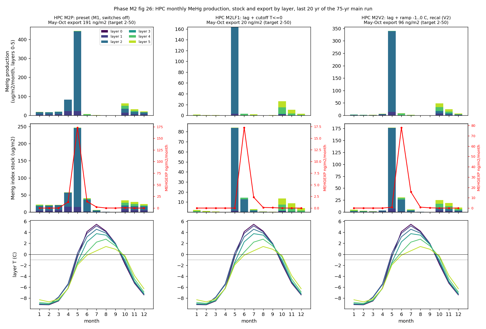
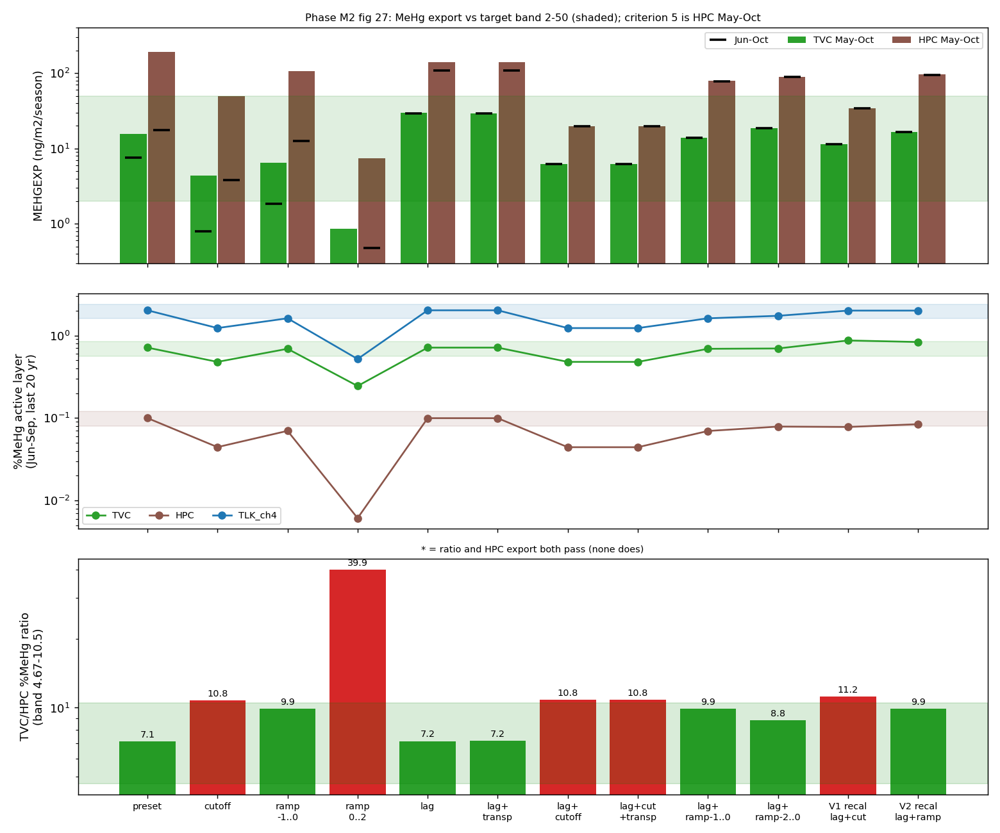
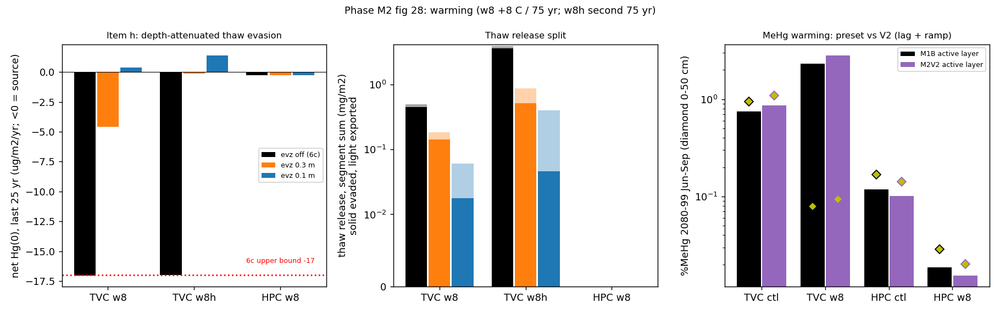

## 15. Phase M3: Toolik export collapse, daily freeze factor, Q10_meth 2, recalibration (2026-11-25)
Plan: `/workspace/hg/t2/PLAN_mehg_M3.md` (approved: 0.3 core-h hard cap, new "PHASE M3" ledger section; preset unchanged).
Base: local feat/hg-t2 at 71c8f791. Code commit 19f1e736 (local, not pushed). Binary bins/binM3 (md5 0f727ba7). Scripts in
src/m3/: patchM3.py, testsM3.cpp, runM3.sh, chain1-3.sh, sum_m3.py, plots_m3.py (and src/ledgerM3.py). Results in an2/m3/.
**M3 used 0.259 of 0.3 core-h; ledger total 10.708.**

### 15.1 Toolik diagnosis (0 core-h; existing M2P / M2F1 / M2L Toolik outputs; figure 29): physical, not a bug
- Toolik's dissolved export is **overland only**: HG_DRAIN is 0 in every month (no lateral drainage from the thawed zone),
  HG_RUNOFF carries 0.3-0.9 ug/m2/month in May-Aug.
- The overland mixing zone is the thawed layers starting above hg_z_runoff = 4.5 cm: layers 0-2 (0-7 cm).
- Those layers methylate **only in the shoulder months** (May, Sep-Oct), when water perches on the frost table and they
  are saturated (proxy) or produce CH4 (CH4 driver) at a monthly T near or below 0 C. In Jun-Aug they are above the water
  table and produce nothing; Toolik's summer methylation is in layers 3-7 (7-46 cm), which have no export path (vertical
  advection only moves MeHg down).
- So the whole Toolik MeHg export (preset 20.5 ng/m2 CH4, 6.3 proxy) is the shoulder-season production of the surface
  layers. A freeze factor on the monthly T removes exactly that production, and the export falls to <= 0.05. The switch
  works as designed; no code fix. The monthly time step is the limitation: a month whose mean T is <= 0 can still have
  thawed days.

### 15.2 HPC May flush, year by year (0 core-h, M2LF1)
- The flush comes from the years in which layer 2 (3-7 cm) is just above 0 C at the monthly step (0.07-0.48 C) while
  layer 3 is still frozen: perched snowmelt water makes the just-thawed layer saturated, and the whole month is credited at
  that state (up to 635 ug/m2 in one May, 45 %MeHg). Layer 2 is in the overland zone, so the lag exports it in June.

### 15.3 Code: `hg_t2_mehg_frzd` (0 off, default; 1 on)
- With hg_t2_mehg_frz 1 or 2, the factor is evaluated on each day's layer T of the month (Hg-only copy of the daily soil
  T, next to the existing daily liq / ice copy) and the month mean of the daily factors is used instead of the factor at the
  monthly T: a thaw-time weighting of the production of thawing layers. Works with and without the lag. Needs
  hg_t2_mehg_frz > 0 and hg_t2_diss = 1.
- Restart unchanged (v4). Unit tests (3 new): parse (default, range, dependencies); the daily-mean algebra (all warm 1, all
  frozen 0, 10 of 30 warm days 1/3, ramp); frzd 0 ignores the daily factors (bit-identical) and frzd 1 uses them. Unit tests
  555/555 (Hg 73/73).
- A separate liq/(liq+ice) cap on the saturation proxy was not coded: frzd already weights thawing layers by thawed time,
  and 15.4 shows the remaining conflict is not a temperature one.

### 15.4 Runs (Jun-Sep %MeHg, last 20 yr; exports ng/m2 May-Oct; all with lag + transport; figure 30)

| run | setting | TVC | HPC | ratio | fen (CH4) | HPC exp | TVC exp | TLK fen exp | TLK proxy exp | HPC exp per HPC % |
|---|---|---|---|---|---|---|---|---|---|---|
| M3D1 | cutoff T<=0, daily | 0.460 | 0.0456 | 10.11 | 1.069 | 45.2 | 10.8 | 4.8 | 1.3 | 992 |
| M3D2 | as D1 + Q10_meth 2 | 0.253 | 0.0225 | 11.24 | 0.575 | 21.9 | 5.1 | 1.8 | 0.5 | 975 |
| M3D3 | daily cutoff t0 0.25 C, k 127.1 / 6078 | 0.555 | 0.0427 | 13.00 | 1.565 | 53.7 | 9.0 | 6.2 | 1.8 | 1258 |
| **M3V1** | **D1 recalibrated, k 127.1 / 6079** | **0.824** | **0.0816** | **10.11** | **2.000** | **80.9** | **19.2** | **9.0** | **2.3** | 992 |
| M2V1 | lag + monthly cutoff, k 129.1 / 5293 | 0.870 | 0.0778 | 11.18 | 2.000 | 33.9 | 11.4 | 0.01 | 0.00 | 436 |
| M2V2 | lag + monthly ramp -1..0, k 85.8 / 4031 | 0.833 | 0.0841 | 9.90 | 2.000 | 95.7 | 16.6 | 0.01 | 0.00 | 1138 |

- The daily factor (D1 vs M2LF1T) restores Toolik export (fen 4.8, proxy 1.3 before recalibration; 9.0 / 2.3 after) and
  brings the ratio inside the band (10.11 vs 10.81), but raises HPC export per %MeHg from 448 to 992 ng/m2 per %: the
  thawed days of May now methylate again in layer 2.
- Q10_meth 2 lowers all sites about equally (ratio 11.2, export per % unchanged): it does not separate the flush from the
  summer production.
- A daily cutoff above 0 (t0 0.25 C) makes both worse (ratio 13.0, 1258 per %): HPC's summer methylation sits at 0-2 C in
  the layers near the frost table (10-40 cm), so any temperature filter strong enough to stop the May layer-2 production
  also stops HPC's summer production.
- %MeHg and export scale linearly with k (M3V1 reproduced the M3D1 x 1.79 prediction to 3 digits).
- **Feasibility (k-independent):** passing needs a ratio of 4.67-10.5 and HPC export per %MeHg <= 625 (50 ng at HPC
  0.08 %). No M2 or M3 configuration is in that box (figure 30a): ratio-passing settings have 975-1910, the monthly cutoff
  has 436-448 but a ratio of 10.8-11.2.

### 15.5 M3V1 against every criterion

| criterion | target | M3V1 | pass |
|---|---|---|---|
| TVC %MeHg (act, Jun-Sep) | 0.7 ±20 % | 0.824 (+17.7 %) | yes |
| HPC %MeHg | 0.1 ±20 % | 0.0816 (-18.4 %) | yes |
| TVC/HPC ratio | 4.67-10.5 | 10.11 | yes |
| Toolik fen (CH4) | 2.0 ±20 % | 2.000 | yes |
| HPC May-Oct export | 2-50 | 80.9 | **no** (x1.6) |
| TVC export | 2-50 | 19.2 | yes |
| Toolik export, fen / proxy | 2-50 | 9.0 / 2.3 | yes |
| 0-50 cm order | plateau < bog < fen | 0.107 < 1.177 < 2.78 | yes |
| k_d,eff | <= 0.5 1/d | 0.047-0.055 | yes |
| k_m,eff below tracer k_m | HPC 8e-4, TVC 4e-3, fen 0.059 | 5.9e-5, 8.9e-4, 1.8e-3 | yes |
| MeHg:THg export | <= ~5 % | HPC 3.9 %, TVC 0.5 %, fen 0.3 % | yes |
| balance / HG_MEHGBAL | <= 2.2e-9 / 0 | 1.8e-9 / 0 | yes |
| identities | | see 15.6 | yes |

### 15.6 Checks
- M3P (binM3, all switches off) vs M2P: 0 diffs in every variable, all 6 case groups.
- M3D1, M3D2, M3D3, M3V1 vs M2P: 0 non-MeHg diffs (558 files).
- Hg-off sub_off, binM vs binM3: PASS.
- No warming run (budget); M2 showed the lag/freeze settings keep the M1 warming direction.

### 15.7 Recommendation (Elchin decides; preset unchanged)
- **Keep the preset.** No setting passes every criterion.
- **Best trade-off: M3V1** (hg_t2_mehg_lag 1, hg_t2_mehg_transport 1, hg_t2_mehg_frz 1, hg_t2_mehg_frzd 1, k_proxy 127.1,
  k_ch4 6079). It passes everything except HPC May-Oct export (81 vs 50), and unlike M2 V1/V2 it keeps a sane Toolik export.
  It is the better MeHg-on configuration to report if one is wanted.
- The remaining conflict is hydrological, not thermal: the HPC flush is snowmelt-perched saturation in the overland zone
  (layer 2). Next levers (not done): the saturation proxy from the daily water table (the same thaw-time logic as frzd), or
  the overland zone depth / MeHg mobility in the flush. Each needs code and about 0.1 core-h.
- **Figures** (docs_src/figures_hg_t2): hg_t2_fig29_m3_toolik.png, hg_t2_fig30_m3_tradeoff.png.

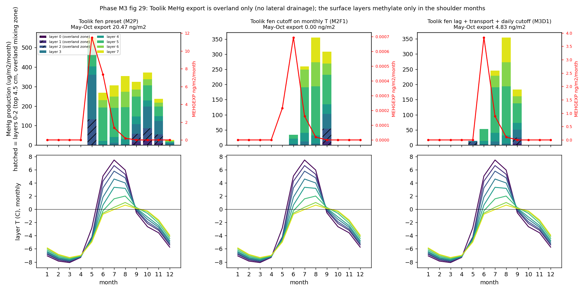
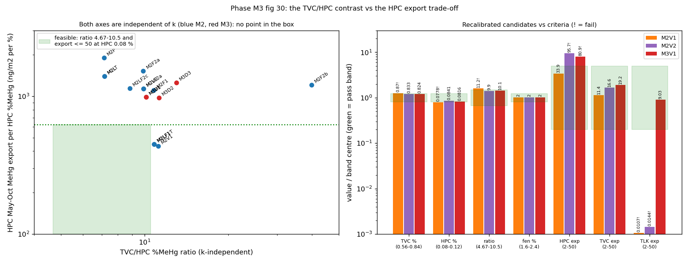

## 16. Phase M4: daily saturation proxy (hydrological step), recalibration, warming (2026-11-25)
Plan: `/workspace/hg/t2/PLAN_mehg_M4.md` (approved "full M4": D1 0.4 core-h budget, 0.45 hard cap, new "PHASE M4" ledger
section; D2 items A and C, B conditional and last; D3 a C pass needing frzmob <= 0.2 is tuning only; D4 HPC export pass
line 50 ng/m2; D5 preset unchanged). Base: feat/hg-t2 at 8ce2cec9. Code commit 076f3bba (local, not pushed). Binary
bins/binM4 (md5 d54607f2). Scripts in src/m4/: patchM4.py, testsM4.cpp, runM4.sh, chain1-2.sh, sum_m4.py, plots_m4.py
(and src/ledgerM4.py). Results in an2/m4/. **M4 used 0.241 of 0.45 core-h (budget 0.4); ledger total 10.949.**

### 16.1 Code (one commit, all default off, bit-identical when off)
- `hg_t2_mehg_satd` (0/1; needs hg_mehg, hg_t2, hg_t2_diss). Item A. With the proxy driver, the saturation factor of the
  methylation index is the month mean of daily factors, sat_d = clamp((z + dz - wt_d)/dz) x g_d, from each day's water
  table (Hg-only copy of d_sois.watertab, hg_dwt[31]) times that day's thaw state g_d (the daily freeze factor when
  hg_t2_mehg_frzd 1, else a thawed indicator). This replaces sat from the monthly-mean water table, which getWaterTable
  pulls shallow on frozen days (frozen layers count as saturated). With frzd 1 the monthly freeze factor is then set to 1
  for the proxy so it is not applied twice. The CH4 driver is unchanged.
- `hg_t2_mehg_zrun` (0-1 m; needs transport). Item B. MeHg-only overland zone depth: with zrun > 0, layers l > 0 whose top
  is at or below zrun do not supply the overland mobile pool. zrun = hg_z_runoff reproduces off exactly.
- `hg_t2_mehg_frzmob` (0-1, default 1; needs transport). Item C. Scales hg_t2_mehg_mobfac in the perched layer (the
  lowest thawed layer above a frozen one, per day).
- Restart unchanged (v4). Unit tests (3 new): parse (defaults, ranges, dependencies); sat_daily algebra; B/C transport
  (zrun = z_runoff equals off, shallower zrun and frzmob < 1 lower only MeHg export, Hg identical, MeHg conserved). Unit
  tests 558/558 (Hg 76/76).

### 16.2 Runs (Jun-Sep %MeHg, last 20 yr; exports ng/m2 May-Oct; all with lag + transport; figures 31-32)

| run | setting | TVC | HPC | ratio | fen (CH4) | HPC exp | TVC exp | TLK fen exp | TLK proxy exp | HPC exp per HPC % |
|---|---|---|---|---|---|---|---|---|---|---|
| M4P | binM4, all M4 switches off (MeHg preset) | 0.712 | 0.0997 | 7.15 | 2.018 | | | | | |
| M4A1 | M3V1 + satd 1 (k 127.1 / 6079) | 0.958 | 0.1183 | 8.09 | 2.000 | 29.6 | 21.2 | 9.0 | 2.0 | 250 |
| M4A2 | satd 1, no freeze factor (k 127.1 / 6079) | 0.974 | 0.1248 | 7.81 | 3.773 | 30.3 | 21.2 | 118.0 | 1.9 | 243 |
| **M4V1** | **M4A1 recalibrated, k 99.9 / 6079** | **0.753** | **0.0930** | **8.09** | **2.000** | **23.2** | **16.7** | **9.0** | **1.6** | **250** |
| M3V1 | M3 best (monthly-mean wt), k 127.1 / 6079 | 0.824 | 0.0816 | 10.11 | 2.000 | 80.9 | 19.2 | 9.0 | 2.3 | 992 |

- **Item A works as predicted.** At equal k, satd cuts HPC May production in the overland layers 0-2 from 324 to about
  109 ug/m2/month (M4V1 86 at k 99.9) and raises HPC Jun-Sep production from 33 to about 115 (M4V1 91): the frozen-day
  saturation of the just-thawed layer is gone, and summer days with a deep daily water table are no longer averaged
  with frozen days. HPC export per %MeHg falls from 992 to 250 ng/m2 per %, the ratio from 10.11 to 8.09 (figure 31).
- **Both A runs reach the k-independent feasible box** (ratio 4.67-10.5 and E <= 625; figure 32a). A2 fails the fen
  criterion: without the freeze factor the CH4 driver (which satd does not touch) methylates in frozen months (fen 3.77,
  Toolik fen export 118). So the freeze factor stays.
- **Stop rule applied:** A1 reached the box, so steps 4-5 (C frzmob, B zrun) were skipped (no runs). Their code stays,
  default off and tested.
- Recalibration: k linear, k_proxy 127.1 x sqrt((0.7/0.9575)(0.1/0.11834)) = 99.9; k_ch4 unchanged (fen already 2.000).
  M4V1 matched the prediction to 3 digits (TVC 0.753, HPC 0.093, HPC export 23.2).

### 16.3 M4V1 against every criterion

| criterion | target | M4V1 | pass |
|---|---|---|---|
| TVC %MeHg (act, Jun-Sep) | 0.7 ±20 % | 0.753 (+7.5 %) | yes |
| HPC %MeHg | 0.1 ±20 % | 0.0930 (-7.0 %) | yes |
| TVC/HPC ratio | 4.67-10.5 | 8.09 | yes |
| Toolik fen (CH4) | 2.0 ±20 % | 2.000 | yes |
| HPC May-Oct export | 2-50 | 23.2 | **yes** (was 80.9 in M3V1) |
| TVC export | 2-50 | 16.7 | yes |
| Toolik export, fen / proxy | 2-50 | 9.0 / 1.58 | fen yes; proxy **just below 2** (secondary, see 16.6) |
| 0-50 cm order | plateau < bog < fen | 0.137 < 1.093 < 2.778 | yes |
| k_d,eff | <= 0.5 1/d | 0.050-0.057 | yes |
| k_m,eff below tracer k_m | HPC 8e-4, TVC 4e-3, fen 0.059 | 8.2e-5, 7.7e-4, 1.8e-3 | yes |
| MeHg:THg export | <= ~5 % | HPC 1.1 %, TVC 0.4 %, fen 0.3 % | yes |
| balance / HG_MEHGBAL | <= 2.2e-9 / 0 | 1.8e-9 / 0 | yes |
| identities | | see 16.4 | yes |

### 16.4 Checks
- M4P (binM4, all switches off) vs M3P: 0 diffs in every variable, all 6 case groups.
- M4A1, M4A2, M4V1 vs M2P: 0 non-MeHg diffs (558 files). Warming set M4V1 vs M1B: 0 non-MeHg diffs (796 files).
- Hg-off sub_off, binM vs binM4 (out/M4R1_sub_off): PASS.

### 16.5 Warming of M4V1 (step 8; 2080-2099 Jun-Sep, copied M1B 2024 restarts, ctl vs w8)

| site | config | %MeHg ctl -> w8 | May-Oct export ctl -> w8 | ALD ctl -> w8 (m) |
|---|---|---|---|---|
| TVC | M1B | 0.745 -> 2.333 (x3.13) | 15.9 -> 1.3 (x0.08) | 0.70 -> 1.26 |
| TVC | M4V1 | 0.903 -> 2.687 (x2.98) | 15.7 -> 15.8 (x1.01) | 0.70 -> 1.26 |
| HPC | M1B | 0.119 -> 0.019 (x0.16) | 215 -> 12.6 (x0.06) | 0.75 -> 1.22 |
| HPC | M4V1 | 0.104 -> 0.011 (x0.11) | 24.8 -> 11.0 (x0.44) | 0.75 -> 1.22 |

- The M1 warming direction is kept (TVC %MeHg up about x3, HPC down as the plateau drains). The export response is
  milder than M1B: TVC export holds (the lag and transport keep the deepening thawed-zone MeHg mobile), HPC falls x0.44
  instead of x0.06 (no snowmelt flush to lose).

### 16.6 Recommendation (Elchin decides; preset unchanged per D5)
- **M4V1 is the first MeHg-on setting that passes every primary criterion**: hg_t2_mehg_lag 1, hg_t2_mehg_transport 1,
  hg_t2_mehg_frz 1, hg_t2_mehg_frzd 1, hg_t2_mehg_satd 1, hg_t2_k_meth_proxy 99.9, hg_t2_k_meth_ch4 6079. It is the
  candidate to adopt if Elchin wants a MeHg-on configuration; the preset is not changed in code.
- Caveat: Toolik proxy-driver export is 1.58 ng/m2 (secondary; the fen CH4 driver gives 9.0). It scales with k_proxy and
  was 2.0 before recalibration, so it is a calibration-level miss, not a mechanism failure. Items B and C (export-only
  levers) would only lower it further, which is another reason they were not run.
- Items B (zrun) and C (frzmob) are coded, tested and off; not needed for the pass.
- **Figures** (docs_src/figures_hg_t2): hg_t2_fig31_m4_satd_layers.png (HPC / TVC monthly production by layer and export,
  M3V1 vs M4V1), hg_t2_fig32_m4_tradeoff.png (k-independent plane with the M4 points; criteria bars M2V1 / M3V1 / M4V1).
  M4A1 and M4V1 sit on the same point in figure 32a (both axes are k-independent).

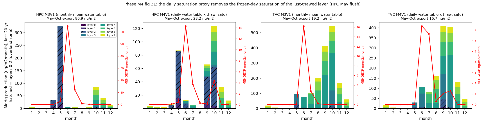
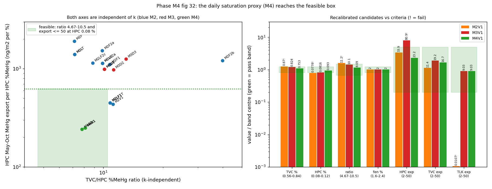

## 17. Phase M5: named MeHg-on preset `hg_t2_mehg_preset` (= M4V1) (2026-11-25)
Approved by Elchin: M4V1 (section 16) as a named, default-off MeHg-on preset. Base: feat/hg-t2 at f668372e. Code commit
35421b85 (local, not pushed). Binary bins/binM5 (md5 c157518e). Scripts in src/m5/: patchM5.py, testsM5.cpp, runM5.sh,
cmp_m5.py, ledgerM5.py. Results in an2/m5/. **M5 used 0.0438 of 0.05 core-h; ledger total 10.993.**

- **Switch:** `hg_t2_mehg_preset` (integer 0-1, default 0 = off; needs hg_mehg = 1 and hg_t2 = 1). With 1, the absent
  MeHg settings take the M4V1 values (Params::t2_mehg_preset_): hg_t2_mehg_lag 1, hg_t2_mehg_transport 1, hg_t2_mehg_frz 1
  (cutoff at hg_t2_mehg_frz_t0 = 0 C), hg_t2_mehg_frzd 1, hg_t2_mehg_satd 1, hg_t2_k_meth_proxy 99.9, hg_t2_k_meth_ch4 6079.
- **Same mechanism as hg_t2_preset:** applied in parse after the hg_t2 preset and before the explicit model_settings, so
  explicit settings win. Preset options whose prerequisite was switched off explicitly follow it, unless they are given too:
  hg_t2_mehg_transport follows hg_t2_diss and hg_transport, hg_t2_mehg_lag follows hg_transport, hg_t2_mehg_frzd follows
  hg_t2_mehg_frz and hg_t2_diss, hg_t2_mehg_satd follows hg_t2_diss. hg_t2_preset, its values and all defaults are unchanged.
  B and C (hg_t2_mehg_zrun, hg_t2_mehg_frzmob) are not part of the preset (off).
- **Unit test** (1 new case, 98 assertions): absent == 0 == the previous parse (all MeHg options off, k 71 / 3250);
  preset 1 gives the same Params as the explicit M4V1 settings; explicit values win; frz 0 / hg_t2_diss 0 / hg_t2_preset 0
  switch the dependent options off; explicit satd with hg_t2_diss 0, preset without hg_mehg or hg_t2, and preset 2 are
  errors. Unit tests 559/559.
- **Model identity (binM5, minimal case subsets, reference outputs reused):**
  - M5Q1 (hg_mehg 1, hg_t2 1, hg_t2_mehg_preset 1) vs M4V1 (explicit settings, binM4): 0 diffs in every variable of TVC
    spin000 + main, HPC spin000 + main, Toolik CH4-driver sp + tr (the fen; it uses k_ch4, TVC / HPC use k_proxy).
  - M5Q0 (preset absent) vs M4P (binM4, all off): 0 diffs in every variable of TVC spin000 + main. The parse is the only
    code change and the unit test shows the off Params are unchanged.
- **Usage:** add `"hg_t2_mehg_preset": 1` to model_settings next to `"hg_tracer": 1, "hg_mehg": 1, "hg_t2": 1` (README).
  Results and caveats as section 16 (M4V1; Toolik proxy-driver export 1.6 ng/m2, just below 2).

## 18. Phase M6: Toolik proxy-driver MeHg export (M4V1 / hg_t2_mehg_preset: 1.58 ng/m2 vs the 2 line) (2026-11-25)
Approved: up to 0.1 core-h (hard cap; new "PHASE M6" ledger section); diagnose first from existing outputs; at most one or
two small Toolik-targeted, physically justified default-off adjustments; preset values unchanged. Base: feat/hg-t2 at
a2fef73f. Scripts in src/m6/: diag_m6.py, plots_m6.py, ledgerM6.py. Results in an2/m6/diag.json. **M6 used 0 core-h (no
runs, no code change); ledger total 10.993.**

### 18.1 What the "Toolik proxy" case is
- It is the Toolik CMT06 fen cell with the wetland CH4 module **disabled** (the only config difference to the Toolik fen
  case is wetland.enabled false), so the MeHg index falls back to the saturation proxy. The fen criterion (2.0 % ±20 %)
  and the Toolik export criterion are met by the CH4-driver case, the standard Toolik setup (M4V1: fen 2.000 %, export
  9.0 ng/m2).
- The proxy case has no calibration target of its own: its %MeHg is 0.10 (20x below the fen target) and its annual
  production 105 ug/m2 (fen 1796). Its export follows from that low production, not from an export-path problem.

### 18.2 Where the Toolik proxy export comes from (M4V1, last 20 yr; figure 33)
- **Overland only:** HG_DRAIN is 0 in every month; HG_RUNOFF carries the export in May-Aug. The overland zone is layers
  0-2 (top 7 cm; layer 0, 1 cm of moss, makes nothing). QRUNOFF is 117 mm in May (snowmelt), 18 / 37 / 44 mm in Jun-Aug,
  about 1 mm in Sep, 0 in Oct.
- **Layers 0-2 make 6 % of the production** (6.7 of 105 ug/m2/yr: May 1.2, Jun 3.2, Sep 2.3). The summer production is in
  layers 3-7 (7-46 cm; 83 ug/m2/yr), which have no export path (vertical advection only moves MeHg down).
- Export: Jun 0.47, Jul 0.91, Aug 0.20 ng/m2 (with the lag, the month's stock moves before that month's update). The Sep
  production in layers 0-2 meets almost no runoff (1 mm) and is demethylated over winter.
- Export per %MeHg: Toolik proxy 15.6 ng/m2 per %, fen 4.5: the proxy case is not export-limited relative to the fen.

### 18.3 Effect of satd (equal k 127.1: M3V1 -> M4A1) and of the recalibration
- satd lowers Toolik proxy export by 13 % (2.33 -> 2.02). In M3V1 the layer 0-2 production was mostly in May (6.2 of 7.7
  ug/m2/yr), credited at frozen-day saturation, i.e. the same artifact that made the HPC flush; with satd it moves to June
  (4.0) after the snowmelt runoff peak, and the export moves from June (1.87) to July (1.16).
- The k recalibration for TVC / HPC (127.1 -> 99.9, -21 %) gives the rest: 2.02 -> 1.58. Export is linear in k.

### 18.4 Adjustments considered (none run)
- **Global k_proxy:** 2 ng/m2 needs k_proxy 126, which puts TVC at 0.95 % (band <= 0.84; figure 33d). Not possible.
- **Any proxy-index or MeHg-transport lever** (saturation proxy, freeze factor, mobility, overland zone depth
  hg_z_runoff / hg_t2_mehg_zrun, hg_t2_mehg_frzmob) acts equally on TVC and HPC, which use the same proxy driver. The
  overland zone is already the same for all sites; zrun and frzmob only lower export. A deeper overland zone would export
  Toolik's summer production of layers 3-7 but would also re-open the HPC flush route (HPC layer 2-3 near the frost table;
  sections 15-16).
- **A Toolik-only switch** would have to key on the site (CMT or the wetland flag), i.e. a tuning knob for a case that
  has no target, with no mechanism that differs between Toolik and the other sites. Not physically justified.
- **Site-config level:** the physically appropriate driver for the Toolik fen is the CH4 driver (wetland module on), and it
  passes. The proxy case is a fallback / sensitivity configuration.
- So no adjustment was coded or run; the 0.1 core-h was not used.

### 18.5 Recommendation (Elchin decides; hg_t2_mehg_preset unchanged)
- **Accept the miss.** The Toolik proxy export (1.58 ng/m2) is 21 % below a lower sanity line, in a configuration with no
  target whose %MeHg is 20x below the fen target. It is not an export-path failure (export per %MeHg is 3.5x the fen's),
  satd removed an artifact from it, and the only lever that raises it (k_proxy) breaks TVC.
- Report Toolik MeHg export with the CH4 driver (9.0 ng/m2; passes). Treat the proxy-driver Toolik values as a sensitivity
  case (no lateral drainage, overland export from the top 7 cm only).
- **Figure** (docs_src/figures_hg_t2): hg_t2_fig33_m6_toolik_proxy.png (a-c monthly production by layer, export and runoff:
  Toolik proxy M3V1, Toolik proxy M4V1, Toolik fen M4V1; d k_proxy scaling of the Toolik proxy export against the TVC and
  HPC bands).

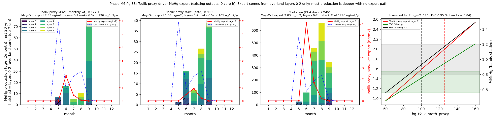

## 19. DOC step 1: diagnostic DOC and DOC-linked Hg export (2026-11-25/26)
Design: `docs_src`-external `~/tem-dev/hg_t2/doc_export/DOC_EXPORT_step1_design.md` (approved "Ok": O1 scaled-Kd coupling
only, O2 timing-only calibration, O3 dissolved-Hg export band added, budget ~0.74 core-h, hard cap 1.0; other items at
the design defaults). Base: feat/hg-t2 at 43553cb8. Code commits f835fa76 (D1) and a21831f4 (D1b), local, not pushed.
Binaries bins/binD1 (md5 658ebebe), bins/binD1b (md5 8d18bd25). Scripts in ~/tem-dev/hg_t2/src/doc/: patchD1.py,
doc_block.h, testsD1.cpp, patchD1b.py, testsD1b.cpp, runD.sh, mk_doc.py (mkmk.py), ledgerDOC.py, an_doc.py, docfit.py,
bands12.py, crit_mehg.py, plots_doc.py. Results in an2/doc/. **DOC step 1 used 0.805 of 1.0 core-h (ledger PHASE DOC step 1; total 11.798).**

### 19.1 Code (all default off, bit-identical when off)
- `hg_t2_doc` (0/1; needs hg_t2, hg_t2_diss, hg_transport). Diagnostic DOC pools (g C/m2) in the organic (shallow / deep)
  layers, never removed from soil C. Per day of the monthly transport step: production hg_doc_fp x the month's layer
  decomposition C (RH + CH4 production) spread over the layer's thawed days; mineralisation k = Q10^((T-10)/10) / tau10
  (x hg_doc_frz on ice-dominated days); transport with the dissolved-Hg daily water fractions (overland in the z_runoff
  zone, lateral drainage, vertical advection x hg_doc_vadv, cap 0.9, thawed zone only); organic export reaches the
  stream with share hg_doc_fconn (rest "retained"); DOC entering a mineral layer is sorbed (hg_doc_minsink 1). Layer
  concentration c = 1000 D / max(liq, 1) mg/L, clamped [hg_doc_cmin, hg_doc_cmax]. Geometry change: the pool is
  redistributed by soil C. Restart variable hg_doc (written only with the switch on). Outputs HG_DOCPOOL, HG_DOCCONC,
  HG_DOCPROD, HG_DOCMIN, HG_DOCEXP, HG_DOCRET, HG_DOCSINK, HG_DOCWAT, HG_DOCBAL, HG_ORGEXP (organic-layer Hg export).
  hg_doc_dump 1: daily DOC drivers to output_dir/hg_doc_dump.txt (output only; offline fit).
- `hg_t2_doc_hg` (0/1; needs hg_t2_doc): organic-layer Kd of the daily sorption x (c_ref / c)^hg_doc_beta. beta 0 is
  identical to off; beta 1 with c_ref = f_C / Kd is the Akerblom epsilon = 1 limit (unit test). Moss / mineral Kd unchanged.
  The day's c is computed in Cohort before the Hg step and carried in the transport Flux, so the spin-up record / jump stays exact.
- D1b: `hg_doc_cref = -1`: site-normalised reference = running mean (e-folding hg_doc_crefyr, 5 yr; previous months only)
  of the flow-weighted c of the water leaving the organic layers (HG_DOCCREF, HG_DOCCX). Needed because a global c_ref
  moves the site mean Kd (see 19.4); with -1 the coupling changes timing, not the site mean (O2). hg_doc layout 2.
- Unit tests: 9 new (parse / dependencies, steady state + Q10 + frozen factor, production timing, flushing / fconn / mineral
  sink / balance, frozen immobility + random-month conservation + clamp, geometry + pack, beta 0 / off bit identity +
  conservation + linearity, Akerblom limit, D1b running mean and cref -1 == cref X). 568/568 test cases (the 8 failing
  non-Hg assertions are pre-existing and unchanged).

### 19.2 Identity checks
| check | runs | result |
|---|---|---|
| I1 switch absent (binD1, M4V1 settings) vs M4V1 | D1Q1, 8 case groups | 0 diffs (all variables) |
| I1b same with binD1b | D4Q1 (TVC, HPC, TLK fen) | 0 diffs |
| I2 hg_t2_doc 1, coupling off vs M4V1 | D1Q2, 8 groups | only diff: new restart variable hg_doc |
| I3 hg_t2_doc_hg 1, beta 0 vs D1Q2 | D1Q3 (TVC, TLK fen) | 0 diffs (incl. DOC files) |
| I4 Hg-off sub_off / 8-case prod vs upmerge binM | D1R1, D1R2 (binD1); D4R1, D4R2 (binD1b) | PASS / PASS; PASS / PASS |
| I5 coupling on (D3P1) vs M4V1: non-Hg variables | 8 groups | 0 non-Hg diffs (C, N, water, energy identical) |
| I6 balances | all runs | HG_BALERR <= 3e-9 ug/m2; DOC balance <= 6e-14 g C/m2 (dump) |
| replica | docfit.py vs C++ (D1Q2 dumps, 3 sites x 900 months) | max rel. diff 1.2e-15 (fluxes), 3.4e-15 (pools) |

### 19.3 D2: DOC parameters (offline fit on the D1Q2 daily drivers, Q10 = 2 fixed)
Grid search (docfit.py, 3 grids, up to 672 sets) on the 11 DOC bands. Chosen: **hg_doc_fp 0.1, hg_doc_tau 160 d,
hg_doc_frz 0.1, hg_doc_fconn 1** (best of the sets meeting the priority bands TVC export / freshet / stream conc and HPC
export / freshet). C++ check (D3P1 / D4V1 DOC outputs): TVC export 2.083 (offline 2.082), May-Jun 0.418 (0.418).

| site | DOC export g C/m2/yr (1-5) | May-Jun share (0.4-0.65; TLK >= 0.35) | stream conc mg/L (TVC 15-35, TLK 8-20) | pore conc JJAS mg/L (20-120) |
|---|---|---|---|---|
| TVC | 2.08 | 0.42 | 20.0 (May-Jun 35.6, Jul-Sep 16.1) | 190 (x) |
| HPC | 3.22 | 0.46 | 76.1 (no band) | 252 (x) |
| Toolik proxy | 0.68 (x) | 0.74 | 6.0 (x) | 54 |

7 of 11 met. Misses are structural: Toolik organic-layer RH is 29 g C/m2/yr (TVC 197, HPC 180), so Toolik DOC export
and concentration cannot reach the bands while TVC stays in its bands; the porewater conc (organic layers with little
water) is about 2x the band at TVC / HPC for every set meeting the TVC freshet share (the freshet share needs the long
tau). The default (fp 0.3, tau 10, frz 1) gave TVC May-Jun 0.19.

### 19.4 D3 pilots (global c_ref) and D4 timing-only refit (all MeHg preset on; runs D3P1-3, D4A, D4B, D4V1)
| run | coupling | THg export TVC / HPC / TLK | May-Jun TVC / HPC / TLK (0.35-0.60) | Ro TVC / HPC / TLK (0.29-0.41) | 12 bands | MeHg primary |
|---|---|---|---|---|---|---|
| M4V1 | none | 4.00 / 2.08 / 2.65 | 0.27 / 0.39 / 0.33 | 0.410 / 0.288 / 0.377 | 10 | 7/7 |
| D3P1 | beta 1, c_ref 41.6 (pooled flow-weighted c) | 3.32 / 3.23 / 2.18 | 0.43 / 0.47 / 0.69 | 0.547 / 0.205 / 0.695 | 8 | 6/7 |
| D3P2 | beta 1, c_ref 220 | 1.35 / 1.11 / 0.87 | 0.40 / 0.46 / 0.72 | 0.810 / 0.324 / 1.161 | 10 | 7/7 |
| D3P3 | beta 0.5, c_ref 41.6 | 3.47 / 2.55 / 2.40 | 0.34 / 0.44 / 0.53 | 0.506 / 0.252 / 0.603 | 8 | 7/7 |
| D4A | beta 1, c_ref site (-1) | 3.13 / 1.93 / 2.39 | 0.44 / 0.47 / 0.70 | 0.358 / 0.288 / 0.405 | 10 | 7/7 |
| D4B | beta 0.6, c_ref site | 3.35 / 1.88 / 2.47 | 0.37 / 0.45 / 0.57 | 0.405 / 0.291 / 0.458 | 10 | 7/7 |
| **D4V1** | **beta 0.6, c_ref site, kd_org 3.296, f_conn 0.582** | **3.84 / 2.26 / 2.74** | **0.36 / 0.45 / 0.57** | **0.375 / 0.281 / 0.409** | **10** | **7/7** |

- The coupling works as designed: the organic-layer outflow DOC concentration peaks at the freshet (TVC May 63, Jun 38,
  Jul-Sep 16-24 mg/L; Toolik 50 / 43 then < 10), so the lower spring Kd shifts Hg export into May-Jun.
- A global c_ref also moves the site mean Kd by c_ref / c_site (TVC c 27, HPC 98, Toolik 21 mg/L): TVC and Toolik Ro rise
  to 0.55-0.70, HPC Ro falls to 0.20; the TVC / HPC Ro ratio (2.0-2.7) cannot be brought back inside the bands by any
  global parameter. Hence D1b (site-normalised c_ref, timing only).
- D4V1: beta 0.6 (beta 1 over-shoots Toolik, 0.70), then kd_org / f_conn from the phase-5 finite-difference sensitivities
  (F7k, F7c) to restore the mean export (TVC aimed at 3.9 to stay < 4.0). Matched the prediction (TVC 3.84 vs 3.9, TLK Ro
  0.409 vs 0.407). Stop rule: the two remaining misses are the same as the preset (HPC Ro 0.281, HPC Rm 1.696, 0.4 % out);
  closing HPC Ro opens Toolik Ro (kd_org moves both the same way), so no further run.

### 19.5 D4V1 against every target
| target | band | D4V1 | pass |
|---|---|---|---|
| THg export (V1) | 0.8-4.0 ug/m2/yr | 3.84 / 2.26 / 2.74 | yes |
| dissolved-Hg export (O3, new) | 0.2-2.3 | 3.84 (x) / 2.26 / 2.74 (x) | HPC only (all model export is dissolved; expected) |
| May-Jun Hg share (V2) | 0.35-0.60 | 0.364 / 0.447 / 0.569 | **yes, all three** (M4V1 0.27 / 0.39 / 0.33) |
| DOC export (V3) | 1-5 g C/m2/yr | 2.08 / 3.22 / 0.68 | TVC, HPC |
| DOC freshet share (V4) | TVC / HPC 0.4-0.65, TLK >= 0.35 | 0.42 / 0.46 / 0.74 | yes |
| stream DOC (V5) | TVC 15-35, TLK 8-20 mg/L | 20.0 / 6.0 | TVC |
| porewater DOC (V6) | 20-120 mg/L | 190 / 252 / 54 | TLK |
| Hg:DOC of organic export (V7) | 0.2-0.45 ng/mg | 1.74 / 0.68 / 3.7 | no (model Hg export is not DOC-limited; see 19.8) |
| 12 T2 bands (V9) | | 10/12 (HPC Ro 0.281, HPC Rm 1.696) | as M4V1 |
| M4V1 MeHg criteria (V10) | 16.3 | TVC 0.741, HPC 0.092, ratio 8.05, fen 2.02, exports HPC 32.6 / TVC 20.5 / fen 16.5 / proxy 3.18 | 7/7 primary; proxy now > 2 |

### 19.6 Warming (D5; 75 yr from copied D4V1 2024 restarts, 2080-2099; ctl vs +8 C ramp)
| site | config | %MeHg ctl -> w8 | MeHg export May-Oct ng/m2 | THg export ug/m2/yr | evasion |
|---|---|---|---|---|---|
| TVC | M4V1 | 0.903 -> 2.687 | 15.7 -> 15.8 | 3.49 -> 8.08 | 5.9 -> 29.0 |
| TVC | D4V1 | 0.893 -> 2.724 | 18.8 -> 18.2 | 3.43 -> 7.96 | 5.5 -> 28.4 |
| HPC | M4V1 | 0.104 -> 0.011 | 24.8 -> 11.0 | 1.98 -> 2.41 | 5.8 -> 7.4 |
| HPC | D4V1 | 0.103 -> 0.011 | 42.5 -> 23.7 | 2.20 -> 2.69 | 5.7 -> 7.2 |
The warming response is unchanged in direction and size (THg export x2.3 TVC, x1.2 HPC; %MeHg TVC x3, HPC x0.1): with
the site-normalised c_ref the DOC coupling follows the warmer climate's own mean DOC (5-yr running mean) and only shifts
timing. HPC MeHg export is higher than M4V1 in both scenarios (spring dissolved Hg carries the MeHg).

### 19.7 Budget
Ledger (core-h): D1 + identity I1-I4 0.290, D3 pilots 0.142, D1b identity (D4Q1, sub_off) 0.068, D4 runs 0.141, D5 warming 0.029, D1b 8-case prod regression 0.135; total 0.805 of the 1.0 cap.
### 19.8 Recommendation (Elchin decides; no preset change)
- D4V1 is the first setting with all three May-Jun shares in band while keeping the 12-band count, the mean exports
  (-4 % / +9 % / +3 %) and every primary MeHg criterion: hg_t2_doc 1, hg_doc_fp 0.1, hg_doc_tau 160, hg_doc_frz 0.1,
  hg_t2_doc_hg 1, hg_doc_cref -1, hg_doc_beta 0.6, hg_t2_log_kd_org 3.296, hg_f_conn 0.582 (with the MeHg preset).
- Open: dissolved-Hg band fails at TVC / Toolik (needs particulate / DOC-limited Hg export, i.e. step 2 Hg:DOC coupling);
  Hg:DOC ratio 2-8x the observed (same cause); Toolik DOC under-production (low organic RH of the Toolik setup); porewater
  DOC about 2x high in the thin, dry organic layers.
- Figures: hg_t2_fig34_doc_fit.png (DOC export and stream conc climatology, D4V1), hg_t2_fig35_doc_hg_timing.png (Hg export
  by month, M4V1 / D3P1 / D4V1), hg_t2_fig36_doc_warming.png (warming bars, M4V1 vs D4V1).

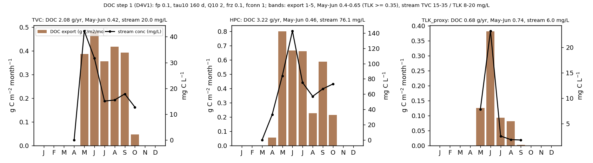
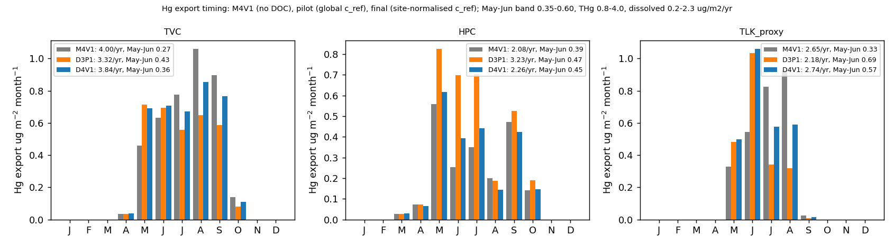
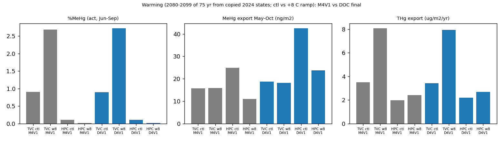

## 20. DOC step 2: DOC carbon loss (doclost), Hg:DOC-limited export, DOC sorption (2026-11-26)
Design: `~/tem-dev/hg_t2/doc_export/DOC_EXPORT_step2_design.md`. Elchin's decision ("Yes" to the recommended set): E1
partition (C loss on, sink 0), E1b sinking DOC mineralised (no re-spin, S2 skipped), E2 eps fixed at 1, E3 DON off, E4 Hg
export scored against the dissolved band 0.2-2.3 (THg band V1 left to a future particulate path), E5 daily cap on inorganic
Hg only, E6 C loss tied to the Hg DOC switch, E7 Toolik for timing and porewater only, E8 DOC sorption added (S4); budget
~0.69 core-h, hard cap 1.0; local commits on feat/hg-t2 (base c7e8c77d), no push. Binary bins/binS2 (md5 7dc5e7df, built
from the code of the first step-2 commit). Scripts in ~/tem-dev/hg_t2/src/doc2/: patchS2.py, testsS2.cpp, mk_s2.py,
runS.sh, ledgerS2.py, an_c.py, crit_mehg.py, prodS2.sh, chainS*.sh, plots_s2.py. Results in an2/s2/.

**Naming:** hgtr::parse only reads keys that start with `hg_`, so the design's names became `hg_doc_c_loss`,
`hg_doc_c_sink`, `hg_doc_n_loss`, `hg_t2_doc_hglim`, `hg_doc_eps`, `hg_doc_capmoss`, `hg_doc_kdoc`.

### 20.1 Code (all default off, bit-identical when off)
- `hg_doc_c_loss` (0/1; needs hg_t2_doc and hg_doc_fp <= 1): the DOC that leaves the soil becomes a real C loss.
  DOC production is fp x the layer CO2 decomposition (rhrawc + rhsoma + rhsompr + rhsomcr; CH4 production is not
  included when the switch is on). After the month's DOC days (Cohort::updateMonthly, after soil_updatePools) the
  difference adj = -(production - mineralisation - sinking) is added to the month's and year's RHSOM (bdall m_/y_soi2a.rhsom)
  and subtracted from NEP (m_/y_l2a.nep). DOCLOST = export + retained. The SOM pools are not changed, so GPP, NPP, SOC
  and N are bit-identical: the DOC pathway re-labels part of the CO2 flux as a lateral loss plus a storage change of the
  DOC pool. `hg_doc_c_sink` (only 0 allowed, E1b: sorbed/sinking DOC counts as mineralised) and `hg_doc_n_loss` (only 0,
  E3) are parsed placeholders. Outputs DOCLOST, DOCPOOLC, DOCRHADJ (g C/m2/time).
- `hg_t2_doc_hglim` (0/1; needs hg_t2_doc), `hg_doc_eps` (default 1), `hg_doc_capmoss` (0/1, needs hglim): in the daily
  dissolved transport, after the MeHg fluxes, the Hg(II) leaving a DOC layer with each water flux (overland, lateral,
  vertical out) is capped at eps x the layer Hg(II):C (soil + dissolved - MeHg, over soil C) x that day's DOC flux of the
  layer (from doc_days, DocFlow). The withheld Hg stays dissolved in the layer (HG_DOCCAP, ug/m2). MeHg is not capped
  (E5). capmoss also caps the moss layer.
- `hg_doc_kdoc` (L/kg OM, default 0; needs hg_t2_doc): DOC sorption. The dissolved share phi = liq / (liq + kdoc x
  OM), OM = 2e-3 x layer C (kg/m2), sets the porewater concentration and the mobile DOC (transport); the sorbed part stays
  in the pool and is mineralised.
- closure.py: when DOCLOST and DOCPOOLC are written, DOCPOOLC joins the C stocks and DOCLOST the outputs
  (DOCLOST_mean_gm2yr reported).
- Limitations: the daily split outputs (RECO_DS etc., daily_c_split = 1) and the RTS tk_rh_hist use RHSOM before the DOC
  adjustment.
- Unit tests (tests/unit/test_hg_tracer.cpp, 3 new cases): parse / ranges / dependencies; doc_days DocFlow bit identity and
  flux sums (export + retained, sink), kdoc 0 bit identity, kdoc > 0 lowers conc and export and conserves, phi;
  cap off / dhg_on 0 / eps 1e30 bit identical, eps 1 lowers export and conserves Hg, eps 0 gives zero organic export,
  MeHg export unchanged, capmoss. Full suite 571/571 test cases (the 8 known may-fail non-Hg assertions unchanged).

### 20.2 S0 identity (binS2)
| check | result |
|---|---|
| Hg-off 8-case prod (regress/cs/prod) binS2 vs binD1b (c7e8c77d) | RESULT: PASS (all A == B bit-identical, closures OK) |
| S0Q1: D4V1 settings, new switches absent, vs D4V1 (binD1b) | 0 differing variables in all stages (TVC / HPC spin + main, Toolik proxy / ch4 sp + tr) |

### 20.3 S1: C loss on (S1A = D4V1 + hg_doc_c_loss 1)
Only RHSOM and RECO change (plus the new DOC files); GPP, NPP, SOC, VEGC, N and water are identical to D4V1. In the Toolik
CH4 run only HG_ / DOC variables change (production now CO2 only) and no C state.

| site | RHSOM D4V1 -> S1A | NEE (RECO - GPP) | DOCLOST | DOCRHADJ | DOC pool end (g C/m2) | closure C resid mean / max |
|---|---|---|---|---|---|---|
| TVC | 225.62 -> 223.75 | 19.98 -> 18.11 | 2.08 | -1.87 | 15.2 | -0.0002 / 0.003 (pass) |
| HPC | 181.54 -> 178.72 | -8.90 -> -11.73 | 3.22 | -2.83 | 8.9 | 0.0005 / 0.004 (pass) |
| Toolik proxy | 53.44 -> 52.72 | 14.95 -> 14.23 | 0.68 | -0.72 | 4.2 | (no closure run) |
| Toolik ch4 | 53.54 -> 52.81 | 14.63 -> 13.89 | | | | |
(g C/m2/yr, last 20 yr.) Without the two new closure terms the C residual would be about +1.9 / +2.8 g C/m2/yr (fails the
0.5 tolerance). The monthly adjustment (figure 37) is negative during flushing (May-Aug) and positive in autumn/winter,
when the DOC pool built in summer is mineralised.

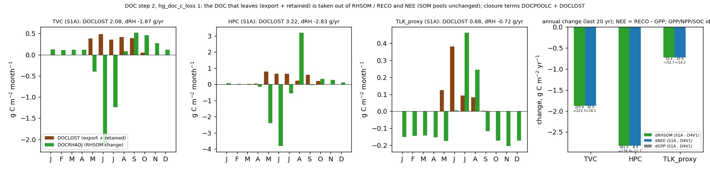

### 20.4 S3: Hg:DOC cap (eps 1) and Hg refit (on S1A; runs S3A, S3B, S3F, S3K)
Scoring follows E4 / E7: the Hg export is scored against the dissolved band 0.2-2.3 ug/m2/yr instead of THg band V1
(0.8-4.0); Toolik is a timing and porewater site (its DOC-export, stream-conc and THg bands are not pass/fail).
"12 bands (E4)" = Ro x3, Rm x3, dissolved export x3, Toolik uptake, net Hg(0), winter share.

| run | change | Hg export TVC / HPC / TLK | Hg:DOC ng/mg (0.2-0.45) | Ro TVC / HPC / TLK (0.29-0.41) | Rm HPC (<= 1.69) | TLK net Hg(0) (6.5 +- 0.7) | 12 bands (E4) | MeHg primary |
|---|---|---|---|---|---|---|---|---|
| D4V1 | step 1 | 3.84 / 2.26 / 2.74 | 1.74 / 0.68 / 3.69 | 0.375 / 0.281 / 0.409 | 1.696 | 6.48 | 8 | 7/7 |
| S3A | cap eps 1 | 1.50 / 1.17 / 0.87 | 0.62 / 0.34 / 0.96 | 0.832 / 0.330 / 1.187 | 1.662 | 5.94 | 10 | 7/7 |
| S3B | + capmoss | 1.22 / 1.13 / 0.82 | 0.49 / 0.33 / 0.89 | 0.852 / 0.331 / 1.197 | 1.661 | 5.93 | 10 | 6/7 (fen export 50.3) |
| S3F | S3A, fd x2 (0.1437) | 0.99 / 0.72 / 0.81 | 0.38 / 0.21 / 0.88 | 0.497 / 0.197 / 1.087 | 1.411 | 5.26 (x) | 7 | 7/7 |
| S3K | S3A, log kd_org 2.996 | 1.76 / 1.24 / 0.92 | 0.75 / 0.37 / 1.04 | 0.822 / 0.335 / 1.179 | 1.682 | 5.95 | 10 | 4/7 (MeHg exports x2) |

- The cap works as designed: the dissolved band is met at all three sites and Hg:DOC drops 2-4x (HPC in band).
- R1 (design) happens: the Hg that can no longer leave stays in the organic layers until eps x Ro x F_DOC balances the
  inputs, so Ro rises to 0.83 (TVC) and 1.19 (Toolik). With eps fixed at 1 (E2) Hg:DOC follows Ro.
- Levers under the cap: kd_org no longer moves Ro (the flux is cap-limited) and doubles the MeHg exports, so it is not
  used. fd (re-emission) lowers Ro at TVC and HPC with the same log slope (-0.74) and hardly at Toolik (-0.12; cold, snow).
  The binding pair is now TVC Ro (needs fd x2.4) vs HPC Ro >= 0.29 (allows fd x1.19); Toolik net Hg(0) (slope -0.18)
  allows about x1.17. capmoss off (S3B loses a MeHg criterion for a small gain).
- Refit (one parameter, from the S3A / S3F log slopes): **hg_fd 0.0826** (x1.15 of the preset 0.071857), the largest step
  that keeps HPC Ro and Toolik net Hg(0) in band.

### 20.5 S4: DOC sorption hg_doc_kdoc (on S3A; runs S4K1, S4K2, S4K5) and final S5F
| run | kdoc L/kg | pore JJAS mg/L TVC / HPC / TLK (20-120) | DOC export TVC / HPC / TLK (1-5) | DOC May-Jun TVC / HPC / TLK (0.4-0.65; TLK >= 0.35) | stream TVC (15-35) |
|---|---|---|---|---|---|
| S3A | 0 | 190 / 252 / 54 | 2.08 / 3.22 / 0.68 | 0.42 / 0.46 / 0.74 | 20.0 |
| S4K1 | 1 | 148 / 192 / 31 | 2.12 / 3.15 / 0.66 | 0.41 / 0.44 / 0.68 | 20.4 |
| S4K2 | 2 | 130 / 170 / 25 | 2.14 / 3.06 / 0.63 | 0.40 / 0.43 / 0.63 | 20.6 |
| S4K5 | 5 | 98 / 129 / 19 | 2.15 / 2.79 / 0.55 | 0.37 / 0.40 / 0.54 | 20.7 |
| **S5F** | 4 (+ fd 0.0826) | **106 / 140 / 21** | 2.16 / 2.88 / 0.58 | 0.375 / 0.41 / 0.56 | 20.7 |
- Sorption lowers the summer porewater 2x while the DOC export hardly moves (the sorbed DOC is mineralised instead of
  flushed; freshet water is not sorption-limited), so no fp refit was needed. It costs freshet share at TVC (0.42 -> 0.375).
  kdoc 4 is the compromise: TVC and Toolik porewater in band, HPC 17 % over, TVC DOC May-Jun 6 % under. kdoc has almost no
  effect on the Hg targets.

### 20.6 Final set S5F (recommended; all new switches stay default off, no preset change)
D4V1 + `hg_doc_c_loss 1, hg_t2_doc_hglim 1 (hg_doc_eps 1), hg_doc_kdoc 4, hg_fd 0.0826` (capmoss 0, sink 0, DON off).

| target | band | TVC | HPC | Toolik proxy |
|---|---|---|---|---|
| Hg:DOC of export (ng/mg) | 0.2-0.45 | 0.56 (x) | 0.33 | 0.98 (x) |
| Hg export, dissolved (ug/m2/yr) | 0.2-2.3 | 1.42 | 1.00 | 0.78 |
| THg export V1 (not scored, E4) | 0.8-4.0 | 1.42 | 1.00 | 0.78 (under) |
| Hg export May-Jun share | 0.35-0.60 | 0.38 | 0.43 | 0.64 (x) |
| DOC export (g C/m2/yr) | 1-5 | 2.16 | 2.88 | 0.58 (not scored) |
| DOC May-Jun share | 0.4-0.65 (TLK >= 0.35) | 0.375 (x) | 0.41 | 0.56 |
| stream DOC (mg/L) | TVC 15-35, TLK 8-20 | 20.7 | 68.0 | 5.0 (not scored) |
| porewater DOC JJAS (mg/L) | 20-120 | 106 | 140 (x) | 21 |
| Ro | 0.29-0.41 | 0.750 (x) | 0.305 | 1.195 (x) |
| Rm | 0.97-1.69 | 1.452 | 1.603 | 1.504 |
| Toolik uptake / net Hg(0) / winter share | 4.1 / 6.5 +- 0.7 / 0.37 | | | 4.06 / 5.81 / 0.414 |
| 12 bands (E4) | | 10/12 (TVC Ro, Toolik Ro); with V1 instead of the dissolved band 9/12 | | |
| MeHg primary | | 7/7: TVC 0.80 %, HPC 0.093 %, ratio 8.6, fen 2.24 %, exports HPC 37.0 / TVC 42.5 / fen 45.6 ng/m2 | | |
| HG_BALERR | | 6e-10 | 1e-9 | 2e-9 |

C (last 20 yr, g C/m2/yr; NEE = RECO - GPP; GPP / NPP / SOC / N identical to D4V1):
| site | RHSOM D4V1 -> S5F | NEE D4V1 -> S5F | DOCLOST | closure C resid mean / max annual |
|---|---|---|---|---|
| TVC | 225.62 -> 223.65 (-1.97) | 19.98 -> 18.01 | 2.16 | -0.0002 / 0.003 (pass) |
| HPC | 181.54 -> 179.10 (-2.45) | -8.90 -> -11.35 | 2.88 | 0.0005 / 0.004 (pass) |
| Toolik proxy | 53.44 -> 52.83 (-0.62) | 14.95 -> 14.33 | 0.58 | |
| Toolik ch4 | 53.54 -> 52.91 (-0.63) | 14.63 -> 14.00 | 0.60 | |

### 20.7 Warming (W6; 75 yr from copied S5F 2024 restarts, last 20 yr; ctl vs +8 C ramp)
| site | config | %MeHg ctl -> w8 | MeHg export May-Oct ng/m2 | Hg export ug/m2/yr | evasion | NEE g C/m2/yr | DOCLOST |
|---|---|---|---|---|---|---|---|
| TVC | D4V1 | 0.893 -> 2.724 | 18.8 -> 18.1 | 3.43 -> 7.96 | 5.5 -> 28.4 | 3.1 -> 199.9 | |
| TVC | S5F | 0.935 -> 2.061 | 39.1 -> 40.5 | 1.30 -> 3.54 | 10.0 -> 31.4 | 0.9 -> 197.7 | 2.30 -> 2.49 |
| HPC | D4V1 | 0.103 -> 0.011 | 42.5 -> 23.7 | 2.20 -> 2.69 | 5.7 -> 7.2 | -1.0 -> 7.4 | |
| HPC | S5F | 0.104 -> 0.011 | 46.7 -> 24.2 | 0.99 -> 1.01 | 6.8 -> 8.9 | -3.4 -> 5.4 | 2.85 -> 2.38 |
- The Hg export response keeps its direction but is capped by DOC: TVC x2.7 (D4V1 x2.3, from a 2.6x lower base), HPC
  x1.02 (D4V1 x1.2; HPC DOC export falls with warming). The withheld Hg leaves as evasion instead (TVC ctl 10 vs 5.5).
  TVC %MeHg rises less (x2.2 vs x3.1). The NEE shift from the C loss is a constant offset of about -2 g C/m2/yr.

### 20.8 Checks and budget
| check | result |
|---|---|
| Hg-off 8-case prod, binS2 vs c7e8c77d (binD1b) | PASS |
| D4V1 settings with the new switches absent (S0Q1) vs D4V1 | 0 diffs, all stages |
| C loss on (S1A) vs D4V1 | only RHSOM / RECO (+ new files) differ |
| closure.py C / N / water, S1A, S3A, S5F (TVC, HPC) | pass (C resid <= 0.0005 mean, 0.0043 max annual) |
| unit tests | 571/571 cases (8 known may-fail assertions) |
| binary = committed code | md5 of the working-tree diff used for binS2 == md5 of the commit's code diff (2966c77b) |
| rules | <= 4 processes, -j2 build, 75-yr segments, no parameters/ edits, restarts copied (mk_w6c), nothing deleted, no push, no GCS |

Runs: 52 (8 prod + S0Q1 4 + S1A 4 + S3A/B 8 + S4K1/2/5, S3F, S3K 20 + S5F 4 + W6 4). Core-h (ledger, src/doc2/ledgerS2.py):
S0 0.113, S1 0.047, S3a 0.095, S4a + probes 0.239, S5F 0.048, W6 0.029; **step 2 total 0.572 of the 1.0 cap (~0.69
planned)**; ledger total 12.370.

### 20.9 Open items
1. TVC and Toolik Ro (and so Hg:DOC) stay high: with eps 1 a single fd cannot lower TVC Ro without pushing HPC Ro below
   band. Options: site/temperature dependence of re-emission, eps > 1 (E2 alternative), or a particulate path that also
   removes organic Hg (would also restore THg band V1).
2. Toolik Hg May-Jun share 0.64: the cap removes more of the summer export (low DOC flux in Jul-Sep).
3. Toolik DOC under-production (unchanged; E7).
4. HPC porewater 140 mg/L with kdoc 4; a higher kdoc costs the TVC freshet share.
5. Daily split C outputs and the RTS RH history use RHSOM before the DOC adjustment.

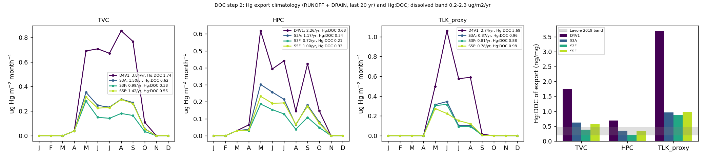
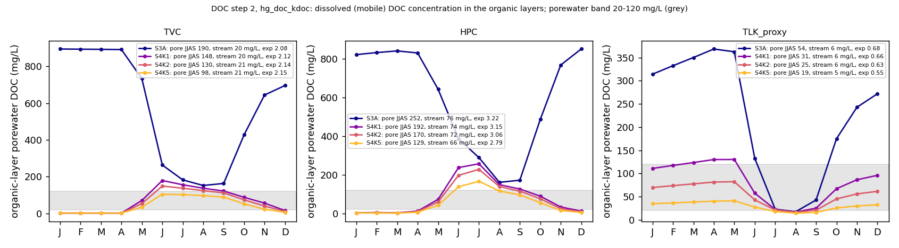

## 21. Re-emission fix R: canopy light x soil-air factor on hg_fd (HG_REEMISSION_fix_design.md)

### 21.1 Code (commit 0096a403; all new switches default off, need hg_t2 = 1 and hg_t2_evasion = 1)
fev_layer x G, G = g_light x g_air(layer) x g_T(layer), clamped to 1 - hg_f_export (clamp only when a switch is on):
- `hg_t2_ev_light` (0/1), `hg_ev_wl` (0.8, [0,1]), `hg_ev_tauref` (1.0): g_light = (1 - wl) + wl x tau / tauref,
  tau = exp(-sum_p klai_p LAI_p vegcov_p) over the vascular PFTs (chtlu.nonvascular == 0) of the month (Cohort.cpp).
  Woody debris gets g_light (and g_T with the air T) only.
- `hg_t2_ev_air` (0/1), `hg_ev_air_b` (1.0, [0,3]), `hg_ev_dref` (0.14): g_air = (D / Dref)^b, D = eps^(10/3) / phi^2
  (Millington-Quirk), eps = phi - theta_liq - theta_ice from the monthly layer liq / ice and porosity.
- `hg_ev_q10` (1 = off, [1,20]), `hg_ev_tref` (2.5 C): g_T = q10^((T - tref) / 10). Coded, not used (decision).
- Outputs (when on): HG_SOILEV0 (re-emission with G = 1; G_eff = HG_SOILEV / HG_SOILEV0), HG_GTRANS (tau; yearly = sum of
  the monthly values). Run scripts: ~/tem-dev/hg_t2/src/reem/ (runR.sh, mk_r.py, prodR.sh, ledgerR.py, scoreR.py, gtr.py,
  dair.py, plots_r.py, chainR0/R1/R1w.sh).
- Unit tests (4 new cases): parse defaults / ranges / dependencies; factor shapes (g_light linear, 1 at tauref; MQ D, 0 when
  the pores are full; g_T); neutral settings (wl 0, b 0, q10 1) and ignored inputs are bitwise = off; layer sum of
  rel x fev x G, clamp, HG_SOILEV0, exact balance; geometry change (G-weighted pot). 575/575 cases (8 known may-fail).

### 21.2 Checks (R0)
| check | result |
|---|---|
| S5F settings with the new switches absent (R0I, binR) vs S5F (binS2) | 0 diffs, all 8 stage groups |
| Hg-off 8-case prod, binR vs binS2 (R0P) | PASS |
| R1B vs S5F | only Hg variables differ (HG*, MEHG*, hg_state); all C / N / water outputs bitwise identical |
| closure.py C / N / water, R1B (TVC, HPC) | pass (C resid mean -0.0002 / 0.0005, max annual 0.003 / 0.004), = S5F |
| HG_BALERR max (ug/m2) R1A / R1B | <= 2.8e-9 (TVC 5e-10, HPC 1e-9, Toolik 2-3e-9) |
| binary = committed code | binR (md5 f7b91e6a) built by src/build.sh at clean HEAD 0096a403 (dirty = 0) |

### 21.3 Actual canopy transmission and effective G (last 20 yr)
| site | tau mean (JJA, min) | design estimate | G_eff R1A (light x air, wl 0.8, b 1) | G_eff R1B (light only, wl 1) | g_air inferred (R1A) |
|---|---|---|---|---|---|
| TVC (CMT51) | 0.862 (0.869, 0.806) | 0.80 | 1.584 | 0.858 | 1.78 |
| HPC (CMT01) | 0.350 (0.367, 0.284) | 0.17 | 1.414 | 0.361 | 2.95 |
| Toolik proxy (CMT06) | 0.975 (0.980, 0.899) | 0.97 | 1.184 | 0.972 | 1.21 |
| Toolik ch4 | 0.974 | | 1.260 | 0.971 | |

The soil-air factor does not do what the design assumed: the re-emitted Hg comes from decomposition, which is dominated at
every site by the dry fibric layers (MQ D 0.29-0.45, above Dref) while the wet humic layers (D 0.002-0.06; Toolik theta_liq
0.70) decompose little. So g_air is largest at HPC (wrong direction) and only 1.5x TVC/Toolik (fig 41). The design's
depth-weighted JJAS moisture (Toolik D_rel 0.044) is not the decay-weighted one.

### 21.4 Runs and targets (R score = E4 12 bands minus Toolik Ro; Toolik Ro and Hg:DOC reported only)
| target | band | S5F | R1A light x air, fd 0.24 | R1B light only, wl 1, fd 0.223 |
|---|---|---|---|---|
| Ro TVC / HPC / TLK (ro) | 0.29-0.41 | 0.750 (x) / 0.305 / 1.195 | 0.202 (x) / 0.091 (x) / 0.928 | **0.378 / 0.298** / 1.013 |
| Rm TVC / HPC / TLK | 0.97-1.69 | 1.452 / 1.603 / 1.504 | 1.212 / 1.186 / 1.456 | 1.292 / 1.589 / 1.471 |
| Hg:DOC TVC / HPC / TLK (ro) | 0.2-0.45 | 0.56 (x) / 0.33 / 0.98 | 0.16 (x) / 0.10 (x) / 0.75 | **0.29 / 0.32** / 0.83 |
| dissolved export TVC / HPC / TLK | 0.2-2.3 | 1.42 / 1.00 / 0.78 | 0.56 / 0.34 / 0.65 | 0.84 / 0.98 / 0.69 |
| Hg May-Jun share TVC / HPC / TLK (ro) | 0.35-0.60 | 0.38 / 0.43 / 0.64 | 0.50 / 0.40 / 0.67 | 0.43 / 0.43 / 0.66 |
| Toolik stomatal + sink0 - soilev - snowred | | 3.99 + 4.19 - 0.95 - 1.42 | - 2.54 | - 2.12 |
| Toolik net Hg(0) | 5.8-7.2 | 5.81 | 4.22 (x) | 4.65 (x) |
| Toolik winter share / uptake | 0.30-0.44 / 3.7-4.5 | 0.414 / 4.06 | 0.569 (x) / 4.06 | 0.517 (x) / 4.06 |
| R score (11) / E4 12-band | | 10 / 10 | 7 / 7 | 9 / 9 |
| MeHg primary (7) | | 7/7 | 6/7 (HPC %MeHg 0.080) | 7/7 (TVC 0.75 %, HPC 0.093 %, ratio 8.0, fen 2.21 %, exports HPC 36.2 / TVC 22.0 / fen 38.5 ng/m2) |

A one-box model Ro = I / (k_ev + k_o) with k_ev scaled by fd x G_eff predicts R1A and R1B within 5 % (R1B predicted
0.394 / 0.316 / net Hg(0) 4.66). With it, no hg_fd / wl / b (/ dref) meets TVC Ro <= 0.41, HPC Ro >= 0.29 and Toolik net
Hg(0) >= 5.8 together: net Hg(0) = 6.76 - soilev and S5F is already at 5.81, so Toolik re-emission cannot rise at all,
while TVC needs x2.2-2.7. Toolik is open ground (tau 0.975 > TVC 0.862) with a fibric layer as dry as TVC's, so neither
factor separates them (TVC/Toolik G ratio: light 0.88, air at b 1 1.47; b >= 2.6 needed, which breaks TVC/HPC). The R2
refit and the R3 final set were therefore not run: the choice needs a decision (21.6).

### 21.5 Warming (W6, R1B; 75 yr from copied R1B 2024 restarts, last 20 yr; ctl -> +8 C ramp)
| site | config | %MeHg | MeHg export May-Oct ng/m2 | Hg export ug/m2/yr | evasion |
|---|---|---|---|---|---|
| TVC | S5F | 0.935 -> 2.061 | 39.1 -> 40.5 | 1.30 -> 3.54 | 10.0 -> 31.4 |
| TVC | R1B | 0.896 -> 2.552 | 20.3 -> 20.3 | 0.77 -> 2.62 | 11.4 -> 33.2 |
| HPC | S5F | 0.104 -> 0.011 | 46.7 -> 24.2 | 0.99 -> 1.01 | 6.8 -> 8.9 |
| HPC | R1B | 0.105 -> 0.011 | 45.7 -> 23.9 | 0.98 -> 1.00 | 6.7 -> 8.2 |
- Same directions; TVC Hg export x3.4 (S5F x2.7) from a lower base, %MeHg x2.8 (x2.2). C identical to S5F (NEE as 20.7).

### 21.6 Status, options and future work
- Not adopted: no final set (S5F stays the recommended set; all R switches default off).
- Options: (a) keep S5F; (b) R1B (light only) if Toolik net Hg(0) / winter share also become reported-only (TVC/HPC Ro and
  Hg:DOC all in band, MeHg 7/7; Toolik net Hg(0) 4.65); (c) a Toolik-specific limiter of re-emission (CMT table hg_fd_cmt,
  the design's benchmark; not coded) or a different Toolik constraint.
- Future work: Toolik C recalibration (vascular LAI ~0.15, DOC under-production E7, Ro 1.0-1.2) before Toolik Ro / Hg:DOC
  can be scored again. The soil-air factor would need a decay-layer moisture signal that differs between sites; as built it
  should stay off.
- Budget (src/reem/ledgerR.py, base 12.3705): R0 identity + R1A 0.095, prod 0.068, R1B 0.049, W6 R1B 0.030; **R total 0.242
  of the 0.7 cap (~0.5 planned)**. Runs: 8 prod + R0I/R1A/R1B 12 + W6 4 = 24. Rules: <= 4 processes, -j2 build, 75-yr
  segments, no parameters/ edits, restarts copied (mk_w6c), nothing deleted, no push, no GCS.

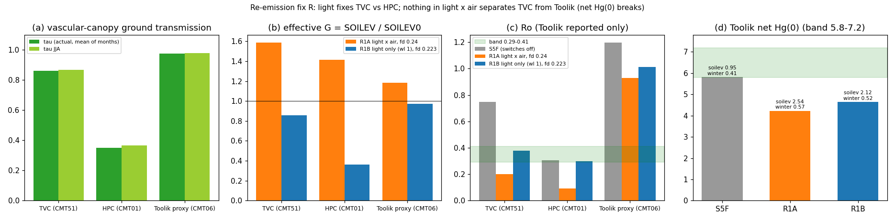
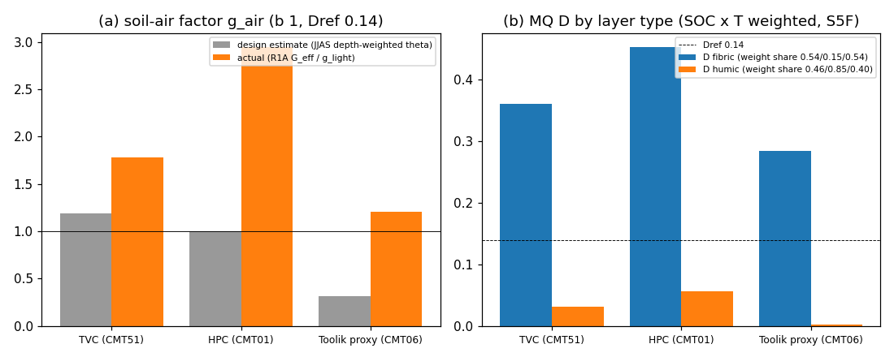

## 22. Decision 2026-11-26: R1B is the recommended hg_t2 set; Toolik net Hg(0) and winter share report-only

**Decision (Elchin, 2026-11-26):** adopt R1B (section 21) and score Toolik net Hg(0) and winter share as report-only,
alongside the already report-only Toolik Ro and Hg:DOC (and the E7 Toolik DOC / May-Jun items).

- **Recommended set: config/hg_t2_overlay_R1B.json** = S5F (config/hg_t2_overlay_S5F.json, written next to it for reference:
  D4V1 + hg_doc_c_loss 1, hg_t2_doc_hglim 1, hg_doc_kdoc 4) with `hg_t2_ev_light 1, hg_ev_wl 1.0, hg_fd 0.223`
  (hg_ev_tauref 1 default). Both are model_settings overlays on the built-in hg_t2 / MeHg presets; their hg_* keys equal the
  model_settings of the R1B / S5F runs (TVC, HPC, Toolik) exactly, except the per-site hg_dep_file / hg_sc_year0.
  Needs a binary at 0096a403 or later. parameters/ and the code defaults are unchanged (all R switches default off).
- **The soil-air switch (hg_t2_ev_air) stays off**, and so does the temperature term (hg_ev_q10 1): in the model the decay
  that re-emits sits in the dry fibric layers at every site, so g_air is largest at HPC and does not separate TVC from
  Toolik (21.3, fig 41).
- **Scoring** (src/reem/scoreR.py; section-21 version kept as scoreR_v1_11band.py): 9 scored bands = Ro TVC / HPC, Rm x3,
  dissolved export x3, Toolik uptake. Report-only: Toolik Ro, Hg:DOC, net Hg(0), winter share, May-Jun share. Goals
  (reported, not counted): Hg:DOC and May-Jun share at TVC / HPC. Re-scored from the existing outputs (no new runs).

| target | band | S5F | **R1B (recommended)** |
|---|---|---|---|
| Ro TVC / HPC | 0.29-0.41 | 0.750 (x) / 0.305 | **0.378 / 0.298** |
| Rm TVC / HPC / Toolik | 0.97-1.69 | 1.452 / 1.603 / 1.504 | 1.292 / 1.589 / 1.471 |
| dissolved export TVC / HPC / Toolik | 0.2-2.3 | 1.42 / 1.00 / 0.78 | 0.84 / 0.98 / 0.69 |
| Toolik uptake | 3.7-4.5 | 4.06 | 4.06 |
| **scored (9)** | | **8/9** | **9/9** |
| Hg:DOC TVC / HPC (goal) | 0.2-0.45 | 0.56 (x) / 0.33 | 0.29 / 0.32 |
| Hg May-Jun share TVC / HPC (goal) | 0.35-0.60 | 0.38 / 0.43 | 0.43 / 0.43 |
| Toolik Ro (report-only) | 0.29-0.41 | 1.195 | 1.013 |
| Toolik Hg:DOC (report-only) | 0.2-0.45 | 0.98 | 0.83 |
| Toolik net Hg(0) (report-only) | 5.8-7.2 | 5.81 | 4.65 |
| Toolik winter share (report-only) | 0.30-0.44 | 0.414 | 0.517 |
| Toolik May-Jun share (report-only) | 0.35-0.60 | 0.64 | 0.66 |
| Toolik budget stomatal + sink0 - soilev - snowred | | 3.99 + 4.19 - 0.95 - 1.42 | 3.99 + 4.19 - 2.12 - 1.42 |
| E4 12-band (old count, for reference) | | 10/12 | 9/12 |
| MeHg primary | 7 | 7/7 | 7/7 (TVC 0.75 %, HPC 0.093 %, ratio 8.0, fen 2.21 %; exports HPC 36.2 / TVC 22.0 / fen 38.5 ng/m2) |
| HG_BALERR max (ug/m2) | | 3.4e-9 | 2.5e-9 |

Checks carried over from section 21: identity with the switches absent (0 diffs), Hg-off 8-case prod PASS, C / N / water
bitwise = S5F and closure pass, W6 warming as 21.5 (TVC Hg export x3.4, %MeHg 0.90 -> 2.55; HPC as S5F).

**Flag: Toolik C recalibration (future work).** The Toolik CMT06 runs have very low vascular LAI (~0.15; canopy
transmission 0.975, so the light term cannot shade the Toolik ground) and low DOC production (E7: DOC export 0.58 g C/m2/yr,
stream DOC 5 mg/L). Toolik Ro (1.0), Hg:DOC (0.83), net Hg(0) (4.65) and winter share (0.52) stay report-only until the
Toolik C is recalibrated; then re-test whether R1B's re-emission at Toolik (2.1 ug/m2/yr vs 0.95 in S5F) is still too high.

Budget: no new runs (re-scoring and plots only); R total stays 0.242 core-h of the 0.7 cap.

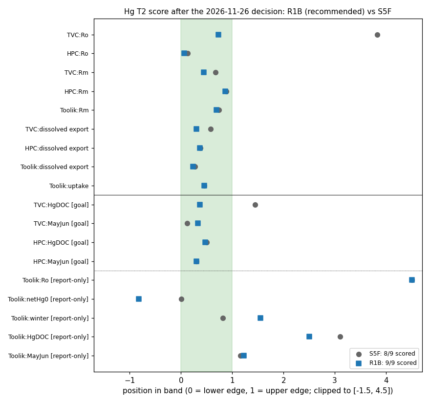

## 23. Depth-dependent evasion, option B: built and tested; B2F adopted as the recommended overlay (2026-11-26)

**Approved by Elchin (2026-11-26):** build option B of the design note (evasion_depth/EVASION_DEPTH_design.md) with
O1 CH4-module tortuosity, O2 Lref fixed at 0.3 m and only fd refit, O3 thaw release 0.16 x P, O4 accept B as the lower
bound and benchmark option A (thaw_evz 0.3) as the upper sensitivity, O5 present-day differences <= 1e-6 relative accepted
for the thaw part, O6 no option C. Cap 0.45 core-h (own ledger line, PHASE EVD B).

### 23.1 Code (commit fb1d502c; all default off)
- `hg_t2_ev_diff 1` (needs hg_t2 and t2_evasion; excludes hg_t2_ev_air): the escape probability of Hg(0) released by decay
  in soil layer l is P_l = exp(-(sum_{j<l} dz_j/L_j + dz_l/(2 L_l))), L = sqrt(Deff/k), with
  Deff = hg_ev_d0 (T/296.15 K)^1.81 tau(eps) + hg_ev_dwh tau(theta) (gas + dissolved paths, eps = phi - theta_liq - theta_ice),
  tau(x) = 0.66 x (x/phi)^3 (hg_ev_tort 1, the CH4-module form; 0 = Millington-Quirk) and k = Deff_ref / hg_ev_lref^2 at the
  reference fibric layer (phi 0.95, theta 0.35, eps 0.6, 5 C). P replaces exp(-z/ev_z): re-emission fraction
  fd (1 - f_snow) [T > 0] x P x g_light. Woody debris P = 1. A layer with Deff = 0 (ice-filled) has optical depth 1e3.
  Defaults: hg_ev_lref 0.3 m, hg_ev_d0 1.31e-5 m2/s, hg_ev_dwh 4e-9 m2/s.
- `hg_t2_ev_diff_thaw 1` (needs ev_diff and thawrel; excludes hg_t2_thaw_evz > 0): thaw-released Hg re-emits
  hg_f_thaw_evade (0.16) x P_l, measured from the surface, instead of the flat 0.16.
- Outputs HG_EVPESC (decay-weighted P) and HG_EVPESCL (P by layer); HG_SOILEV0 is also written when ev_diff is on.
- Unit tests (test_hg_tracer.cpp, 4 new cases, 63 assertions): parse and validation; Deff formula, L = lref at the
  reference layer, ice blocking, MQ variant; the step (off = bitwise, homogeneous P = exp(-z/0.3), woody debris P = 1, ice
  blocks, wetter gives less, light x P, frozen layer, Hg balance); thaw (thaw evasion = s0 x 0.16 x exp(-0.30/0.3), thaw export
  unchanged, balance). The full suite has 579/579 cases; the 8 failing assertions are the known may-fail ones, the same as with binR.

### 23.2 Identity (binB, md5 abd371cf)
- B0I (R1B settings, B switches absent) vs R1B (binR): 0 differing variables in all 8 run sets (TVC / HPC spin + main,
  Toolik proxy / ch4 sp + tr).
- Hg-off 8-case production (prodB.sh B0P, binB vs binR runs of out/R0P_B): RESULT PASS.
- B2F vs R1B: only Hg outputs (and the restarts that carry Hg) differ; C / N / water bitwise equal and closure passes
  (an_c.py).

### 23.3 Probe and fd refit
- B1A (R1B + ev_diff + ev_diff_thaw, fd 0.223): TVC Ro 0.3889, HPC 0.2914. Unlike the read-only estimate (x0.91 / x0.76),
  the effective re-emission changed little and the other way at HPC (one-box k_ev,B / k_ev,R1B = 0.966 TVC, 1.033 HPC).
  The model's Hg release is weighted towards the top 10 cm more than the SOC x Q10 proxy, and there B's P is at or above
  exp(-z/0.3) (fig 43). Decay-weighted P: TVC 0.43, HPC 0.63, Toolik 0.56.
- The one-box refit for balanced margins gives fd x0.965, so **hg_fd 0.215** (B2F). Predicted TVC 0.401 / HPC 0.300;
  the run gave 0.402 / 0.299.

| target | band | R1B (baseline) | B1A (fd 0.223) | **B2F (fd 0.215)** |
|---|---|---|---|---|
| Ro TVC / HPC | 0.29-0.41 | 0.378 / 0.298 | 0.389 / 0.291 | **0.402 / 0.299** |
| Rm TVC / HPC / Toolik | 0.97-1.69 | 1.292 / 1.589 / 1.471 | 1.298 / 1.577 / 1.478 | 1.304 / 1.591 / 1.480 |
| dissolved export TVC / HPC / Toolik | 0.2-2.3 | 0.84 / 0.98 / 0.69 | 0.85 / 0.96 / 0.71 | 0.87 / 0.98 / 0.71 |
| Toolik uptake | 3.7-4.5 | 4.06 | 4.06 | 4.06 |
| **scored (9)** | | **9/9** | 9/9 | **9/9** |
| Hg:DOC TVC / HPC (goal) | 0.2-0.45 | 0.29 / 0.32 | 0.30 / 0.31 | 0.31 / 0.32 |
| Hg May-Jun share TVC / HPC (goal) | 0.35-0.60 | 0.43 / 0.43 | 0.43 / 0.42 | 0.43 / 0.43 |
| Toolik Ro (report-only) | 0.29-0.41 | 1.013 | 1.050 | 1.058 |
| Toolik Hg:DOC (report-only) | 0.2-0.45 | 0.83 | 0.85 | 0.86 |
| Toolik net Hg(0) (report-only) | 5.8-7.2 | 4.65 | 4.95 | 5.00 |
| Toolik winter share (report-only) | 0.30-0.44 | 0.517 | 0.485 | 0.480 |
| Toolik May-Jun share (report-only) | 0.35-0.60 | 0.66 | 0.65 | 0.65 |
| Toolik soil re-emission (ug/m2/yr) | | 2.12 | 1.81 | 1.76 |
| MeHg primary | 7 | 7/7 | 7/7 | 7/7 (TVC 0.751 %, HPC 0.093 %, ratio 8.08, fen 2.22 %; exports HPC 36.3 / TVC 23.2 / fen 40.6 ng/m2) |
| HG_BALERR max (ug/m2) | | 2.5e-9 | 3.5e-9 | 3.3e-9 |

The smallest Ro margin is about the same as R1B's (B2F: TVC 0.008 below the top and HPC 0.009 above the bottom; R1B: HPC
0.008), so B does not widen the TVC / HPC window. The report-only Toolik items move towards their bands: net Hg(0)
4.65 -> 5.00, winter share 0.517 -> 0.480.

### 23.4 Soil-gas check (fig 43; prof.py; JJAS, last 20 yr; C/C_atm = P by reciprocity)

| site | P at 5 / 10 / 20 / 40 cm (B2F) | mean 5-40 cm, B2F | R1B exp(-z/0.3) mean |
|---|---|---|---|
| TVC | 0.85 / 0.74 / 0.39 / 1e-4 | 0.50 | 0.58 |
| HPC | 0.90 / 0.63 / 0.25 / 0.06 | 0.46 | 0.58 |
| Toolik | 0.86 / 0.67 / 0.11 / 1e-4 | **0.41** | 0.58 |
| Toolik observed (Obrist et al. 2017; Jiskra et al. 2019) | 40 cm wells most depleted, some below detection | **0.49** (0.54 / 1.1 ng/m3) | |

B gets the observed shape: near-zero at 40 cm under the wet humic layers, where today's law still gives 0.26. Its 5-40 cm
mean (0.41) is slightly below the observed 0.49 (R1B: 0.58 is slightly above). The two bracket the observations, which is
consistent with the design's bracket (Lref 0.3 -> 0.40, 0.5 -> 0.46 from the proxy).

### 23.5 Warming, TVC +8 C ramp (W6, 75 yr from copied 2024 restarts; last 20 yr, ug Hg/m2/yr; fig 44)

| TVC w8 | R1B (flat 0.16) | option A: R1B + thaw_evz 0.3 (upper sensitivity) | **B2F (0.16 x P)** |
|---|---|---|---|
| total Hg(0) evasion | 33.2 | 21.4 | **14.8** |
| thaw-layer evasion | 17.1 | 5.31 | **2e-35 (~0)** |
| thaw-layer export | 1.60 | 1.62 | 1.63 |
| dissolved Hg export | 2.62 | 2.63 | 2.70 |
| %MeHg active layer (ctl -> w8) | 0.90 -> 2.55 | -> 2.55 | 0.90 -> 2.51 |

- Under B, thaw layers below the old permafrost table (~0.75 m and deeper) lie under wet humic / mineral layers with
  P(0.46 m) ~ 0 in August, so the thaw-released Hg(0) is retained in the soil (sink and sorption) and not re-emitted. This is the
  accepted lower bound (O4). Option A at evz 0.3 (5.3) is the upper sensitivity, and R1B's flat 0.16 (17.1) is the old upper bound.
- HPC w8 does not thaw below its old maximum: thaw evasion is 0 in all three runs, and B2F equals R1B to within 0.5 % (evasion 8.24 vs
  8.20, %MeHg 0.105 -> 0.011 in both).
- The option A benchmark (W6_R1BA3_TVC_w8) is R1B's 2024 restart (copied) with hg_t2_thaw_evz 0.3 added for the warming run
  only; zpf is restart state. Present-day differences from evz in the spin-up are below 1e-6 (design note §3 A), so this matches a full evz run.

### 23.6 Candidate overlay and status
- **config/hg_t2_overlay_B2F.json** = R1B + `hg_t2_ev_diff 1, hg_t2_ev_diff_thaw 1, hg_fd 0.215` (hg_ev_lref 0.3,
  hg_ev_tort 1 defaults). Needs a binary at fb1d502c or later. **R1B stays the recommended baseline** until Elchin decides
  whether to adopt B2F. Present-day scores are equivalent (9/9, MeHg 7/7). B2F adds the soil-gas shape and makes the
  thaw-evasion term moisture-aware and depth-consistent with the ordinary term.
- Scripts: src/evd/ (runB.sh, prodB.sh, ledgerB.py, mk_b.py, mk_w6x.py, prof.py, plots_b.py, chainB0.sh, chainB1.sh,
  chainB1w.sh). chainB1 stopped at `warm` because the site / scenario pairs were unquoted; mk_w6c failed on its arguments before
  creating anything. chainB1w redid W6 + option A.
- Budget: 0.248 core-h of the 0.45 cap (PHASE EVD B line in LEDGER.txt): identity var + B1A probe 0.095, prod 0.068,
  B2F 0.048, W6 B2F x4 0.031, option A W6 0.007.

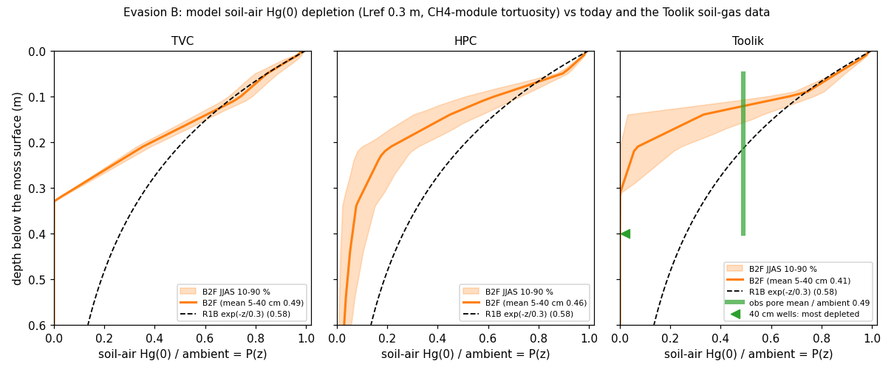
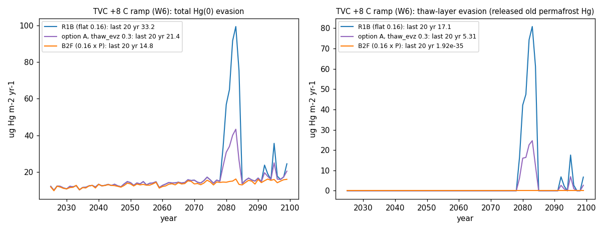
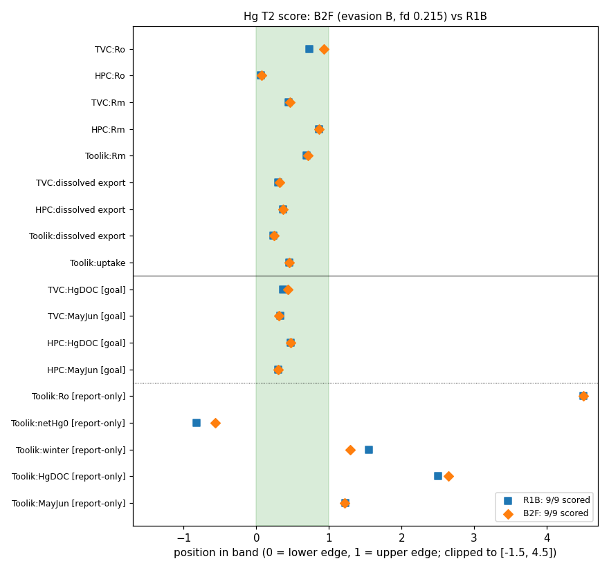

### 23.x Decision (2026-11-26)

Elchin Jafarov adopted B2F (`config/hg_t2_overlay_B2F.json`: R1B + `hg_t2_ev_diff 1`, `hg_t2_ev_diff_thaw 1`, `hg_fd 0.215`)
as the recommended hg_t2 overlay, replacing R1B (section 22). R1B and S5F overlays stay in config/ for reference. Scoring rules
are unchanged from section 22 (9 scored bands; Toolik Ro, Hg:DOC, net Hg(0), winter share and May-Jun share report-only).
B2F: 9/9, MeHg 7/7; TVC +8 C thaw-layer evasion ~0 (R1B 17.1, option A thaw_evz 0.3 as upper sensitivity 5.31 ug/m2/yr).
Code defaults are unchanged (all switches default off). Docs-only commit; no runs.

## 24. T3 process-based MeHg, P0: switches, unit tests and identities (2026-11-26)

Design: `docs_src/T3_design.md` (recommendations T1-T12, approved 2026-11-26 11:12 ET: build T3 with T1-T12, cap 1.0 core-h,
copied Toolik run-mask, local only). Branch `feat/hg-t3` off `feat/hg-t2` @ 75fccfb1. Ledger: `PHASE T3` lines in
`~/tem-dev/hg_t2/LEDGER.txt` (`src/t3/ledgerT3.py`: T3 core-h = T2 total - 12.8608, cap 1.0).

### 24.1 What was built (all default-off; `hg_t3` = 1 with every other `hg_t3_*` key at its default is the T2 model)

| key | default | meaning |
|---|---|---|
| `hg_t3` | 0 | master; needs `hg_mehg`, `hg_t2`, `hg_t2_diss`, `hg_transport`, `hg_t2_mehg_transport` = 1 |
| `hg_t3_closure` | 0 | T1/T2: MeHg is a mass-conserving sub-pool of the layer Hg, carried in the sorbed pool. Hg(II) processes see THg - MeHg: decay release, evasion, thaw release, internal C transfers (the MeHg is withheld from `State::soil` for the C-driven part of `step()` and put back before the transport sub-step), sorption target `phi (THg - MeHg)` (the dissolved pool is Hg(II) only), Hg(II) transfers, the Hg:DOC cap, and the methylation substrate. MeHg transfers / exports / flow-path retention / bioturbation move THg. With a geometry change the MeHg is re-mapped with the C, and the MeHg of lost C goes to the pot as Hg(II). The spin-up jump runs with MeHg = 0 as before, so it is unchanged. |
| `hg_t3_dlogkd_mehg` | 0 | T7: log10 Kd(MeHg) - log10 Kd(Hg(II)); the MeHg mobile share is multiplied by `phi_M / phi_H = (liq + Kd M) / (liq + Kd 10^d M)`, with the day's (DOC-scaled) Kd. MeHg stays outside the Hg:DOC cap. |
| `hg_t3_fred` | 0 | T5: share of the gross demethylation `D = P - dM` reduced to Hg(0). The escape-probability share `P_l` (thawed layers) evades and is booked in `HG_EVASION` / `HG_SOILEV` / `HG_T3RED`. Needs closure and `hg_t2_ev_diff`. Sensitivity only. |
| `hg_t3_wavail` | 0 | T3: methylation x ((1 - w) + w phi_eq / THg-weighted column mean phi_eq). Built and unit-tested, not run. |
| `hg_t3_so4`, `_ks` 0.1, `_ki` 1.6, `_sref` 0.1 mM, `hg_t3_so4_class {"cmt": S}` | 0 | T6: `(S/(Ks+S)) (Ki/(Ki+S))`, normalised at S_ref (optimum sqrt(Ks Ki) = 0.4 mM). Not fitted. |
| `hg_t3_class {"cmt": g}` | none | T8: methylation factor by CMT (the cohort's `cd.cmttype`). |

New outputs (only with `hg_t3` = 1): `MEHG_DEMETH` (gross demethylation) and `HG_T3RED` (reductive-demethylation Hg(0) evaded,
part of `HG_EVASION`). Deviation from the design: `MEHG_DISS`, `MEHG_PWC` and `HG_T3BAL` were not added. The THg balance is
`HG_BALERR`, which closure keeps at roundoff (unit test), and the MeHg transport balance is `HG_MEHGBAL`. No restart change:
MeHg already sits in the v4 restart.

Unit tests (`tests/unit/test_hg_tracer.cpp`, 6 new cases) cover:
- parse: defaults, dependencies, class maps;
- rate factors exactly 1 at the defaults, and the sulfate optimum;
- step + `mehg_month` bitwise identity at `hg_t3` 1;
- closure: THg balance at 1e-12, MeHg moves are THg moves, MeHg not lost with the Hg(II) release, zero MeHg == off,
  geometry change conserved;
- the Kd offset raises the MeHg export;
- the closure substrate, the class factor, and `f_red` booking.

binT3a (c5ac8d70; built -j2 from the tree of this commit): 585/585 cases pass, with the same 8 known xfail assertions as binB.

### 24.2 P0 identities (0.1664 core-h)

- **T3A0** (B2F settings, `hg_t3` absent, binT3) vs **B2F** (binB): 0 differences in every NetCDF variable of the 8 groups
  (TVC/HPC spin000 + main, Toolik proxy/ch4 sp + tr; 360-382 variables per group).
- **T3A1** (B2F + `hg_t3` 1, every other key at its default) vs **B2F**: 0 differences in all 8 groups (index equivalence, T11).
- **Hg-off 8-case prod** binT3 vs binR (runs of out/R0P_B): RESULT PASS.

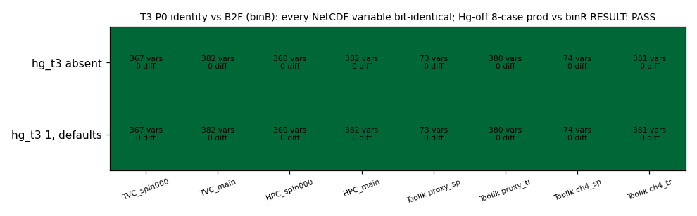
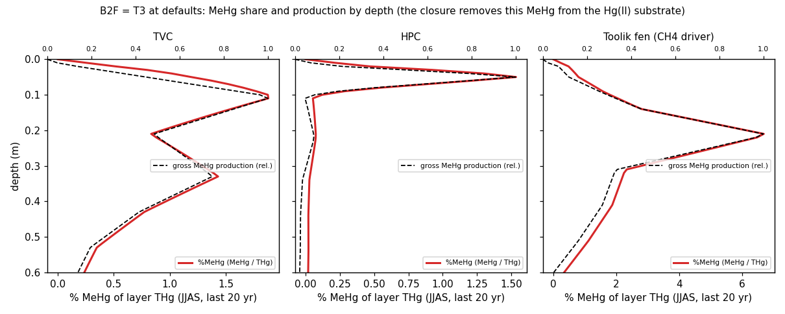

Fig. 47 shows the B2F (= T3 at defaults) JJAS %MeHg and gross-production profiles. TVC peaks at 1.9 % at about 10 cm; HPC
peaks at 1.5 % in the top 5 cm and is about 0.1 % below; the Toolik fen peaks at 6.7 % at about 20 cm. This is the MeHg that
the closure takes out of the Hg(II) substrate. Up to 7 % of the layer THg at the fen peak means up to 7 % less substrate
there, so closure is a small first-order effect on %MeHg.
